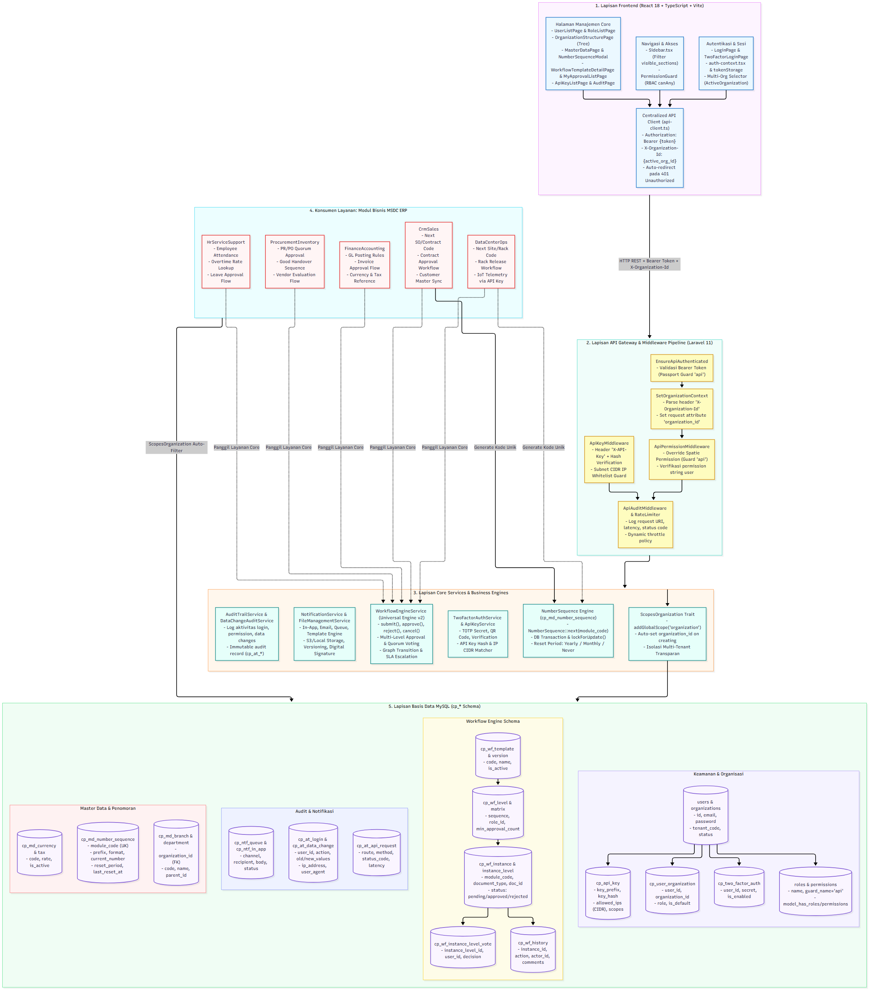

# BEDAH MODUL COREPLATFORM: TULANG PUNGGUNG & FONDASI ARSITEKTUR MSDC ERP
## Modul: CorePlatform (`Team 1 — Identity, Auth, RBAC, Multi-Tenancy, Master Data, Workflow Engine, Audit Trail, & API Gateway`)
**Target Cakupan**: Layanan Fondasi Terpusat untuk Seluruh Modul ERP (`DataCenterOps`, `CrmSales`, `FinanceAccounting`, `HrServiceSupport`, `ProcurementInventory`, `IntegrationAnalytics`)

---

## 1. PERAN STRATEGIS & FILOSOFI BISNIS COREPLATFORM DALAM EKOSISTEM MSDC ERP

Dalam pengembangan sistem informasi berskala *Enterprise Resource Planning* (ERP) modern, khususnya pada industri berintensitas modal tinggi seperti penyedia infrastruktur *Data Center* dan *Managed Services*, fragmentasi arsitektur merupakan risiko teknis paling berbahaya. Tanpa adanya lapisan fondasi bersama (*shared foundational kernel*), setiap tim fungsional cenderung mengimplementasikan mekanisme autentikasi, model data pengguna, skema hak akses, format penomoran dokumen, dan alur persetujuan (*approval workflow*) secara terisolasi dan tidak konsisten (*siloed systems*). Dampaknya adalah timbulnya kerentanan keamanan lintas batas (*security blindspots*), kebocoran data antar-organisasi (*cross-tenant leakage*), serta ketidakmungkinan melakukan konsolidasi pelaporan korporat secara *real-time*.

Modul **`CorePlatform`** (ditetapkan dengan prioritas *booting* tertinggi `priority: 0` pada arsitektur modular Laravel) dirancang untuk memecahkan permasalahan struktural tersebut. Filosofi rekayasa utama yang diusung oleh modul ini adalah **"Build Once, Enforce Universally"** (Membangun Satu Kali, Memberlakukan Secara Semesta). Modul ini bertindak sebagai sistem operasi internal (*kernel layer*) yang melayani seluruh pilar fungsional bisnis pada MSDC ERP:

1. **Penyedia Identitas Tunggal (*Single Source of Truth for Identity*)**: Seluruh entitas pengguna (*users*), profil organisasi induk dan anak (*tenants/organizations*), serta struktur divisi korporat (*branches, business units, departments*) diatur secara terpusat.
2. **Pagar Pemisah Multi-Tenancy (*Multi-Tenant Isolation Boundary*)**: Menjamin bahwa transaksi bisnis, kontrak penjualan pelanggan (*CRM*), inventaris rak server (*Data Center Ops*), pengadaan barang (*Procurement*), hingga pencatatan jurnal buku besar (*Finance*) selalu terisolasi ke dalam domain organisasi penyewa yang sah melalui injeksi *context header* `X-Organization-Id`.
3. **Mesin Penomoran Dokumen Konsisten (*Centralized Number Sequence Engine*)**: Memberikan jaminan integritas atomik terhadap seluruh kode identifikasi transaksi korporat (mulai dari kode fasilitas gedung, nomor kontrak, tiket komplain, hingga faktur pajak) bebas dari tabrakan nomor (*concurrency collisions*) dan duplikasi penomoran.
4. **Mesin Alur Persetujuan Terpadu (*Universal Workflow Engine v2*)**: Menyediakan kapabilitas orkestrasi persetujuan berjenjang (*multi-level hierarchical approval*), pemungutan suara berkuorum (*quorum voting*), pelimpahan wewenang (*delegation*), hingga eskalasi berbasis *Service Level Agreement* (SLA) tanpa mengharuskan modul hilir merancang ulang skema basis data persetujuannya sendiri.
5. **Jejak Audit Komprehensif (*Immutable Audit Trail & Regulatory Compliance*)**: Memenuhi standar kepatuhan regulasi tata kelola data industri data center (seperti ISO/IEC 27001 dan SOC 2 Type II) dengan mencatat secara permanen riwayat autentikasi, mutasi data sensitif, penugasan hak akses, serta aktivitas pemanggilan *API Gateway*.

---

## 2. PETA FITUR & SUB-MODUL UTAMA

Berdasarkan hasil audit mendalam terhadap direktori `MSDC/Modules/CorePlatform/` dan antarmuka pengguna `MSDCFrontend/src/modules/core-platform/`, kapabilitas `CorePlatform` dikelompokkan ke dalam 8 sub-modul inti:

### 2.1. Autentikasi Terintegrasi & Manajemen Identitas
Sub-modul ini menangani siklus hidup (*lifecycle*) kredensial akun pengguna:
* **Autentikasi Multi-Tahap**: Mendukung autentikasi berbasis *OAuth2 Personal Access Token* via Laravel Passport dengan masa kedaluwarsa aman (6 bulan).
* **Two-Factor Authentication (2FA / TOTP)**: Implementasi standar RFC 6238 berbasis *Time-based One-Time Password* melalui pustaka otentikator pihak ketiga (Google Authenticator / Microsoft Authenticator), dilengkapi kode pemulihan darurat (*recovery codes*).
* **Manajemen Sesi & Perangkat**: Pelacakan sesi aktif pengguna (*login sessions*) mencakup *IP address*, *user agent*, waktu *last activity*, serta kapabilitas penarikan sesi secara instan (*revoke all other sessions*).
* **User Onboarding & Invitations**: Pendaftaran pengguna baru melalui jalur undangan resmi (*cryptographic token invitation*) via email tanpa membuka registrasi publik secara liar.

### 2.2. Isolasi Multi-Tenancy & Struktur Korporat
Menyediakan tata kelola struktur organisasi bertingkat:
* **Organization & Tenant Management**: Pengelolaan hierarki entitas legal organisasi bisnis, batas kuota pengguna (*user quota*), dan identitas surat (*letterhead*, logo, legalitas).
* **Context Resolution**: Penentuan organisasi aktif pada saat login awal. Bagi pengguna yang memiliki hak akses pada lebih dari satu entitas perusahaan (*cross-organization staff*), antarmuka menyajikan gerbang pemilih organisasi (*organization gate*) sebelum token sesi diterbitkan.
* **Organization Structure Tree**: Pemodelan spasial divisi korporat mencakup Cabang (*Branch*), Unit Bisnis (*Business Unit*), dan Departemen (*Department*).

### 2.3. Otorisasi Berbasis Peran (RBAC - Role-Based Access Control)
Pengendalian akses granuler diimplementasikan melalui adaptasi *Spatie Laravel-Permission*:
* **Guard Override 'api'**: Seluruh evaluasi *permission* dialihkan secara eksplisit ke guard API untuk mencegah anomali penolakan token (*HTTP 403 Forbidden*) saat request berbasis *Bearer Token* berinteraksi dengan *session guard*.
* **Pemisahan Hak Aksi dan Navigasi**: *Permissions* mengatur hak aksi (*action-level access* seperti `create`, `update`, `delete`), sementara properti `visible_sections` membatasi visibilitas menu sidebar pada antarmuka pengguna sesuai deskripsi wewenang fungsional.

### 2.4. Mesin Penomoran Terpusat (Centralized Number Sequence)
Engine pembangkit nomor seri dokumen bisnis secara deterministik dan atomik:
* Mendukung format pola (*mask pattern*) kustom: `{PREFIX}/{YYYY}/{MM}/{SEQ:4}`.
* Periode reset otomatis (*auto-reset counter*): Tahunan (*yearly*), Bulanan (*monthly*), atau Berkelanjutan (*never*).
* Pengecualian global (*Global Exception Handling*): Bila suatu modul bisnis memicu transaksi tanpa konfigurasi penomoran di *Master Data*, sistem melempar `NumberSequenceNotConfiguredException` dengan kode respon `HTTP 422 Unprocessable Entity` yang terstruktur.

### 2.5. Mesin Alur Persetujuan Universal (Universal Workflow Engine v2)
Layanan orkestrasi dokumen transaksi korporat:
* **Penyusunan Desain Workflow (*Design-Time*)**: Template alur, versi template, level persetujuan berurut, dan matriks penentu kondisi nilai nominal (*threshold matrix*).
* **Eksekusi Runtime (*Run-Time*)**: Pengajuan (*submit*), persetujuan (*approve*), penolakan (*reject*), pembatalan (*cancel*), dan pembukaan kembali (*reopen*).
* **Mekanisme Kuorum (*Quorum Voting*)**: Dukungan aturan persetujuan jamak (*two-man rule* atau multi-approver) di mana suatu level membutuhkan $N$ persetujuan sebelum status dokumen dapat dinaikkan.
* **Delegasi Wewenang & Eskalasi Otomatis**: Pengalihan hak persetujuan sementara saat pejabat terkait cuti, serta eksekusi eskalasi otomatis via perintah terjadwal (*scheduled command*) saat persetujuan melampaui batas SLA.
* **Tanda Tangan Digital & Verifikasi Publik**: Penyimpanan metadata tanda tangan digital dan penyediaan endpoint verifikasi keaslian dokumen via kode QR publik tanpa mengharuskan pengguna login.

### 2.6. API Gateway, Keamanan API Key, & Whitelisting IP
Gerbang pertahanan terpadu untuk integrasi perangkat dan klien eksternal:
* **API Key Management**: Pengelolaan kunci akses untuk integrasi antar-mesin (*machine-to-machine / IoT*), seperti sensor telemetri rak data center.
* **Subnet Matching Guard**: Pemeriksaan validitas alamat IP pengirim berbasis notasi CIDR (*Classless Inter-Domain Routing*) untuk menangkal serangan pemalsuan IP (*IP spoofing*).
* **Dynamic Rate Limiting & Audit API**: Pembatasan laju pemanggilan (*throttling*) dan pencatatan telemetri latensi layanan.

### 2.7. Jejak Audit & Pemantauan Sistem (Audit Trail)
Pencatatan aktivitas sistem yang tidak dapat diubah (*tamper-evident log*):
* `cp_at_login`: Log riwayat login berhasil, gagal, dan pergantian alamat IP.
* `cp_at_data_change`: Audit mutasi data model (*delta change tracking*) yang merekam nilai sebelum (*old_values*) dan sesudah (*new_values*) transaksi.
* `cp_at_permission`: Riwayat penambahan, modifikasi, atau penarikan hak akses pengguna.
* `cp_at_api_request`: Log performa pemanggilan API terperinci (*route, method, payload size, execution latency*).
* `cp_at_error_log`: Pencatatan *unhandled exception* aplikasi beserta penanda penyelesaian (*mark resolved*).

### 2.8. Layanan Pendukung Bersama (Shared Platform Services)
* **Pusat Notifikasi Terpadu**: Pengiriman pesan multi-saluran (*in-app notification, queue email, broadcast, automatic reminder*).
* **Manajemen Berkas & Dokumen**: Penyimpanan berkas terabstraksi (S3/lokal), kontrol versi berkas (*file versioning*), perizinan akses berkas, dan pembuatan *thumbnail*.
* **Backup & Restore Terisolasi**: Fasilitas pencadangan dan pemulihan basis data sistem secara terstruktur dengan proteksi hak akses super-admin (`system-backup.manage`).

---

## 3. ARSITEKTUR FULLSTACK & ALUR KODE END-TO-END

Struktur interaksi fullstack pada modul `CorePlatform` memisahkan secara tegas tanggung jawab antarmuka pengguna (*presentation layer*), gerbang penyaring (*middleware & API gateway*), lapisan logika domain (*service layer*), dan persistensi data multi-tenant (*database layer*):



### 3.1. Alur 1: Pipeline Autentikasi Tiga Tahap, Multi-Organization Selection, dan TOTP 2FA

Proses autentikasi pada `CorePlatform` dirancang untuk memitigasi risiko pembajakan akun dan menjamin penegakan konteks organisasi sejak awal:

1. **Frontend**: Pengguna memasukkan kredensial email dan password pada komponen `LoginPage.tsx`.
2. **Klien HTTP**: Axios mengirimkan payload `POST /api/v1/core-platform/auth/login`.
3. **Penyaringan Kredensial Dasar (`AuthController::login`)**:
   - Sistem memvalidasi kesesuaian email dan enkripsi kata sandi (*bcrypt/argon2*).
   - Memeriksa status keaktifan akun (`is_active`) dan verifikasi email (`email_verified_at`).
4. **Gerbang Pemilihan Organisasi (*Organization Gate*)**:
   - Sistem memeriksa relasi pengguna pada tabel `cp_user_organization`.
   - Apabila pengguna terdaftar pada lebih dari satu entitas perusahaan yang aktif, sistem menahan penerbitan token sesi dan mengembalikan respon berstatus `requires_organization_selection: true`:

```php
$organizations = $user->organizations()
    ->where('organizations.is_active', true)
    ->orderByDesc('cp_user_organization.is_default')
    ->get();

if ($organizations->count() > 1) {
    $pendingToken = Str::random(40);
    Cache::put("org_pending:{$pendingToken}", $user->id, now()->addMinutes(5));

    return response()->json([
        'message' => 'Password benar. Pilih organization untuk melanjutkan login.',
        'requires_organization_selection' => true,
        'organization_token' => $pendingToken,
        'organizations' => $organizations->map(fn (Organization $o) => [
            'id' => $o->id, 'code' => $o->code, 'name' => $o->name
        ])->values(),
        'expires_in_minutes' => 5,
    ]);
}
```

5. **Resolusi Organisasi Terpilih (`AuthController::selectOrganization`)**:
   - Pengguna memilih entitas organisasi pada dialog antarmuka, lalu mengirim `organization_token` dan `organization_id`.
   - Backend memverifikasi bahwa `organization_id` yang diajukan benar-benar merupakan hak akses pengguna yang sah (mencegah manipulasi ID):

```php
$allowed = $user->organizations()
    ->where('organizations.id', $validated['organization_id'])
    ->where('organizations.is_active', true)
    ->exists();

if (! $allowed) {
    return response()->json(['message' => 'Organization yang dipilih bukan hak akses Anda.'], 403);
}

Cache::forget("org_pending:{$validated['organization_token']}");
return $this->proceedAfterOrganization($user, (int) $validated['organization_id'], $request);
```

6. **Gerbang Dua Faktor (*2FA Gate*)**:
   - Jika akun mengaktifkan 2FA, sistem menerbitkan `two_factor_token` sementara dan mengembalikan respon `requires_2fa: true`.
   - Pengguna memasukkan 6 digit kode TOTP dari aplikasi otentikator ke `TwoFactorLoginPage.tsx`.
   - Metode `AuthController::loginTwoFactor` memvalidasi kode via `TwoFactorAuthService`.
7. **Penerbitan Sesi Final**:
   - Diterbitkan *Personal Access Token* (Passport).
   - Token dan informasi organisasi aktif disimpan di *Local Storage* antarmuka (`msdc_access_token` dan `msdc_active_org_id`).

### 3.2. Alur 2: Isolasi Multi-Tenancy Otomatis (Global Scope Trait)

Penegakan batas *multi-tenancy* diimplementasikan secara otomatis tanpa mengharuskan pengembang menulis klausa `WHERE organization_id = ...` secara manual pada setiap kueri:

1. **Frontend Interceptor (`api-client.ts`)**:
   Setiap permintaan keluar secara transparan disuntikkan token otorisasi dan header identitas organisasi yang sedang aktif:

```typescript
apiClient.interceptors.request.use((config: InternalAxiosRequestConfig) => {
  const token = tokenStorage.get();
  if (token) {
    config.headers.Authorization = `Bearer ${token}`;
  }

  const orgId = getActiveOrgId();
  if (orgId !== null) {
    config.headers["X-Organization-Id"] = String(orgId);
  }

  return config;
});
```

2. **Middleware Lapisan Server (`SetOrganizationContext.php`)**:
   Middleware global membaca header `X-Organization-Id` dan menyimpannya ke dalam atribut request siklus berjalan:

```php
public function handle(Request $request, Closure $next)
{
    $orgId = $request->header('X-Organization-Id');

    if ($orgId !== null && $orgId !== '') {
        $request->attributes->set('organization_id', (int) $orgId);
    }

    return $next($request);
}
```

3. **Eloquent Global Scope (`ScopesOrganization.php`)**:
   Model bisnis yang menggunakan trait `ScopesOrganization` secara otomatis memodifikasi seluruh operasi pemanggilan basis data:
   - Pada operasi pembacaan (`SELECT`), kueri dibatasi hanya untuk data organisasi yang aktif.
   - Pada operasi pembuatan data baru (`INSERT`), atribut `organization_id` diisi secara otomatis:

```php
public static function bootScopesOrganization(): void
{
    static::addGlobalScope('organization', function (Builder $builder) {
        if (! static::orgScopeEnabled()) {
            return;
        }

        $orgId = static::getOrgIdFromRequest();
        if ($orgId !== null) {
            $builder->where($builder->getModel()->getTable() . '.organization_id', $orgId);
        }
    });

    static::creating(function (Model $model) {
        if (! static::orgScopeEnabled()) {
            return;
        }
        if (empty($model->organization_id)) {
            $orgId = static::getOrgIdFromRequest();
            if ($orgId !== null) {
                $model->organization_id = $orgId;
            }
        }
    });
}
```

### 3.3. Alur 3: Sentralisasi Penomoran Dokumen Atomik (Pessimistic Locking)

Pencegahan nomor ganda (*race condition*) pada saat banyak transaksi terjadi bersamaan ditangani oleh model `NumberSequence`:

1. **Pemanggilan Layanan**: Modul pemanggil (seperti `DataCenterOps` atau `CrmSales`) mengeksekusi:

```php
$nextCode = NumberSequence::next('dc_site');
```

2. **Eksekusi Transaksi Atomik (`NumberSequence.php`)**:
   - Sistem membungkus operasi di dalam transaksi basis data (`DB::transaction`).
   - Baris konfigurasi nomor seri dikunci secara pesimistik menggunakan `lockForUpdate()`, menahan proses konkuren lain hingga transaksi selesai:

```php
public static function next(string $moduleCode): string
{
    return \DB::transaction(function () use ($moduleCode) {
        $sequence = self::where('module_code', $moduleCode)->lockForUpdate()->firstOrFail();

        $sequence->maybeReset();

        $sequence->increment('current_number');
        $sequence->refresh();

        return $sequence->formatNumber();
    });
}
```

3. **Logika Reset Periode & Pemformatan Pola**:
   - Jika periode reset tahunan atau bulanan telah berganti, nilai pencacah dikembalikan ke 0.
   - Pola format dievaluasi menggantikan variabel penanda tanggal dan deret angka berpadding:

```php
protected function formatNumber(): string
{
    $now = now();
    $replacements = [
        '{PREFIX}' => $this->prefix,
        '{YYYY}'   => $now->format('Y'),
        '{YY}'     => $now->format('y'),
        '{MM}'     => $now->format('m'),
        '{DD}'     => $now->format('d'),
    ];

    $result = strtr($this->format, $replacements);

    return preg_replace_callback('/\{SEQ:(\d+)\}/', function ($matches) {
        return str_pad((string) $this->current_number, (int) $matches[1], '0', STR_PAD_LEFT);
    }, $result);
}
```

### 3.4. Alur 4: Orkestrasi Workflow Engine & Mekanisme Kuorum Persetujuan

Saat dokumen operasional (misalnya perintah kerja pembongkaran server atau alokasi kapasitas rak) diajukan untuk disetujui:

1. **Pengajuan (*Submission*)**:
   - Modul pemanggil mengeksekusi `WorkflowEngineService::submit()`.
   - Layanan menentukan versi template aktif berdasarkan kode template atau matriks nilai batas (*approval matrix*).
   - Seluruh tahapan persetujuan diinstansiasi ke dalam tabel `cp_wf_instance` dan `cp_wf_instance_level`.
2. **Proses Persetujuan Kuorum (`WorkflowEngineService::approve`)**:
   - Pada saat pengguna melakukan persetujuan (`POST /workflow/instances/{id}/approve`), sistem mengunci instance via `lockForUpdate()`.
   - Sistem memeriksa apakah level yang bersangkutan menerapkan kuorum jamak (`min_approval_count > 1`):

```php
if ($currentLevel->min_approval_count > 1) {
    $this->assertUserCanVote($currentLevel, $instanceLevel, $userId);

    WorkflowInstanceLevelVote::create([
        'instance_level_id' => $instanceLevel->id,
        'user_id'           => $userId,
        'decision'          => 'approved',
        'comments'          => $comments,
    ]);

    $approvedCount = $instanceLevel->votes()->where('decision', 'approved')->count();

    if ($approvedCount < $currentLevel->min_approval_count) {
        // Kuorum belum terpenuhi, dokumen tetap menunggu vote anggota lainnya
        return $instance->fresh(['instanceLevels', 'currentLevel']);
    }

    // Kuorum tercapai, tandai level selesai dan majukan ke tahap berikutnya
    $instanceLevel->update([
        'status'   => 'approved',
        'acted_by' => $userId,
        'acted_at' => now(),
    ]);

    $this->advance($instance, $currentLevel, 'approve');
}
```

3. **Transisi Status & Notifikasi Multi-Saluran**:
   - Begitu seluruh tahapan selesai, event `WorkflowInstanceCompleted` disiarkan.
   - Status entitas dokumen pada modul pemanggil secara otomatis diperbarui (misalnya dari `submitted` menjadi `approved`), dan pemohon menerima notifikasi *in-app* serta email via `NotificationService`.

---

## 4. TITIK INTEGRASI LINTAS MODUL (CROSS-MODULE CONTRACTS)

Modul bisnis pada MSDC ERP tidak beroperasi secara mandiri, melainkan terikat oleh kontrak antarmuka (*interface contracts*) yang disediakan oleh `CorePlatform`:

| Komponen CorePlatform | Tipe Kontrak | Modul Konsumen | Mekanisme Pemanggilan & Realisasi di Kode |
| :--- | :--- | :--- | :--- |
| **`NumberSequence::next()`** | *Domain Service* | `DataCenterOps`, `CrmSales`, `ProcurementInventory` | Mengenerasi penomoran unik dokumen. Contoh: `SITE-2026-0001` (`dc_site`), `SO-2026-0042` (`crm_sales_order`), dan `PO-2026-0105` (`proc_purchase_order`). |
| **`WorkflowEngineService`** | *Domain Service* | `DataCenterOps`, `CrmSales`, `ProcurementInventory` | Digunakan oleh DC Ops untuk alur persetujuan *Release Capacity Rack* (template: `rack-action-approval-v1`), dan oleh Procurement untuk persetujuan pengadaan bernilai besar via aturan kuorum. |
| **`ScopesOrganization`** | *Eloquent Model Trait* | Seluruh Modul ERP | Disematkan pada entitas bisnis (`Site`, `Rack`, `Device`, `Customer`, `Invoice`). Membatasi visibilitas rekaman data hanya dalam lingkup tenant aktif dari header `X-Organization-Id`. |
| **`ApiPermissionMiddleware`** | *Route Middleware* | Seluruh Modul ERP | Didaftarkan sebagai alias `permission:*` pada `bootstrap/app.php`. Memastikan bahwa panggilan API hanya diizinkan bagi pengguna dengan hak akses spesifik (contoh: `permission:dc-ops.view`). |
| **`ApiKeyMiddleware` & IP Matcher** | *Security Middleware* | `DataCenterOps`, `IntegrationAnalytics` | Menjaga endpoint ingest telemetri suhu/daya rak data center. Memvalidasi token header `X-API-Key` dan memeriksa kesesuaian subnet IP pengirim (*CIDR IP Whitelist*). |
| **`cp_md_branch & department`** | *Master Data Entity* | `HrServiceSupport`, `ProcurementInventory` | Menjadi jangkar penempatan pegawai (*employee placement*) dan unit anggaran pengeluaran (*cost center division*). |

---

## 5. SPESIFIKASI ENDPOINT API & SKEMA TABEL INTI

### 5.1. Matriks Endpoint API Utama

Berikut adalah ringkasan representatif dari ratusan endpoint yang diekspos oleh `CorePlatform`:

| Metode HTTP | Endpoint URI | Controller Penanggung Jawab | Deskripsi Fungsi & Keamanan |
| :--- | :--- | :--- | :--- |
| `POST` | `/api/v1/core-platform/auth/login` | `AuthController@login` | Validasi awal email/password, pemeriksaan status aktif, dan evaluasi gerbang organisasi. |
| `POST` | `/api/v1/core-platform/auth/select-organization` | `AuthController@selectOrganization` | Memilih konteks organisasi kerja aktif untuk pengguna dengan kepemilikan multi-organisasi. |
| `POST` | `/api/v1/core-platform/auth/2fa-login` | `AuthController@loginTwoFactor` | Verifikasi token TOTP 6-digit untuk akun dengan otentikasi dua faktor aktif. |
| `GET` | `/api/v1/core-platform/users` | `UserController@index` | Mengambil katalog akun pengguna sistem (Terproteksi `permission:user.view`). |
| `POST` | `/api/v1/core-platform/roles` | `RoleController@store` | Mendaftarkan peran otorisasi baru (Terproteksi `permission:role.assign`). |
| `GET` | `/api/v1/core-platform/number-sequences/{code}/generate-next` | `NumberSequenceController@generateNext` | Mengenerasi nomor urut transaksi berikutnya berdasarkan kode modul terdaftar. |
| `POST` | `/api/v1/core-platform/workflow/instances` | `WorkflowInstanceController@submit` | Mengajukan dokumen operasional baru ke dalam alur persetujuan terpusat. |
| `POST` | `/api/v1/core-platform/workflow/instances/{id}/approve` | `WorkflowInstanceController@approve` | Memberikan persetujuan berjenjang atau pemungutan suara kuorum terhadap dokumen transaksi. |
| `GET` | `/api/v1/core-platform/workflow/my-approvals` | `WorkflowInstanceController@myApprovals` | Mengambil daftar antrean dokumen yang memerlukan tindakan persetujuan dari pengguna aktif. |
| `POST` | `/api/v1/core-platform/api-keys` | `ApiKeyController@store` | Menerbitkan token API eksternal baru beserta konfigurasi restriksi subnet CIDR IP. |
| `GET` | `/api/v1/core-platform/audit/logins` | `AuditLoginController@index` | Menampilkan rekam jejak riwayat login seluruh staf dan pengguna sistem. |
| `GET` | `/api/v1/core-platform/documents/verify` | `DocumentController@verify` | Endpoint publik untuk memverifikasi keabsahan tanda tangan digital surat via pemindaian kode QR. |

### 5.2. Skema Entitas Basis Data Utama

Struktur basis data `CorePlatform` menerapkan konvensi prefiks terstandarisasi guna memudahkan pemeliharaan dan pengelompokan tabel:

1. **Entitas Identitas & Keamanan (`users`, `organizations`, `cp_user_organization`, `cp_two_factor_auth`, `cp_api_key`)**:
   - `users`: Menyimpan data identitas kredensial (`name`, `email`, `password`, `is_active`, `email_verified_at`).
   - `organizations`: Menyimpan profil entitas perusahaan (`code`, `name`, `tenant_code`, `is_active`, `logo_file_id`, `letterhead`).
   - `cp_user_organization`: Menghubungkan relasi banyak-ke-banyak (*many-to-many*) antara pengguna dan organisasi tempatnya bertugas, beserta tanda organisasi *default*.
   - `cp_two_factor_auth`: Menyimpan enkripsi rahasia TOTP (*secret key*) dan daftar kode pemulihan terenkripsi.
   - `cp_api_key`: Menyimpan prefiks kunci publik, *hash* kunci rahasia (*SHA-256*), array cakupan izin (*scopes*), dan daftar pembatasan IP sumber (*allowed_ips*).
2. **Entitas Master Data & Penomoran (`cp_md_number_sequence`, `cp_md_branch`, `cp_md_department`, `cp_md_currency`)**:
   - `cp_md_number_sequence`: Memegang kendali format penomoran (`module_code`, `prefix`, `format`, `current_number`, `reset_period`, `last_reset_at`).
   - `cp_md_branch` & `cp_md_department`: Memodelkan hierarki spasial dan divisi kerja korporat yang terikat pada `organization_id`.
3. **Entitas Workflow Engine (`cp_wf_template`, `cp_wf_version`, `cp_wf_level`, `cp_wf_instance`, `cp_wf_instance_level_vote`, `cp_wf_history`)**:
   - `cp_wf_template` & `cp_wf_version`: Definisi desain alur kerja dan nomor revisi alur.
   - `cp_wf_level`: Tahapan persetujuan yang memuat urutan langkah (*sequence*), peran yang berwenang (*role_id*), dan syarat minimal kuorum (*min_approval_count*).
   - `cp_wf_instance`: Eksemplar dokumen transaksi yang sedang berjalan memuat `module_code`, `document_type`, `document_id`, dan `status`.
   - `cp_wf_instance_level_vote`: Rekam jejak pemungutan suara masing-masing pejabat saat tahapan memerlukan kuorum jamak.
   - `cp_wf_history`: Catatan audit perjalanan dokumen yang tidak dapat dihapus (*append-only*).
4. **Entitas Audit Trail (`cp_at_login`, `cp_at_data_change`, `cp_at_permission`, `cp_at_api_request`)**:
   - Menyimpan seluruh bukti forensik digital operasi sistem lengkap dengan pencatatan waktu (*timestamp*), aktor pelaksana (*user_id*), alamat jaringan (*IP*), dan objek perubahan (*delta JSON*).

---

## 6. BANK PERTANYAAN & JAWABAN PENGUJI (FOKUS ARSITEKTUR ERP)

Berikut adalah ringkasan skenario pengujian kritis terkait arsitektur `CorePlatform` beserta formula jawaban akademisnya:

### Pertanyaan 1: Mengapa sistem memilih pendekatan Multi-Tenancy berbasis Logical Row-Level Isolation (Single Database, Shared Schema) dengan Header X-Organization-Id daripada Physical Database Separation (Multi-Database per Tenant)?
> **Jawaban Akademis:**  
> Pemilihan pendekatan *logical isolation* berbasis kolom `organization_id` dan *shared schema* didasarkan pada karakteristik operasional startup data center yang membutuhkan efisiensi sumber daya dan kelincahan konsolidasi pelaporan. Pada model multi-database fisik, setiap penambahan tenant mengharuskan migrasi skema terpisah, meningkatkan kompleksitas *connection pooling*, dan menyulitkan konsolidasi data analitik lintas anak perusahaan.  
> Untuk mencegah risiko kebocoran data (*data bleeding*), sistem menerapkan penegakan berlapis (*defense-in-depth*): (1) Pemeriksaan kepemilikan organisasi di lapisan gateway pada saat login awal, (2) Penerapan middleware global `SetOrganizationContext` yang mengekstraksi header `X-Organization-Id`, dan (3) Penegakan otomatis di tingkat ORM melalui trait `ScopesOrganization` yang secara deterministik menyuntikkan *global query scope* `WHERE organization_id = ?` ke seluruh operasi basis data. Dengan arsitektur ini, isolasi data tetap terjamin kokoh setara pemisahan fisik tanpa mengorbankan performa agregasi sistem.

---

### Pertanyaan 2: Bagaimana mekanisme Concurrency Control pada NumberSequence Engine memastikan tidak pernah terjadi duplikasi nomor dokumen ketika ratusan transaksi terjadi secara bersamaan?
> **Jawaban Akademis:**  
> Penomoran dokumen pada MSDC ERP tidak mengandalkan fungsi agregasi sederhana seperti `COUNT()` atau `MAX() + 1` yang sangat rentan terhadap *race condition*. Sistem menerapkan mekanisme *pessimistic concurrency control* melalui fungsi `NumberSequence::next()` yang dibungkus di dalam transaksi basis data atomik (`DB::transaction`).  
> Baris konfigurasi nomor urut yang bersangkutan dikunci menggunakan klausa SQL `SELECT ... FOR UPDATE` (`lockForUpdate()`). Kunci ini menahan seluruh transaksi lain yang mencoba membaca atau memodifikasi nomor urut modul tersebut hingga proses kalkulasi penomoran, penambahan pencacah (`increment('current_number')`), dan persistensi data transaksi pertama selesai dilakukan (*commit*). Setelah *commit*, kunci dilepaskan dan transaksi berikutnya mengeksekusi nilai pencacah terbaru secara berurutan.

---

### Pertanyaan 3: Mengapa middleware otorisasi RBAC Spatie perlu di-override menggunakan ApiPermissionMiddleware dengan penegakan eksplisit terhadap guard 'api'?
> **Jawaban Akademis:**  
> Secara bawaan, middleware `PermissionMiddleware` dari pustaka *Spatie Laravel-Permission* mengevaluasi hak akses menggunakan *default authentication guard* yang dikonfigurasi pada framework (umumnya guard `web` berbasis sesi cookies). Pada sistem MSDC ERP yang sepenuhnya mengadopsi arsitektur *decoupled fullstack* (React SPA berkomunikasi dengan RESTful API Laravel Passport), otorisasi dikirimkan melalui *HTTP Bearer Token* pada guard `api`.  
> Tanpa adanya *override*, ketika permintaan API masuk, pustaka otorisasi akan mencoba mengevaluasi sesi pengguna melalui guard `web` yang bernilai null, sehingga menghasilkan respon kegagalan otentikasi palsu berupa pengecualian `UnauthorizedException::notLoggedIn()` (*HTTP 403 Forbidden*). Dengan mengimplementasikan `ApiPermissionMiddleware`, sistem secara eksplisit memerintahkan evaluasi hak akses menggunakan objek pengguna dari `Auth::guard('api')->user()`, sehingga integritas verifikasi hak akses berbasis *Bearer Token* berjalan sempurna.

---

### Pertanyaan 4: Bagaimana WorkflowEngineService menangani kebutuhan persetujuan dengan Aturan Kuorum (Two-Man Rule) dan apa implikasinya terhadap State Transition dokumen?
> **Jawaban Akademis:**  
> Pada alur persetujuan konvensional (kuorum tunggal atau `min_approval_count = 1`), satu aksi *approve* dari pengguna yang berwenang langsung mengubah status tahapan menjadi `approved` dan memajukan dokumen ke tahapan berikutnya. Namun, pada transaksi bernilai kritis (seperti pelepasan kapasitas rak server komersial atau pengeluaran kas bernilai besar), sistem menerapkan aturan *two-man rule* atau kuorum jamak (`min_approval_count > 1`).  
> Pada skenario kuorum, ketika seorang pejabat melakukan aksi persetujuan, sistem tidak langsung memajukan tahapan alur kerja, melainkan mencatat keputusan tersebut sebagai entri pemungutan suara di dalam tabel `cp_wf_instance_level_vote`. Sistem kemudian menghitung akumulasi suara persetujuan yang sah. Apabila jumlah suara belum mencapai ambang batas `min_approval_count`, status dokumen tetap berada pada kondisi `pending` pada level yang sama. Baru ketika suara terakhir yang memenuhi kuorum masuk, tahapan level ditandai selesai (`approved`), dan mesin alur kerja mengeksekusi metode `advance()` untuk mengalihkan dokumen ke tahapan selanjutnya atau menandai seluruh proses persetujuan telah tuntas.

---

### Pertanyaan 5: Bagaimana arsitektur ApiKeyMiddleware memvalidasi integritas panggilan sensor IoT Data Center dan menolak upaya Spoofing IP?
> **Jawaban Akademis:**  
> Sensor perangkat keras telemetri rak data center (seperti pemantau temperatur dan konsumsi daya) berkomunikasi melalui integrasi antar-mesin (*M2M*) menggunakan header `X-API-Key` tanpa interaksi sesi pengguna. Untuk menjaga integritas saluran transmisi data ini, `ApiKeyMiddleware` menerapkan protokol validasi bertingkat:  
> Pertama, kunci rahasia mentah diverifikasi terhadap tabel `cp_api_key` melalui pencocokan *cryptographic hash* (kunci tidak disimpan dalam bentuk teks biasa demi mencegah kebocoran data jika basis data terkompromi). Kedua, setelah kunci terbukti sah dan berstatus aktif, sistem mengevaluasi atribut `allowed_ips` menggunakan pencocokan subnet CIDR (*bitwise subnet masking* via fungsi `ip2long`). Request yang berasal dari luar blok subnet IP yang telah didaftarkan akan langsung ditolak dengan kode `HTTP 403 Forbidden` sebelum menyentuh lapisan controller. Langkah ini memastikan bahwa meskipun token API key bocor ke pihak luar, token tersebut tetap tidak dapat dieksploitasi dari alamat jaringan asing.
