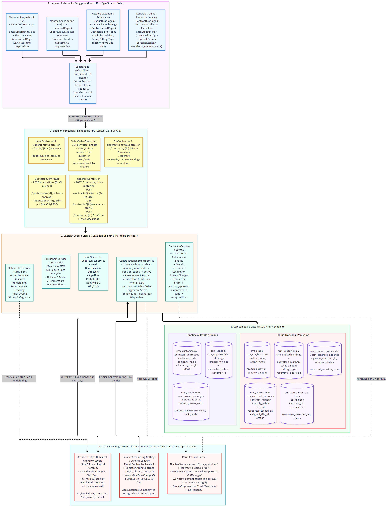

# BEDAH MODUL CRMSALES: ENGINE PENDAPATAN & SIKLUS TRANSAKSI BISNIS MSDC ERP
## Modul: CrmSales (`Lead-to-Cash Pipeline, DC Resource Reservation, Contract Lifecycle, SLA Management, & Billing Handover`)
**Target Cakupan**: Siklus Komersial Penjualan Layanan *Data Center*, Tata Kelola Kontrak *Multi-Tenant*, Reservasi Fisik Kapasitas Rak (`DataCenterOps`), & Integrasi Finansial (`FinanceAccounting`)

---

## 1. PERAN STRATEGIS & FILOSOFI BISNIS CRMSALES DALAM EKOSISTEM MSDC ERP

Pada industri infrastruktur *Data Center* dan *Managed Services*, aktivitas komersial penjualan memiliki karakteristik unik yang membedakannya secara fundamental dari sistem *Customer Relationship Management* (CRM) ritel atau perangkat lunak konvensional. Penjualan layanan *colocation*, kapasitas rak server (*rack unit / whole rack*), pasokan daya listrik (*power density*), konektivitas *bandwidth*, dan interkoneksi kabel serat optik (*cross-connect*) tidak sekadar berupa transaksi administratif di atas kertas. Setiap komitmen penjualan yang disepakati dengan pelanggan secara langsung berdampak fisik terhadap kapasitas terpasang, beban pendinginan (*HVAC cooling load*), keandalan kelistrikan (*PDU distribution*), serta alokasi ruang lorong dingin (*cold aisle containment*) di dalam gedung *data center*.

Apabila batasan fisik tersebut tidak terintegrasi secara *real-time* ke dalam mesin penjualan, risiko terbesar yang dihadapi perusahaan adalah fenomena penjualan berlebih (*double booking / over-subscription*). Kondisi ini terjadi ketika tim penjualan menerbitkan kontrak kepada pelanggan baru untuk menempati slot rak yang secara bersamaan telah dialokasikan kepada pelanggan lain atau sedang dalam proses pemeliharaan oleh tim *Data Center Operations*. Dampak hukum dari kegagalan pemenuhan komitmen ini sangat fatal, mencakup penalti pelanggaran *Service Level Agreement* (SLA), klaim kerugian finansial, hingga pembatalan kontrak sepihak.

Modul **`CrmSales`** dirancang sebagai pilar penggerak pendapatan (*revenue engine*) sekaligus pagar pengaman integritas komitmen fisik pada ekosistem MSDC ERP. Filosofi rekayasa utama yang diusung oleh modul ini adalah **"Resource-Backed Contract Commitment"** (Komitmen Kontrak Berbasis Verifikasi Sumber Daya Fisik). Modul ini menolak paradigma konvensional di mana kontrak diterbitkan secara terpisah lalu baru dinegosiasikan penempatannya kepada tim teknis di lapangan. Sebaliknya, modul ini memberlakukan arsitektur di mana:

1. **Jaminan Ketersediaan Kapasitas Nyata (*Physical Resource Validation*)**: Sejak tahap penyusunan draf kontrak, sistem secara wajib mewajibkan pemilihan lokasi gedung (*site*) dan penguncian unit slot rak secara visual (*visual rack space locking*) melalui integrasi langsung dengan modul `DataCenterOps`.
2. **Pagar Validasi Persetujuan Bertingkat (*Two-Stage Multi-Level Governance*)**: Draf kontrak yang memuat alokasi rak fisik dan komitmen finansial dibekukan statusnya (*immutable state lock*), lalu diwajibkan melewati gerbang persetujuan independen dua tahap: persetujuan keuangan (*Finance Approval*) untuk analisis margin dan kelayakan kredit, serta persetujuan hukum (*Legal Approval*) untuk kepatuhan klausul klausul kontrak.
3. **Pemisahan Model Pendapatan Berulang dan Sekali-Bayar (*Revenue Stream Segregation*)**: Mengisolasi secara deterministik antara komponen pendapatan berulang bulanan (*Monthly Recurring Revenue / MRR*) seperti sewa ruang rak dan *bandwidth*, dengan biaya instalasi atau penarikan kabel satu-kali (*one-time setup fee*). Hal ini menjamin bahwa faktur penagihan bulanan yang diterbitkan modul `FinanceAccounting` bebas dari anomali tagihan berganda (*double billing*).
4. **Otomasi Penyerahan Operasional (*Seamless Operations Handover*)**: Begitu kontrak ditandatangani secara sah oleh pelanggan dan dokumen digital diverifikasi, sistem secara atomik memicu penerbitan *Sales Order* aktif dan menginstansiasi perintah kerja (*work order*) kepada teknisi lapangan di modul `DataCenterOps` tanpa ada langkah intervensi manual yang rentan kelalaian manusia (*human error*).

---

## 2. PETA FITUR & SUB-MODUL UTAMA

Berdasarkan audit mendalam terhadap basis kode backend `MSDC/Modules/CrmSales/` dan antarmuka frontend `MSDCFrontend/src/modules/crm-sales/`, kapabilitas fungsional modul `CrmSales` terbagi ke dalam 8 sub-modul inti:

### 2.1. Manajemen Prospek & Pipeline Peluang (Lead & Opportunity Pipeline)
Menangani siklus hidup awal hubungan calon pelanggan sebelum terbentuk entitas legal transaksi:
* **Pengelolaan Prospek (*Lead Management*)**: Pencatatan identitas prospek, sumber perolehan (*lead source* seperti rujukan, pameran, *inbound web*), estimasi potensi nilai kontrak, serta penugasan tenaga penjual penanggung jawab (*sales representative / PIC*).
* **Buku Harian Aktivitas (*Activity Timeline Log*)**: Pencatatan riwayat interaksi (*calls, meetings, email correspondence*) yang terikat secara runut waktu (*chronological order*) pada setiap entitas prospek.
* **Konversi Prospek Terpadu (*Lead Qualification & Conversion*)**: Mekanisme transisi status dari prospek terverifikasi (*qualified lead*) menjadi entitas pelanggan legal (*Customer Master Data*) dan penciptaan entitas Peluang Penjualan (*Opportunity*) secara atomik.
* **Kanban Pipeline Peluang (*Visual Stage Progression*)**: Visualisasi tahapan transaksi penjualan terstruktur mencakup tahapan *prospecting*, *qualification*, *proposal*, *negotiation*, hingga pencapaian akhir *closed_won* atau kegagalan *closed_lost*, dilengkapi metrik bobot probabilitas keberhasilan transaksi (*probability weighting*).

### 2.2. Katalog Layanan Data Center & Paket Promosi (DC Product Catalog & Promo Packages)
Fondasi spesifikasi teknis dan komersial layanan komputasi serta infrastruktur:
* **Katalog Layanan Komersial**: Pengelompokan produk ke dalam kategori standar industri: *Colocation* (rak per-U dan rak penuh), *Dedicated Server*, *Cloud VPS*, *Bandwidth IP Transit / Local Peering (IXP)*, *Cross-Connect*, dan *Managed Services*.
* **Template Persyaratan Sumber Daya (*Default Resource Templates*)**: Setiap entitas produk menyimpan konfigurasi bawaan kebutuhan fisik: `default_rack_u`, `default_rack_mode` (*unit* atau *whole_rack*), `default_ip_count`, `default_power_watt`, `default_bandwidth_mbps`, dan penanda `default_requires_cross_connect`. Konfigurasi ini secara otomatis disalin ke baris transaksi tanpa mengharuskan staf penjualan menghafal parameter teknis rak server.
* **Paket Promosi Berbatas Waktu (*Promo Packages*)**: Manajemen bundel produk (misalnya sewa rak 42U gratis interkoneksi *cross-connect* 2 jalur) dengan penetapan masa berlaku dan diskon paket.

### 2.3. Mesin Penawaran Harga (Quotation Management Engine)
Penyusunan dokumen komersial formal yang diajukan kepada calon pelanggan:
* **Kalkulasi Multi-Item Terstruktur**: Perhitungan subtotal, persentase diskon per baris (*line item discount*), diskon global (*header discount*), serta pajak pertambahan nilai (*tax amount*) secara deterministik hingga 2 digit desimal.
* **Diferensiasi Model Penagihan (*Billing Type Segregation*)**: Penetapan eksplisit tipe penagihan pada setiap baris penawaran: `recurring` (tagihan rutin bulanan) atau `one_time` (biaya instalasi/aktivasi awal).
* **Persetujuan Manajerial Internal (*Managerial Approval Workflow*)**: Pengajuan draf penawaran ke dalam mesin alur kerja *CorePlatform* menggunakan template `quotation-approval-v1` yang mewajibkan *approval* manajer penjualan sebelum dokumen diizinkan terkirim ke klien.
* **Pencatatan Penolakan Terstruktur (*Structured Lose Quotation*)**: Mekanisme pembatalan penawaran yang mewajibkan input alasan kekalahan (*lost reason*), yang secara otomatis memperbarui status peluang (*opportunity*) menjadi *closed_lost* jika seluruh penawaran alternatif telah gugur.

### 2.4. Tata Kelola Siklus Hidup Kontrak (Contract Lifecycle Management & Visual Locking)
Jantung operasional modul `CrmSales` yang mengikat komitmen komersial dan alokasi fisik:
* **Penciptaan Berorientasi Penawaran (*Direct Quotation-to-Contract Transition*)**: Kontrak dibuat langsung dari *Quotation* berstatus *accepted*, mewarisi seluruh rincian layanan, nilai bulanan berulang (*monthly recurring value*), dan estimasi konsumsi sumber daya data center.
* **Penguncian Sumber Daya Rak Spasial (*Spatial Rack Locking via Visual Picker*)**: Antarmuka visual yang menampilkan matriks 42U rak server dari modul `DataCenterOps`, memungkinkan staf penjualan mengunci unit U spesifik atau keseluruhan rak fisik (*whole rack lock*) sebelum draf kontrak diajukan ke dewan persetujuan.
* **Pembekuan Status Transaksi (*Immutable State Locking*)**: Selama proses persetujuan berlangsung (*LOCKED_STATUSES*), seluruh parameter lokasi gedung (*site*), alokasi rak server, dan parameter SLA terkunci total (*read-only*) untuk mencegah manipulasi komitmen.
* **Alur Persetujuan Bertingkat Independen (*Two-Stage Multi-Level Approval*)**: Integrasi dengan *Workflow Engine* via template `contract-approval-v1` yang mengorkestrasi persetujuan dua pintu berurutan: *Finance Approval* (kelayakan kredit dan syarat pembayaran) lalu *Legal Approval* (evaluasi kepatuhan hukum).
* **Verifikasi Tanda Tangan Digital Klien (*Signed Document Confirmation*)**: Penerimaan dokumen kontrak basah atau digital bertandatangan dari pelanggan, verifikasi identitas penanda tangan (*PIC signee*), dan aktivasi resmi status kontrak (*Active / Executed*).

### 2.5. Penerbitan & Eksekusi Pesanan Penjualan (Sales Order Fulfillment & Provisioning Trigger)
Jembatan eksekusi teknis dari komitmen legal ke implementasi lapangan:
* **Penerbitan Otomatis (*Automated Order Issuance*)**: Begitu kontrak berstatus aktif dan seluruh sumber daya fisik terkonfirmasi terkunci (*resources_locked_at*), sistem secara otomatis menerbitkan dokumen *Sales Order* (SO) berstatus aktif.
* **Pencegahan Anomali Tagihan Berganda (*Anti-Double-Billing Safeguards*)**: Berbeda dari alur konvensional, penerbitan SO dari kontrak aktif sengaja tidak memicu event pembuatan faktur satu-kali, karena pendaftaran kontrak penagihan berulang telah diorkestrasi secara terpusat oleh event `ContractActivated`.
* **Pemicu Perintah Kerja Lapangan (*DC Provisioning Trigger*)**: Dokumen SO aktif menjadi referensi legal bagi divisi operasional data center untuk menerbitkan perintah kerja instalasi server (*device mounting*), penarikan kabel *patch cord*, dan pengalokasian blok subnet IP.

### 2.6. Perjanjian Tingkat Layanan & Pemantauan Pelanggaran (SLA Management & Breach Tracking)
Penjaminan kualitas layanan komersial data center:
* **Matriks Metrik Keandalan**: Penetapan target keandalan formal mencakup ketersediaan infrastruktur (*Uptime SLA* 99.98% / Tier III Standard), jaminan kestabilan pasokan daya *Dual Feed A+B*, kestabilan suhu lorong dingin (*Cold Aisle Temperature SLA* 18–27°C sesuai standar ASHRAE TC 9.9), serta batas waktu penanganan gangguan (*Mean Time to Restore / MTTR*).
* **Pencatatan Insiden Pelanggaran (*SLA Breach Logging*)**: Pendataan durasi gangguan (*outage duration*), akar penyebab masalah (*root cause*), dan formula kompensasi penalti kredit tagihan (*billing credit penalty*).

### 2.7. Retensi Pelanggan & Perpanjangan Kontrak (Contract Renewal & Churn Prevention)
Pengendalian keberlanjutan pendapatan berulang dan mitigasi risiko kehilangan pelanggan:
* **Deteksi Dini Kontrak Kedaluwarsa (*Upcoming Expiration Early Warning*)**: Peringatan otomatis sistem pada interval 90, 60, dan 30 hari kalender sebelum masa berlaku kontrak berakhir.
* **Siklus Negosiasi Perpanjangan (*Renewal Tracking & Negotiation Flow*)**: Penyusunan penawaran perpanjangan (*renewal quotation*) yang secara otomatis menautkan referensi ke kontrak induk (*parent contract*).
* **Proteksi Tabrakan Perpanjangan (*Concurrency Parent Lock*)**: Mekanisme penguncian baris basis data pada saat draf perpanjangan dibentuk guna mencegah terbitnya dua kontrak baru untuk satu kontrak induk yang sama.

### 2.8. Analitik Kinerja Penjualan & Pelaporan Eksekutif (CRM Analytics & Revenue Intelligence)
Dasbor intelijen bisnis untuk manajemen puncak dan kepala bagian penjualan:
* **Pelacakan Metrik Finansial**: Pemantauan *Monthly Recurring Revenue* (MRR), *Annual Recurring Revenue* (ARR), tingkat pertumbuhan bersih (*Net Revenue Retention*), serta tingkat kehilangan pelanggan (*Churn Rate*).
* **Analisis Konversi & Rasio Kemenangan (*Funnel & Win-Loss Ratio*)**: Evaluasi efektivitas konversi tahapan *pipeline* penjualan dan analisis komparasi alasan kekalahan (*loss reason analysis*).
* **Pengukuran Produktivitas Tenaga Penjual (*Sales Representative Quota vs Achievement*)**: Pelacakan realisasi pencapaian target penjualan per individu staf terhadap kuota yang ditetapkan perusahaan.

---

## 3. ARSITEKTUR FULLSTACK & ALUR KODE END-TO-END

Struktur interaksi fullstack pada modul `CrmSales` memisahkan secara tegas antara lapisan presentasi antarmuka (*React Single Page Application*), lapisan rute dan otorisasi (*API Gateway & Controller*), lapisan orkestrasi domain (*Service Layer*), serta interkoneksi lintas batas modul (*Cross-Module Layer*):



### 3.1. Alur 1: Dari Prospek Menjadi Peluang dan Konversi Pelanggan Resmi

Siklus transaksi komersial bermula dari penangkapan prospek mentah hingga menjadi entitas pelanggan terdaftar:

1. **Frontend**: Staf penjualan mengisi formulir prospek pada komponen antarmuka `LeadListPage.tsx`.
2. **Klien HTTP**: Axios mengirimkan payload `POST /api/v1/crm-sales/leads` dengan menyertakan header otentikasi `Authorization: Bearer <token>` dan konteks penyewa `X-Organization-Id: <org_id>`.
3. **Penyaringan Kredensial & Validasi (`LeadController::store`)**:
   - Sistem memvalidasi kelengkapan data kontak (`contact_name`, `company_name`, `email`, `phone`, `lead_source`, `estimated_deal_value`).
   - Melalui `LeadService::create()`, sistem membangkitkan kode prospek unik deterministik dari *CorePlatform* via `NumberSequence::next('lead')`.
4. **Proses Kualifikasi & Konversi (`LeadController::convert`)**:
   - Setelah interaksi dicatat pada `LeadTimelineService`, prospek yang dinilai prospektif dialihkan statusnya menjadi *qualified*.
   - Saat pengguna menekan tombol "Konversi Menjadi Pelanggan", pengendali mengeksekusi metode atomik `LeadService::convert()`:

```php
public function convert(Lead $lead, array $data = []): array
{
    return DB::transaction(function () use ($lead, $data) {
        $lead = Lead::query()->lockForUpdate()->findOrFail($lead->id);

        if ($lead->status === 'converted') {
            throw new \RuntimeException("Lead '{$lead->lead_code}' sudah pernah dikonversi.");
        }

        // 1. Instansiasi Entitas Customer Baru
        $customer = Customer::create([
            'customer_code' => $this->generateSequentialNumber('customer', 'CUST'),
            'company_name'  => $data['company_name'] ?? $lead->company_name,
            'status'        => 'active',
            'created_by'    => auth('api')->id(),
        ]);

        // 2. Buat Kontak Utama Pelanggan
        $customer->contacts()->create([
            'name'       => $lead->contact_name,
            'email'      => $lead->email,
            'phone'      => $lead->phone,
            'is_primary' => true,
        ]);

        // 3. Buka Peluang Penjualan (Opportunity) Terkait
        $opportunity = Opportunity::create([
            'opportunity_code' => $this->generateSequentialNumber('opportunity', 'OPP'),
            'lead_id'          => $lead->id,
            'customer_id'      => $customer->id,
            'title'            => 'Peluang: ' . ($data['company_name'] ?? $lead->company_name),
            'stage'            => 'qualification',
            'probability_pct'  => 30,
            'estimated_value'  => $lead->estimated_deal_value ?? 0,
        ]);

        $lead->update([
            'status'                => 'converted',
            'converted_customer_id' => $customer->id,
            'converted_at'          => now(),
        ]);

        return ['customer' => $customer, 'opportunity' => $opportunity];
    });
}
```

5. **Respons Sistem**: Frontend menerima identitas `customer_id` dan `opportunity_id` baru, lalu secara otomatis mengarahkan tampilan ke papan Kanban peluang penjualan.

---

### 3.2. Alur 2: Penyusunan Penawaran Harga, Kalkulasi Komponen, dan Persetujuan Manajerial

Ketika kesepakatan awal tercapai, staf penjualan menyusun draf penawaran formal:

1. **Frontend**: Pengguna membuka modal antarmuka `QuotationFormModal.tsx`, memilih produk katalog (seperti *Full Rack Colocation 42U* dan *100 Mbps Local Loop*), menentukan kuantitas, harga satuan, dan tipe penagihan (`recurring` vs `one_time`).
2. **Klien HTTP**: Axios mengirimkan data payload ke rute `POST /api/v1/crm-sales/quotations`.
3. **Kalkulasi Deterministik (`QuotationService::create`)**:
   - Sistem memvalidasi keberadaan minimal satu baris layanan (`lines >= 1`).
   - Setiap baris layanan dihitung nilai bersihnya setelah dikurangi diskon baris (`round($quantity * $unitPrice * (1 - $discountPct / 100), 2)`).
   - Nilai subtotal diakumulasikan, dikurangi diskon global, lalu ditambahkan pajak untuk menghasilkan nilai total akhir (`total_amount`).
4. **Pemeriksaan Penguncian Status Pembatalan (*Lose Guard*)**:
   - Apabila penawaran ditolak pelanggan, pembatalan tidak dilakukan sembarangan, melainkan wajib melalui metode `QuotationService::markLost()` dengan mencatat alasan kekalahan (*lost reason*):

```php
public function markLost(Quotation $quotation, string $reason, int $actorUserId): Quotation
{
    return DB::transaction(function () use ($quotation, $reason, $actorUserId) {
        $current = Quotation::query()->lockForUpdate()->findOrFail($quotation->id);

        if ($current->contracts()->exists() || $current->salesOrders()->exists()) {
            throw new \RuntimeException("Quotation '{$current->quotation_number}' sudah memiliki Contract atau Sales Order, tidak bisa ditandai Lose.");
        }

        $current->update([
            'status'      => 'lost',
            'lost_reason' => trim($reason),
            'lost_by'     => $actorUserId,
            'lost_at'     => now(),
        ]);

        // Sinkronisasi status Opportunity terkait apabila tidak ada penawaran aktif lainnya
        if ($current->opportunity_id) {
            $opportunity = Opportunity::query()->lockForUpdate()->find($current->opportunity_id);
            if ($opportunity && !in_array($opportunity->stage, ['closed_won', 'closed_lost'], true)) {
                $hasOtherActive = $opportunity->quotations()->whereNotIn('status', ['lost', 'rejected', 'expired'])->exists();
                if (!$hasOtherActive) {
                    $opportunity->update([
                        'stage'           => 'closed_lost',
                        'probability_pct' => 0,
                        'lost_reason'     => $reason,
                        'closed_at'       => now(),
                        'closed_by'       => $actorUserId,
                    ]);
                }
            }
        }

        return $current->fresh();
    });
}
```

5. **Pengajuan Persetujuan Manajerial**:
   - Staf penjualan menekan tombol "Ajukan Approval".
   - Klien HTTP mengirim `POST /api/v1/core-platform/workflow/instances` dengan parameter `template_code: 'quotation-approval-v1'` dan referensi dokumen `crm_quotation`.
   - Modul *CorePlatform* mengalihkan status penawaran menjadi `waiting_approval`. Setelah disetujui Manajer Penjualan, status berubah menjadi `approved`, membuka hak ekspor PDF resmi dengan kode QR verifikasi HMAC (`crm/s/{reference}`).

---

### 3.3. Alur 3: Reservasi Kapasitas Rak Spasial, Alur Persetujuan Bertingkat, dan Aktivasi Kontrak

Setelah penawaran berstatus *accepted*, sistem memasuki fase paling krusial: reservasi sumber daya fisik data center dan tata kelola kontrak:

1. **Penciptaan Draf Kontrak (`ContractManagementService::createFromQuotation`)**:
   - Sistem memvalidasi bahwa penawaran bersangkutan berstatus sah `accepted` dan belum pernah dijadikan kontrak sebelumnya.
   - Nilai bulanan berulang (`monthly_value`) dihitung secara eksklusif hanya dari baris bertipe `recurring` untuk melindungi pelanggan dari tagihan berganda terhadap biaya instalasi awal:

```php
$recurringTotal = $quotation->lines->where('billing_type', '!=', 'one_time')->sum('amount');

$contract = Contract::create([
    'contract_number'   => $this->generateSequentialNumber('contract', 'CTR'),
    'customer_id'       => $quotation->customer_id,
    'quotation_id'      => $quotation->id,
    'sales_employee_id' => $quotation->sales_employee_id,
    'contract_type'     => $parent ? 'renewal' : 'new',
    'status'            => 'draft',
    'monthly_value'     => $data['monthly_value'] ?? $recurringTotal,
    'payment_term_days' => $data['payment_term_days'] ?? 30,
]);
```

2. **Pemilihan Lokasi & Penguncian Rak Fisik Spasial (*Visual Rack Space Locking*)**:
   - Pengguna membuka antarmuka `ContractDetailPage.tsx`.
   - Komponen mengimpor modul spasial `@modules/data-center-ops/components/rack/RackVisualPicker`.
   - Staf menentukan lokasi gedung melalui `POST /api/v1/crm-sales/contracts/{id}/site`.
   - Pada grid visual 42U rak data center, staf memilih unit slot yang akan ditempati (misalnya U12–U24 atau satu rak penuh *Rack 04-A*).
   - Panggilan API diarahkan ke *endpoint* alokasi `DataCenterOps`, yang menyisipkan entri ke dalam tabel `dc_rack_allocation` berstatus `reserved` dengan menyematkan `contract_id` dan `customer_id`.
3. **Verifikasi Kesiapan Sumber Daya (*Resource Lock Verification*)**:
   - Sebelum draf kontrak diizinkan diajukan ke dewan persetujuan, metode `ContractManagementService::resourceLockStatus()` memverifikasi pemenuhan kapasitas secara ketat di tingkat server:

```php
public function resourceLockStatus(Contract $contract): array
{
    $contract->loadMissing(['services', 'rackAllocations']);

    $lockedAllocations = $contract->rackAllocations->whereIn('status', ['active', 'reserved']);
    $unitServices = $contract->services->where('rack_mode', 'unit')->filter(fn ($s) => (int) $s->required_rack_u > 0);
    $wholeRackServices = $contract->services->where('rack_mode', 'whole_rack');

    $requiredUnitU = (int) $unitServices->sum('required_rack_u');
    $fullRackAllocationCount = 0;
    $unitAllocatedU = 0;

    foreach ($lockedAllocations as $allocation) {
        $rackTotalU = Rack::where('id', $allocation->rack_id)->value('total_u');
        $allocatedU = $allocation->end_u - $allocation->start_u + 1;
        if ($rackTotalU && $allocatedU === (int) $rackTotalU) {
            $fullRackAllocationCount++;
        } else {
            $unitAllocatedU += $allocatedU;
        }
    }

    $unitOk = $requiredUnitU === 0 || $unitAllocatedU >= $requiredUnitU;
    $wholeRackOk = $wholeRackServices->count() <= $fullRackAllocationCount;

    return [
        'required_unit_u'      => $requiredUnitU,
        'locked_unit_u'        => $unitAllocatedU,
        'required_whole_racks' => $wholeRackServices->count(),
        'locked_whole_racks'   => $fullRackAllocationCount,
        'ok'                   => $unitOk && $wholeRackOk,
    ];
}
```

4. **Pembekuan Status & Alur Persetujuan Bertingkat (*Two-Stage Multi-Level Governance*)**:
   - Begitu tombol "Ajukan Approval" ditekan, status kontrak berubah menjadi salah satu dari `LOCKED_STATUSES` (`pending_finance_approval`). Pada kondisi ini, manipulasi data gedung, rak, dan nilai kontrak dilarang keras.
   - Dokumen memasuki alur kerja `contract-approval-v1`:
     - **Tahap 1 (*Finance Approval*)**: Dievaluasi oleh pejabat dengan peran `finance-approver` guna memeriksa kelayakan termin kredit (*payment terms*) dan keabsahan deposit pelanggan.
     - **Tahap 2 (*Legal Approval*)**: Dievaluasi oleh pejabat dengan peran `legal-approver` guna memeriksa kepatuhan klausul *liability*, batasan ganti rugi pemadaman, dan yurisdiksi hukum.
5. **Pemberitahuan Klien & Unggah Dokumen Bertandatangan**:
   - Setelah persetujuan ganda selesai, status kontrak bergeser ke `sent_to_client`. Dokumen PDF resmi dicetak lengkap dengan blok tanda tangan digital dan stempel verifikasi.
   - Klien menandatangani kontrak, lalu staf mengunggah pindaian dokumen melalui komponen `FileUploadField.tsx` ke rute `POST /api/v1/crm-sales/contracts/{id}/confirm-signed-document`.

---

### 3.4. Alur 4: Penerbitan Otomatis Sales Order, Pemicu Provisioning DC Ops, dan Handover Finansial Anti-Double Billing

Tahapan pamungkas menandai mulainya operasi layanan dan pencatatan akuntansi:

1. **Aktivasi Kontrak & Penyiaran Event (`ContractManagementService::confirmSignedDocument`)**:
   - Sistem mencatat tautan berkas resmi pada kolom `signed_file_id` dan menetapkan status kontrak menjadi `active`.
   - Event `ContractActivated` disiarkan secara asinkron ke seluruh sistem:

```php
public function confirmSignedDocument(Contract $contract, int $fileId): Contract
{
    if ($contract->status !== 'sent_to_client') {
        throw new \RuntimeException("Contract '{$contract->contract_number}' berstatus '{$contract->status}', harus 'sent_to_client' dulu.");
    }

    $contract->update(['status' => 'active', 'signed_file_id' => $fileId]);

    // Tandai status perpanjangan lama selesai jika ada
    ContractRenewal::query()
        ->where('new_contract_id', $contract->id)
        ->whereIn('renewal_status', ['pending', 'notified', 'negotiating'])
        ->update(['renewal_status' => 'renewed']);

    // 1. Siarkan Event untuk Pendaftaran Kontrak Billing di FinanceAccounting
    ContractActivated::dispatch($contract->fresh());

    // 2. Terbitkan Sales Order Otomatis (Resource Sudah Terkunci Lengkap)
    try {
        $this->lockResourcesAndIssueSalesOrder($contract->fresh());
    } catch (\RuntimeException $e) {
        Log::warning("ContractApproval: Contract {$contract->contract_number} aktif tapi SO belum otomatis terbit: {$e->getMessage()}");
    }

    // 3. Terbitkan Faktur AR Satu-Kali untuk Biaya Instalasi / Setup
    $this->invoiceOneTimeCharges($contract->fresh());

    return $contract->fresh();
}
```

2. **Penerbitan Sales Order Otomatis Tanpa Anomali Billing**:
   - Metode `SalesOrderService::createFromContract()` menginstansiasi dokumen SO aktif.
   - Penanda `resources_reserved_at` dibubuhi stempel waktu saat ini.
   - Penyiaran event penagihan satu-kali sengaja ditiadakan pada metode ini untuk mencegah timbulnya tagihan ganda terhadap pelanggan (*anti-double-billing architecture*).
3. **Penerbitan Faktur Satu-Kali (*One-Time Setup Invoicing*)**:
   - Metode `invoiceOneTimeCharges()` memfilter baris layanan bertipe `billing_type = 'one_time'` (misalnya biaya penarikan kabel *cross-connect* dan konfigurasi awal router).
   - Layanan memanggil `AccountsReceivableService::createInvoice()` pada modul `FinanceAccounting` dengan referensi unik `reference_type = 'contract_one_time'` dan `reference_number = $contract->contract_number`. Mekanisme ini menjamin idempotensi penagihan meskipun terjadi pemanggilan ulang (*safe re-entrant execution*).
4. **Pemicu Eksekusi Lapangan (*DataCenterOps Work Order Trigger*)**:
   - Status alokasi rak pada `dc_rack_allocation` bertransisi otomatis dari `reserved` menjadi `active`.
   - Tim operasional data center menerima notifikasi perintah kerja pemasangan perangkat (*device provisioning*) yang terikat langsung pada nomor kontrak dan nomor pesanan penjualan yang sah.

---

## 4. TITIK INTEGRASI LINTAS MODUL (CROSS-MODULE CONTRACTS)

Modul `CrmSales` memegang peran sentral dalam pertukaran data komersial, fisik, dan keuangan di dalam ekosistem MSDC ERP:

| Komponen / Titik Integrasi | Tipe Kontrak | Modul Terkait | Mekanisme Pemanggilan & Realisasi di Kode Nyata |
| :--- | :--- | :--- | :--- |
| **`NumberSequence::next()`** | *Domain Service* | `CorePlatform` | Membangkitkan penomoran dokumen transaksi secara atomik berbasis *pessimistic lock*. Modul kode yang digunakan: `lead` (`LEAD-YYYY-SEQ`), `customer` (`CUST-YYYY-SEQ`), `opportunity` (`OPP-YYYY-SEQ`), `quotation` (`QUO-YYYY-SEQ`), `contract` (`CTR-YYYY-SEQ`), dan `sales_order` (`SO-YYYY-SEQ`). |
| **`WorkflowEngineService`** | *Engine Service* | `CorePlatform` | Mengorkestrasi persetujuan dokumen bisnis. Penawaran harga divalidasi via template `quotation-approval-v1` (Persetujuan Manager). Kontrak divalidasi via template 2 tahap `contract-approval-v1` (Persetujuan Keuangan oleh `finance-approver` dilanjutkan Persetujuan Hukum oleh `legal-approver`). |
| **`ScopesOrganization`** | *Eloquent Trait* | `CorePlatform` | Menjamin batas pemisah *multi-tenancy*. Seluruh kueri basis data pada entitas `Lead`, `Quotation`, `Contract`, dan `SalesOrder` secara transparan dibatasi hanya pada organisasi aktif dari *context header* `X-Organization-Id`. |
| **`RackVisualPicker` & Alokasi Rak** | *React Component & Eloquent Model* | `DataCenterOps` | Komponen antarmuka `ContractDetailPage` menyematkan picker rak interaktif 42U. Backend mengunci kapasitas pada `dc_rack_allocation` (kolom `contract_id`, `customer_id`, `start_u`, `end_u`, status `reserved`/`active`). |
| **Pengecekan Kapasitas Fisik** | *Server-Side Validation* | `DataCenterOps` | Metode `ContractManagementService::resourceLockStatus()` memvalidasi kecukupan unit U (`total_u`) dan jumlah rak penuh (*whole rack*) sebelum kontrak diizinkan terbit menjadi *Sales Order*. |
| **Interkoneksi Jaringan & Perangkat** | *Relational Anchor* | `DataCenterOps` | Entitas `CrossConnect`, `Device`, `BandwidthAllocation`, dan `IpAddress` pada modul operasional memegang *foreign key* `contract_id` dan `contract_service_id` untuk penelusuran status kepemilikan aset (*Customer 360 view*). |
| **Pendaftaran Penagihan Berulang** | *Domain Event* | `FinanceAccounting` | Penyiaran event `ContractActivated` ditangkap oleh listener finansial untuk mendaftarkan kontrak ke tabel `fin_bi_billing_contract` guna eksekusi *auto-billing* faktur piutang bulanan. |
| **Faktur Biaya Setup Satu-Kali** | *Direct Service Call* | `FinanceAccounting` | Metode `invoiceOneTimeCharges()` memanggil `AccountsReceivableService::createInvoice()` untuk menagih biaya instalasi awal/setup non-rutin dengan pemetaan akun pendapatan (*revenue account CoA mapping*). |
| **Pencegahan Tagihan Berganda** | *Database Guard* | `FinanceAccounting` | Pengecekan keberadaan rekaman `ArInvoice` dengan `reference_type = 'sales_order'` atau `reference_type = 'contract_one_time'` sebelum eksekusi penagihan baru dijalankan. |

---

## 5. SPESIFIKASI ENDPOINT API & SKEMA TABEL INTI

### 5.1. Matriks Endpoint API Utama

Berikut adalah ringkasan representatif dari endpoint API yang diekspos oleh modul `CrmSales` pada rute `/api/v1/crm-sales`:

| Metode HTTP | Endpoint URI | Controller Penanggung Jawab | Deskripsi Fungsi & Pengamanan Hak Akses |
| :--- | :--- | :--- | :--- |
| `POST` | `/leads` | `LeadController@store` | Mendaftarkan prospek bisnis baru (`permission:lead.manage`). |
| `POST` | `/leads/{lead}/convert` | `LeadController@convert` | Mengonversi prospek menjadi Pelanggan dan Peluang Penjualan aktif (`permission:lead.manage`). |
| `GET` | `/opportunities/pipeline-summary` | `OpportunityController@pipelineSummary` | Mengambil ringkasan tahapan pipeline penjualan dan estimasi nilai transaksi (`permission:opportunity.view`). |
| `POST` | `/quotations` | `QuotationController@store` | Menyusun draf penawaran harga multi-item dengan kalkulasi diskon & pajak (`permission:quotation.manage`). |
| `POST` | `/quotations/{id}/submit-approval`| `QuotationController@submitApproval` | Mengajukan draf penawaran ke mesin alur kerja manajerial (`permission:quotation.manage`). |
| `POST` | `/quotations/{id}/status` | `QuotationController@updateStatus` | Memperbarui status penawaran (*accepted*, *rejected*, atau *lost*) (`permission:quotation.manage`). |
| `GET` | `/quotations/{id}/print-pdf` | `QuotationController@printPdf` | Mencetak dokumen penawaran resmi berstempel kode QR verifikasi publik (`permission:quotation.view`). |
| `POST` | `/contracts/from-quotation` | `ContractController@storeFromQuotation` | Mengonversi penawaran berstatus *accepted* menjadi draf Kontrak baru (`permission:contract.manage`). |
| `POST` | `/contracts/{id}/site` | `ContractController@setSite` | Menetapkan fasilitas gedung data center penempatan layanan (`permission:contract.manage`). |
| `GET` | `/contracts/{id}/resource-status` | `ContractController@resourceStatus` | Memverifikasi kelengkapan penguncian rak server per-U dan rak penuh (`permission:contract.view`). |
| `POST` | `/contracts/{id}/confirm-signed-document` | `ContractController@confirmSignedDocument` | Mengunggah pindaian kontrak bertandatangan dan mengaktifkan kontrak secara resmi (`permission:contract.manage`). |
| `POST` | `/sales-orders/from-quotation` | `SalesOrderController@storeFromQuotation` | Menerbitkan pesanan penjualan dari penawaran (*legacy flow*) (`permission:sales-order.manage`). |
| `GET` | `/contracts/{id}/slas` | `SlaController@index` | Menampilkan parameter metrik SLA yang disepakati pada kontrak (`permission:sla.view`). |
| `POST` | `/slas/{sla}/breaches` | `SlaController@reportBreach` | Mencatat insiden pelanggaran ambang batas SLA data center (`permission:sla.manage`). |
| `GET` | `/reports/kpis` | `CrmReportController@kpis` | Menyajikan agregasi metrik MRR, rasio kemenangan, dan pertumbuhan penjualan (`permission:opportunity.view`). |

---

### 5.2. Skema Entitas Basis Data Utama

Struktur basis data modul `CrmSales` mengadopsi konvensi prefiks tabel `crm_*` yang terisolasi secara teratur:

1. **Entitas Hubungan Calon Pelanggan (`crm_leads`, `crm_opportunities`, `crm_customers`)**:
   - `crm_leads`: Menyimpan data prospek (`lead_code`, `company_name`, `contact_name`, `email`, `phone`, `lead_source`, `estimated_deal_value`, `status`, `converted_customer_id`, `organization_id`).
   - `crm_opportunities`: Memodelkan peluang transaksi pada *sales funnel* (`opportunity_code`, `lead_id`, `customer_id`, `stage`, `probability_pct`, `estimated_value`, `closed_at`, `lost_reason`).
   - `crm_customers`: Menyimpan identitas legal klien korporat (`customer_code`, `company_name`, `industry`, `tax_id`, `status`, `organization_id`). Didukung oleh entitas pendukung `crm_customer_contacts` dan `crm_customer_addresses`.
2. **Entitas Katalog Layanan Data Center (`crm_products`, `crm_product_categories`, `crm_promo_packages`)**:
   - `crm_products`: Spesifikasi komersial dan template fisik data center (`product_code`, `name`, `category_id`, `base_price`, `billing_cycle`, `default_rack_u`, `default_rack_mode`, `default_power_watt`, `default_bandwidth_mbps`, `default_requires_cross_connect`).
   - `crm_promo_packages` & `crm_promo_package_items`: Struktur paket promosi gabungan beberapa produk layanan dengan harga khusus.
3. **Entitas Penawaran Harga (`crm_quotations`, `crm_quotation_lines`)**:
   - `crm_quotations`: Dokumen komersial utama (`quotation_number`, `customer_id`, `opportunity_id`, `quotation_date`, `valid_until`, `subtotal`, `discount_amount`, `tax_amount`, `total_amount`, `status`, `lost_reason`).
   - `crm_quotation_lines`: Rincian layanan penawaran (`service_type`, `product_id`, `description`, `quantity`, `unit_price`, `discount_pct`, `amount`, `billing_type`, `cc_source_location`, `cc_destination_location`).
4. **Entitas Tata Kelola Kontrak & SLA (`crm_contracts`, `crm_contract_services`, `crm_slas`, `crm_contract_renewals`)**:
   - `crm_contracts`: Perjanjian legal komersial (`contract_number`, `customer_id`, `quotation_id`, `site_id`, `contract_type`, `status`, `start_date`, `end_date`, `monthly_value`, `payment_term_days`, `signed_file_id`, `resources_locked_at`).
   - `crm_contract_services`: Baris layanan kontrak yang mengikat kebutuhan fisik data center (`required_rack_u`, `rack_mode`, `required_power_watt`, `required_bandwidth_mbps`, `requires_cross_connect`, `billing_type`).
   - `crm_slas` & `crm_sla_breaches`: Konfigurasi metrik keandalan (`metric_name`, `target_value`, `unit`, `penalty_rate`) dan bukti insiden gangguan (*downtime duration, penalty_amount*).
   - `crm_contract_renewals`: Pelacakan siklus perpanjangan kontrak (`parent_contract_id`, `new_contract_id`, `renewal_status`, `proposed_monthly_value`).
5. **Entitas Pesanan Penjualan (`crm_sales_orders`, `crm_sales_order_lines`)**:
   - `crm_sales_orders`: Dokumen eksekusi komersial dan pemenuhan layanan (`so_number`, `contract_id`, `quotation_id`, `customer_id`, `site_id`, `order_date`, `status`, `total_amount`, `resources_reserved_at`).

---

## 6. BANK PERTANYAAN & JAWABAN PENGUJI (FOKUS ARSITEKTUR ERP)

Berikut adalah kompilasi skenario pengujian kritis terkait arsitektur transaksi komersial dan integrasi fisik pada modul `CrmSales` beserta formula jawaban akademisnya:

### Pertanyaan 1: Mengapa sistem mengharuskan penguncian alokasi rak fisik (Rack Locking via Visual Picker) dilakukan pada tahap draf kontrak sebelum diajukan ke dewan persetujuan, bukan setelah kontrak berstatus aktif?
> **Jawaban Akademis:**  
> Kebijakan rekayasa ini didasarkan pada karakteristik bisnis *data center colocation* yang memiliki kendala ruang dan daya fisik nyata. Apabila penguncian rak baru dilakukan setelah kontrak ditandatangani oleh klien (*post-signing allocation*), terdapat risiko fatal terjadinya penjualan berlebih (*double booking*) di mana slot rak yang dijanjikan pada saat penawaran ternyata telah terisi oleh pelanggan lain atau tidak memenuhi persyaratan kepadatan daya (*power density threshold*).  
> Dengan mewajibkan staf mengunci unit U spesifik atau keseluruhan rak melalui `RackVisualPicker` pada status draf, sistem memastikan bahwa kapasitas fisik tersebut telah resmi dipesan (*reserved*) di tabel `dc_rack_allocation`. Ketika draf kontrak diajukan ke dewan persetujuan (*Finance & Legal Approval*), para pejabat yang berwenang meninjau dokumen yang didukung oleh kepastian ketersediaan lokasi fisik yang nyata (*resource-backed contract*), sehingga klausul kontrak yang ditandatangani terbebas dari sengketa ketidakmampuan pemenuhan layanan.

---

### Pertanyaan 2: Bagaimana arsitektur modul CrmSales membedakan perlakuan penagihan antara komponen pendapatan berulang (Monthly Recurring Revenue) dan biaya setup satu-kali (One-Time Charge) untuk mencegah anomali tagihan berganda (Double Billing)?
> **Jawaban Akademis:**  
> Modul `CrmSales` menerapkan pemisahan tegas pada atribut `billing_type` di tingkat baris transaksi (`crm_quotation_lines` dan `crm_contract_services`). Nilai kontrak bulanan (`monthly_value`) dihitung secara eksklusif hanya dengan menjumlahkan baris yang bertipe selain `one_time` (`where('billing_type', '!=', 'one_time')`). Nilai inilah yang didaftarkan ke mesin penagihan otomatis berulang modul `FinanceAccounting` via penyiaran event `ContractActivated`.  
> Sebaliknya, baris layanan bertipe `one_time` (seperti biaya instalasi penarikan kabel *cross-connect*) dieksekusi secara terpisah melalui metode `invoiceOneTimeCharges()` yang menerbitkan satu faktur piutang (*AR Invoice*) mandiri pada saat kontrak resmi aktif. Metode ini bersifat idempoten karena memeriksa kombinasi `reference_type = 'contract_one_time'` dan nomor kontrak, sehingga menjamin biaya instalasi ditagih tepat satu kali dan tidak akan pernah terulang pada siklus penagihan rutin bulanan berikutnya.

---

### Pertanyaan 3: Mengapa alur persetujuan Kontrak menerapkan mekanisme Two-Stage Approval (Finance lalu Legal) menggunakan CorePlatform Workflow Engine dan status dokumen dibekukan (LOCKED_STATUSES)?
> **Jawaban Akademis:**  
> Penjualan kontrak infrastruktur data center bernilai tinggi membawa dua risiko kritis: risiko finansial dan risiko hukum. Persetujuan tahap pertama oleh peran `finance-approver` mengevaluasi profil kelayakan kredit pelanggan, keabsahan uang jaminan (*security deposit*), serta kesesuaian margin laba kotor terhadap konsumsi daya listrik. Persetujuan tahap kedua oleh `legal-approver` memverifikasi kesesuaian dokumen dengan regulasi perlindungan data, batasan tanggung jawab hukum (*limitation of liability*), dan parameter penalti *SLA breach*.  
> Selama kedua tahap persetujuan ini berlangsung, draf kontrak dikunci ke dalam kelompok status `LOCKED_STATUSES` (`pending_finance_approval`, `pending_legal_approval`, `sent_to_client`). Pembekuan ini menonaktifkan seluruh hak modifikasi pada entitas kontrak, penempatan gedung data center (`setSite`), serta alokasi rak fisik. Hal ini menjamin prinsip integritas tata kelola korporat (*governance integrity*): parameter komersial dan alokasi fisik yang disetujui oleh direksi keuangan dan hukum identik seratus persen dengan dokumen yang akhirnya dikirimkan dan ditandatangani oleh pelanggan.

---

### Pertanyaan 4: Bagaimana sistem mencegah terjadinya kondisi Concurrency Collision ketika dua staf penjualan mencoba melakukan perpanjangan (Renewal) terhadap kontrak induk yang sama pada saat bersamaan?
> **Jawaban Akademis:**  
> Penanganan tabrakan konkurensi pada siklus perpanjangan kontrak ditangani melalui mekanisme *pessimistic locking* pada basis data di dalam blok transaksi atomik (`DB::transaction`). Ketika proses perpanjangan diinisiasi baik melalui pembuatan draf dari penawaran (`createFromQuotation`) maupun modul perpanjangan langsung, baris kontrak induk dikunci menggunakan klausa SQL `SELECT ... FOR UPDATE` via Eloquent `Contract::whereKey($parent->id)->lockForUpdate()->firstOrFail()`.  
> Sistem kemudian memverifikasi keberadaan kontrak anak aktif melalui kueri keberadaan relasi `parent_contract_id` dengan status dalam proses (*draft*, *pending approvals*, atau *active*). Apabila transaksi pertama sedang memproses draf perpanjangan, transaksi kedua yang mencoba mengakses kontrak induk yang sama akan tertahan hingga transaksi pertama tuntas, lalu mendeteksi bahwa kontrak induk telah memiliki proses perpanjangan aktif dan secara otomatis melempar pengecualian `RuntimeException` dengan pesan yang terstruktur. Mekanisme ini menjamin bahwa satu kontrak sewa data center tidak akan pernah menghasilkan dua kontrak perpanjangan paralel.

---

### Pertanyaan 5: Mengapa penerbitan Sales Order secara otomatis dari Kontrak aktif sengaja TIDAK menyiarkan event SalesOrderConfirmedByClient?
> **Jawaban Akademis:**  
> Pada alur penjualan lama (*legacy sales flow*), dokumen *Sales Order* dibuat langsung dari penawaran harga (*Quotation*), dan konfirmasi pemesanan dari klien (`confirmWithClientFile()`) menyiarkan event `SalesOrderConfirmedByClient`. Listener finansial `CreateInvoiceFromSalesOrder` menangkap event tersebut dan secara otomatis membentuk faktur piutang (*AR Invoice*) atas nilai total *Sales Order*.  
> Pada arsitektur baru yang berorientasi kontrak (*contract-driven architecture*), seluruh gerbang legal, persetujuan dewan, dan komitmen penagihan berulang telah diorkestrasi dan disiarkan secara resmi pada saat kontrak aktif melalui event `ContractActivated` yang mendaftarkan kontrak penagihan bulanan pada *FinanceAccounting*. Apabila metode `createFromContract()` pada *SalesOrderService* turut menyiarkan event `SalesOrderConfirmedByClient`, modul finansial akan menerbitkan faktur piutang tambahan untuk nilai yang sama persis, sehingga pelanggan akan tertagih dua kali (*double invoiced*) untuk satu pesanan layanan data center. Oleh karena itu, *Sales Order* yang diterbitkan dari kontrak aktif difungsikan murni sebagai dokumen pemenuhan teknis (*technical fulfillment document*) untuk memicu pekerjaan fisik tim *Data Center Operations* tanpa menyentuh siklus penagihan finansial.