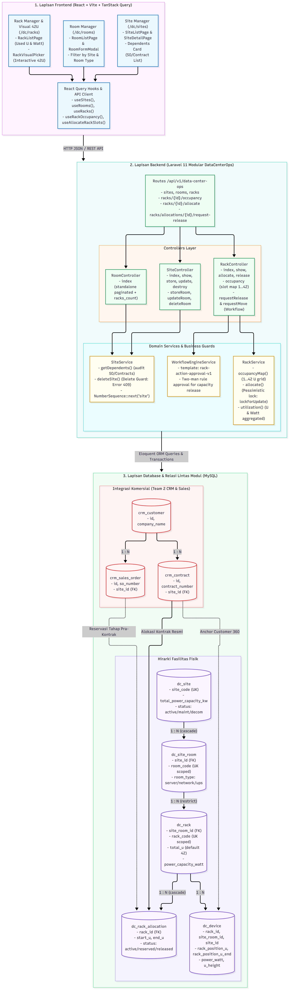

# BEDAH KLASTER 1: HIRARKI FASILITAS FISIK GEDUNG DATA CENTER
## Modul: Data Center Operations (DC Ops) — MSDC ERP
**Target Sub-Menu**: Site Manager (`/dc/sites`), Room Manager (`/dc/rooms`), Rack Manager & Visual 42U (`/dc/racks`)

---

## 1. FILOSOFI BISNIS & IDENTIFIKASI MASALAH

Dalam industri *Colocation Data Center* dan *Managed Services*, komoditas komersial utama yang ditransaksikan kepada penyewa (*tenant*) bukanlah sekadar konektivitas internet, melainkan **ruang fisik (*floor space & rack space*)**, **keandalan daya listrik (*power capacity*)**, dan **stabilitas temperatur lingkungan (*cooling SLA*)**. 

Ketiadaan pemodelan data spasial yang ketat pada sistem operasional data center berpotensi menimbulkan kerugian fatal, antara lain:

1. **Risiko Alokasi Ganda (*Double-Booking / Over-selling*)**: Dua pelanggan yang berbeda dapat secara tidak sengaja dijanjikan atau ditempatkan pada unit lemari rak yang sama.
2. **Kekacauan Lokasi Fisik (*Spatial Misplacement*)**: Staf teknisi lapangan kesulitan melacak letak rak server karena penamaan kode rak yang bertabrakan antargedung.
3. **Pelanggaran Integritas Kontrak Komersial**: Penghapusan fasilitas gedung yang masih menampung kontrak sewa aktif dapat mengakibatkan terputusnya layanan pelanggan dan hilangnya pendapatan berulang (*Monthly Recurring Revenue / MRR*).

Untuk menanggulangi permasalahan tersebut, arsitektur sistem informasi *Data Center Infrastructure Management* (DCIM) pada MSDC ERP menerapkan **pemodelan hierarki spasial bertingkat (*hierarchical spatial containment*)**:

$$\text{Site (Gedung/Kampus DC)} \longrightarrow \text{Room (Ruang/Zona/Lantai)} \longrightarrow \text{Rack (42U Chassis)} \longrightarrow \text{Slot U (Unit Fisik 1..42)}$$

### 1.1. Peran dan Tanggung Jawab Sub-Menu
1. **Site Manager (`/dc/sites`) — Tingkat Makro Gedung**:
   - Merepresentasikan fasilitas fisik gedung data center (contoh: `DC-SBY-01`, `DC-JKT-01`).
   - Menyimpan parameter kapasitas makro fasilitas: total kapasitas daya listrik gedung (`total_power_capacity_kw`), batas total agregat *bandwidth* (`total_bandwidth_mbps`), status operasional gedung (`active`, `maintenance`, `decommissioned`), serta penanda *Cost Center* akuntansi.
   - **Interkoneksi CRM**: Site bertindak sebagai jangkar (*anchor*) legal bagi Sales Order (`crm_sales_order`) dan Kontrak Pelanggan (`crm_contract`).
2. **Room Manager (`/dc/rooms`) — Tingkat Ruangan & Zona Fungsional**:
   - Membagi gedung ke dalam ruangan fungsional atau zona keamanan: *Server Room (Data Hall)*, *Network Room (Meet-Me Room / MMR)*, *UPS & Battery Room*, serta *Staging Area*.
   - Mencatat atribut fisik mencakup lantai (*floor*), zona keamanan (*zone*), tipe ruangan (*room_type*), dan luas area (*area_sqm*).
   - Memisahkan ruangan berdaya tinggi (ruang server) dari ruangan utilitas penunjang (ruang baterai/UPS) guna mempermudah audit kepatuhan ISO 27001 dan TIA-942.
3. **Rack Manager & Visual 42U (`/dc/racks`) — Tingkat Lemari Rak Komersial**:
   - Merepresentasikan lemari rak server standar EIA-310 (umumnya berukuran 42U).
   - Mencatat ambang batas daya maksimum per rak (`power_capacity_watt`, misalnya 3.500 Watt atau 5.000 Watt per rak).
   - Menghitung utilisasi ruang (sisa U) dan utilisasi daya (sisa Watt) secara *real-time*.
   - **Visual 42U Elevation Grid**: Antarmuka visual interaktif vertikal dari U-42 (posisi paling atas) hingga U-01 (posisi paling bawah), yang memetakan status setiap unit slot: kosong (*available/green*), direservasi oleh Sales Order (*reserved/blue*), atau telah terpasang server fisik pelanggan (*booked/red*).

---

## 2. ARSITEKTUR FULLSTACK & ALUR KODE END-TO-END

Alur data pada Klaster 1 mengalir secara modular dari komponen antarmuka pengguna hingga transaksi basis data dengan isolasi *multi-tenant*:

```
[React UI Component] 
       │ (Interaksi Pengguna & Event Handler)
       ▼
[TanStack Query Hook & Axios] (useSites / useRooms / useRacks / useRackOccupancy)
       │ (HTTP GET/POST/PUT/DELETE + Headers: Bearer Token, X-Organization-Id)
       ▼
[Laravel API Route] (Modules/DataCenterOps/routes/api.php)
       │ (Route Binding & Middleware Auth/Tenant Context)
       ▼
[Controller Layer] (SiteController / RoomController / RackController)
       │ (Validasi Input & Form Request)
       ▼
[Service Layer] (SiteService / RackService / WorkflowEngineService)
       │ (Business Rules, Number Sequence, Pessimistic Locking, Delete Guards)
       ▼
[Eloquent ORM & MySQL] (dc_site, dc_site_room, dc_rack, dc_rack_allocation, dc_device)
```



### 2.1. Alur 1: Audit Dependensi Lintas Modul pada Detail Site
Saat pengguna mengakses halaman detail fasilitas fisik (`/dc/sites/:id`):

1. **Frontend**: Komponen `SiteDetailPage.tsx` mengeksekusi *hook* `useSite(id)`.
2. **Permintaan API**: Klien Axios mengirimkan request `GET /api/v1/data-center-ops/sites/{id}`.
3. **Controller**: Metode `SiteController::show(Site $site)` melakukan *eager-load* relasi `rooms` dan memanggil `SiteService::getDependents($site)`.
4. **Logika Layanan (`SiteService::getDependents`)**:
   - Menghitung agregat infrastruktur fisik:

```php
$rackCount = Rack::whereHas('siteRoom', fn ($q) => $q->where('site_id', $site->id))->count();
$deviceCount = Device::where('site_id', $site->id)->count();
```

   - Mengambil data kontrak komersial yang terikat pada site tersebut:

```php
$contracts = Contract::where('site_id', $site->id)
    ->with('customer:id,company_name')
    ->get(['id', 'contract_number', 'status', 'customer_id']);
```

   - Mengambil data Sales Order pada tahap pra-kontrak:

```php
$salesOrders = SalesOrder::where('site_id', $site->id)
    ->with('customer:id,company_name')
    ->get(['id', 'so_number', 'status', 'customer_id']);
```

   - Memeriksa alokasi daya (`PowerAllocation`) dan alokasi *bandwidth* (`BandwidthAllocation`) yang berstatus `active` atau `reserved`.
   - Mengalkulasi bendera proteksi:

```php
'can_delete' => $contracts->isEmpty() && $salesOrders->isEmpty()
    && $powerAllocCount === 0 && $bandwidthAllocCount === 0
    && $devicesWithCustomer->isEmpty() && $racksWithActiveAlloc->isEmpty(),
```

5. **Respons & Proteksi UI**: Antarmuka menerima objek dependensi. Apabila nilai `can_delete` bernilai `false`, tombol hapus dinonaktifkan secara otomatis dan komponen `DependentsCard` menampilkan daftar entitas penghalang yang wajib diselesaikan terlebih dahulu.

### 2.2. Alur 2: Katalog Ruangan Terpaginasi (*Eager Loading*)
Untuk menghindari permasalahan *query* $N+1$ pada daftar ruangan:

1. **Frontend**: `RoomListPage.tsx` memanggil `useRooms({ site_id, room_type, search, page, per_page })`.
2. **Endpoint**: `GET /api/v1/data-center-ops/rooms`.
3. **Implementasi Controller (`RoomController::index`)**:

```php
$rooms = SiteRoom::query()
    ->with('site:id,site_code,site_name')
    ->withCount('racks')
    ->when($request->filled('site_id'), fn ($q) => $q->where('site_id', $request->site_id))
    ->when($request->filled('room_type'), fn ($q) => $q->where('room_type', $request->room_type))
    ->when($request->filled('search'), function ($q) use ($request) {
        $search = $request->search;
        $q->where(fn ($sub) => $sub->where('room_code', 'like', "%{$search}%")->orWhere('room_name', 'like', "%{$search}%"));
    })
    ->orderBy('room_code')
    ->paginate($request->integer('per_page', 25));
```

Penggunaan `with('site')` dan `withCount('racks')` memastikan informasi nama site induk dan total unit rak di dalam ruangan diambil hanya melalui dua *query* SQL terindeks.

### 2.3. Alur 3: Konstruksi Grid Okupansi Visual 42U
Peta visual rak pada `RackVisualPicker.tsx` bekerja melalui pemetaan unit slot:

1. **Frontend**: Memanggil `useRackOccupancy(rackId)` yang mengakses `GET /api/v1/data-center-ops/racks/{id}/occupancy`.
2. **Logika Layanan (`RackService::occupancyMap`)**:
   - Memetakan alokasi ruang berstatus `active` atau `reserved`:

```php
foreach ($rack->allocations()->whereIn('status', ['active', 'reserved'])->with('customer:id,company_name')->get() as $allocation) {
    for ($u = $allocation->start_u; $u <= $allocation->end_u; $u++) {
        $occupied[$u] = [
            'allocation_id' => $allocation->id,
            'customer_name' => $allocation->customer?->company_name,
            'status'        => $allocation->status,
        ];
    }
}
```

   - Memetakan perangkat fisik server (`dc_device`) yang menempati slot tertentu:

```php
foreach (Device::where('rack_id', $rack->id)->whereNotNull('rack_position_u')->get() as $device) {
    $endU = $device->rack_position_u_end ?? $device->rack_position_u;
    for ($u = $device->rack_position_u; $u <= $endU; $u++) {
        $occupied[$u] = ($occupied[$u] ?? []) + [
            'device_id'   => $device->id,
            'device_code' => $device->device_code,
            'device_name' => $device->device_name,
        ];
    }
}
```

   - Mengompilasi seluruh slot dari $u = 1$ hingga `total_u` (42 unit):

```php
for ($u = 1; $u <= $rack->total_u; $u++) {
    $slots[] = isset($occupied[$u])
        ? ['u' => $u, 'status' => 'booked'] + $occupied[$u]
        : ['u' => $u, 'status' => 'available'];
}
```

3. **Representasi Visual**: Komponen `RackVisualPicker.tsx` menggunakan CSS `flex flex-col-reverse` sehingga slot $U=42$ berada di posisi teratas dan $U=1$ berada di posisi terbawah, menyerupai lemari rak fisik di lorong data center.

---

## 3. SPESIFIKASI API, VALIDASI & LOGIKA PROTEKSI DATA

### 3.1. Kontrak Endpoint Utama
| Metode | Rute Endpoint | Pengendali (*Controller*) | Fungsi & Akses |
| :---: | :--- | :--- | :--- |
| `GET` | `/api/v1/data-center-ops/sites` | `SiteController@index` | Katalog seluruh site terpaginasi (*filter status & search*) |
| `POST` | `/api/v1/data-center-ops/sites` | `SiteController@store` | Pendaftaran site baru (*auto-numbering site_code*) |
| `GET` | `/api/v1/data-center-ops/sites/{site}` | `SiteController@show` | Detail site beserta audit dependensi `can_delete` |
| `DELETE` | `/api/v1/data-center-ops/sites/{site}` | `SiteController@destroy` | Penghapusan site (*Delete Guard: Error 409*) |
| `GET` | `/api/v1/data-center-ops/rooms` | `RoomController@index` | Katalog seluruh room mandiri beserta `racks_count` |
| `GET` | `/api/v1/data-center-ops/racks` | `RackController@index` | Katalog rak beserta kalkulasi sisa U dan sisa Watt |
| `GET` | `/api/v1/data-center-ops/racks/{rack}/occupancy` | `RackController@occupancy` | Peta slot U 1..42 untuk visual elevation grid |
| `POST` | `/api/v1/data-center-ops/racks/{rack}/allocate` | `RackController@allocate` | Alokasi slot U (*Pessimistic Lock: lockForUpdate*) |
| `POST` | `/api/v1/data-center-ops/racks/allocations/{id}/request-release` | `RackController@requestRelease` | Pengajuan pelepasan alokasi rak (*Workflow Engine*) |

### 3.2. Keunikan Bertingkat (*Scoped Uniqueness*)
Integritas basis data dirancang untuk mencerminkan kondisi fisik di lapangan:

- **`site_code`**: Unik per organisasi (*scoped to organization*), digenerasi secara terpusat melalui `NumberSequence::next('site')`.
- **`room_code`**: Unik per site (`UNIQUE ('site_id', 'room_code')`). Skema ini memungkinkan dua site yang berbeda memiliki nama ruangan yang identik (contoh: `R-SERVER-01`) tanpa memicu konflik basis data.
- **`rack_code`**: Unik per ruangan (`UNIQUE ('site_room_id', 'rack_code')`). Kode rak lokal seperti `R01`, `R02`, `R03` dapat digunakan berulang di ruangan yang berbeda.

### 3.3. Pencegahan Tumpang Tindih Slot (*Overlap Prevention*)
Saat operator mengalokasikan ruang rak, sistem menerapkan penguncian pesimis (*pessimistic locking*) di dalam transaksi basis data:

```php
return DB::transaction(function () use ($rack, $data, $startU, $endU) {
    $overlap = $rack->allocations()
        ->whereIn('status', ['active', 'reserved'])
        ->where('start_u', '<=', $endU)
        ->where('end_u', '>=', $startU)
        ->lockForUpdate()
        ->exists();

    if ($overlap) {
        throw new \RuntimeException("Rentang U {$startU}-{$endU} tumpang tindih dengan alokasi active/reserved lain di rack '{$rack->rack_code}'.");
    }

    return RackAllocation::create([...]);
});
```

Klausul `start_u <= end_u_input AND end_u >= start_u_input` merepresentasikan formula matematis deteksi irisan dua interval tertutup $[A_1, A_2] \cap [B_1, B_2] \neq \emptyset$. Penggunaan `lockForUpdate()` mencegah terjadinya *race conditions* ketika dua transaksi alokasi diajukan secara bersamaan.

### 3.4. Tata Kelola Persetujuan Pelepasan Kapasitas (*Workflow Engine*)
Pelepasan kapasitas rak berstatus aktif tidak dieksekusi secara langsung oleh teknisi lapangan demi mencegah penghentian sepihak atas pendapatan berulang pelanggan (*MRR*).

Proses pelepasan diintegrasikan dengan `WorkflowEngineService`:

1. Permintaan diajukan melalui `RackController::requestRelease()`.
2. Sistem mendaftarkan dokumen persetujuan bertipe `rack_release` dengan kode templat `rack-action-approval-v1`.
3. Status alokasi berubah menjadi `pending_release`.
4. Alokasi hanya akan dilepas dan status perangkat dinonaktifkan setelah Manager Operasional memberikan persetujuan (*approved*) melalui event listener `SyncRackActionApprovalResult`.

---

## 4. BANK PERTANYAAN & JAWABAN SIDANG PENGUJI

### Q1: Mengapa kode rak (`rack_code`) tidak dirancang unik secara global pada basis data, melainkan hanya unik per ruangan (`site_room_id`)?
**Jawaban Akademik**:
> "Berdasarkan standar perancangan fisik data center (seperti TIA-942 dan BICSI-002), penamaan lemari rak berbasis pada tata letak lorong (*aisle grid*) lokal di setiap ruangan, misalnya baris `A01-A10` di Server Room 1. Apabila data center memiliki beberapa gedung atau ruangan terpisah, sangat wajar jika setiap ruangan memiliki rak dengan label fisik `R01` atau `Rack-01`. Penerapan *unique constraint* secara global pada kolom `rack_code` akan memaksa operator memberikan penamaan yang tidak sinkron dengan label fisik di lapangan. Oleh karena itu, integritas data dimodelkan menggunakan *composite unique key* pada level `['site_room_id', 'rack_code']`. Untuk mencegah kerancuan pada antarmuka pengguna, sistem menerapkan *eager loading* yang menampilkan hierarki lengkap: `Site Code -> Room Name -> Rack Code`."

### Q2: Bagaimana sistem menangani *concurrency* saat terdapat dua permintaan yang mencoba mengalokasikan slot U yang sama pada saat bersamaan?
**Jawaban Akademik**:
> "Sistem menerapkan mekanisme *Pessimistic Locking* melalui klausa `lockForUpdate()` di dalam blok transaksi basis data `DB::transaction()` pada metode `RackService::allocate()`. Sebelum pencatatan alokasi baru disimpan, sistem mengeksekusi pemeriksaan irisan interval matematis `start_u <= end_u_input AND end_u >= start_u_input` dengan mengunci baris data terkait pada tabel `dc_rack_allocation`. Transaksi konkuren kedua yang mencoba mengakses rentang rak yang sama akan ditahan (*wait lock*) sampai transaksi pertama selesai melakukan *commit* atau *rollback*. Apabila transaksi pertama berhasil, transaksi kedua otomatis memicu `RuntimeException` yang dikembalikan sebagai respons HTTP 409 Conflict ke antarmuka pengguna."

### Q3: Mengapa penghapusan Site dan Room tidak menggunakan fitur `cascadeOnDelete` biasa, melainkan menerapkan pengujian dependensi (*Delete Guards*)?
**Jawaban Akademik**:
> "Operasional data center terikat langsung pada perjanjian tingkat layanan (*SLA*) dan aset fisik bernilai tinggi milik pelanggan (*tenant assets*). Penggunaan `cascadeOnDelete` tanpa validasi berisiko memusnahkan seluruh riwayat penempatan perangkat pelanggan, alokasi daya listrik, serta memutus keterkaitan relasi pada modul CRM (Sales Order dan Kontrak Pelanggan). Oleh karena itu, metode `SiteService::deleteSite()` bertindak sebagai *gatekeeper*: sistem memverifikasi ketiadaan kontrak aktif, sales order aktif, alokasi daya/bandwidth, dan perangkat berpemilik. Jika ditemukan satu saja relasi komersial yang masih aktif, permintaan penghapusan ditolak dengan status HTTP 409 Conflict. Operasi penghapusan berantai hanya diizinkan untuk infrastruktur internal yang sudah steril dari keterikatan pelanggan."

### Q4: Mengapa status alokasi rak menyediakan nilai `reserved` selain `active`? Bagaimana perbedaannya secara teknis dan operasional?
**Jawaban Akademik**:
> "Secara operasional, terdapat tenggang waktu antara penandatanganan penawaran harga (*Sales Order*) oleh calon pelanggan hingga tanggal berlakunya kontrak resmi (*Contract Active*). Pada tahap Sales Order, calon pelanggan telah memesan kapasitas slot tertentu. Apabila penguncian slot baru dilakukan saat kontrak aktif, terdapat celah risiko di mana slot tersebut dialokasikan kembali oleh staf lain (*over-selling* atau *double-booking*). Status `reserved` diperkenalkan untuk mengunci slot sejak tahap Sales Order (`sales_order_id`). Secara teknis pada metode `occupancyMap()` dan `allocate()`, slot `reserved` diperlakukan setara dengan `active` (berstatus *occupied* sehingga tidak dapat dipesan pihak lain). Perbedaannya, status `reserved` belum memicu pencatatan penagihan berkala (*billing*) sebelum kontrak beralih menjadi `active`."

### Q5: Mengapa pelepasan alokasi rak (*rack release*) memerlukan alur kerja persetujuan (*Workflow Engine*) dan tidak dapat langsung dieksekusi oleh teknisi lapangan?
**Jawaban Akademik**:
> "Pelepasan slot rak (*de-allocation*) berdampak langsung terhadap penghentian pendapatan berulang (*Monthly Recurring Revenue / MRR*) dari pelanggan. Untuk mencegah kesalahan operasional maupun tindakan tanpa otorisasi di mana teknisi lapangan melepas kapasitas tanpa koordinasi dengan divisi komersial, sistem mengadopsi prinsip tata kelola *Four-Eyes Principle (Two-Man Rule)*. Tindakan pelepasan di antarmuka pengguna mengeksekusi `RackController::requestRelease()` yang mengirimkan tiket persetujuan ke `WorkflowEngineService` dengan templat `rack-action-approval-v1`. Status slot ditandai sebagai `pending_release`. Kapasitas rak baru resmi dilepaskan setelah disetujui secara formal oleh Manager Operasional melalui modul persetujuan terpusat."
