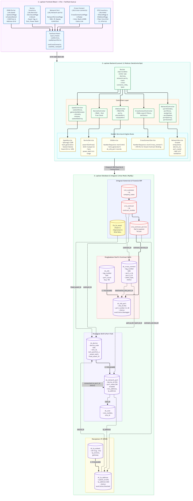

# BEDAH KLASTER 2: JARINGAN, PORT & PENGKABELAN (CONNECTIVITY LAYER)
## Modul: Data Center Operations (DC Ops) — MSDC ERP
**Target Sub-Menu**: Device Inventory (`/dc/devices`), Network Port Management (`/dc/network-ports`), Cross-Connect (`/dc/cross-connects`), OTB Inventory (`/dc/otbs`), IPAM (`/dc/ipam`)

---

## 1. FILOSOFI BISNIS & IDENTIFIKASI MASALAH

Apabila Klaster 1 memodelkan hierarki spasial fisik gedung data center (*spatial containment*), maka **Klaster 2 memodelkan tulang punggung konektivitas aktif, pasif, dan pengalamatan logika (*active hardware, passive cabling, & logical IP addressing*)**.

Di lingkungan pusat data komersial, pencatatan konektivitas tidak dapat direduksi sebagai sekadar "kabel terpasang". Ketiadaan manajemen konektivitas yang granular memicu serangkaian risiko operasional:

1. **Ketidaksinkronan Perangkat Aktif dan Kabel Pasif**: Teknisi lapangan mengonfigurasi jalur serat optik (*Cross-Connect*) atau panel terminasi (*OTB*), namun port antarmuka pada unit server pelanggan tidak tercatat secara presisi, sehingga menyulitkan pelacakan gangguan (*troubleshooting*).
2. **Kekacauan Jalur Kabel (*Cable Spaghetti & Ghost Cables*)**: Kabel penghubung antar-rak yang tidak memiliki nomor tag resmi sering kali ditinggalkan di dalam *cable tray* setelah kontrak pelanggan berakhir, mengakibatkan pemborosan kapasitas jalur kabel fisik.
3. **Tabrakan Alokasi Pengalamatan (*IP Conflict & Blacklisting*)**: Pengelolaan alamat IP tanpa sistem terpadu berisiko memunculkan duplikasi penetapan IP publik atau pengalokasian IP yang masih terikat pada kontrak aktif pelanggan lain.
4. **Pemisahan Catatan Fisik dan Finansial Aset**: Server bernilai ratusan juta rupiah tercatat di ruang data center tanpa terhubung ke sistem pembukuan nilai aset tetap perusahaan (*Fixed Assets*).

Untuk menyelesaikan persoalan tersebut, arsitektur modul DataCenterOps memisahkan konektivitas ke dalam lima lapisan domain terpadu:

- **Perangkat Keras Aktif (*Active Compute & Switching*)**: Server, Core Switch, Router, Firewall, PDU, dan Storage.
- **Port Fisik Perangkat (*Network Interface Ports*)**: Kartu jaringan fisik bawaan perangkat (`eth0`, `sfp-sfpplus1`, `mgmt`) beserta alamat MAC, kecepatan tautan, dan penugasan segmen VLAN.
- **Pengkabelan Pasif Lintas Rak & MMR (*Cross-Connect Cabling*)**: Kabel fisik (UTP Cat6 atau Serat Optik Single-mode/Multi-mode) yang melintasi lorong rak atau menuju *Meet-Me Room* (MMR). Ini merupakan **produk komersial yang dijual dan ditagih bulanan (*recurring fee*) kepada pelanggan**.
- **Panel Terminasi Optik (*Optical Termination Box / OTB*)**: Kotak terminasi berdensitas tinggi yang menampung puluhan hingga ratusan *core* serat optik individual.
- **Pengalamatan Logika (*Logical IP Addressing - IPAM*)**: Pengelolaan blok subnet IPv4/IPv6 publik dan privat beserta alokasi host individual.

---

## 2. ARSITEKTUR FULLSTACK & ALUR KODE END-TO-END

Alur data pada Klaster 2 mengintegrasikan perangkat aktif, pengkabelan pasif, pool IPAM, serta modul komersial CRM dan modul finansial Fixed Assets:

```
[React UI Component] (DeviceListPage / NetworkPortListPage / CrossConnectListPage / OtbListPage / IpamListPage)
       │ (TanStack Query Hooks: useDevices, useNetworkPorts, useCrossConnects, useOtbs, useIpam)
       ▼
[Laravel API Route] (Modules/DataCenterOps/routes/api.php)
       │ (Route Binding & Middleware Auth/Tenant Context)
       ▼
[Controller Layer] (DeviceController / NetworkController / CrossConnectController / OtbController / IpamController)
       │ (Validasi Form Request, Scoped Uniqueness, Formatter)
       ▼
[Service Layer] (DeviceService / NetworkService / CrossConnectService / OtbService / IpamService)
       │ (Slot Free Check, Auto-generate OTB Ports, Binary IP Math, Delete Guards)
       ▼
[Eloquent ORM & MySQL] (dc_device, dc_network_port, dc_vlan, dc_cross_connect, dc_otb, dc_otb_port, dc_ip_subnet, dc_ip_address)
```



### 2.1. Alur 1: Pendaftaran Perangkat & Guard Anti-Tumpuk Slot U
Saat operator mendaftarkan unit server fisik baru ke dalam lemari rak:

1. **Frontend**: Antarmuka `DeviceDetailPage.tsx` mengeksekusi mutasi `useCreateDevice()`.
2. **Endpoint**: `POST /api/v1/data-center-ops/devices`.
3. **Validasi Layanan (`DeviceService::assertSlotFree`)**:
   - Sistem mengalkulasi interval slot fisik: `start_u = rack_position_u` hingga `end_u = start_u + u_height - 1`.
   - Apabila perangkat ditautkan pada kontrak pelanggan tertentu, sistem memverifikasi bahwa slot berada dalam rentang alokasi kontrak yang sah (`RackAllocation` aktif):

```php
$hasValidAlloc = RackAllocation::where('contract_id', $contractId)
    ->where('rack_id', $rackId)
    ->where('start_u', '<=', $startU)
    ->where('end_u', '>=', $endU)
    ->whereIn('status', ['active', 'reserved'])
    ->exists();
```

   - Sistem memastikan tidak ada perangkat fisik lain yang menduduki irisan slot tersebut:

```php
$conflict = Device::where('rack_id', $rackId)
    ->where('id', '!=', $deviceId)
    ->whereNotNull('rack_position_u')
    ->where(function ($q) use ($startU, $endU) {
        $q->where('rack_position_u', '<=', $endU)
          ->where(DB::raw('COALESCE(rack_position_u_end, rack_position_u)'), '>=', $startU);
    })
    ->exists();
if ($conflict) {
    throw new \RuntimeException("Slot U{$startU}-U{$endU} di rak ini sudah ditempati oleh perangkat lain.");
}
```

4. **Penyimpanan**: Perangkat tersimpan pada `dc_device`. Nilai daya listrik (`power_watt`) otomatis teragregasi pada ringkasan beban rak di `RackController::index`.

### 2.2. Alur 2: Manajemen Master Port Jaringan & Keunikan Berlingkup
1. **Frontend**: Pengguna dapat mengelola port fisik baik secara terpusat pada katalog master `/dc/network-ports` (`NetworkPortListPage.tsx`) maupun pada rincian perangkat `/dc/devices/:id`.
2. **Endpoint**:
   - `GET /api/v1/data-center-ops/network-ports` (Katalog terpaginasi dengan relasi `device.site`, `vlan`, dan `connectedToPort`).
   - `POST /api/v1/data-center-ops/devices/{device}/ports` (Registrasi port fisik).
   - `PUT /api/v1/data-center-ops/network-ports/{port}` (Pembaruan kecepatan tautan, MAC, dan IP).
   - `DELETE /api/v1/data-center-ops/network-ports/{port}` (Penghapusan port secara aman).
3. **Integritas Basis Data (`dc_network_port`)**:
   `UNIQUE KEY ('device_id', 'port_name')`  
   Nama port seperti `eth0` atau `mgmt` dapat eksis di ribuan unit perangkat berbeda, namun wajib unik mutlak di dalam unit fisik perangkat yang sama.

4. **Validasi Atribut**: Controller memverifikasi format alamat fisik `mac_address` (standar IEEE 802) dan alamat logika `ip_address` sebelum disimpan ke basis data.

### 2.3. Alur 3: Cross-Connect Lintas Rak & Meet-Me Room
Kabel *Cross-Connect* merepresentasikan produk infrastruktur pasif yang dijual kepada penyewa (*tenant*):

1. **Model Titik Ujung Fleksibel (*Hybrid Endpoints*)**:
   - Sisi Asal (*Side A*): Dapat ditautkan ke port formal `port_a_id` (`dc_network_port`) atau lokasi tekstual bebas `source_location` + `source_port`.
   - Sisi Tujuan (*Side B*): Dapat ditautkan ke port formal `port_b_id`, port terminasi optik internal `destination_otb_port_id` (`dc_otb_port`), atau lokasi luar sistem `destination_location` + `destination_port` (contoh: *MMR Rack 05 - Patch Panel Telkom Port 12*).
2. **Penomoran Otomatis**: Label tag fisik kabel (`tag_number`) digenerasi otomatis oleh `NumberSequence::next('cross_connect')` (contoh: `XC-2026-0042`).
3. **Keterkaitan Komersial**: Ditautkan ke `customer_id`, `contract_id`, dan `contract_service_id` untuk perhitungan penagihan bulanan (*recurring fee*).

### 2.4. Alur 4: Otomasi Pembuatan Port OTB (*Optical Termination Box*)
1. **Registrasi Panel OTB**: Operator mendaftarkan kotak OTB baru dengan kapasitas port fisik (contoh: `port_count = 48` atau `port_count = 256`).
2. **Generasi Otomatis Baris Port (`OtbService::create`)**:
   Sistem mengeksekusi operasi massal (*bulk creation*) di dalam transaksi basis data:

```php
for ($i = 1; $i <= $portCount; $i++) {
    OtbPort::create([
        'organization_id' => $otb->organization_id,
        'otb_id'          => $otb->id,
        'port_number'     => $i,
        'status'          => 'available',
    ]);
}
```

3. **Siklus Hidup Dapat Digunakan Kembali (*Reusable*)**: Saat kontrak penyewa berakhir, metode `OtbService::releasePort()` mengembalikan status port menjadi `available` tanpa menghapus data historisnya.

### 2.5. Alur 5: Kalkulasi Alamat IPAM Biner (`ip2long` & `long2ip`)
Modul IPAM menyediakan manajemen alokasi alamat IP publik dan privat:

1. **Registrasi Subnet**: Operator mendaftarkan blok CIDR (contoh: `103.10.20.0/24`).
2. **Algoritma Translasi Biner Host (`IpamService::generateAddressesForSubnet`)**:
   Untuk subnet IPv4 (dibatasi maksimal prefix `/22` atau 1.024 host per blok):

```php
[$network, $prefixStr] = explode('/', $subnet->cidr);
$prefix = (int) $prefixStr;
$networkLong = ip2long($network);
$hostCount = 2 ** (32 - $prefix); // contoh: 2^(32-24) = 256 alamat

for ($i = 0; $i < $hostCount; $i++) {
    $ip = long2ip($networkLong + $i);
    IpAddress::create([
        'subnet_id'  => $subnet->id,
        'ip_address' => $ip,
        'status'     => 'available',
    ]);
}
```

3. **Alokasi Alamat**: Alamat IP individual dialokasikan ke pelanggan (`customer_id`), perangkat jaringan (`device_id`), atau baris kontrak layanan (`contract_service_id`).

---

## 3. SPESIFIKASI API, VALIDASI & LOGIKA PROTEKSI DATA

### 3.1. Kontrak Endpoint Utama
| Metode | Rute Endpoint | Pengendali (*Controller*) | Fungsi & Akses |
| :---: | :--- | :--- | :--- |
| `GET` | `/api/v1/data-center-ops/devices` | `DeviceController@index` | Katalog seluruh perangkat (*filter rack, site, status*) |
| `POST` | `/api/v1/data-center-ops/devices` | `DeviceController@store` | Pendaftaran server baru (*validasi assertSlotFree*) |
| `GET` | `/api/v1/data-center-ops/network-ports` | `NetworkController@portAllIndex` | Katalog master port jaringan (*eager load device, vlan*) |
| `POST` | `/api/v1/data-center-ops/devices/{device}/ports` | `NetworkController@portStore` | Pendaftaran port fisik (*scoped uniqueness device_id*) |
| `PUT` | `/api/v1/data-center-ops/network-ports/{port}` | `NetworkController@portUpdate` | Pembaruan konfigurasi port fisik (kecepatan, MAC, IP) |
| `DELETE` | `/api/v1/data-center-ops/network-ports/{port}` | `NetworkController@portDestroy` | Penghapusan port fisik (*clean release interconnect*) |
| `GET` | `/api/v1/data-center-ops/cross-connects` | `CrossConnectController@index` | Katalog kabel cross-connect (*search tag, lokasi*) |
| `POST` | `/api/v1/data-center-ops/cross-connects` | `CrossConnectController@store` | Registrasi cross-connect (*auto tag, link CRM*) |
| `GET` | `/api/v1/data-center-ops/otbs` | `OtbController@index` | Katalog panel OTB beserta ringkasan port status |
| `POST` | `/api/v1/data-center-ops/otbs` | `OtbController@store` | Pembuatan OTB dan auto-generate port optik |
| `GET` | `/api/v1/data-center-ops/ipam/subnets` | `IpamController@subnetIndex` | Katalog blok subnet CIDR (*withCount addresses*) |
| `POST` | `/api/v1/data-center-ops/ipam/subnets/{id}/generate` | `IpamController@generateAddresses` | Generasi host IP individual berbasis matematika biner |
| `DELETE` | `/api/v1/data-center-ops/ipam/subnets/{subnet}` | `IpamController@subnetDestroy` | Penghapusan subnet (*Delete Guard: Error 409*) |

### 3.2. Integrasi ke Modul Finansial Fixed Assets (`fin_fa_asset`)
Di dalam sistem MSDC ERP, perangkat server memiliki dua dimensi pencatatan:

- **Dimensi Operasional Fisik (DataCenterOps - Team 3)**: Menunjukkan posisi letak rak, nomor slot U, penyerapan daya listrik, dan port jaringan aktif.
- **Dimensi Akuntansi Finansial (Fixed Asset Management - Team 4)**: Menunjukkan tanggal perolehan, harga beli (*purchase cost*), metode penyusutan (*depreciation*), masa manfaat, dan akumulasi nilai buku (*book value*).

Kolom `dc_device.fixed_asset_id` menghubungkan kedua dimensi tersebut, memungkinkan tim audit keuangan melakukan pemeriksaan fisik (*stock opname*) secara langsung berdasarkan lokasi rak di ruang server.

### 3.3. Perlindungan Penghapusan Subnet (*Subnet Delete Guard*)
Menghapus blok subnet yang masih memiliki alamat IP terpakai dapat memutuskan rute jaringan dan kontrak layanan pelanggan aktif.

Pada metode `IpamService::deleteSubnet()`:

```php
$activeAllocations = $subnet->addresses()
    ->whereIn('status', ['allocated', 'reserved'])
    ->count();

if ($activeAllocations > 0) {
    throw new \RuntimeException(
        "Subnet '{$subnet->cidr}' masih memiliki {$activeAllocations} alamat IP yang sedang digunakan atau dicadangkan. Lepas alokasi alamat terlebih dahulu sebelum menghapus subnet."
    );
}
```

Penghapusan hanya diizinkan apabila seluruh alamat IP di dalam subnet tersebut sudah berstatus `available`.

---

## 4. BANK PERTANYAAN & JAWABAN SIDANG PENGUJI

### Q1: Apa perbedaan mendasar antara Port Jaringan Fisik (`dc_network_port`) dan Kabel Cross-Connect (`dc_cross_connect`) dalam arsitektur sistem ini?
**Jawaban Akademik**:
> "Keduanya merepresentasikan lapisan infrastruktur yang berbeda. Entitas `dc_network_port` merepresentasikan antarmuka fisik bawaan (*Network Interface Card / SFP port*) yang melekat secara permanen pada unit perangkat tertentu (contohnya port `eth0` pada server tertentu), yang mencatat atribut internal seperti MAC address, kecepatan tautan, dan penugasan VLAN. Sedangkan `dc_cross_connect` merepresentasikan kabel pasif antar-rak atau kabel dari rak penyewa menuju *Meet-Me Room (MMR)* milik operator telekomunikasi eksternal. Secara bisnis, Cross-Connect adalah produk komersial yang dijual dan ditagih berkala (*recurring fee*) kepada pelanggan, sedangkan Network Port merupakan komponen pembentuk topologi lokal perangkat."

### Q2: Bagaimana sistem memastikan dua server fisik tidak dipasang tumpang tindih (*overlap*) pada slot U yang sama di dalam satu rak?
**Jawaban Akademik**:
> "Sistem menerapkan validasi interval matematis pada metode `DeviceService::assertSlotFree()`. Server di pusat data umumnya berukuran lebih dari 1U (misalnya server berukuran 2U atau 4U). Sistem menghitung rentang slot yang dibutuhkan: dari `start_u = rack_position_u` hingga `end_u = start_u + u_height - 1`. Sebelum penyimpanan dieksekusi, sistem menjalankan *query* basis data untuk memastikan tidak ada perangkat lain di rak tersebut yang memiliki irisan interval $[A_1, A_2] \cap [B_1, B_2] \neq \emptyset$. Jika terdeteksi irisan slot dengan perangkat lain yang sudah terpasang, sistem langsung membatalkan transaksi dengan melempar `RuntimeException` sehingga tata letak rak fisik tetap konsisten."

### Q3: Mengapa entitas `dc_device` memiliki relasi foreign key ke tabel `fin_fa_asset` milik modul Fixed Assets (Keuangan)?
**Jawaban Akademik**:
> "Berdasarkan kerangka kerja tata kelola IT Enterprise (seperti ITIL Service Transition), pengelolaan aset fisik wajib selaras dengan akuntansi aset tetap perusahaan (*Financial Asset Management*). Perangkat keras bernilai tinggi merupakan aset modal yang mengalami penyusutan nilai buku setiap periode akuntansi. Dengan mengaitkan `dc_device.fixed_asset_id` ke tabel `fin_fa_asset` (Team 4 Keuangan), sistem menyatukan data operasional fisik (letak rak dan status operasional) dengan data akuntansi (nilai perolehan, masa manfaat, dan metode depresiasi), mempermudah audit kepatuhan aset dan rekonsiliasi perpajakan."

### Q4: Bagaimana cara kerja algoritma pembuatan port OTB dan pembuatan host IP pada modul IPAM?
**Jawaban Akademik**:
> "Untuk modul OTB, saat operator mendaftarkan kotak OTB baru dengan parameter kapasitas `port_count = 48`, metode `OtbService::create()` secara otomatis mengeksekusi operasi transaksi massal untuk membuat 48 baris data anak di tabel `dc_otb_port` dengan nomor urut 1 sampai 48 berstatus `available`. Untuk modul IPAM, sistem menerapkan algoritma translasi biner alamat IP: metode `IpamService::generateAddressesForSubnet()` memecah notasi CIDR (misalnya `103.10.20.0/24`), mengubah IP jaringan awal menjadi integer 32-bit menggunakan fungsi `ip2long()`, menghitung total host $2^{(32 - \text{prefix})}$, lalu melakukan perulangan untuk men-generate seluruh alamat IP individual menggunakan `long2ip()`. Alamat IP yang ter-generate siap dialokasikan secara granular ke pelanggan atau antarmuka server."

### Q5: Mengapa penghapusan Subnet pada modul IPAM dijaga oleh mekanisme Delete Guard yang mengembalikan error HTTP 409?
**Jawaban Akademik**:
> "Alamat IP publik di pusat data merupakan sumber daya krusial yang terikat langsung pada konfigurasi *routing*, sistem domain (*DNS*), serta perjanjian kontrak aktif pelanggan. Apabila penghapusan berantai (*cascade delete*) diizinkan secara bebas, seluruh riwayat pemakaian IP pelanggan akan musnah dan berpotensi menimbulkan gangguan operasional jaringan berskala luas. Oleh karena itu, metode `IpamService::deleteSubnet()` mengaudit status alokasi: jika masih terdapat alamat IP di dalam subnet tersebut yang berstatus `allocated` atau `reserved`, transaksi dibatalkan seketika dengan status HTTP 409 Conflict. Penghapusan subnet hanya diizinkan apabila seluruh alamat IP di dalamnya sudah berstatus `available` (bersih dari alokasi pelanggan)."
