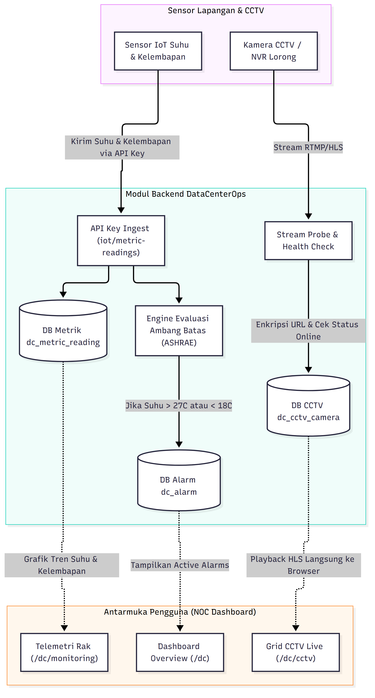

# BEDAH KLASTER 3: TELEMETRI RAK & PENGAWASAN CCTV DATA CENTER
## Modul: Data Center Operations (DC Ops) — MSDC ERP
**Target Sub-Menu**: Dashboard Utama DC (`/dc`), Telemetri Rak & ASHRAE TC 9.9 (`/dc/monitoring`), Pemantauan CCTV Lorong & Rak (`/dc/cctv`)

---

## 1. FILOSOFI BISNIS & IDENTIFIKASI MASALAH

Klaster 3 memodelkan fungsi operasional *Network Operations Center* (NOC) 24×7, yang bertugas menjaga ketersediaan tinggi (*High Availability*) infrastruktur data center, memitigasi risiko kegagalan perangkat keras sebelum terjadi *downtime*, dan memberikan pengawasan visual lorong rak secara *real-time*.

Di dalam pusat data berstandar *enterprise*, terdapat beberapa permasalahan kritis yang menuntut otomasi pengawasan:
1. **Keterbatasan Fisik Personel NOC**: Operator tidak dapat terus-menerus berada di dalam ruang server yang bersuhu dingin ($18^\circ\text{C}$) dan bising (>75 dB) akibat deru kipas pendingin.
2. **Kekeliruan Paradigma Pendinginan Lingkungan**: Terdapat miskonsepsi umum bahwa ruang data center harus dibuat sedingin mungkin. Secara termodinamika fisika, temperatur yang terlalu dingin justru memicu kondensasi uap air yang menyebabkan korsleting listrik (*short circuit*), sedangkan kelembapan yang terlalu kering memicu listrik statis (*Electrostatic Discharge / ESD*) yang merusak mikroprosesor.
3. **Banjir Alarm Palsu (*Alarm Fatigue*)**: Sensor IoT yang mengirimkan data anomali setiap beberapa detik dapat membanjiri kotak masuk email operator dengan ribuan notifikasi duplikat jika tidak dilengkapi mekanisme deduplikasi.
4. **Beban Komputasi Streaming CCTV**: Mengalirkan video pengawasan resolusi tinggi melalui server aplikasi web backend dapat menghabiskan *bandwidth* jaringan dan memicu kehabisan memori (*out of memory*) pada server PHP-FPM.

Untuk mengatasi tantangan tersebut, Klaster 3 mengadopsi konsep **Segitiga Pertahanan NOC**:
- **Radar Makro (Dashboard `/dc`)**: Memberikan visualisasi ringkasan kapasitas fasilitas, total beban listrik (kW), matriks insiden aktif, serta daftar petugas piket yang sedang bertugas (*Staff On-Duty*).
- **Saraf Sensorik (Telemetri `/dc/monitoring`)**: Memantau suhu dan kelembapan rak berbasis standar termal internasional ASHRAE TC 9.9 menggunakan ambang batas ganda (*Dual Thresholds*).
- **Mata Visual (Pengawasan CCTV `/dc/cctv`)**: Melakukan verifikasi visual jarak jauh (*Remote Hands efficiency*) terhadap kondisi fisik lorong rak tanpa perlu membuka pintu fisik ruang server.

### 1.1. Standar Termal ASHRAE TC 9.9 & Ambang Batas Ganda (*Dual Thresholds*)
Mengacu pada pedoman termal internasional **ASHRAE TC 9.9**, sistem menetapkan ambang batas ganda (*Dual Bounds*) untuk parameter suhu dan kelembapan:

$$\text{Lower Critical} < \text{Lower Warning} \le \text{Kondisi Ideal} \le \text{Upper Warning} < \text{Upper Critical}$$

| Parameter Lingkungan | Rentang Nilai | Status Sistem | Analisis Risiko Termal & Kerusakan Fisik |
| :--- | :---: | :---: | :--- |
| **Suhu Terlalu Dingin** | $< 18,0^\circ\text{C}$ | ⚠️ *Warning / Critical* | **Kondensasi Uap Air**: Udara dingin yang bertemu komponen aktif panas mengembun menjadi butiran air, memicu korsleting listrik. |
| **Suhu Rekomendasi (Ideal)** | $18,0^\circ\text{C} - 27,0^\circ\text{C}$ | 🟢 *Normal* | Titik efisiensi termal tertinggi prosesor dan efisiensi energi pendingin (*PUE - Power Usage Effectiveness*). |
| **Suhu Peringatan (*Warning*)** | $27,1^\circ\text{C} - 30,0^\circ\text{C}$ | ⚠️ *Warning* | Beban pendingin presisi (*CRAC/PAC*) meningkat; kipas pendingin server berputar maksimal (100% RPM). |
| **Suhu Panas Ekstrem (*Critical*)** | $> 30,0^\circ\text{C}$ | 🔴 *Critical* | Terjadi *thermal throttling* (penurunan *clock* CPU) hingga *emergency shutdown* otomatis untuk mencegah silikon chip meleleh. |
| **Kelembapan Kering Ekstrem** | $< 40\%$ RH (Kritis: $<20\%$) | 🔴 *Critical* | **Listrik Statis (ESD - Electrostatic Discharge)**: Udara kering memicu lonjakan muatan statis dari gesekan udara yang dapat membakar *microchip*. |
| **Kelembapan Basah Ekstrem** | $> 60\%$ RH (Kritis: $>70\%$) | 🔴 *Critical* | **Korosi & Jamur**: Tingkat uap air tinggi memicu karat pada pin konektor tembaga, papan sirkuit, dan konektor serat optik. |

---

## 2. ARSITEKTUR FULLSTACK & ALUR KODE END-TO-END

Alur data telemetri dan CCTV memisahkan secara tegas antara jalur kontrol (*Control Plane*) dan jalur transmisi video (*Data Plane*):

```
[Hardware Sensor IoT / Kamera CCTV]
       │ (IoT: Ingest HTTP JSON via X-API-Key | CCTV: RTMP Stream Push)
       ▼
[Laravel Backend: API Routes] (Modules/DataCenterOps/routes/api.php)
       │ (ApiKeyMiddleware / Auth Passport / SSRF Protection)
       ▼
[Controller Layer] (MonitoringController / CctvCameraController / DashboardController)
       │ (Format DTO, Deduplication Check, Enkripsi AES-256)
       ▼
[Service Layer] (MonitoringService / CctvStreamProbeService / DashboardService)
       │ (Evaluasi Hierarki Ambang Batas, Probe ffprobe HLS, Shift Schedule Match)
       ▼
[Database & External Media Server] (dc_metric_reading, dc_alarm, dc_cctv_camera, Server SRS JTV)
```



### 2.1. Alur 1: Ingest Sensor IoT & Evaluasi Ambang Batas Ganda
1. **Sensor Perangkat Keras**: Mikrokontroler (ESP32/DHT22) mengirimkan pembacaan metrik ke `POST /api/v1/data-center-ops/iot/metric-readings`.
2. **Autentikasi Mesin (*M2M Auth*)**: Rute diproteksi oleh `ApiKeyMiddleware` melalui header `X-API-Key`. Kunci API divalidasi ke modul CorePlatform dan diikat pada organisasi terkait tanpa memerlukan token sesi pengguna (*JWT-less*).
3. **Penyimpanan Metrik**: Metode `MonitoringService::recordReading()` mencatat sampel ke tabel `dc_metric_reading`.
4. **Evaluasi Ambang Batas (`MonitoringService::evaluateThreshold`)**:
   - Sistem memeriksa hierarki ambang batas: Perangkat (*Device-Specific*) $\rightarrow$ Rak (*Rack-Specific*) $\rightarrow$ Site (*Site-Specific*) $\rightarrow$ Global.
   - Evaluasi ambang batas ganda mengecek apakah nilai berada di bawah `lower_critical` / `lower_warning` atau di atas `upper_warning` / `upper_critical`.
   - **Deduplikasi Alarm**: Jika anomali terdeteksi, sistem memeriksa apakah sudah terdapat alarm aktif berstatus `open` untuk metrik dan entitas yang sama. Tiket alarm baru pada `dc_alarm` hanya dibuat jika belum ada alarm terbuka, mencegah terjadinya banjir email notifikasi.

### 2.2. Alur 2: Streaming CCTV Berlatensi Rendah (*Zero-Trust Stream Architecture*)
1. **Transcoding Server Media**: Kamera fisik mengirimkan *stream* RTMP lokal ke Server CCTV internal (SRS / MediaMTX), yang mengonversi aliran video ke format modern *HTTP Live Streaming* (HLS `.m3u8`).
2. **Pendaftaran Kamera & Pengujian Probe (`CctvCameraController::testConnection`)**:
   - Sistem memvalidasi URL dan menjalankan *SSRF Protection* untuk memblokir alamat IP lokal terlarang dan alamat *cloud metadata* (`169.254.169.254`).
   - Layanan `CctvStreamProbeService` menjalankan *probe* (via `ffprobe` atau HTTP HEAD) untuk memverifikasi ketersediaan sinyal video, resolusi, dan codec H.264.
3. **Enkripsi Kredensial URL**: URL sumber otentikasi kamera dienkripsi menggunakan algoritma simetris AES-256 (`Crypt::encryptString`) sebelum disimpan pada kolom `dc_cctv_camera.source_url`.
4. **Pemutaran pada Antarmuka**: Frontend menggunakan pustaka `Hls.js` yang memutar video langsung dari Server CCTV tanpa membebani server aplikasi Laravel. Untuk menjaga kestabilan memori browser, antarmuka membatasi pemutaran aktif maksimal 4 kamera (`MAX_ACTIVE_PLAYERS = 4`).

### 2.3. Alur 3: Integrasi Petugas Piket (*HR Shift Schedule*)
1. **Permintaan Dashboard**: Komponen Dashboard memanggil `GET /api/v1/data-center-ops/dashboard/on-duty-today`.
2. **Penyelarasan Lintas Modul**: Metode `DashboardService::onDutyToday($siteId)` melakukan *query* ke tabel `hr_shift_schedule` (modul HR Service Support) untuk mencocokkan jadwal dinas aktif pada tanggal berjalan (`schedule_date = today`).
3. **Eager Loading Karyawan**: Sistem memuat nama teknisi, foto profil, nomor kontak darurat, serta jumlah tiket operasional yang sedang ditangani oleh petugas bersangkutan.

---

## 3. SPESIFIKASI API, VALIDASI & LOGIKA PROTEKSI DATA

### 3.1. Kontrak Endpoint Utama
| Metode | Rute Endpoint | Pengendali (*Controller*) | Fungsi & Akses |
| :---: | :--- | :--- | :--- |
| `GET` | `/api/v1/data-center-ops/dashboard` | `DashboardController@index` | Ringkasan makro kapasitas, insiden aktif, utilisasi daya |
| `GET` | `/api/v1/data-center-ops/dashboard/on-duty-today` | `DashboardController@onDutyToday` | Daftar petugas piket NOC hari ini (*integrasi HR*) |
| `POST` | `/api/v1/data-center-ops/iot/metric-readings` | `MonitoringController@iotRecordReading` | Ingest data telemetri sensor IoT (*Header: X-API-Key*) |
| `GET` | `/api/v1/data-center-ops/monitoring/telemetry/all-racks-summary` | `MonitoringController@allRacksTelemetrySummary` | Agregat metrik seluruh rak beserta status alarm kritis |
| `GET` | `/api/v1/data-center-ops/monitoring/alarms` | `MonitoringController@alarmIndex` | Daftar insiden alarm aktif (*open, acknowledged, resolved*) |
| `POST` | `/api/v1/data-center-ops/cctv-cameras/test` | `CctvCameraController@testConnection` | Uji konektivitas probe video HLS (*SSRF Protection*) |
| `GET` | `/api/v1/data-center-ops/cctv-cameras` | `CctvCameraController@index` | Katalog kamera CCTV lorong rak (*Resource tanpa source_url*) |

### 3.2. Deduplikasi Alarm (*Alarm Storm Prevention*)
Mekanisme deduplikasi pada `MonitoringService::evaluateThreshold()` mencegah terjadinya banjir notifikasi:
```php
$existingAlarm = Alarm::where('site_id', $reading->site_id)
    ->where('rack_id', $reading->rack_id)
    ->where('metric_type', $reading->metric_type)
    ->where('status', 'open')
    ->first();

if (! $existingAlarm) {
    Alarm::create([
        'organization_id' => $reading->organization_id,
        'site_id'         => $reading->site_id,
        'rack_id'         => $reading->rack_id,
        'metric_type'     => $reading->metric_type,
        'severity'        => $severity,
        'trigger_value'   => $reading->value,
        'status'          => 'open',
    ]);
    NotificationService::sendAlertEmail(...);
}
```

### 3.3. Keamanan Aliran Video (*Zero-Trust Stream Security*)
Kredensial kamera yang tersimpan pada `source_url` (berisi kata sandi kamera lokal) diisolasi secara ketat:
1. Kolom `source_url` dienkripsi pada tingkat *database record*.
2. Pada lapisan presentasi, `CctvCameraResource` secara eksplisit membuang atribut `source_url` dari respon JSON dan hanya menyediakan `playback_url` publik.
3. Fitur *probe* memblokir alamat IP *private loopback* dan alamat metadata layanan cloud (`169.254.169.254`) guna mencegah eksploitasi *Server-Side Request Forgery* (SSRF).

---

## 4. BANK PERTANYAAN & JAWABAN SIDANG PENGUJI

### Q1: Mengapa sistem pemantauan suhu rak memiliki ambang batas bawah (*lower threshold*), bukankah ruang server lebih bagus jika semakin dingin?
**Jawaban Akademik**:
> "Berdasarkan standar termal internasional ASHRAE TC 9.9, temperatur ruang server yang terlalu dingin (< $18^\circ\text{C}$) sangat berbahaya karena memicu kondensasi uap air. Ketika udara dingin bersentuhan dengan permukaan papan induk (*motherboard*) server yang hangat, uap air akan mengembun menjadi butiran air yang dapat menimbulkan korsleting listrik fatal. Selain itu, kelembapan udara yang terlalu rendah (< 40% RH) memicu timbulnya muatan listrik statis (*Electrostatic Discharge / ESD*) yang mampu merusak mikroprosesor silikon. Oleh karena itu, sistem menerapkan Ambang Batas Ganda (*Dual Thresholds*) yang mengawasi batas bawah dan batas atas secara seimbang."

### Q2: Bagaimana mekanisme autentikasi sensor perangkat keras IoT saat mengirim data metrik ke server backend?
**Jawaban Akademik**:
> "Sensor IoT di lapangan (seperti mikrokontroler ESP32 atau probe SNMP) tidak menggunakan token sesi pengguna (*JWT*) karena merupakan entitas mesin (*Machine-to-Machine*). Sistem menyediakan rute khusus `POST /api/v1/data-center-ops/iot/metric-readings` yang diproteksi menggunakan `ApiKeyMiddleware` melalui header `X-API-Key`. Kunci API diverifikasi terhadap tabel otentikasi CorePlatform dan dipetakan langsung ke ID organisasi terkait, sehingga pengiriman data telemetri berjalan aman, ringan, dan terisolasi antartenant."

### Q3: Mengapa aliran video CCTV tidak dialirkan (*streaming*) langsung melewati server backend Laravel?
**Jawaban Akademik**:
> "Arsitektur sistem memisahkan secara tegas antara jalur kontrol (*Control Plane*) dan jalur transmisi video (*Data Plane*). Mengalirkan video resolusi tinggi melewati proses PHP Laravel akan menghabiskan lebar pita jaringan (*bandwidth*), membebani pemrosesan CPU PHP-FPM, dan memicu latensi tinggi. Backend Laravel hanya bertindak sebagai *Control Plane* yang mengelola perizinan, pengujian konektivitas probe, dan enkripsi kredensial. Sedangkan *Data Plane* dialirkan langsung dari Server Media CCTV internal ke peramban web pengguna menggunakan protokol modern *HTTP Live Streaming* (HLS `.m3u8`) yang dirender secara efisien oleh pustaka `Hls.js`."

### Q4: Bagaimana sistem mencegah banjir alarm (*alarm storm*) jika sensor IoT terus-menerus melaporkan suhu kritis setiap satu menit?
**Jawaban Akademik**:
> "Sistem menerapkan algoritma Deduplikasi Alarm pada metode `MonitoringService::evaluateThreshold()`. Sebelum alarm baru diterbitkan, sistem memverifikasi apakah sudah terdapat alarm aktif dengan jenis metrik dan lokasi rak yang sama yang masih berstatus `open`. Jika alarm terbuka sudah ada, sistem tidak akan menerbitkan tiket duplikat maupun mengirimkan email notifikasi berulang, melainkan membiarkan tiket insiden tersebut tetap aktif hingga operator NOC melakukan konfirmasi (*Acknowledge*) dan penyelesaian (*Resolve*)."
