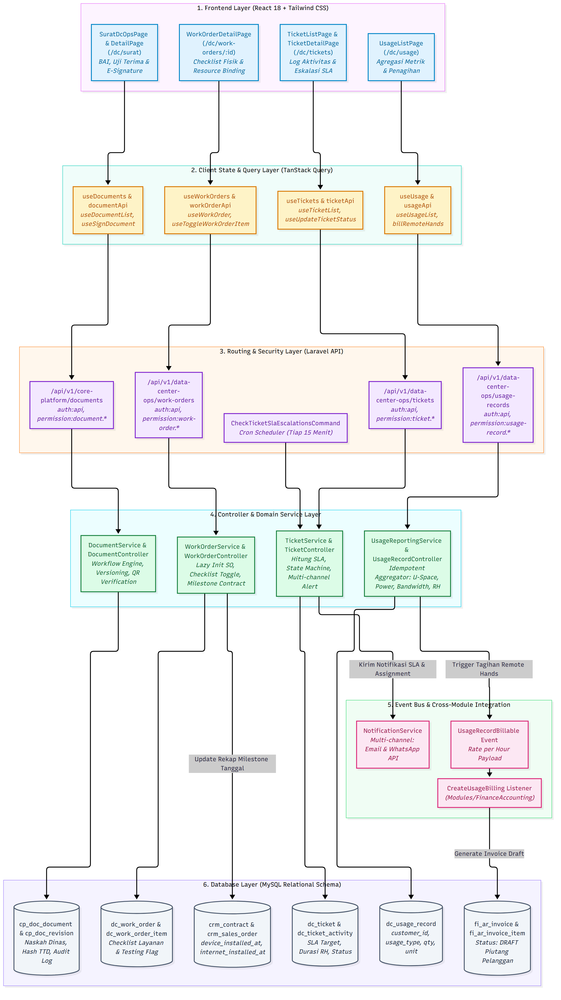

# KLASTER 4: OPERASIONAL & ADMINISTRASI HARIAN (OPERATIONS & WORKFLOW)


*Gambar 4.1: Arsitektur Alur Data Fullstack Klaster 4 (Operasional & Administrasi Harian).*

---

## 1. FILOSOFI BISNIS & IDENTIFIKASI MASALAH

### 1.1. Peran Strategis Operasional Harian dalam Industri Data Center
Operasional pusat data (*data center*) komersial tidak hanya bertumpu pada keandalan infrastruktur fisik dan telemetri perangkat, melainkan juga pada efisiensi alur kerja administratif dan ketepatan eksekusi teknis harian. Layanan *colocation* berstandar *enterprise* mewajibkan kepatuhan ketat terhadap *Service Level Agreement* (SLA), pencatatan jam kerja penanganan teknis (*remote hands*), transparansi utilisasi daya dan ruang, serta legalitas administrasi melalui berita acara resmi. 

Klaster 4 (Operasional & Administrasi Harian) mengintegrasikan empat pilar proses bisnis utama:
1. **Manajemen Tiket Insiden & Layanan Teknis (*Tickets & Remote Hands*)**: Pengelolaan gangguan dan permintaan bantuan teknisi fasilitas (*smart hands / remote hands*) dengan pelacakan tenggat waktu respon dan penyelesaian berdasarkan kontrak SLA pelanggan.
2. **Perintah Kerja Lapangan (*Work Orders*)**: Penjabaran pesanan penjualan (*sales order*) dari modul CRM menjadi daftar periksa (*checklist*) instalasi perangkat fisik, penarikan kabel *cross-connect*, pengalokasian alamat IP, hingga tahap pengujian akhir (*commissioning*).
3. **Pencatatan Utilisasi & Tagihan (*Usage Records & Billing*)**: Agregasi data konsumsi *rack space*, daya listrik (*power* rata-rata kW), *bandwidth*, dan jam kerja *remote hands* secara bulanan yang terintegrasi secara otomatis ke modul *Finance & Accounting* sebagai draf faktur piutang (*Accounts Receivable Invoice*).
4. **Tata Naskah & Dokumen Operasional DC (*Operational Letters & Deeds*)**: Penerbitan dan pengarsipan naskah dinas resmi, seperti Berita Acara Instalasi (BAI), Berita Acara Uji Terima (BAUT), dan Surat Izin Kerja Teknisi, yang dilengkapi alur persetujuan (*approval workflow*) bertingkat serta tanda tangan digital ganda berbasis verifikasi kode QR publik.

---

### 1.2. Identifikasi Masalah Riil Industri & Dampak Ketiadaan Sistem
Ketiadaan sistem terpadu yang menjembatani operasional lapangan dengan administrasi korporat menimbulkan berbagai risiko fatal:
- **Pelanggaran SLA Tanpa Mitigasi (*Unmonitored SLA Breaches*)**: Tiket gangguan yang dicatat secara manual melalui pesan instan sering kali terabaikan tanpa peringatan dini. Hal ini memicu denda penalti finansial (*SLA penalty credits*) dan kerugian reputasi akibat lambatnya waktu respon (*response time*) maupun resolusi (*resolution time*).
- **Kebocoran Pendapatan Teknis (*Unbilled Remote Hands Leakage*)**: Teknisi data center kerap kali melakukan tindakan fisik (seperti *reboot server*, penggantian kabel *patch cord*, atau inspeksi indikator LED) tanpa pencatatan durasi kerja terstandar. Akibatnya, jam kerja teknisi tidak dapat ditagihkan kepada pelanggan (*unbilled billable hours*), menimbulkan kerugian operasional ribuan dolar per bulan.
- **Kesenjangan antara Penjualan CRM dan Realisasi Lapangan (*Provisioning Gap*)**: Staf pemasaran sering kali menandai pesanan penjualan (*sales order*) telah selesai tanpa verifikasi apakah rak telah dipasang, kabel telah disambungkan, dan perangkat telah diuji. Ketiadaan *Work Order* berbasis *milestone* membuat status kontrak aktif prematur sebelum fasilitas siap digunakan.
- **Sengketa Tagihan Pemakaian (*Billing Disputes*)**: Perhitungan pemakaian listrik dan *bandwidth* yang dihitung secara manual rentan manipulasi atau kesalahan humanis. Sistem memerlukan agregasi data telemetri berbasis pembagian proporsional *U-space* yang transparan dan dapat diaudit (*audit-proof*).
- **Ketiadaan Validitas Yuridis (*Legal Repudiation*)**: Berita acara fisik berbasis kertas rawan hilang, dipalsukan, atau rusak. Dokumen administratif harus terikat secara kriptografis pada sistem pusat dan dapat diverifikasi keasliannya oleh auditor keamanan maupun petugas pos jaga satpam melalui pemindaian kode QR instan.

---

### 1.3. Pemodelan Entitas dan Relasi Data
Hubungan relasional antar-tabel dalam basis data Klaster 4 dirancang sebagai berikut:
- Entitas `dc_ticket` memiliki relasi *one-to-many* ke `dc_ticket_activity`. Setiap tiket berelasi secara opsional (*nullable foreign key*) ke `crm_customer`, `crm_contract`, `crm_contract_service`, `crm_sla`, `dc_site`, dan `dc_device`.
- Entitas `dc_work_order` bertindak sebagai penghubung antara `crm_sales_order` (1:1) dan `crm_contract` (1:1). `dc_work_order` memiliki relasi *one-to-many* ke `dc_work_order_item`. Masing-masing item layanan berelasi ke `crm_contract_service` dan secara langsung menautkan inventaris `dc_device`, `dc_cross_connect`, dan `dc_ip_address`.
- Entitas `dc_usage_record` menampung catatan utilisasi bulanan per `customer_id`, `site_id`, `usage_type`, `period_month`, dan `period_year` dengan status siklus hidup (`draft`, `sent_to_finance`, `billed`).
- Entitas `cp_doc_document` menampung naskah dinas dengan identifikasi modul `module_code = 'data-center-ops'`, terikat pada siklus revisi `cp_doc_revision`, dan riwayat persetujuan *workflow engine*.

---

## 2. ARSITEKTUR FULLSTACK & ALUR KODE END-TO-END

### 2.1. Alur Manajemen Tiket, Pelacakan SLA, dan Eskalasi Multi-Channel
Siklus hidup tiket dirancang menggunakan mesin status (*state machine*) ketat yang membedakan status tiket baru, pemeliharaan, penundaan konfirmasi pelanggan, penyelesaian, hingga penutupan permanen.

```
React UI (TicketListPage/TicketDetailPage)
       │
       ▼ (HTTP POST /v1/data-center-ops/tickets)
TicketController::store() / logActivity() / updateStatus()
       │
       ▼
TicketService
  ├── Hitung SLA Response & Resolution Due At (dari crm_sla)
  ├── Generate Nomor Tiket Otomatis (Format: TCK-YYYYMM-XXXX)
  ├── Catat Log Aktivitas (dc_ticket_activity) & Durasi (duration_minutes)
  └── Notifikasi Multi-Channel (Email & WhatsApp via NotificationService)
       │
       ▼
CheckTicketSlaEscalationsCommand (Cron Tiap 15 Menit)
  ├── Evaluasi is_response_overdue & is_resolution_overdue
  ├── Throttling Notifikasi Eskalasi (4 Jam)
  └── Kirim Notifikasi Eskalasi ke Engineer Bertugas
```

#### Cuplikan Kode Backend: Resolusi SLA dan Penutupan Tiket (`TicketService.php`)
```php
public function create(array $data): Ticket
{
    $orgId = $this->resolveOrgFromData($data);

    // Resolusi SLA: Diutamakan dari sla_id langsung, contract_id, atau kontrak aktif pelanggan
    $sla = null;
    if (! empty($data['sla_id'])) {
        $sla = Sla::find($data['sla_id']);
    } elseif (! empty($data['contract_id'])) {
        $sla = Sla::where('contract_id', $data['contract_id'])->latest('id')->first();
    } elseif (! empty($data['customer_id'])) {
        $sla = Sla::whereHas('contract', fn ($q) => $q
            ->where('customer_id', $data['customer_id'])
            ->where('status', 'active'))
            ->latest('id')
            ->first();
    }

    $now = now();
    $responseDue = $sla?->response_time_minutes ? $now->copy()->addMinutes($sla->response_time_minutes) : null;
    $resolutionDue = $sla?->resolution_time_hours ? $now->copy()->addHours($sla->resolution_time_hours) : null;

    return DB::transaction(function () use ($data, $sla, $responseDue, $resolutionDue, $orgId) {
        $ticketType = $data['ticket_type'] ?? 'incident';

        $ticket = Ticket::create([
            'ticket_number'           => $this->generateTicketNumber(),
            'customer_id'            => $data['customer_id'] ?? null,
            'contract_id'            => $data['contract_id'] ?? null,
            'contract_service_id'    => $data['contract_service_id'] ?? null,
            'site_id'                => $data['site_id'] ?? null,
            'device_id'              => $data['device_id'] ?? null,
            'sla_id'                 => $sla?->id,
            'ticket_type'            => $ticketType,
            'priority'               => $data['priority'] ?? 'medium',
            'subject'                => $data['subject'],
            'description'            => $data['description'] ?? null,
            'status'                 => $ticketType === 'maintenance' ? 'maintenance' : 'trouble',
            'assigned_to'            => $data['assigned_to'] ?? null,
            'sla_response_due_at'   => $responseDue,
            'sla_resolution_due_at'  => $resolutionDue,
            'created_by'            => $data['created_by'] ?? null,
            'organization_id'       => $orgId,
        ]);

        $ticket->activities()->create([
            'organization_id' => $orgId,
            'activity_type'   => 'comment',
            'description'     => 'Ticket dibuat.',
            'performed_by'    => $data['created_by'] ?? null,
            'performed_at'    => now(),
        ]);

        return $ticket->fresh();
    });
}
```

Saat penutupan tiket, sistem mewajibkan pengisian `resolution_action` sebagai catatan pertanggungjawaban teknis dan mengunci tiket agar tidak dapat dimanipulasi:
```php
public function updateStatus(Ticket $ticket, string $status, ?int $performedBy = null, ?string $resolutionAction = null): Ticket
{
    if ($ticket->status === 'closed') {
        throw new \RuntimeException("Ticket '{$ticket->ticket_number}' sudah closed, tidak bisa diubah statusnya lagi.");
    }
    if ($status === 'closed' && ! $resolutionAction && ! $ticket->resolution_action) {
        throw new \InvalidArgumentException("Tindakan yang dilakukan (resolution action) wajib diisi untuk menutup ticket.");
    }

    $updateData = ['status' => $status];
    if (! $ticket->first_response_at) {
        $updateData['first_response_at'] = now();
    }
    if ($status === 'normal' && ! $ticket->resolved_at) {
        $updateData['resolved_at'] = now();
    }
    if ($status === 'closed') {
        $updateData['closed_at'] = now();
        $updateData['resolution_action'] = $resolutionAction;
    }

    $ticket->update($updateData);
    return $ticket->fresh();
}
```

---

### 2.2. Alur Perintah Kerja (*Work Order*) dan Rekonsiliasi Kontrak Dinamis
Perintah Kerja (*Work Order*) menjembatani *Sales Order* aktif dengan implementasi fisik di lapangan. Pembuatan *Work Order* menggunakan pola *lazy initialization*: berkas dibuat otomatis saat staf operasional membuka rincian pesanan pertama kali.

```
CRM Sales Order (Status: Active)
       │
       ▼ (Buka Halaman /dc/work-orders/:id)
WorkOrderController::show() -> WorkOrderService::findOrCreateForSalesOrder()
  ├── Buat dc_work_order (status: open)
  ├── Iterasi ContractService -> Buat dc_work_order_item (item_type: service)
  └── Sisipkan 1 Item Pengujian Terminal (item_type: testing)
       │
       ▼ (Teknisi Eksekusi Fisik & Centang Selesai di UI)
WorkOrderController::toggleItem() -> WorkOrderService::toggleItem()
  ├── Update is_completed, completed_at, completed_by
  ├── Rekomputasi Milestone Kontrak (recomputeContractDates)
  │     ├── device_installed_at   <- Tanggal maksimal selesai perangkat
  │     ├── internet_installed_at <- Tanggal maksimal selesai konektivitas
  │     └── testing_completed_at  <- Tanggal selesai item pengujian
  └── Jika seluruh item selesai -> Set dc_work_order status 'completed'
```

#### Cuplikan Kode Backend: Rekomputasi Tanggal Kontrak (`WorkOrderService.php`)
```php
private function recomputeContractDates(WorkOrder $workOrder): void
{
    $items = $workOrder->items;
    $contract = Contract::find($workOrder->contract_id);
    if (! $contract) {
        return;
    }

    $serviceItems = $items->where('item_type', 'service');
    $internetItems = $serviceItems->whereIn('service_type', self::INTERNET_SERVICE_TYPES);
    $deviceItems = $serviceItems->reject(fn (WorkOrderItem $i) => in_array($i->service_type, self::INTERNET_SERVICE_TYPES, true));
    $testingItem = $items->firstWhere('item_type', 'testing');

    $contract->update([
        'device_installed_at'   => ($deviceItems->isNotEmpty() && $deviceItems->every(fn ($i) => $i->is_completed))
            ? $deviceItems->max('completed_at') : null,
        'internet_installed_at' => ($internetItems->isNotEmpty() && $internetItems->every(fn ($i) => $i->is_completed))
            ? $internetItems->max('completed_at') : null,
        'testing_completed_at'  => $testingItem?->is_completed ? $testingItem->completed_at : null,
    ]);

    $allDone = $items->isNotEmpty() && $items->every(fn (WorkOrderItem $i) => $i->is_completed);
    $workOrder->update([
        'status'       => $allDone ? 'completed' : 'open',
        'completed_at' => $allDone ? now() : null,
    ]);
}
```

---

### 2.3. Agregasi Metrik Utilisasi dan Integrasi Tagihan Otomatis (*Finance Billing*)
Pencatatan pemakaian sumber daya dihitung secara bulanan melalui algoritma agregasi pada `UsageReportingService`. Proses ini bersifat idempoten (*idempotent*): mengeksekusi ulang fungsi *generate* untuk periode yang sama akan memperbarui kuantitas data tanpa membuat rekaman ganda.

```
UsageRecordController::generate(month, year)
       │
       ▼
UsageReportingService::generateMonthlyUsage()
  ├── 1. Rack Space: Akumulasi total unit U aktif dari RackAllocation
  ├── 2. Daya (Power): Rata-rata kW sensor dibagi proporsional porsi U
  ├── 3. Bandwidth: Rata-rata Mbps sensor dibagi proporsional porsi U
  └── 4. Remote Hands: Agregasi menit kerja TicketActivity (remote_hands_task)
       │
       ▼ (Eksekusi Tagihan: billRemoteHands)
UsageRecordBillable Event
       │
       ▼ (Sinkron / Synchronous Listener)
CreateUsageBilling Listener (Modules/FinanceAccounting)
       │
       ▼
Buat Faktur Draf AR Invoice (fi_ar_invoice) -> Menunggu Review Finance
```

#### Alokasi Proporsional Metrik Daya dan *Bandwidth*
Apabila suatu situs data center mengonsumsi rata-rata daya listrik sebesar $P_{\text{avg}}$ (dalam kW), dan total kapasitas unit rak terpakai pada situs tersebut adalah $U_{\text{total}}$, maka alokasi kuantitas daya untuk pelanggan $i$ yang menyewa $U_i$ unit rak dihitung melalui persamaan:
$$P_i = P_{\text{avg}} \times \left( \frac{U_i}{U_{\text{total}}} \right)$$

Metode serupa diterapkan pada agregasi *bandwidth* ($B_i$) untuk menjamin keadilan pembebanan biaya operasional secara matematis.

#### Integrasi Penagihan Remote Hands ke Modul Finance
Saat pengguna menekan tombol *Bill Remote Hands* dan memasukkan tarif per jam (*rate per hour*), sistem menembakkan *event* `UsageRecordBillable`:
```php
public function billRemoteHands(Request $request, UsageRecord $usageRecord)
{
    $validated = Validator::make($request->all(), [
        'rate_per_hour' => ['required', 'numeric', 'min:0'],
    ])->validate();

    if ($usageRecord->usage_type !== 'remote_hands') {
        return response()->json(['message' => 'Hanya tipe remote_hands yang dapat ditagih melalui jalur ini.'], 422);
    }
    if (in_array($usageRecord->status, ['sent_to_finance', 'billed'], true)) {
        return response()->json(['message' => 'Catatan penggunaan ini telah dikirim ke Finance sebelumnya.'], 409);
    }

    UsageRecordBillable::dispatch($usageRecord, (float) $validated['rate_per_hour']);

    return response()->json([
        'message' => 'Draf AR Invoice berhasil dibuat dan menunggu persetujuan tim Finance.',
        'data'    => $usageRecord->fresh(),
    ]);
}
```

---

### 2.4. Dokumen Operasional DC, Alur Persetujuan, dan Tanda Tangan Digital
Pengelolaan dokumen teknis operasional terhubung dengan subsistem dokumen terpadu (`CorePlatform`). Naskah dinas seperti Berita Acara Instalasi (BAI) dan Uji Terima (BAUT) melalui serangkaian tahapan validasi:

```
SuratDcOpsPage (/dc/surat)
  ├── useDocumentList({ module_code: 'data-center-ops' })
  └── Filter Berdasarkan Tipe Surat (BAI, BAUT, Izin Akses)
       │
       ▼
SuratDcOpsDetailPage (/dc/surat/:id)
  ├── SuratDcOpsViewerCard (Pratinjau PDF Inline / Image Preview)
  ├── useSubmitDocumentForApproval() -> WorkflowEngineService
  ├── useSignDocument() -> Tanda Tangan Digital Pembuat
  │     ├── Generate Hash Kriptografis (User ID, Timestamp, IP Address)
  │     └── Cetak Kode QR Verifikasi pada PDF Dokumen
  └── Verifikasi Publik (/api/v1/public/documents/verify?number=XXX)
```

Tanda tangan digital pada dokumen mencakup dua peran:
1. **Pembuat Surat (*Creator Signature*)**: Ditandatangani secara eksplisit oleh staf teknis yang menyusun berita acara melalui tombol tanda tangan pada antarmuka.
2. **Pemberi Persetujuan (*Approver Signature*)**: Ditandatangani secara otomatis oleh manajer fasilitas data center begitu alur persetujuan pada *Workflow Engine* berstatus selesai (*approved*).

---

## 3. SPESIFIKASI API, VALIDASI & LOGIKA PROTEKSI DATA

### 3.1. Tabel Kontrak Endpoint API Klaster 4

| Method | Endpoint URI | Fungsi & Deskripsi | Parameter & Body Kunci |
| :--- | :--- | :--- | :--- |
| `GET` | `/v1/data-center-ops/tickets` | Mengambil daftar tiket gangguan & layanan | `status`, `priority`, `ticket_type`, `customer_id`, `open_only`, `page`, `per_page` |
| `POST` | `/v1/data-center-ops/tickets` | Membuat tiket insiden atau *remote hands* baru | `customer_id`, `contract_id`, `site_id`, `ticket_type`, `priority`, `subject`, `description` |
| `POST` | `/v1/data-center-ops/tickets/{id}/activities` | Mencatat log kerja atau komentar teknisi | `activity_type`, `description`, `duration_minutes` (min: 1) |
| `POST` | `/v1/data-center-ops/tickets/{id}/status` | Mengubah status tiket (*state machine*) | `status` (`trouble`, `maintenance`, `pending_customer`, `normal`, `closed`), `resolution_action` |
| `POST` | `/v1/data-center-ops/tickets/{id}/assign` | Menugaskan tiket ke staf teknisi | `user_id` |
| `GET` | `/v1/data-center-ops/work-orders` | Mengambil daftar *Sales Order* aktif yang belum selesai | `search`, `page`, `per_page` |
| `GET` | `/v1/data-center-ops/work-orders/{so_id}` | Membuka rincian perintah kerja (*lazy initialize*) | `salesOrderId` (Path Parameter) |
| `POST` | `/v1/data-center-ops/work-order-items/{id}/toggle` | Menandai selesai/batal item perintah kerja | `is_completed` (boolean), `notes` (string, max: 1000) |
| `GET` | `/v1/data-center-ops/usage-records` | Mengambil daftar agregasi utilisasi bulanan | `customer_id`, `usage_type`, `status`, `period_month`, `period_year` |
| `POST` | `/v1/data-center-ops/usage-records/generate` | Menjalankan agregasi pemakaian sumber daya | `month` (1-12), `year` (2000-2100) |
| `POST` | `/v1/data-center-ops/usage-records/{id}/bill-remote-hands` | Menerbitkan draf invoice tagihan *remote hands* | `rate_per_hour` (numeric, min: 0) |
| `POST` | `/v1/data-center-ops/usage-records/{id}/mark-sent` | Menandai data pemakaian telah dikirim ke Finance | - |
| `GET` | `/v1/core-platform/documents` | Mengambil daftar surat & berita acara dinas | `module_code=data-center-ops`, `document_type`, `status`, `search` |
| `POST` | `/v1/core-platform/documents/{id}/sign` | Menandatangani naskah dinas sebagai pembuat | - |
| `GET` | `/v1/public/documents/verify` | Verifikasi keaslian dokumen via kode QR (Publik) | `number` (Nomor Surat) |

---

### 3.2. Logika Proteksi Data, Integritas Transaksi & Edge Cases
1. **Ketertutupan Status Tiket Permanen (*Closed State Immutability*)**: Tiket dengan status `closed` dilindungi dari segala bentuk pembaruan data lanjutan. Sistem akan melemparkan *exception* `\RuntimeException` berstatus kode HTTP 409 bila dilakukan upaya modifikasi. Selain itu, penutupan tiket mewajibkan input teks `resolution_action` untuk memenuhi audit transparansi penanganan insiden.
2. **Throttling Notifikasi Eskalasi SLA**: Pemeriksaan keterlambatan SLA melalui *cron schedule* `CheckTicketSlaEscalationsCommand` dijalankan secara berkala setiap 15 menit. Guna mencegah pembanjiran notifikasi (*alert storming / spam*), sistem mengimplementasikan pembatasan (*throttle*) 4 jam pada kolom `escalated_at`.
3. **Pemberitahuan Multi-Channel Independen**: Pengiriman notifikasi penugasan tiket dan eskalasi mendesak memanfaatkan dua saluran independen (Email dan WhatsApp). Eksekusi kedua saluran dibungkus dalam blok penanganan kesalahan (*try-catch*) terpisah, memastikan kegagalan pada penyedia layanan WhatsApp (misalnya nomor kontak belum terdaftar) tidak membatalkan pengiriman email resmi korporat.
4. **Proteksi Penagihan Ganda (*Double-Billing Prevention*)**: Catatan pemakaian sumber daya yang telah berstatus `sent_to_finance` atau `billed` ditolak secara mutlak pada endpoint penagihan (`billRemoteHands`) dengan pesan kesalahan *Conflict* (HTTP 409).
5. **Idempotensi Agregasi Utilisasi**: Eksekusi berulang fungsi `generateMonthlyUsage` pada bulan dan tahun yang sama memanfaatkan metode `updateOrCreate` berbasis kunci unik gabungan `[customer_id, site_id, usage_type, period_month, period_year]`. Data pemakaian yang telah ada akan diperbarui nilainya tanpa memicu duplikasi baris data.

---

## 4. BANK PERTANYAAN & JAWABAN SIDANG PENGUJI

Berikut adalah kompilasi pertanyaan kritis yang kerap diajukan oleh dosen penguji atau pembimbing tugas akhir/sidang PKL beserta formula jawaban ilmiah berbasis kode:

### Pertanyaan 1:
> *"Bagaimana sistem menjamin bahwa tiket insiden yang dibuat benar-benar terikat pada batas waktu SLA yang disepakati dengan pelanggan, dan apa yang terjadi jika insinyur terlambat merespons?"*

**Formula Jawaban Ilmiah:**  
Sistem menerapkan mekanisme keterikatan SLA berjenjang (*hierarchical SLA resolution*) pada lapisan `TicketService`. Saat tiket dibuat, sistem mencari referensi batas waktu dengan prioritas: (1) `sla_id` spesifik layanan, (2) SLA yang melekat pada `crm_contract` aktif, atau (3) kontrak aktif pelanggan tersebut. Dari konfigurasi SLA, sistem menghitung secara presisi batas waktu tanggap (`sla_response_due_at`) dan batas waktu penyelesaian (`sla_resolution_due_at`).  
Untuk mencegah kelalaian teknisi, sistem menjalankan perintah terjadwal (*scheduled console command*) `CheckTicketSlaEscalationsCommand` setiap 15 menit. Perintah ini mengevaluasi apakah `now() > sla_response_due_at` atau `now() > sla_resolution_due_at` pada tiket yang masih aktif. Apabila terdeteksi pelanggaran (*breach*), sistem secara otomatis mencatat aktivitas bertipe `escalation` ke tabel `dc_ticket_activity` dan mengirimkan peringatan darurat multi-saluran (*multi-channel*) berupa surel dan pesan WhatsApp langsung ke teknisi yang ditugaskan, dengan mekanisme pembatasan waktu (*throttle*) selama 4 jam agar tidak terjadi penumpukan notifikasi berulang.

---

### Pertanyaan 2:
> *"Mengapa sistem membutuhkan sub-modul Work Order terpisah, padahal sudah ada Sales Order pada modul CRM dan Modul Provisioning?"*

**Formula Jawaban Ilmiah:**  
Dalam praktik operasional pusat data, terdapat kesenjangan kritis (*gap*) antara penyusunan kontrak penjualan di CRM dengan realisasi pemasangan fisik di lorong rak data center. Fungsi *provisioning* awal pada sistem umumnya hanya membuat *placeholder* atau alokasi awal, namun tidak pernah mencatat verifikasi nyata kapan teknisi memasang *server* di rak, kapan kabel serat optik dicolokkan ke port OTB, dan kapan pengujian kelayakan sinyal (*testing & commissioning*) selesai dilakukan.  
Modul `WorkOrder` hadir menutup celah ini. Melalui `WorkOrderService::findOrCreateForSalesOrder()`, sistem secara otomatis memetakan setiap rincian layanan pesanan (*contract service*) menjadi item daftar periksa (*checklist item*) lapangan, ditambah satu item pengujian akhir (*testing & commissioning*). Teknisi dapat mengalokasikan perangkat rak, *cross-connect*, dan alamat IPAM secara langsung dari jendela modal perintah kerja. Lebih jauh lagi, fungsi `recomputeContractDates()` secara dinamis memperbarui tonggak tanggal kontrak (`device_installed_at`, `internet_installed_at`, dan `testing_completed_at`) secara presisi berdasarkan bukti penyelesaian di lapangan, sehingga mencegah aktivasi faktur penagihan sewa sebelum layanan fisik benar-benar berfungsi normal.

---

### Pertanyaan 3:
> *"Bagaimana kalkulasi pemakaian listrik (Power) dan Bandwidth pada Usage Records dapat dibagikan secara adil kepada masing-masing pelanggan colocation?"*

**Formula Jawaban Ilmiah:**  
Di fasilitas *colocation*, konsumsi listrik keseluruhan lorong rak diukur menggunakan sensor daya terpusat (*busway / PDU aggregate meter*) yang mencatat rata-rata kilowatt bulanan ($P_{\text{avg}}$) ke dalam tabel `dc_metric_reading`. Karena tidak semua rak memiliki sensor daya per unit individu secara independen, sistem menerapkan formula alokasi proporsional berdasarkan porsi ruang rak (*U-space share*).  
Pada fungsi `UsageReportingService::generateProportionalMetricUsage()`, sistem mengagregasi total unit rak aktif pada situs tersebut ($U_{\text{total}}$) melalui entitas `RackAllocation`. Kemudian, untuk masing-masing pelanggan yang menyewa sejumlah $U_i$ unit, nilai daya yang dialokasikan dihitung secara matematis menggunakan rasio pembagian:
$$P_i = \text{round}\left( P_{\text{avg}} \times \frac{U_i}{U_{\text{total}}}, 4 \right)$$
Angka pemakaian ini disimpan dengan status `draft` pada tabel `dc_usage_record`. Dengan metode ini, pembebanan biaya fasilitas bersama (*shared infrastructure cost*) dapat dipertanggungjawabkan secara matematis, transparan, dan dapat diaudit secara ilmiah oleh pihak akuntansi maupun pelanggan.

---

### Pertanyaan 4:
> *"Jelaskan arsitektur integrasi antara aktivitas teknisi Remote Hands di data center dengan pencatatan piutang di modul Finance & Accounting!"*

**Formula Jawaban Ilmiah:**  
Integrasi ini memanfaatkan arsitektur berorientasi peristiwa (*event-driven architecture*) yang bersifat transaksional. Alur data diawali saat teknisi menyelesaikan pekerjaan bantuan teknis di lapangan dan mencatat aktivitas tiket dengan `activity_type = 'remote_hands_task'` beserta atribut wajib `duration_minutes`.  
Pada akhir periode bulan penagihan, fungsi `generateRemoteHandsUsage()` mengagregasi seluruh durasi aktivitas tersebut per pelanggan dan mengubah total menit ke satuan jam tagihan (`quantity = round(total_minutes / 60, 2)`). Ketika staf operasional mengeksekusi penagihan melalui endpoint `POST /usage-records/{id}/bill-remote-hands` dengan menyertakan parameter `rate_per_hour`, sistem memvalidasi bahwa rekaman belum pernah ditagihkan sebelumnya (`status != 'billed'`), lalu meluncurkan *event* `UsageRecordBillable`. *Event* ini ditangkap secara sinkron oleh pendengar (*listener*) `CreateUsageBilling` di modul `FinanceAccounting`, yang secara otomatis membentuk draf faktur piutang (*AR Invoice Draft*) lengkap dengan rincian baris layanan di tabel `fi_ar_invoice`. Faktur draf ini kemudian masuk ke antrean *AR Integration* untuk diverifikasi oleh manajer keuangan sebelum dibukukan ke jurnal buku besar (*general ledger*), sehingga mencegah terjadinya kebocoran pendapatan atas jasa keahlian teknisi.

---

### Pertanyaan 5:
> *"Bagaimana keabsahan dokumen operasional seperti Berita Acara Instalasi (BAI) dilindungi dari pemalsuan fisik maupun modifikasi digital?"*

**Formula Jawaban Ilmiah:**  
Keabsahan dokumen operasional pada sistem MSDC dilindungi melalui tiga lapisan keamanan:
1. **Pemisahan Tanda Tangan Digital Ganda (*Dual Digital Signature*)**: Dokumen membedakan secara tegas tanda tangan penyusun teknis (*creator*) dan tanda tangan persetujuan manajerial (*approver*). Tanda tangan pembuat dibubuhkan melalui endpoint resmi `DocumentController::sign()`, sedangkan tanda tangan penanggung jawab dibubuhkan secara otomatis oleh sistem saat alur kerja persetujuan pada `WorkflowEngineService` tuntas disetujui.
2. **Jejak Audit Kriptografis (*Audit Trail Metadata*)**: Setiap stempel tanda tangan merekam identitas pengguna (*User ID*), nama lengkap, alamat IP pengakses saat menandatangani, dan stempel waktu (*timestamp* ISO 8601) yang tersimpan secara terenkripsi dalam basis data.
3. **Verifikasi Publik Kode QR (*Public QR Verification*)**: Dokumen PDF hasil render menyematkan stempel visual kode QR yang mengarah ke endpoint publik `GET /api/v1/public/documents/verify?number={nomor_surat}`. Endpoint ini dapat diakses oleh siapa pun tanpa memerlukan kredensial login (misalnya petugas keamanan gerbang fasilitas atau auditor pihak ketiga), yang akan menampilkan status validitas dokumen, nomor registrasi naskah dinas, serta riwayat nama penandatangan resmi, sehingga lembar cetakan fisik tidak dapat dipalsukan atau diubah isinya secara sepihak.
