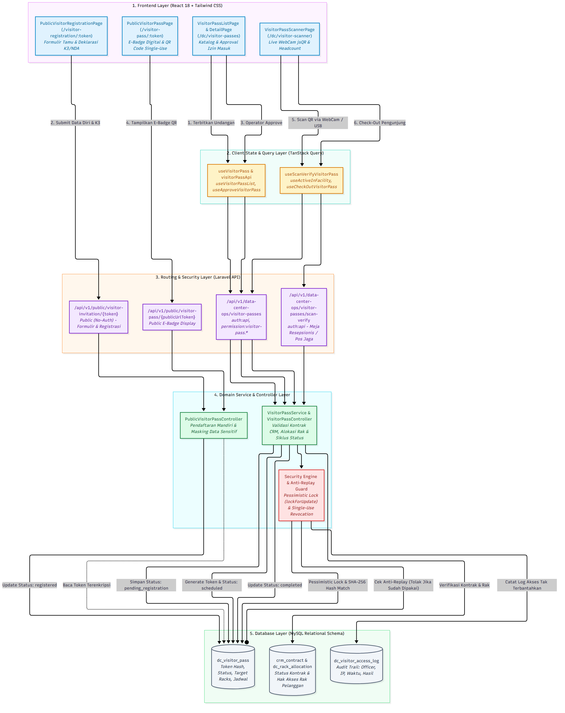

# KLASTER 5: KEAMANAN AKSES FISIK (SECURITY & ISO 27001 COMPLIANCE)


*Gambar 5.1: Arsitektur Alur Data Fullstack Klaster 5 (Keamanan Akses Fisik & ISO 27001).*

---

## 1. FILOSOFI BISNIS & IDENTIFIKASI MASALAH

### 1.1. Peran Strategis Keamanan Akses Fisik dalam Industri Data Center
Pusat data komersial (*commercial colocation data center*) merupakan infrastruktur informasi vital yang menampung ribuan server komputasi kritis dan data rahasia korporat. Keamanan informasi tidak semata-mata bergantung pada pertahanan siber (*cybersecurity*), melainkan berakar kuat pada **kendali keamanan akses fisik (*physical access control*)**. 

Berdasarkan standar internasional **ISO/IEC 27001 (khususnya Kontrol A.11.1 - *Physical Entry Controls*)**, **TIA-942 (Physical Security Tier Standard)**, serta regulasi kepatuhan **SOC 2 Type II**, fasilitas data center wajib memberlakukan perimeter keamanan berlapis. Setiap individu yang melangkahi pintu masuk fasilitas harus teridentifikasi secara positif, memiliki otorisasi formal berbasis kontrak komersial yang aktif, menandatangani deklarasi kepatuhan K3 (*Keselamatan & Kesehatan Kerja*) serta perjanjian kerahasiaan (*Non-Disclosure Agreement / NDA*), serta tercatat pergerakannya dalam jejak audit yang tidak dapat disangkal (*non-repudiation audit trail*).

Klaster 5 (Keamanan Akses Fisik) mengintegrasikan subsistem perizinan akses menyeluruh:

1. **Manajemen Izin Masuk Pengunjung (*Visitor Pass Management*)**: Penerbitan tiket izin masuk terencana, verifikasi identitas resmi (KTP, SIM, Paspor), dan pembatasan akses hanya ke nomor rak spesifik yang disewa pelanggan.
2. **Pendaftaran Mandiri Tamu (*Self-Service Guest Registration*)**: Alur tanpa akun (*no-auth*) yang memungkinkan vendor dan teknisi pihak ketiga mengisi biodata, jadwal kedatangan, daftar peralatan bawaan, dan persetujuan K3/NDA secara mandiri sebelum tiba di lokasi.
3. **Persetujuan Bertingkat Operator (*Multi-Stage Operator Approval*)**: Mekanisme peninjauan oleh staf operasional data center sebelum token akses digital diterbitkan.
4. **Stasiun Pemindai Pos Jaga Satpam (*Guard House Scanner Station*)**: Antarmuka meja resepsionis/keamanan yang mendukung pemindaian kamera langsung (*webcam live feed* via `jsQR`), pemindai *barcode* USB (*hardware HID wedge*), serta gerbang putar (*turnstile gate integration*).
5. **Penghitung Okupansi Fasilitas (*Live Facility Headcount Tracking*)**: Pemantauan jumlah individu aktif di dalam gedung secara waktu-nyata (*real-time*) guna memenuhi protokol evakuasi keselamatan darurat.

---

### 1.2. Identifikasi Masalah Riil Industri & Dampak Ketiadaan Sistem
Pengelolaan izin masuk data center secara konvensional (misalnya menggunakan buku tamu kertas atau komunikasi pesan instan informal) memicu berbagai ancaman keamanan berskala tinggi:

- **Penyusupan Fisik & Pembuntutan (*Tailgating / Piggybacking*)**: Tamu yang diizinkan masuk dapat secara sengaja atau tidak sengaja membawa pihak ketiga yang tidak terverifikasi ke dalam ruang server (*data hall*).
- **Serangan Pemalsuan Tiket Berulang (*Replay Attacks*)**: Kode QR tiket masuk yang dikirim ke ponsel tamu dapat dengan mudah ditangkap layarnya (*screenshot*) dan dibagikan kepada rekan kerja lain untuk masuk berulang kali tanpa izin. Tanpa kebijakan *single-use token* dan pembatalan instan pasca-pemindaian, perimeter keamanan fasilitas akan runtuh.
- **Akses Ilegal ke Lemari Rak Asing (*Cross-Tenant Tampering*)**: Teknisi vendor yang disewa oleh Pelanggan A berpotensi membuka atau mencabut kabel pada rak milik Pelanggan B akibat ketiadaan batasan izin yang mengunci daftar rak tujuan (*rack whitelist enforcement*).
- **Ketiadaan Visibilitas Saat Evakuasi Bencana (*Evacuation Blindspot*)**: Saat terjadi insiden darurat (kebakaran, gempa bumi, atau kebocoran gas *fire suppression* FM-200), petugas keselamatan (*safety warden*) tidak mengetahui secara pasti siapa saja orang luar yang masih terjebak di dalam lorong server.
- **Kegagalan Audit Kepatuhan Regulasi (*Audit Non-Compliance & Liability*)**: Ketiadaan stempel waktu, bukti identitas, alamat IP saat menyetujui NDA, dan identitas petugas jaga yang meloloskan tamu akan mengakibatkan gugurnya sertifikasi ISO 27001 dan memicu sanksi hukum berat bila terjadi kebocoran data fisik.

---

### 1.3. Pemodelan Entitas dan Relasi Data
Arsitektur basis data Klaster 5 dirancang dengan memisahkan izin masuk dengan riwayat transaksi pemindaian:

- **`dc_visitor_pass`**: Tabel inti yang menyimpan siklus hidup izin masuk pengunjung. Berelasi ke `crm_customer` (penyewa penanggung jawab), `crm_contract` (kontrak komersial aktif), `dc_site` (gedung fasilitas), `dc_site_room` (ruang server tujuan), serta petugas yang menyetujui (`approved_by_officer_id`), meloloskan masuk (`check_in_officer_id`), dan memproses keluar (`check_out_officer_id`). Kolom `target_rack_ids` menyimpan daftar ID rak yang diizinkan dalam format *JSON array*.
- **`dc_visitor_access_log`**: Tabel log audit tak terbantahkan (*immutable audit log*) yang merekam setiap peristiwa pemindaian token QR di pos jaga, baik yang berstatus sukses (`granted`), ditolak (`denied`), maupun terdeteksi sebagai upaya serangan penggandaan (`replay_attempt`), lengkap dengan stempel waktu mikroskopis, alamat IP, *user agent*, dan ID petugas jaga.

---

## 2. ARSITEKTUR FULLSTACK & ALUR KODE END-TO-END

### 2.1. Alur 1: Jalur Undangan Mandiri Tamu (*Self-Service Invitation Flow*)
Untuk kunjungan terencana (seperti pemeliharaan perangkat rutin oleh vendor pelanggan), sistem menyediakan alur registrasi tanpa memerlukan akun *login*:

```
Staf Operator DC Ops (VisitorPassListPage)
       │
       ▼ (POST /v1/data-center-ops/visitor-passes/invite)
VisitorPassService::createInvitation()
  ├── Verifikasi Kontrak CRM Aktif & Alokasi Rak Milik Pelanggan
  ├── Generate Nomor Pass (VP-YYYYMM-XXXX) & Raw Invite Token (VPINV_...)
  ├── Simpan Hash SHA-256 (invite_token_hash) & Status: pending_registration
  └── Kirim Surel Undangan via CorePlatform NotificationService
       │
       ▼ (Tamu Buka Tautan: /visitor-registration/{rawInviteToken})
PublicVisitorPassController::showInvitation()
       │
       ▼ (Tamu Isi Identitas, Daftar Alat, Jadwal, & Centang NDA/K3)
PublicVisitorPassController::submitRegistration()
  ├── Catat Waktu & IP Deklarasi K3/NDA (safety_nda_agreed_at, safety_nda_ip)
  └── Update Status: registered (Menunggu Verifikasi Operator)
       │
       ▼ (Operator Tinjau di /dc/visitor-passes/:id & Tekan Approve)
VisitorPassController::approve() -> VisitorPassService::approveVisitorPass()
  ├── Generate Token Akses Digital (VPQR_...) & Hash SHA-256 (token_hash)
  ├── Generate URL Badge Publik (/visitor-pass/{publicUrlToken})
  ├── Update Status: scheduled
  └── Kirim Surel E-Badge QR Code ke Pengunjung
```

#### Cuplikan Kode Backend: Persetujuan Operator & Penerbitan Token E-Badge (`VisitorPassService.php`)

```php
public function approveVisitorPass(int $id, int $officerId, ?string $notes = null): VisitorPass
{
    /** @var VisitorPass $pass */
    $pass = VisitorPass::findOrFail($id);

    if ($pass->status !== 'registered') {
        throw new \DomainException("Hanya izin masuk berstatus 'registered' yang dapat disetujui. Status saat ini: '{$pass->status}'.");
    }

    // Validasi ulang: Pastikan kontrak CRM pelanggan masih aktif saat disetujui
    if (!$pass->contract || $pass->contract->status !== 'active') {
        throw new \DomainException("Akses ditolak: Kontrak pelanggan terkait sudah tidak aktif.");
    }

    // 1. Terbitkan Raw Token QR Code unik bertanda prefiks VPQR_
    $rawQrToken = 'VPQR_' . bin2hex(random_bytes(24));
    $tokenHash = hash('sha256', $rawQrToken);

    // 2. Terbitkan Token Tautan Publik E-Badge unik
    $rawPublicUrlToken = 'VPB_' . bin2hex(random_bytes(20));

    // 3. Tentukan jendela toleransi validitas waktu (valid_from dan valid_until)
    $validFrom = $pass->planned_check_in_at ? $pass->planned_check_in_at->copy()->subHours(2) : now();
    $validUntil = $pass->planned_check_out_at ? $pass->planned_check_out_at->copy()->addHours(4) : now()->addHours(12);

    $pass->update([
        'status'                  => 'scheduled',
        'token_hash'              => $tokenHash,
        'encrypted_token'         => Crypt::encryptString($rawQrToken),
        'public_url_token'        => $rawPublicUrlToken,
        'valid_from'              => $validFrom,
        'valid_until'             => $validUntil,
        'approved_by_officer_id'  => $officerId,
        'approval_notes'          => $notes,
    ]);

    // Kirim notifikasi E-Badge QR Code ke surel pengunjung
    $this->notifyBadgeIssued($pass, $rawQrToken, $rawPublicUrlToken);

    return $pass->fresh(['customer', 'contract', 'site', 'room']);
}
```

---

### 2.2. Alur 2: Jalur Kedatangan Darurat (*Emergency On-Site Registration*)
Bila terjadi insiden kritis perangkat di data center pada dini hari dan teknisi tiba tanpa undangan sebelumnya, staf resepsionis/keamanan pos jaga dapat menerbitkan izin secara langsung (*walk-in*) melalui antarmuka `VisitorPassCreatePage.tsx`:

1. Petugas menginput identitas resmi, nomor kontak, perusahaan, dan memilih kontrak aktif pelanggan.
2. Sistem mengeksekusi metode `VisitorPassService::createVisitorPass()`:
   - Token QR Code langsung diterbitkan seketika.
   - Status izin masuk langsung meloncat ke status `scheduled` tanpa tahap `pending_registration`.
   - Jejak audit mencatat petugas yang membuat izin sebagai penanggung jawab.

---

### 2.3. Alur 3: Pemindai Pos Jaga Satpam (*Guard House Live Scanning*)
Pada pos jaga masuk fasilitas, stasiun pemindai dijalankan pada halaman `VisitorPassScannerPage.tsx` (`VisitorScannerView.tsx`):

```
Kamera Pos Jaga (WebCam Live Stream / USB Barcode Scanner)
       │
       ▼ (jsQR memindai canvas video per frame secara real-time)
Deteksi Token String: "VPQR_a1b2c3d4..."
       │
       ▼ (Audio: playSound('scanned'))
POST /api/v1/data-center-ops/visitor-passes/scan-verify
       │
       ▼
VisitorPassService::scanAndVerify() [Database Transaction]
  ├── Hitung Hash: SHA-256(rawToken)
  ├── Pessimistic Lock: VisitorPass::where('token_hash', ...)->lockForUpdate()
  ├── 1. Validasi Keberadaan Token di Basis Data
  ├── 2. Validasi Kesesuaian Gedung (isWrongScanSite Guard)
  ├── 3. Validasi Keaktifan Kontrak CRM Pelanggan
  ├── 4. Validasi Jendela Waktu (valid_from <= now <= valid_until)
  ├── 5. Anti-Replay Guard: Cek qr_token_consumed_at !== null
  ├── 6. Whitelist Status Guard: Wajib berstatus 'scheduled'
  │
  ├── [JIKA LOLOS] ACCESS GRANTED:
  │     ├── Update status -> 'active_in_facility'
  │     ├── Set qr_token_consumed_at = now() & actual_check_in_at = now()
  │     ├── Catat Log: dc_visitor_access_log (result: 'granted')
  │     ├── Balas data tamu + Daftar Rak yang Diizinkan (allocated_racks)
  │     └── Frontend: Tampilkan Banner Hijau & playSound('success')
  │
  └── [JIKA GAGAL / REPLAY DETECTED]:
        ├── Lempar ReplayAttemptException (HTTP 409 Conflict)
        ├── Catat Log: dc_visitor_access_log (result: 'replay_attempt' / 'denied')
        └── Frontend: Tampilkan Banner Merah Darurat & playSound('error')
```

#### Cuplikan Kode Backend: Proteksi Anti-Replay dan Verifikasi Pos Jaga (`VisitorPassService.php`)

```php
public function scanAndVerify(string $rawToken, string $method, int $officerId, array $clientMeta = []): array
{
    $attemptedHash = hash('sha256', trim($rawToken));

    return DB::transaction(function () use ($attemptedHash, $method, $officerId, $clientMeta) {
        /** @var VisitorPass|null $pass */
        $pass = VisitorPass::where('token_hash', $attemptedHash)
            ->lockForUpdate()
            ->first();

        // 1. Verifikasi keberadaan token
        if (!$pass) {
            $this->logAccessAttempt(null, $attemptedHash, $method, $officerId, $clientMeta, 'denied', 'Token tidak valid.');
            throw new \DomainException('Kode QR tidak dikenali atau tidak terdaftar dalam sistem.');
        }

        // 2. Proteksi Kesesuaian Lokasi Site
        if ($this->isWrongScanSite($pass, $clientMeta)) {
            $allocatedSite = $pass->site?->site_name ?? "Site ID #{$pass->site_id}";
            $this->logAccessAttempt($pass->id, $attemptedHash, $method, $officerId, $clientMeta, 'denied', 'Lokasi gedung salah.');
            throw new \DomainException("Akses ditolak: Tiket ini terdaftar untuk {$allocatedSite}, bukan untuk lokasi fasilitas pos jaga saat ini.");
        }

        // 3. Proteksi Masa Berlaku Kontrak CRM
        if (!$pass->contract || $pass->contract->status !== 'active') {
            $this->logAccessAttempt($pass->id, $attemptedHash, $method, $officerId, $clientMeta, 'denied', 'Kontrak pelanggan tidak aktif.');
            throw new \DomainException('Akses ditolak: Kontrak pelanggan berstatus tidak aktif atau telah berakhir.');
        }

        // 4. Proteksi Rentang Waktu Kunjungan (TTL)
        if (now()->lt($pass->valid_from)) {
            $this->logAccessAttempt($pass->id, $attemptedHash, $method, $officerId, $clientMeta, 'denied', 'Jadwal izin belum dimulai.');
            throw new \DomainException('Akses ditolak: Jadwal izin masuk belum dimulai.');
        }

        if (now()->gt($pass->valid_until)) {
            $this->logAccessAttempt($pass->id, $attemptedHash, $method, $officerId, $clientMeta, 'denied', 'Tiket telah kedaluwarsa.');
            throw new \DomainException('Akses ditolak: Kode QR tiket telah kedaluwarsa.');
        }

        // 5. Anti-Replay Single-Use Protection (Mencegah Pemakaian Screenshot Ganda)
        if ($pass->qr_token_consumed_at !== null || in_array($pass->status, ['active_in_facility', 'overstayed'])) {
            $this->logAccessAttempt($pass->id, $attemptedHash, $method, $officerId, $clientMeta, 'replay_attempt', 'Percobaan penggunaan token bekas (Replay Attack).');
            throw new ReplayAttemptException('Akses ditolak: Kode QR sudah pernah digunakan sebelumnya (Single-use policy).');
        }

        // 6. Whitelist Status Izin Masuk
        if ($pass->status !== 'scheduled') {
            $this->logAccessAttempt($pass->id, $attemptedHash, $method, $officerId, $clientMeta, 'denied', "Status tidak memenuhi syarat: {$pass->status}");
            throw new \DomainException("Akses ditolak: Tiket berstatus '{$pass->status}', belum disetujui operator.");
        }

        // 7. OTORISASI DITERIMA (ACCESS GRANTED)
        $pass->update([
            'status'               => 'active_in_facility',
            'qr_token_consumed_at' => now(),
            'actual_check_in_at'   => now(),
            'check_in_method'      => $method,
            'check_in_officer_id'  => $officerId,
        ]);

        $this->logAccessAttempt($pass->id, $attemptedHash, $method, $officerId, $clientMeta, 'granted', 'Akses masuk disetujui.');

        $allocatedRacks = !empty($pass->target_rack_ids) ? Rack::whereIn('id', $pass->target_rack_ids)->get() : [];

        return [
            'message'         => "Akses masuk disetujui. Selamat datang, {$pass->visitor_name}.",
            'visitor_pass'    => $pass,
            'allocated_racks' => $allocatedRacks,
        ];
    });
}
```

---

### 2.4. Alur 4: Pemantauan Okupansi (*Live Headcount*) & Siklus Check-Out
Setelah tamu melintasi pos jaga dan berstatus `active_in_facility`:

1. **Live Headcount Widget**: Antarmuka pos jaga secara berkala meminta data `GET /api/v1/data-center-ops/visitor-passes/active-in-facility`. Sistem menghitung total individu aktif di dalam gedung dan menampilkan daftar nama, perusahaan, nomor telepon, dan lokasi ruangan yang sedang dimasuki.
2. **Proses Check-Out**: Saat tamu menyelesaikan pekerjaan fisik dan keluar melintasi pos jaga, petugas menekan tombol *Check-Out* pada baris pengunjung:
   - Endpoint `POST /api/v1/data-center-ops/visitor-passes/{id}/check-out` dipanggil.
   - Status izin masuk beralih secara permanen menjadi `completed`.
   - Kolom `actual_check_out_at` dan `check_out_officer_id` dicatat ke basis data.
   - Angka *headcount* fasilitas berkurang secara seketika (*instant reconciliation*).

---

## 3. SPESIFIKASI API, VALIDASI & LOGIKA PROTEKSI DATA

### 3.1. Tabel Kontrak Endpoint API Klaster 5

| Method | Endpoint URI | Akses & Otentikasi | Fungsi & Deskripsi | Parameter & Payload Kunci |
| :--- | :--- | :--- | :--- | :--- |
| `GET` | `/v1/data-center-ops/visitor-passes` | Internal (`auth:api`) | Katalog riwayat izin masuk pengunjung | `status`, `site_id`, `customer_id`, `date`, `search`, `page`, `per_page` |
| `GET` | `/v1/data-center-ops/visitor-passes/eligible-customers` | Internal (`auth:api`) | Daftar pelanggan dengan kontrak & rak aktif | `site_id` (opsional) |
| `GET` | `/v1/data-center-ops/visitor-passes/active-in-facility` | Internal (`auth:api`) | *Live Headcount* pengunjung di dalam gedung | `site_id` (opsional) |
| `GET` | `/v1/data-center-ops/visitor-passes/{id}` | Internal (`auth:api`) | Detail tiket izin masuk & log akses audit | `id` (Path Parameter) |
| `POST` | `/v1/data-center-ops/visitor-passes/invite` | Internal (`auth:api`) | Menerbitkan undangan pendaftaran mandiri | `customer_id`, `contract_id`, `site_id`, `site_room_id`, `allowed_start_date`, `allowed_end_date`, `invited_email` |
| `POST` | `/v1/data-center-ops/visitor-passes` | Internal (`auth:api`) | Menerbitkan izin masuk darurat (*walk-in*) | `customer_id`, `visitor_name`, `visitor_identity_type`, `visitor_identity_number`, `visitor_phone`, `purpose` |
| `POST` | `/v1/data-center-ops/visitor-passes/{id}/approve` | Internal (`auth:api`) | Operator menyetujui izin & terbitkan QR | `id`, `notes` (opsional) |
| `POST` | `/v1/data-center-ops/visitor-passes/scan-verify` | Internal (`auth:api`) | Memverifikasi token QR di pos jaga satpam | `token` (String QR), `scan_method`, `site_id` |
| `POST` | `/v1/data-center-ops/visitor-passes/{id}/check-out` | Internal (`auth:api`) | Memproses keluar pengunjung dari gedung | `id`, `notes` (opsional) |
| `POST` | `/v1/data-center-ops/visitor-passes/{id}/cancel` | Internal (`auth:api`) | Membatalkan izin masuk sebelum digunakan | `id`, `cancellation_reason` |
| `GET` | `/v1/public/visitor-invitation/{token}` | Publik (No-Auth) | Mengambil informasi awal formulir tamu | `token` (`VPINV_...`) |
| `POST` | `/v1/public/visitor-invitation/{token}/register` | Publik (No-Auth) | Tamu submit biodata, jadwal & persetujuan K3 | `visitor_name`, `visitor_identity_number`, `planned_check_in_at`, `safety_nda_agreed` (boolean) |
| `GET` | `/v1/public/visitor-pass/{publicUrlToken}` | Publik (No-Auth) | Menampilkan E-Badge digital & QR Code tamu | `publicUrlToken` (`VPB_...`) |

---

### 3.2. Logika Proteksi Data, Integritas Transaksi & Edge Cases
1. **Pencegahan Kondisi Balapan (*Pessimistic Concurrency Guard*)**: Penggunaan klausa `lockForUpdate()` di dalam transaksi basis data `DB::transaction` pada fungsi `scanAndVerify()` menjamin bahwa apabila terdapat dua pembaca kartu (*scanner*) yang memindai kode QR yang sama pada milidetik yang sama, transaksi pertama akan mengunci baris data dan menandai token telah terkonsumsi (`qr_token_consumed_at`). Transaksi kedua akan otomatis terhenti dan dilemparkan ke `ReplayAttemptException`.
2. **Prinsip Sekali Pakai (*Single-Use Token Policy*)**: Kode QR yang telah digunakan untuk *check-in* hangus seketika. Jika pengunjung mencoba menunjukkan kembali tangkapan layar kode QR yang sama, sistem mendeteksi keberadaan stempel waktu `qr_token_consumed_at` dan menolak akses dengan kode HTTP 409 Conflict.
3. **Penyensoran Informasi Sensitif pada Respons Publik (*Public Data Masking*)**: Endpoint publik (`showInvitation` dan `submitRegistration`) secara ketat menyaring (*whitelist*) data yang dikembalikan melalui metode `toRegistrationSummary()`. Data sensitif internal korporat (seperti nomor identitas KTP/Paspor, catatan internal operator, IP pelapor NDA, dan identitas ID petugas) tidak pernah diekspos ke publik.
4. **Proteksi Kesesuaian Fasilitas (*Site Location Guard*)**: Petugas pos jaga pada Gedung Data Center Surabaya (`DC-SBY-01`) tidak dapat meloloskan pengunjung yang tiketnya dialokasikan untuk Gedung Jakarta (`DC-JKT-01`). Ketidaksesuaian nilai `site_id` langsung memicu penolakan otorisasi dengan pesan penolakan lokasi spesifik.
5. **Jejak Audit Tanpa Penyangkalan (*Non-Repudiation Audit Logging*)**: Setiap percobaan pemindaian di pos jaga wajib mencatat rekaman ke tabel `dc_visitor_access_log` di luar status keberhasilan otorisasi. Informasi mencakup stempel waktu atomik, alamat IP terminal pos jaga, *user agent*, metode perangkat pemindai (`webcam_guard`, `usb_scanner`, `turnstile_gate`), ID petugas yang bertugas, serta alasan kegagalan jika akses ditolak.

---

## 4. BANK PERTANYAAN & JAWABAN SIDANG PENGUJI

Berikut adalah kompilasi pertanyaan kritis penguji seputar keamanan fisik data center dan formula jawaban ilmiah berbasis kode nyata:

### Pertanyaan 1:
> *"Bagaimana sistem informasi ini membuktikan kepatuhan terhadap standar keamanan fisik ISO/IEC 27001 Kontrol A.11.1 (Physical Entry Controls)?"*

**Formula Jawaban Ilmiah:**  
Sistem mengimplementasikan seluruh klausul Kontrol A.11.1 melalui lima pilar kendali teknis:  
Pertama, **Otorisasi Berbasis Hak Akses (*Need-to-Access Basis*)**: Pengunjung tidak dapat meminta akses bebas ke seluruh gedung, melainkan dibatasi secara ketat hanya pada ruang server (`site_room_id`) dan lemari rak spesifik (`target_rack_ids`) yang terbukti disewa oleh pelanggan aktif di modul CRM (`crm_contract`).  
Kedua, **Deklarasi Kepatuhan K3 & NDA Terekam**: Tamu diwajibkan menyetujui deklarasi K3 dan *Non-Disclosure Agreement* secara elektronik, di mana sistem merekam stempel waktu presisi (`safety_nda_agreed_at`) dan alamat IP publik tamu (`safety_nda_ip`).  
Ketiga, **Pemisahan Peran Pengawas (*Segregation of Duties*)**: Tamu yang mendaftar mandiri tidak langsung mendapatkan akses, melainkan wajib melalui verifikasi formal staf operasional data center (`approved_by_officer_id`).  
Keempat, **Pencatatan Waktu-Nyata Otentik**: Waktu kedatangan dan kepulangan aktual dicatat berdasarkan interaksi pemindaian pos jaga (`actual_check_in_at` dan `actual_check_out_at`).  
Kelima, **Jejak Audit Tak Terbantahkan (*Non-Repudiation Audit Trail*)**: Setiap percobaan pemindaian token QR—baik yang berhasil, kedaluwarsa, salah gedung, maupun percobaan serangan penggandaan—disimpan secara permanen pada tabel `dc_visitor_access_log` beserta identitas petugas keamanan (`officer_id`) dan alamat IP pos jaga.

---

### Pertanyaan 2:
> *"Bagaimana arsitektur sistem mencegah serangan penggandaan kode QR (Replay Attack), misalnya jika seorang teknisi menyebarkan tangkapan layar (screenshot) kode QR izin masuk kepada rekannya?"*

**Formula Jawaban Ilmiah:**  
Sistem menerapkan kebijakan token sekali pakai (*single-use token policy*) yang dilindungi oleh integritas transaksi basis data. Pada metode `VisitorPassService::scanAndVerify()`, sistem tidak menyimpan token mentah di basis data, melainkan menyimpan representasi *hash* kriptografis SHA-256 (`token_hash = hash('sha256', $rawToken)`).  
Saat pemindai di pos jaga membaca kode QR, sistem mengeksekusi *pessimistic lock* menggunakan `VisitorPass::where('token_hash', $attemptedHash)->lockForUpdate()->first()`. Pemeriksaan keamanan secara eksplisit mengevaluasi:

```php
if ($pass->qr_token_consumed_at !== null || in_array($pass->status, ['active_in_facility', 'overstayed'])) {
    throw new ReplayAttemptException('Akses ditolak: Kode QR sudah pernah digunakan sebelumnya (Single-use policy).');
}
```

Begitu otorisasi pertama kali disetujui, kolom `qr_token_consumed_at` langsung diisi dengan stempel waktu `now()`, dan status tiket diubah menjadi `active_in_facility`. Jika tangkapan layar tersebut dipindai kembali oleh orang kedua beberapa detik kemudian, sistem mendeteksi bahwa token telah terkonsumsi, melemparkan *custom exception* `ReplayAttemptException`, mencatat insiden sebagai `replay_attempt` pada tabel `dc_visitor_access_log`, dan mengembalikan status HTTP 409 Conflict dengan sirene peringatan visual/audio pada layar pos jaga.

---

### Pertanyaan 3:
> *"Mengapa endpoint registrasi publik (PublicVisitorPassController) tidak mengekspos model Eloquent VisitorPass secara langsung, dan bagaimana mitigasi kebocoran data sensitifnya?"*

**Formula Jawaban Ilmiah:**  
Model `VisitorPass` internal menampung atribut-atribut data yang sangat sensitif (*Personally Identifiable Information / PII*) serta rahasia korporat internal, antara lain: nomor induk kependudukan/paspor tamu, catatan instruksi operator, alamat IP NDA, ID petugas internal, serta keterkaitan kontrak dan diskon komersial pada relasi `contract`.  
Mengekspos model Eloquent secara langsung (misalnya melalui `response()->json($pass)`) melanggar prinsip *OWASP API Security Top 10* terkait *Broken Object Property Level Authorization / Excessive Data Exposure*.  
Untuk memitigasi risiko tersebut, controller publik menerapkan metode penyaringan ketat (*data whitelisting*) melalui fungsi pembantu `toRegistrationSummary()`:

```php
private function toRegistrationSummary(VisitorPass $pass): array
{
    return [
        'pass_number'          => $pass->pass_number,
        'status'               => $pass->status,
        'visitor_name'         => $pass->visitor_name,
        'visitor_company'      => $pass->visitor_company,
        'site_name'            => $pass->site?->site_name,
        'room_name'            => $pass->room?->room_name,
        'planned_check_in_at'  => $pass->planned_check_in_at?->toISOString(),
        'planned_check_out_at' => $pass->planned_check_out_at?->toISOString(),
    ];
}
```

Dengan mekanisme ini, antarmuka tamu hanya menerima informasi status umum pendaftaran tanpa mengekspos nomor identitas, riwayat audit internal, maupun keterkaitan kontrak bisnis pelanggan lain.

---

### Pertanyaan 4:
> *"Apa fungsi teknis dari klausa lockForUpdate() saat pemindaian pos jaga dilakukan, dan apa dampaknya jika klausa tersebut dihilangkan?"*

**Formula Jawaban Ilmiah:**  
Di fasilitas data center dengan gerbang putar ganda (*dual-lane turnstile gate*) atau meja pos jaga yang memiliki lebih dari satu stasiun pemindai (*multiple reception desks*), terdapat potensi kondisi balapan (*race condition / concurrency issue*). Apabila seorang penyerang memindai kode QR fisik yang sama pada dua pemindai terpisah pada pecahan milidetik yang hampir bersamaan, kedua thread HTTP server di backend dapat mengeksekusi blok kode secara simultan.  
Jika klausa `lockForUpdate()` dihilangkan:

1. Thread A dan Thread B sama-sama membaca baris `dc_visitor_pass` di mana `qr_token_consumed_at` masih bernilai `NULL`.
2. Kedua thread menganggap token belum pernah digunakan dan meloloskan kedua orang tersebut secara bersamaan (*double entry breach*).  
Penerapan `VisitorPass::where(...)->lockForUpdate()->first()` di dalam `DB::transaction` menginstruksikan mesin basis data MySQL/InnoDB untuk memasang kunci eksklusif (*row-level exclusive lock*). Ketika Thread A mengakses baris data tersebut, Thread B dipaksa menunggu (*blocking wait*) hingga transaksi Thread A tuntas (*commit*). Setelah Thread A melakukan *commit* dan mengubah `qr_token_consumed_at` menjadi `now()`, giliran Thread B membaca data yang sudah diperbarui dan langsung menggagalkan upaya pemindaian kedua karena terdeteksi sebagai *replay attempt*.

---

### Pertanyaan 5:
> *"Bagaimana sistem mendukung prosedur evakuasi darurat (Emergency Evacuation) saat terjadi kebakaran atau bencana alam di fasilitas data center?"*

**Formula Jawaban Ilmiah:**  
Dalam situasi darurat seperti alarm kebakaran atau kebocoran sistem pencegah kebakaran gas (*fire suppression gas discharge*), petugas keselamatan (*Occupational Health and Safety / HSE Officer*) memerlukan data pasti mengenai berapa banyak dan siapa saja orang luar yang berada di dalam zona gedung.  
Sistem mendukung prosedur ini melalui endpoint khusus `GET /api/v1/data-center-ops/visitor-passes/active-in-facility` yang ditenagai oleh metode `VisitorPassService::getActiveInFacility($siteId)`. Metode ini mengeksekusi *query* teroptimasi:

```php
return VisitorPass::where('site_id', $siteId)
    ->whereIn('status', ['active_in_facility', 'overstayed'])
    ->with(['customer:id,company_name', 'room:id,room_name'])
    ->get();
```

Antarmuka pos jaga menampilkan widget *Live Headcount* yang merinci: total jumlah kepala (*occupancy count*), nama lengkap tamu, perusahaan asal, nomor telepon darurat, waktu kedatangan aktual, dan nama ruangan server yang sedang mereka masuki. Data ini dapat langsung dicetak atau diakses melalui perangkat seluler petugas di titik kumpul evakuasi (*muster point*) untuk memastikan tidak ada satu pun teknisi atau vendor yang tertinggal di dalam gedung data center.
