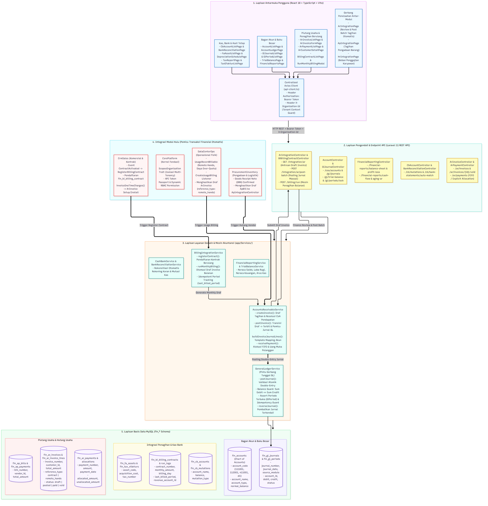

# BEDAH MODUL FINANCEACCOUNTING: JANTUNG FINANSIAL, BUKU BESAR, & INTEGRASI PENAGIHAN MSDC ERP
## Modul: FinanceAccounting (`General Ledger, Chart of Accounts, AR/AP, Billing Integration, Cash & Bank, Fixed Assets, & Multi-Tenant Fiscal Governance`)
**Target Cakupan**: Orkestrasi Finansial Terpusat, Integrasi Penagihan Otomatis dari Kontrak & *Usage* Data Center (`DataCenterOps` & `CrmSales`), Tata Kelola Jurnal Berimbang (*Double-Entry*), serta Pelaporan Fiskal Korporat

---

## 1. PERAN STRATEGIS & FILOSOFI BISNIS FINANCEACCOUNTING DALAM EKOSISTEM MSDC ERP

Dalam tata kelola perusahaan penyedia infrastruktur *Data Center* dan *Managed Services*, kompleksitas operasional finansial berada pada tingkat yang sangat tinggi. Karakteristik bisnis ini bertumpu pada aset modal raksasa (*capital-intensive infrastructure*)—seperti bangunan fisik *data center*, mesin pendingin presisi (*HVAC/chiller*), genset pembangkit darurat, perangkat *Uninterruptible Power Supply* (UPS), serta deretan rak server—yang mengalami depresiasi nilai buku secara berkala. Di sisi lain, arus kas pendapatan berulang (*Monthly Recurring Revenue / MRR*) mengalir dari ratusan kontrak sewa ruang rak, komitmen daya listrik, dan sambungan *bandwidth*, yang bercampur dengan tagihan pemakaian dinamis (*usage-based billing*) seperti tiket bantuan teknis *Remote Hands*, konsumsi daya melebihi kuota (*power overage*), serta biaya instalasi interkoneksi kabel serat optik (*cross-connect*).

Apabila modul keuangan dirancang secara terpisah (*decoupled silo*) tanpa integrasi *real-time* ke sistem fisik data center dan sistem komersial, perusahaan akan mengalami tiga kegagalan struktural yang fatal:
1. **Kebocoran Pendapatan (*Revenue Leakage*)**: Aktivitas teknis yang dilakukan tim operasional di lorong rak (misalnya pekerjaan perbaikan server pelanggan selama 4 jam kerja) tidak pernah tertagih karena hilangnya transmisi data dari tiket operasional ke bagian keuangan.
2. **Kekacauan Jurnal Akuntansi (*Unbalanced & Invalid General Ledger*)**: Terjadinya transaksi sepihak dari modul-modul bisnis tanpa penegakan disiplin pencatatan berpasangan (*double-entry bookkeeping*), yang mengakibatkan ketidakseimbangan neraca saldo (*trial balance*) dan kegagalan audit akuntan publik.
3. **Penyimpangan Pengakuan Pendapatan (*Revenue Recognition Distortion*)**: Tagihan biaya instalasi satu-kali (*one-time setup*) bercampur dengan tagihan sewa bulanan berulang, menyebabkan distorsi pada laporan laba rugi (*Profit & Loss*) dan kekeliruan perhitungan kewajiban pajak pertambahan nilai (PPN).

Modul **`FinanceAccounting`** dibangun untuk memecahkan permasalahan mendasar tersebut dengan bertindak sebagai **"Single Source of Truth for Financial Integrity"** (Pusat Kebenaran Tunggal Integritas Finansial). Filosofi rekayasa utama yang diusung oleh modul ini adalah:

1. **Pintu Gerbang Tunggal Buku Besar (*Single Entry Point for General Ledger*)**: Dilarang keras bagi modul eksternal mana pun (`DataCenterOps`, `CrmSales`, `ProcurementInventory`, maupun `HrServiceSupport`) menyisipkan baris jurnal langsung ke tabel basis data. Seluruh mutasi keuangan wajib melewati gerbang tunggal `GeneralLedgerService::postJournal()` yang memvalidasi keseimbangan atomik debet-kredit ($\sum \text{Debit} == \sum \text{Credit}$), keaktifan akun dari Bagan Akun (*Chart of Accounts / CoA*), keterbukaan periode fiskal, serta jaminan idempoten anti-duplikasi.
2. **Pola Antrean Verifikasi Penagihan Otomatis (*Review-First Integration Queue*)**: Transaksi yang dipicu secara otomatis oleh modul lain—seperti tiket *Remote Hands* dari `DataCenterOps` atau pengiriman barang dari modul pengadaan—tidak langsung dibukukan secara buta ke buku besar. Transaksi tersebut ditampung ke dalam status draf pada antrean *AR Integration* (`/finance/integration/ar`) agar staf keuangan dapat memverifikasi kesesuaian nilai, melihat pratinjau jurnal (*journal preview*), dan melakukan eksekusi posting massal (*post batch*) secara terukur.
3. **Pemisahan Deterministik Siklus Penagihan Kontrak (*Deterministic Recurring Billing*)**: Mesin integrasi penagihan (`BillingIntegrationService`) memisahkan kontrak layanan berulang bulanan dari biaya penyiapan satu-kali. Kontrak penagihan dieksekusi secara otomatis berbasis tanggal tagih (*billing day* 1–28) dengan penanda siklus penagihan terakhir (*last_billed_period*) guna menjamin tidak pernah terjadi tagihan ganda pada satu periode bulan kalender yang sama.

---

## 2. PETA FITUR & SUB-MODUL UTAMA

Berdasarkan audit mendalam terhadap basis kode backend `MSDC/Modules/FinanceAccounting/` dan antarmuka frontend `MSDCFrontend/src/modules/finance-accounting/`, kapabilitas modul `FinanceAccounting` terbagi ke dalam 8 sub-modul inti:

### 2.1. Bagan Akun Terstandarisasi (Standardized Chart of Accounts / CoA)
Fondasi struktur hierarki klasifikasi finansial perusahaan:
* **Pengelompokan 5 Pilar Akun**: Pengkodean numerik terstruktur standar akuntansi Indonesia mencakup Aset (`1xxxxx`), Liabilitas (`2xxxxx`), Ekuitas (`3xxxxx`), Pendapatan (`4xxxxx`), dan Beban (`5xxxxx`).
* **Akun Khusus Industri Data Center**: Menyediakan akun spesifik operasional data center mencakup `121001` (Peralatan Data Center), `411001` (Pendapatan Colocation), `412001` (Pendapatan Dedicated Server), `413001` (Pendapatan Remote Hands), `511001` (Beban Listrik), dan `512001` (Beban Internet Upstream/Transit).
* **Penetapan Saldo Normal & Penanda Postable**: Menentukan arah saldo bawaan (*debit* atau *credit*) termasuk pembalikan saldo normal pada akun kontra-aset (`129001` Akumulasi Depresiasi dengan normal saldo *credit*). Akun induk (*header account*) diproteksi agar tidak dapat dijurnal secara langsung (`is_postable = false`).

### 2.2. Buku Besar Umum & Kontrol Periode Fiskal (General Ledger & Fiscal Period Governance)
Mesin pencatatan transaksi berpasangan (*double-entry*):
* **Pencatatan Jurnal Atomik**: Pembuatan entri jurnal yang mengikat atribut `journal_number`, `source_module`, `reference_type`, dan `reference_number`.
* **Tata Kelola Periode Akuntansi (*Fiscal Period Control*)**: Manajemen status periode bulanan pada tabel `fin_gl_periods`. Modul mendukung dua lapis penguncian: *Period Lock* (kunci operasional bulanan untuk membekukan posting transaksi baru) dan *Period Close* (penutupan buku akhir tahun yang memindahkan saldo laba berjalan ke akun Laba Ditahan `312001`).
* **Mekanisme Pembalikan Jurnal Terkendali (*Controlled Journal Reversal*)**: Entri jurnal yang telah dibukukan (*posted*) tidak dapat dihapus (*immutable*). Koreksi kesalahan wajib dilakukan melalui penerbitan jurnal pembalik otomatis (`reverseJournal()`) dengan mencatat referensi silang dan alasan pembatalan pada jejak audit.

### 2.3. Piutang Usaha & Tata Kelola Batas Kredit (Accounts Receivable & Credit Limit Management)
Pengelolaan siklus penagihan piutang dagang kepada pelanggan data center:
* **Penerbitan Faktur Penjualan (*AR Invoices*)**: Pengelolaan dokumen tagihan multi-item dengan kalkulasi subtotal, pajak PPN 11%, dan tanggal jatuh tempo (*due date*).
* **Pengawasan Batas Kredit (*Credit Limit Assertion*)**: Evaluasi otomatis terhadap profil pelanggan (`ArCustomerProfile`) guna memastikan akumulasi piutang yang belum terbayar tidak melampaui batas plafon kredit korporat sebelum faktur disetujui untuk diterbitkan.
* **Laporan Penuaan Piutang (*AR Aging Report*)**: Klasifikasi penuaan piutang terstruktur ke dalam kelompok: Berjalan (*Current*), 1–30 hari, 31–60 hari, 61–90 hari, dan Menunggak (> 90 hari) dilengkapi fasilitas cetak PDF formal untuk penagihan.

### 2.4. Integrasi Penagihan Kontrak Berulang (Recurring Contract Billing Integration)
Jembatan otomatisasi pendapatan dari komitmen komersial ke faktur:
* **Pendaftaran Kontrak Penagihan (*Billing Contract Registration*)**: Sinkronisasi data kontrak komersial yang aktif dari modul `CrmSales` ke entitas `fin_bi_billing_contract`.
* **Eksekusi Penagihan Bulanan Deterministik (*Monthly Billing Run Engine*)**: Layanan `runMonthlyBilling()` yang memindai seluruh kontrak aktif yang jatuh tempo pada bulan berjalan. Hari penagihan dibatasi maksimum tanggal 28 (*billing day* $\le 28$) untuk menjaga konsistensi pada bulan Februari.
* **Jejak Eksekusi Idempoten (*Billing Run Log*)**: Perekaman riwayat pada tabel `fin_bi_billing_run_log` yang mendeteksi kolom `last_billed_period`, menjamin kontrak tidak akan pernah ditagih dua kali pada bulan yang sama.

### 2.5. Gerbang Antrean Integrasi Penagihan Otomatis (AR/AP Integration Review Queues)
Lapisan penengah pengaman antara operasional lapangan dan pembukuan resmi:
* **Antrean Penelaahan Piutang (*AR Integration Queue*)**: Menampung faktur draf yang dihasilkan secara otomatis oleh tiket *Remote Hands* `DataCenterOps` dan siklus *Monthly Billing*.
* **Pratinjau Jurnal Interaktif (*Real-Time Journal Preview*)**: Menggunakan fungsi tunggal `buildInvoiceJournalLines()` untuk menampilkan simulasi baris akun yang akan terbentuk (Debet Piutang Usaha, Kredit Pendapatan Layanan, Kredit Hutang Pajak PPN) sebelum transaksi benar-benar dibukukan.
* **Aksi Kolektif & Penolakan (*Post Batch & Structured Rejection*)**: Fasilitas bagi tim akuntansi untuk menyetujui puluhan faktur sekaligus dalam satu kali klik atomik, atau menolak draf tagihan bermasalah dengan pembatalan otomatis (*void*) dan pengembalian penanda periode billing.

### 2.6. Hutang Usaha & Rekonsiliasi Pengadaan (Accounts Payable & Procurement Reconciliation)
Tata kelola kewajiban pembayaran kepada pemasok dan mitra vendor:
* **Pencatatan Tagihan Vendor (*AP Bills*)**: Penatausahaan tagihan atas pengadaan barang sparepart server, genset, solar, dan biaya pemeliharaan fasilitas.
* **Antrean Integrasi Pengadaan (*AP Integration Queue*)**: Penelaahan draf tagihan vendor yang dipicu oleh konfirmasi penerimaan barang (*Goods Receipt Note / GRN*) dari modul `ProcurementInventory`.
* **Laporan Penuaan Hutang (*AP Aging Report*)**: Pemantauan jadwal kewajiban pembayaran jangka pendek guna menjaga likuiditas kas operasional.

### 2.7. Manajemen Kas, Bank, & Rekonsiliasi Rekening Koran (Cash, Bank, & Bank Reconciliation)
Pengawasan likuiditas moneter perusahaan:
* **Multi-Rekening Kas & Bank**: Pengelolaan akun kas operasional, kas kecil (*petty cash*), rekening Bank BCA, dan Bank Mandiri pada tabel `fin_cb_accounts`.
* **Pencatatan Mutasi Terintegrasi**: Perekaman setoran (*deposit*), penarikan (*withdrawal*), dan transfer antar-bank dengan penjurnalan GL otomatis.
* **Rekonsiliasi Bank Cerdas (*Smart Bank Statement Auto-Matching*)**: Impor rekening koran bank (*bank statement*) format elektronik dan algoritma pencocokan otomatis (*auto-match*) berbasis tanggal transaksi, nilai nominal, dan nomor referensi mutasi.

### 2.8. Manajemen Aset Tetap, Perpajakan, & Pelaporan Keuangan (Fixed Assets, Tax, & Reporting)
Pilar kepatuhan hukum fiskal dan pelaporan eksekutif:
* **Aktiva Tetap Data Center (*Fixed Assets & Depreciation Engine*)**: Pencatatan aset perangkat komputasi dan infrastruktur gedung (`fin_fa_assets`), penentuan masa manfaat, serta kalkulasi otomatis beban depresiasi bulanan metode garis lurus (*straight-line depreciation*).
* **Manajemen Pajak Pertambahan Nilai & PPh (*Tax Engine & e-Faktur*)**: Pembuatan draf faktur pajak elektronik PPN Keluaran secara otomatis pada saat faktur penjualan dibukukan (`AutoCreateTaxEFaktur`), serta pengelolaan bukti potong PPh Pasal 23 dan Pasal 4 ayat (2).
* **Konsolidasi Laporan Keuangan Standar**: Penyajian laporan keuangan komprehensif mencakup Neraca Saldo (*Trial Balance*), Laporan Posisi Keuangan (*Balance Sheet*), Laporan Laba Rugi (*Profit & Loss*), Laporan Arus Kas (*Cash Flow*), serta Laporan Kinerja Pusat Laba (*Profit Center Comparison*).

---

## 3. ARSITEKTUR FULLSTACK & ALUR KODE END-TO-END

Struktur fullstack pada modul `FinanceAccounting` dirancang dengan arsitektur berlapis yang kokoh guna menjamin tidak adanya kebocoran data multi-tenant dan penegakan aturan akuntansi semesta:



### 3.1. Alur 1: Pendaftaran Kontrak Billing Otomatis dari CRM dan Eksekusi Siklus Penagihan Bulanan

Siklus penagihan pendapatan berulang (*recurring colocation billing*) berjalan secara mulus tanpa intervensi manual antar-departemen:

1. **Pemicu Modul Hulu**: Pada modul `CrmSales`, pelanggan menandatangani kontrak dan staf mengunggah berkas resmi. Metode `ContractManagementService::confirmSignedDocument()` mengubah status kontrak menjadi `active` dan menyiarkan event `ContractActivated`.
2. **Penangkap Event Finansial (`RegisterBillingContract::handle`)**:
   - Listener finansial berjalan secara sinkron di dalam siklus permintaan yang sama guna menjaga ketersediaan header konteks `X-Organization-Id`.
   - Listener memeriksa keabsahan tipe kontrak. Kontrak satu-kali (*one-time / project / trial*) diabaikan.
   - Pengecekan idempoten dilakukan untuk memastikan kontrak belum pernah terdaftar sebelumnya pada tabel `fin_bi_billing_contract`.
   - Layanan memetakan akun pendapatan berdasarkan jenis layanan kontrak (misalnya `revenue_colocation` dipetakan ke akun `411001` via `config/finance-accounting.php`):

```php
public function handle(ContractActivated $event): void
{
    $contract = $event->contract;
    $contract->loadMissing(['customer', 'services']);

    if (in_array($contract->contract_type ?? '', ['one_time', 'project', 'trial'])) {
        return;
    }

    $existing = BiBillingContract::where('contract_number', $contract->contract_number)->first();
    if ($existing) {
        return;
    }

    $firstService = $contract->services->first();
    $customer = $contract->customer;

    $this->billingService->registerContract([
        'contract_number'     => $contract->contract_number,
        'crm_contract_id'     => $contract->id,
        'customer_id'         => $contract->customer_id,
        'customer_name'       => $customer->company_name ?? 'Unknown',
        'customer_code'       => $customer->customer_code ?? null,
        'service_description' => $contract->services->where('billing_type', '!=', 'one_time')
                                    ->map(fn ($s) => $s->description)->join(', ') ?: 'Layanan Kontrak',
        'revenue_account_id'  => $firstService?->revenue_account_id ?? $this->resolveDefaultRevenueAccount($firstService),
        'monthly_amount'      => (float) $contract->monthly_value,
        'tax_rate'            => $customer->tax_rate ?? 11.0,
        'billing_day'         => min((int) $contract->start_date->format('j'), 28),
        'start_date'          => $contract->start_date->toDateString(),
        'end_date'            => $contract->end_date?->toDateString(),
        'payment_term_days'   => (int) ($contract->payment_term_days ?? 30),
    ]);
}
```

3. **Eksekusi Penagihan Rutin Bulanan (`BillingIntegrationService::runMonthlyBilling`)**:
   - Baik dipicu melalui antarmuka pengguna (`POST /api/v1/finance-accounting/billing/run`) maupun perintah CLI terjadwal harian (*cron job*), sistem mengevaluasi seluruh kontrak berstatus `active`.
   - Kontrak yang memiliki nilai `last_billed_period` identik dengan bulan berjalan dilewati secara otomatis (*skipped*).
   - Untuk setiap kontrak yang jatuh tempo, sistem memanggil `AccountsReceivableService::createInvoice()` dengan menetapkan status eksplisit `status: 'draft'`:

```php
$invoice = $this->arService->createInvoice([
    'customer_id'      => $contract->customer_id,
    'customer_name'    => $contract->customer_name,
    'customer_code'    => $contract->customer_code,
    'profit_center_id' => $contract->profit_center_id,
    'invoice_date'     => $periodDate,
    'due_date'         => $dueDate,
    'reference_type'   => 'contract',
    'reference_number' => $contract->contract_number,
    'tax_amount'       => $taxAmount,
    'status'           => 'draft',
    'lines'            => [
        [
            'description'        => "{$contract->service_description} - " . Carbon::parse($periodDate)->translatedFormat('F Y'),
            'quantity'           => 1,
            'unit_price'         => $subtotal,
            'revenue_account_id' => $contract->revenue_account_id,
        ],
    ],
]);

$contract->update(['last_billed_period' => $period]);
```

4. **Hasil Transaksi**: Faktur yang terbentuk tidak langsung menjurnal ke buku besar, melainkan masuk ke antrean verifikasi tim keuangan pada antarmuka *AR Integration*.

---

### 3.2. Alur 2: Alur Penagihan Penggunaan Sumber Daya Data Center Masuk ke Antrean AR Integration

Selain sewa rutin, konsumsi dinamis operasional di gedung data center ditagih melalui mekanisme *usage reporting*:

1. **Pekerjaan Fisik di Lapangan**: Teknisi data center menyelesaikan pekerjaan pemeliharaan darurat atas permintaan pelanggan pada tiket *Remote Hands*. Tiket ditandai selesai pada modul `DataCenterOps`.
2. **Pencatatan Rekaman Penggunaan (`UsageReportingService`)**:
   - Sistem operasional membuat rekaman pada tabel `dc_usage_record` dengan `usage_type = 'remote_hands'`, durasi waktu, dan status `billable`.
   - Sistem menyiarkan event `UsageRecordBillable`.
3. **Penyambung Penagihan Lapangan (`CreateUsageBilling::handle`)**:
   - Listener operasional menangkap event, memetakan tarif per jam layanan teknisi, lalu memanggil `AccountsReceivableService::createInvoice()` pada modul `FinanceAccounting`:

```php
public function handle(UsageRecordBillable $event): void
{
    $record = $event->usageRecord;
    $record->loadMissing('customer');

    // Resolusi akun pendapatan Remote Hands (Prioritas: PostingRule -> Default CoA 413001)
    $revenueAccountId = $this->resolveRemoteHandsRevenueAccountId();

    $invoice = $this->arService->createInvoice([
        'customer_id'      => $record->customer_id,
        'customer_name'    => $record->customer->company_name ?? 'Unknown Customer',
        'invoice_date'     => now()->toDateString(),
        'due_date'         => now()->addDays(30)->toDateString(),
        'reference_type'   => 'remote_hands',
        'reference_number' => (string) $record->id,
        'tax_amount'       => round($subtotal * 0.11, 2),
        'status'           => 'draft',
        'lines'            => [
            [
                'description'        => "Layanan Remote Hands Tiket #{$record->ticket_id}: {$record->description}",
                'quantity'           => (float) $record->quantity,
                'unit_price'         => (float) $ratePerHour,
                'revenue_account_id' => $revenueAccountId,
            ],
        ],
    ]);

    $record->update(['invoice_id' => $invoice->id, 'status' => 'invoiced', 'sent_at' => now()]);
}
```

4. **Tautan Dua Arah**: Entitas `dc_usage_record` menyimpan `invoice_id` sebagai kunci asing lunak (*soft reference*), memungkinkan staf operasional memantau status pembayaran tagihan teknis langsung dari antarmuka monitoring data center.

---

### 3.3. Alur 3: Penelaahan Finansial, Verifikasi Jurnal, dan Eksekusi Posting Massal

Pencegahan kekeliruan pencatatan buku besar ditegakkan melalui antrean penelaahan terpadu:

1. **Frontend**: Staf akuntansi membuka menu antarmuka `ArIntegrationPage.tsx` (`/finance/integration/ar`).
2. **Klien HTTP**: Axios memanggil `GET /api/v1/finance-accounting/integration/ar`.
3. **Penyusunan Pratinjau Jurnal Atomik (`ArIntegrationController::index`)**:
   - Pengendali memuat seluruh faktur berstatus `draft`.
   - Menggunakan metode inti `AccountsReceivableService::buildInvoiceJournalLines()`, sistem melakukan simulasi konstruksi baris jurnal secara *real-time* tanpa menyentuh basis data:

```php
public function buildInvoiceJournalLines(ArInvoice $invoice, array $resolvedLines, float $taxAmount): array
{
    $revenueByAccount = [];
    foreach ($resolvedLines as $line) {
        $accountId = $line['revenue_account_id'];
        $revenueByAccount[$accountId] = ($revenueByAccount[$accountId] ?? 0) + $line['amount'];
    }

    // Ambil akun Piutang Usaha dari aturan posting (default: 112001)
    $receivableRule = PostingRule::resolve('ar_invoice', 'ar_trade_receivable');
    $glLines = [
        [
            'account_code' => $receivableRule->account_code,
            'debit'        => (float) $invoice->total_amount,
            'credit'       => 0,
            'description'  => "{$receivableRule->label} - {$invoice->invoice_number}",
        ],
    ];

    // Buat baris kredit untuk masing-masing akun pendapatan
    foreach ($revenueByAccount as $accountId => $amount) {
        $glLines[] = [
            'account_id'  => $accountId,
            'debit'       => 0,
            'credit'      => round($amount, 2),
            'description' => "Pendapatan - {$invoice->invoice_number}",
        ];
    }

    // Tambahkan baris kredit PPN Keluaran jika ada pajak (default: 211002)
    if ($taxAmount > 0) {
        $taxRule = PostingRule::tryResolve('ar_invoice', 'tax_output');
        if ($taxRule) {
            $glLines[] = [
                'account_code' => $taxRule->account_code,
                'debit'        => 0,
                'credit'       => $taxAmount,
                'description'  => "{$taxRule->label} - {$invoice->invoice_number}",
            ];
        }
    }

    return ['lines' => $glLines];
}
```

4. **Eksekusi Penyetujuan Massal (`ArIntegrationController::postBatch`)**:
   - Staf keuangan mencentang daftar faktur yang telah diverifikasi dan menekan tombol "Posting Terpilih".
   - Metode `postInvoice()` memvalidasi batas kredit pelanggan, mengalihkan status faktur dari `draft` ke `posted`, memanggil `GeneralLedgerService::postJournal()`, dan mencatat nomor jurnal resmi pada kolom `gl_journal_number`.
   - Event `ArInvoicePosted` disiarkan, yang secara otomatis memicu pembuatan draf faktur pajak elektronik PPN via listener `AutoCreateTaxEFaktur`.
5. **Penolakan Faktur Bermasalah (`ArIntegrationController::reject`)**:
   - Jika staf menemukan data tiket ganda atau nilai tagihan keliru, staf menekan tombol "Tolak" disertai alasan penolakan.
   - Status faktur diubah menjadi `void`. Event `ArInvoiceRejected` disiarkan, yang ditangkap oleh listener `ResetBillingContractOnInvoiceRejection` untuk mengembalikan stempel `last_billed_period` pada kontrak penagihan, sehingga kontrak tersebut dapat diproses ulang pada siklus berikutnya.

---

### 3.4. Alur 4: Penerimaan Pembayaran Pelanggan dan Penegakan Keseimbangan Jurnal Berkembar

Tahap akhir siklus piutang adalah penyelesaian pembayaran dan pembukuan kas:

1. **Penerimaan Pembayaran (`AccountsReceivableService::receivePayment`)**:
   - Pelanggan melakukan transfer pelunasan ke rekening Bank BCA perusahaan.
   - Staf keuangan memasukkan data pembayaran melalui `POST /api/v1/finance-accounting/ar/payments`.
   - Pengguna dapat menentukan daftar faktur yang dilunasi atau membiarkan sistem mengalokasikan dana secara otomatis berbasis metode *First-In, First-Out* (FIFO) terhadap faktur tertua yang belum lunas.
2. **Penanganan Kelebihan Bayar (*Customer Advance Handling*)**:
   - Apabila nominal pembayaran lebih besar dari total faktur terutang, kelebihan dana tidak dihilangkan, melainkan dialokasikan ke akun liabilitas `112002` (Uang Muka Pelanggan).
3. **Penegakan Keseimbangan Mutlak di `GeneralLedgerService::postJournal()`**:
   - Baris transaksi dikirimkan ke gerbang tunggal jurnal umum.
   - Layanan menjalankan serangkaian validasi pertahanan mendalam (*defense-in-depth*):

```php
public function postJournal(array $data)
{
    $lines = $data['lines'] ?? [];
    if (count($lines) < 2) {
        throw new \InvalidArgumentException('Jurnal minimal harus punya 2 baris (1 debit, 1 credit).');
    }

    // 1. Idempotency Guard: Tolak duplikasi nomor referensi transaksi
    if (! empty($data['reference_type']) && ! empty($data['reference_number'])) {
        $alreadyPosted = GlJournal::query()
            ->where('source_module', $data['source_module'])
            ->where('reference_type', $data['reference_type'])
            ->where('reference_number', $data['reference_number'])
            ->whereIn('status', ['draft', 'posted'])
            ->exists();

        if ($alreadyPosted) {
            throw new DuplicateJournalReferenceException("Transaksi '{$data['reference_type']}#{$data['reference_number']}' sudah pernah dijurnal.");
        }
    }

    // 2. Fiscal Period Assertion: Pastikan bulan transaksi belum dikunci
    $journalDate = $data['journal_date'] ?? now()->toDateString();
    GlPeriod::assertPeriodOpen($journalDate);

    // 3. Double-Entry Balance Assertion: Debet Wajib Sama Persis Dengan Kredit
    $totalDebit = 0.0;
    $totalCredit = 0.0;
    foreach ($lines as $line) {
        $totalDebit += (float) ($line['debit'] ?? 0);
        $totalCredit += (float) ($line['credit'] ?? 0);
    }

    if (abs(round($totalDebit, 2) - round($totalCredit, 2)) > 0.0001) {
        throw new UnbalancedJournalException("Jurnal tidak seimbang! Total Debit: {$totalDebit}, Total Credit: {$totalCredit}");
    }

    // 4. Persistensi Atomik ke fin_gl_journals
    return DB::transaction(function () use ($data, $lines, $journalDate) {
        $journalNumber = $this->generateJournalNumber();
        // Simpan baris-baris jurnal dengan stempel organization_id aktif
        ...
        return $journalNumber;
    });
}
```

4. **Hasil Penjurnalan Kas Masuk**:
   - Terbentuk entri jurnal berimbang:
     $$\text{Debet: } 111002 \text{ (Bank BCA)} = \text{Rp } 11.100.000$$
     $$\text{Kredit: } 112001 \text{ (Piutang Usaha)} = \text{Rp } 11.100.000$$
   - Saldo rekening bank pada tabel `fin_cb_accounts` bertambah secara atomik, dan status faktur penjualan pada `fin_ar_invoices` bertransisi menjadi `paid`.

---

## 4. TITIK INTEGRASI LINTAS MODUL (CROSS-MODULE CONTRACTS)

Modul `FinanceAccounting` bertindak sebagai jangkar pertanggungjawaban seluruh operasi finansial di MSDC ERP:

| Komponen Finansial | Tipe Kontrak | Modul Terkait | Mekanisme Pemanggilan & Realisasi di Kode Nyata |
| :--- | :--- | :--- | :--- |
| **`GeneralLedgerService::postJournal()`** | *Domain Service (Single Entry Point)* | Seluruh Modul ERP | Pintu masuk tunggal penjurnalan transaksi. Digunakan oleh AR (Faktur & Pembayaran), AP (Tagihan Vendor & Pelunasan), Kas-Bank (Mutasi Rekening), dan Aset Tetap (Penyusutan Bulanan). |
| **`RegisterBillingContract` Listener** | *Event Listener* | `CrmSales` | Menangkap event `ContractActivated`. Membaca atribut kontrak komersial dan mendaftarkan entitas `BiBillingContract` baru untuk eksekusi penagihan rutin bulanan. |
| **Faktur Biaya Setup Kontrak** | *Direct Service Call* | `CrmSales` | `ContractManagementService::invoiceOneTimeCharges()` memanggil `AccountsReceivableService::createInvoice()` untuk menagih biaya instalasi awal/setup non-rutin dengan `reference_type = 'contract_one_time'`. |
| **`CreateUsageBilling` Listener** | *Event Listener* | `DataCenterOps` | Menangkap event `UsageRecordBillable` dari tiket operasional *Remote Hands*. Memanggil `AccountsReceivableService::createInvoice()` dengan status `draft` untuk ditinjau pada antrean *AR Integration*. |
| **Integrasi Pengadaan Barang (GRN)** | *API Controller / Service* | `ProcurementInventory` | Konfirmasi penerimaan barang (*Goods Receipt Note*) memicu pembuatan draf tagihan hutang (*AP Bill*) yang masuk ke antrean *AP Integration* (`/finance/integration/ap`) sebelum dibukukan ke hutang usaha. |
| **Integrasi Beban Penggajian (Payroll)** | *API Controller / Service* | `HrServiceSupport` | Rekapitulasi gaji bulanan staf data center masuk ke antrean *HR Integration* (`/finance/integration/hr`) untuk verifikasi pembebanan akun gaji `513001` dan hutang gaji `212001`. |
| **`ScopesOrganization` Trait** | *Eloquent Model Trait* | `CorePlatform` | Memastikan seluruh pembukuan akun, faktur piutang, tagihan hutang, rekening kas, dan jurnal umum terisolasi secara ketat pada organisasi legal yang sedang aktif via header `X-Organization-Id`. |
| **Otorisasi Izin Akses Granuler** | *Route Middleware* | `CorePlatform` | Mengamankan seluruh rute API finansial menggunakan izin berbasis peran (*RBAC*), seperti `permission:coa.manage`, `permission:gl.post-journal`, `permission:ar.manage`, dan `permission:billing-integration.manage`. |

---

## 5. SPESIFIKASI ENDPOINT API & SKEMA TABEL INTI

### 5.1. Matriks Endpoint API Utama

Berikut adalah ringkasan representatif dari endpoint API yang diekspos oleh modul `FinanceAccounting` pada rute `/api/v1/finance-accounting`:

| Metode HTTP | Endpoint URI | Controller Penanggung Jawab | Deskripsi Fungsi & Pengamanan Hak Akses |
| :--- | :--- | :--- | :--- |
| `GET` | `/coa/accounts` | `AccountController@index` | Mengambil seluruh katalog Bagan Akun terstruktur (`permission:coa.view`). |
| `POST` | `/coa/accounts` | `AccountController@store` | Mendaftarkan kode dan nama akun baru (`permission:coa.manage`). |
| `GET` | `/gl/journals` | `GlJournalController@index` | Menampilkan rekam jejak jurnal umum dengan filter tanggal dan modul sumber (`permission:gl.view`). |
| `POST` | `/gl/journals` | `GlJournalController@store` | Memasukkan entri jurnal penyesuaian manual berimbang (`permission:gl.post-journal`). |
| `POST` | `/gl/journals/{no}/reverse` | `GlJournalController@reverse` | Menerbitkan jurnal pembalik resmi atas entri jurnal yang salah (`permission:gl.post-journal`). |
| `POST` | `/gl/periods/{id}/lock` | `GlPeriodController@lock` | Mengunci periode buku bulanan dari mutasi transaksi baru (`permission:gl.post-journal`). |
| `GET` | `/ar/invoices` | `ArInvoiceController@index` | Mengambil daftar faktur piutang pelanggan berserta status pelunasan (`permission:ar.view`). |
| `POST` | `/ar/invoices` | `ArInvoiceController@store` | Membuat faktur piutang penjualan manual baru (`permission:ar.manage`). |
| `POST` | `/ar/payments` | `ArPaymentController@store` | Mencatat pelunasan piutang pelanggan dan penjurnalan kas otomatis (`permission:ar.manage`). |
| `GET` | `/integration/ar` | `ArIntegrationController@index` | Menampilkan antrean draf faktur otomatis dari DC Ops & Billing CRM (`permission:ar.view`). |
| `POST` | `/integration/ar/post-batch` | `ArIntegrationController@postBatch` | Menyetujui dan membukukan massal draf faktur ke piutang & jurnal GL (`permission:ar.manage`). |
| `POST` | `/integration/ar/{id}/reject` | `ArIntegrationController@reject` | Menolak draf faktur otomatis dan membatalkan penagihan (`permission:ar.manage`). |
| `POST` | `/billing/run` | `BiBillingContractController@runBilling` | Mengeksekusi mesin penagihan bulanan kontrak berulang (`permission:billing-integration.manage`). |
| `POST` | `/cb/mutations` | `CbMutationController@storeDeposit` | Mencatat setoran kas/bank dan pembaruan saldo rekening (`permission:cash-bank.manage`). |
| `GET` | `/financial-reports/trial-balance` | `FinancialReportingController@fullTrialBalance` | Menyajikan laporan neraca saldo pembuktian keseimbangan buku besar (`permission:financial-report.view`). |
| `GET` | `/financial-reports/balance-sheet` | `FinancialReportingController@balanceSheet` | Menghasilkan laporan posisi keuangan aktiva, pasiva, dan ekuitas (`permission:financial-report.view`). |
| `GET` | `/financial-reports/profit-loss` | `FinancialReportingController@profitAndLoss` | Menghasilkan laporan laba rugi komprehensif pendapatan vs beban (`permission:financial-report.view`). |

---

### 5.2. Skema Entitas Basis Data Utama

Struktur basis data modul `FinanceAccounting` mengadopsi konvensi prefiks tabel `fin_*` yang terisolasi secara teratur:

1. **Entitas Bagan Akun & Buku Besar (`fin_accounts`, `fin_gl_journals`, `fin_gl_periods`)**:
   - `fin_accounts`: Menyimpan katalog akun (`account_code`, `account_name`, `account_type`, `account_subgroup`, `normal_balance`, `is_postable`, `is_active`, `organization_id`).
   - `fin_gl_journals`: Menyimpan baris pembukuan atomik (`journal_number`, `journal_date`, `source_module`, `reference_type`, `reference_number`, `account_id`, `debit`, `credit`, `description`, `status`).
   - `fin_gl_periods`: Mengontrol siklus periode akuntansi (`period_name`, `start_date`, `end_date`, `status: open|locked|closed`, `is_locked`, `organization_id`).
2. **Entitas Piutang Usaha & Penagihan Berulang (`fin_ar_invoices`, `fin_ar_payments`, `fin_bi_billing_contracts`)**:
   - `fin_ar_invoices`: Menyimpan faktur penagihan pelanggan (`invoice_number`, `customer_id`, `customer_name`, `invoice_date`, `due_date`, `reference_type`, `reference_number`, `subtotal`, `tax_amount`, `total_amount`, `paid_amount`, `status: draft|posted|paid|void`, `gl_journal_number`).
   - `fin_ar_invoice_lines`: Rincian baris faktur (`invoice_id`, `line_number`, `description`, `quantity`, `unit_price`, `amount`, `revenue_account_id`).
   - `fin_ar_payments` & `fin_ar_payment_allocations`: Catatan pembayaran masuk dari pelanggan (`payment_number`, `customer_id`, `payment_date`, `payment_method`, `amount`, `allocated_amount`, `unallocated_amount`, `deposit_account_id`, `gl_journal_number`).
   - `fin_bi_billing_contracts` & `fin_bi_billing_run_logs`: Manajemen kontrak penagihan berulang (`contract_number`, `crm_contract_id`, `customer_id`, `monthly_amount`, `tax_rate`, `billing_day`, `start_date`, `end_date`, `last_billed_period`, `revenue_account_id`, `status: active|suspended|terminated`).
3. **Entitas Hutang Usaha & Logistik (`fin_ap_bills`, `fin_ap_payments`)**:
   - `fin_ap_bills`: Tagihan kewajiban kepada pemasok sparepart atau jasa vendor data center (`bill_number`, `vendor_id`, `bill_date`, `due_date`, `reference_type: grn|po`, `total_amount`, `paid_amount`, `status`).
   - `fin_ap_payments`: Catatan pengeluaran kas pelunasan hutang vendor.
4. **Entitas Kas, Bank, & Rekonsiliasi (`fin_cb_accounts`, `fin_cb_mutations`, `fin_bank_statements`)**:
   - `fin_cb_accounts`: Rekening kas fisik dan rekening giro bank (`account_name`, `account_number`, `bank_name`, `gl_account_id`, `current_balance`, `organization_id`).
   - `fin_cb_mutations`: Rekaman mutasi penambahan, penarikan, dan pemindahbukuan antar-rekening kas.
   - `fin_bank_statements` & `lines`: Data rekening koran elektronik yang diimpor untuk proses rekonsiliasi bank otomatis.
5. **Entitas Aset Tetap & Perpajakan (`fin_fa_assets`, `fin_tax_efakturs`)**:
   - `fin_fa_assets`: Buku register aktiva tetap data center (`asset_code`, `asset_name`, `acquisition_date`, `acquisition_cost`, `useful_life_years`, `salvage_value`, `asset_account_id`, `accum_deprec_account_id`, `deprec_expense_account_id`).
   - `fin_tax_efakturs`: Rekam jejak nomor seri faktur pajak elektronik PPN Keluaran yang diterbitkan untuk Direktorat Jenderal Pajak.

---

## 6. BANK PERTANYAAN & JAWABAN PENGUJI (FOKUS ARSITEKTUR ERP)

Berikut adalah kompilasi skenario pengujian kritis terkait arsitektur akuntansi berpasangan, pengendalian periode fiskal, dan integrasi penagihan otomatis pada modul `FinanceAccounting` beserta formula jawaban akademisnya:

### Pertanyaan 1: Mengapa sistem melarang keras modul eksternal (seperti CrmSales atau DataCenterOps) menyisipkan data langsung ke tabel fin_gl_journals dan mewajibkan pemanggilan melalui GeneralLedgerService::postJournal()?
> **Jawaban Akademis:**  
> Larangan penyisipan data secara langsung (*direct database insertion*) ke tabel buku besar didasarkan pada prinsip perlindungan integritas akuntansi (*single point of truth and enforcement*). Apabila setiap modul diizinkan menulis langsung ke tabel jurnal, sistem akan kehilangan jaminan konsistensi semesta terkait aturan akuntansi berpasangan (*double-entry bookkeeping*).  
> Melalui metode tunggal `GeneralLedgerService::postJournal()`, sistem menegakkan empat lapis validasi kritis secara atomik: (1) Memvalidasi bahwa jumlah debet identik seratus persen dengan jumlah kredit ($\sum \text{Debit} == \sum \text{Credit}$), (2) Memverifikasi bahwa seluruh kode akun yang terlibat berstatus aktif dan bertipe *postable* pada Bagan Akun (*Chart of Accounts*), (3) Memeriksa status keterbukaan periode fiskal melalui `GlPeriod::assertPeriodOpen()`, serta (4) Menjalankan pengaman idempoten (*idempotency guard*) berbasis kombinasi `source_module`, `reference_type`, dan `reference_number` guna mencegah pencatatan ganda atas satu transaksi bisnis yang sama.

---

### Pertanyaan 2: Bagaimana arsitektur AR Integration menangani tagihan otomatis yang datang dari tiket Remote Hands DataCenterOps dan mengapa tagihan tersebut berstatus 'draft' alih-alih langsung dibukukan ke buku besar?
> **Jawaban Akademis:**  
> Pada operasional data center, pekerjaan teknis di lorong rak yang dicatat oleh staf lapangan (seperti pemasangan modul RAM atau perapian kabel pada tiket *Remote Hands*) rentan terhadap ketidakakuratan input durasi kerja maupun potensi perselisihan pembebanan biaya dengan pelanggan (*disputed billable hours*). Apabila tiket operasional tersebut langsung menjurnal ke buku besar (*immediate direct posting*), tim akuntansi akan terbebani oleh tingginya frekuensi penerbitan jurnal koreksi apabila pelanggan mengajukan komplain.  
> Oleh karena itu, modul `DataCenterOps` melalui listener `CreateUsageBilling` menerbitkan faktur piutang dengan status awal `draft` yang dialirkan ke antrean penelaahan *AR Integration* (`/finance/integration/ar`). Melalui antarmuka ini, staf keuangan dapat memeriksa kesesuaian waktu kerja, melihat simulasi pratinjau jurnal (*journal preview*) via `buildInvoiceJournalLines()`, dan memvalidasi batas kredit pelanggan. Baru setelah dinyatakan sah, staf keuangan mengeksekusi *Post Batch*, yang secara atomik mengubah status faktur menjadi `posted` dan membukukan piutang serta pendapatan ke buku besar umum.

---

### Pertanyaan 3: Bagaimana sistem memastikan bahwa siklus penagihan kontrak bulanan (runMonthlyBilling) tidak pernah menagih pelanggan dua kali (Double Billing) pada bulan kalender yang sama?
> **Jawaban Akademis:**  
> Pencegahan penagihan ganda pada siklus penagihan berulang diimplementasikan melalui mekanisme pelacakan periode idempoten (*idempotent period tracking*) pada model `BiBillingContract`. Setiap kali proses penagihan bulanan dijalankan (`runMonthlyBilling()`), sistem menghitung nilai periode awal bulan dari tanggal yang diajukan (misalnya `2026-11-01` untuk penagihan bulan November 2026).  
> Sebelum membentuk faktur draf, sistem memeriksa nilai kolom `last_billed_period` pada baris kontrak bersangkutan. Apabila nilai kolom tersebut telah bernilai sama dengan periode berjalan, sistem secara otomatis melewati (*skip*) kontrak tersebut dan mencatat status `skipped` pada tabel jejak eksekusi `fin_bi_billing_run_log`. Hanya kontrak yang belum memiliki stempel penagihan periode berjalan yang akan dibungkus ke dalam transaksi basis data (`DB::transaction`) untuk diterbitkan fakturnya, yang kemudian secara atomik memperbarui nilai `last_billed_period = period`. Apabila terjadi kegagalan jaringan atau eksekusi ulang perintah penagihan, kontrak yang telah sukses tidak akan pernah diproses ulang.

---

### Pertanyaan 4: Apa yang terjadi jika pembayaran pelanggan melebihi total nominal faktur yang terutang (Overpayment) dan bagaimana General Ledger memperlakukan kelebihan dana tersebut?
> **Jawaban Akademis:**  
> Ketika pembayaran masuk dari pelanggan melebihi total akumulasi saldo faktur yang dialokasikan, sistem pada metode `AccountsReceivableService::receivePayment()` tidak menolak transaksi dan tidak mengabaikan kelebihan dana tersebut. Sistem secara otomatis menghitung selisih kelebihan bayar sebagai `unallocated_amount`.  
> Pada pencatatan buku besar (*General Ledger*), sistem membentuk entri jurnal bertingkat: rekening kas/bank didebet penuh sesuai total uang riil yang diterima pelanggan, akun Piutang Usaha (`112001`) dikredit sebesar nilai faktur yang teralokasi, dan sisa kelebihan dana dikreditkan ke akun liabilitas lancar `112002` (Uang Muka Pelanggan / *Customer Advance*). Saldo uang muka ini tersimpan secara rapi pada profil buku pembantu piutang pelanggan (*customer subsidiary ledger*) dan dapat dialokasikan sebagai pengurang pembayaran pada penerbitan faktur siklus bulan berikutnya.

---

### Pertanyaan 5: Mengapa entri jurnal yang telah berstatus 'posted' tidak diizinkan untuk diedit atau dihapus secara langsung, dan bagaimana mekanisme pembatalan jurnal (Reversal) menjaga jejak audit fiskal?
> **Jawaban Akademis:**  
> Pelarangan pengeditan atau penghapusan fisik entri jurnal yang telah dibukukan (*immutability of posted journals*) merupakan kepatuhan terhadap standar akuntansi keuangan (SAK) dan prinsip integritas forensik audit tata kelola korporat (seperti ISO/IEC 27001 dan SOC 2). Menghapus baris jurnal secara langsung akan merusak urutan penomoran transaksi kronologis, mengaburkan jejak mutasi historis kas, serta membuka peluang manipulasi laporan keuangan.  
> Apabila terjadi kesalahan pembukuan pada faktur atau entri jurnal, sistem memberlakukan protokol pembatalan resmi melalui metode `GeneralLedgerService::reverseJournal()`. Metode ini tidak menghapus jurnal asli, melainkan menerbitkan entri jurnal baru bertipe pembalik (*reversal journal*) dengan posisi debet dan kredit yang dibalik seratus persen dari jurnal aslinya. Sistem menyematkan stempel waktu pembatalan, mencatat identitas pengguna yang melakukan otorisasi pembalikan pada jejak audit `fin_audit_logs`, serta menautkan nomor referensi jurnal asal. Dengan demikian, rekam jejak keuangan tetap transparan, dapat ditelusuri secara utuh (*fully auditable*), dan memenuhi standar audit perpajakan resmi.