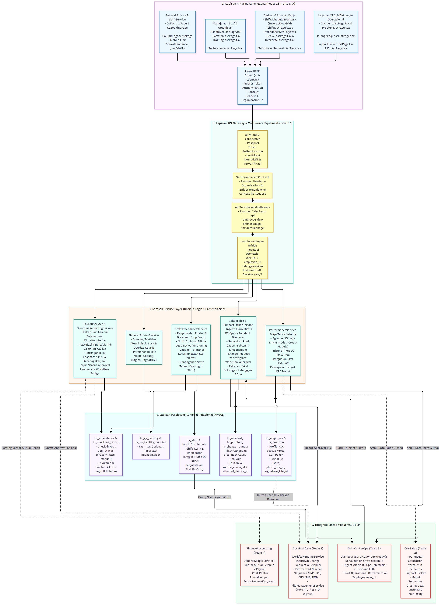

# BEDAH MODUL HRSERVICESUPPORT: MANAJEMEN HUMAN CAPITAL, OPERASIONAL SHIFT 24/7, & SERVICE DESK ITIL MSDC ERP
## Modul: HrServiceSupport (`Team 6 — Employee Directory, Roster & Shift Scheduling, Attendance, Payroll & PPh 21 TER, ITIL Service Desk, General Affairs, & Employee Self-Service`)
**Target Cakupan**: Layanan Tata Kelola Sumber Daya Manusia, Penjadwalan Jaga Operasional Data Center, Penggajian & Kepatuhan Pajak, serta Tata Kelola Layanan Dukungan Korporat

---

## 1. PERAN STRATEGIS & FILOSOFI BISNIS HRSERVICESUPPORT DALAM EKOSISTEM MSDC ERP

Dalam industri penyedia fasilitas *data center tier-rated* dan *managed network services*, ketersediaan infrastruktur (*high availability*) sebesar 99,982% hingga 99,995% tidak hanya bertumpu pada keandalan sistem pendingin presisi (*precision cooling*) atau redundansi kelistrikan (*dual-feed UPS & backup generator*), melainkan sangat bergantung pada kesiapsiagaan sumber daya manusia (*human capital operational readiness*). Pusat data beroperasi tanpa henti selama 24 jam sehari, 7 hari seminggu, dan 365 hari setahun (*24/7/365 continuous operations*). Ketiadaan staf teknisi di ruang *Network Operations Center* (NOC) atau keterlambatan penanganan insiden perangkat keras dapat memicu pelanggaran *Service Level Agreement* (SLA) bernilai miliaran rupiah serta pembatalan sewa rak (*colocation lease termination*) oleh pelanggan korporat.

Modul **`HrServiceSupport`** dirancang sebagai pilar penopang operasional manusia (*human operational pillar*) dan meja bantuan terpadu (*unified service desk*) pada MSDC ERP. Berbeda dari sistem HR konvensional yang semata-mata berfokus pada administrasi personalia kantor (*back-office HR*), arsitektur `HrServiceSupport` dirancang secara *mission-critical* untuk menjawab tantangan dinamis industri pusat data:

1. **Jaminan Keberlanjutan Pengawasan Fasilitas (*Continuous 24/7 Roster Enforcement*)**: Menyediakan infrastruktur penjadwalan shift rotasi (*shift roster*) bertingkat yang menjamin ketersediaan insinyur teknis (*on-duty engineers*) di setiap lokasi fisik gedung data center (*data center sites*), mencegah kekosongan personel pada saat pergantian regu jaga (*shift handover*), serta menangani penugasan lintas batas tengah malam (*overnight shifts*).
2. **Jembatan Informasi Personel Operasional (*Operational On-Duty Bridge*)**: Berfungsi sebagai penyedia data tunggal (*single source of truth*) bagi modul `DataCenterOps` mengenai identitas, nomor kontak, foto identitas, serta keahlian spesifik staf yang sedang aktif bertugas di lapangan. Integrasi ini memastikan operator dapat segera menugaskan tiket insiden kepada teknisi yang memiliki sertifikasi relevan (misalnya sertifikasi terminasi serat optik atau penanganan generator diesel).
3. **Standarisasi Tata Kelola Layanan Berbasis ITIL (*ITIL-Compliant Service Desk*)**: Menerapkan kerangka kerja *Information Technology Infrastructure Library* (ITIL v4) untuk manajemen gangguan (*Incident Management*), analisis akar penyebab (*Problem Management & Root Cause Analysis*), serta pengendalian mitigasi risiko perubahan sistem (*Change Management / RFC*), lengkap dengan gerbang persetujuan terpusat (*Workflow Engine*).
4. **Otomasi Penggajian & Kepatuhan Regulasi Nasional (*Statutory Compliance Engine*)**: Mengintegrasikan pencatatan kehadiran fisik (*biometric/mobile attendance*) dan akumulasi lembur (*overtime*) insinyur ke dalam sistem penggajian (*payroll*) yang mematuhi hukum ketenagakerjaan dan perpajakan Indonesia, mencakup skema Tarif Efektif Rata-Rata (TER) PPh 21 berdasarkan PP No. 58 Tahun 2023 / PMK No. 168 Tahun 2023, serta pemotongan iuran BPJS Kesehatan dan BPJS Ketenagakerjaan.
5. **Pemberdayaan Mandiri Staf (*Employee Self-Service & General Affairs*)**: Menyediakan portal swalayan karyawan (*Employee Self-Service / ESS*) untuk presensi berbasis lokasi, pengajuan izin/cuti (*leave request*), peminjaman fasilitas rapat (*facility booking* dengan *pessimistic concurrency lock*), hingga permohonan izin masuk gedung (*building access permit*) yang terhubung dengan sistem otorisasi gerbang fisik data center.

---

## 2. PETA FITUR & SUB-MODUL UTAMA

Berdasarkan audit komprehensif terhadap direktori `MSDC/Modules/HrServiceSupport/` dan antarmuka web pada `MSDCFrontend/src/modules/hr-service-support/`, kapabilitas fungsional modul ini diklasifikasikan ke dalam 6 domain utama:

```
┌─────────────────────────────────────────────────────────────────────────────┐
│                          MODUL HRSERVICESUPPORT                             │
├──────────────────────┬──────────────────────┬───────────────────────────────┤
│ 1. MANAJEMEN STAF    │ 2. WAKTU & OPERASIONAL│ 3. PENGGAJIAN & LEMBUR        │
│    & KOMPETENSI      │    SHIFT 24/7        │    (STATUTORY COMPLIANCE)     │
│  - Profil Karyawan   │  - Master Shift Kerja│  - Aturan Jam Kerja (Policy)  │
│  - Riwayat Karir     │  - Board Jadwal Roster│  - Rekap Lembur Insinyur      │
│  - Matriks Keahlian  │  - Presensi Lapangan │  - Kalkulasi PPh 21 TER       │
│  - Pelatihan & Sert. │  - Koreksi Presensi  │  - Pemotongan BPJS Kes & TK   │
│  - Target KPI Posisi │  - Manajemen Cuti    │  - Jurnal Akrual Biaya        │
├──────────────────────┼──────────────────────┼───────────────────────────────┤
│ 4. ITIL SERVICE DESK │ 5. GENERAL AFFAIRS   │ 6. EMPLOYEE SELF-SERVICE      │
│  - Incident Mgmt     │  - Peminjaman Ruang  │  - Mobile Check-in/out        │
│  - Problem & RCA     │  - Izin Masuk Gedung │  - Pengajuan Cuti Mandiri     │
│  - Change Request    │  - Dokumen Digital   │  - Dasbor Shift Saya          │
│  - Knowledge Base    │  - Approval Fasilitas│  - Status Tiket Internal      │
│  - Customer Support  │  - Log Penggunaan    │  - Akses Riwayat Slip Gaji    │
└──────────────────────┴──────────────────────┴───────────────────────────────┘
```

### 2.1. Manajemen Direktori Karyawan & Matriks Kompetensi (*Employee & Talent Management*)
Sub-modul ini mengelola data induk sumber daya manusia dari fase perekrutan hingga terminasi:
* **Profil Komprehensif Karyawan (`/hr/employees`)**: Menyimpan nomor induk karyawan (*employee number*), Nomor Induk Kependudukan (NIK), Nomor Pokok Wajib Pajak (NPWP), status pernikahan/PTKP, informasi kontak darurat, susunan keluarga, riwayat pendidikan formal, dan pengalaman kerja lampau.
* **Tautan Identitas Pengguna (*User Account Binding*)**: Menghubungkan entitas `hr_employee` dengan akun login `users` pada `CorePlatform` via kolom `user_id`. Tautan ini menjadi pondasi atribusi persetujuan dokumen serta penentuan penugasan tiket pemeliharaan.
* **Matriks Keahlian (*Skills Inventory*)**: Mendokumentasikan keahlian teknis (seperti *Cisco Routing, Fiber Splicing, HVAC Maintenance, High-Voltage Power*) beserta tingkat kemahiran (*beginner, intermediate, advanced, expert*) yang diekspos langsung ke modul operasional data center.
* **Program Pelatihan & Masa Berlaku Sertifikasi (`/hr/trainings`, `/hr/certifications`)**: Memantau partisipasi pelatihan internal/eksternal dan melacak masa kedaluwarsa sertifikasi profesional (*certification expiry tracking*), dilengkapi fungsi peringatan otomatis (*expiring soon query*).

### 2.2. Penjadwalan Roster Kerja & Manajemen Presensi (*Shift Scheduling & Attendance*)
Fondasi operasional fasilitas 24/7 yang menjamin ketersediaan insinyur teknis di setiap situs pusat data:
* **Master Definisi Shift (`/hr/shifts`)**: Mengatur jam kerja reguler dan shift rotasi (Pagi, Siang, Malam, *Graveyard*). Menerapkan prinsip *non-destructive shift versioning* untuk melindungi integritas perhitungan jam lembur historis saat konfigurasi jam shift diperbarui.
* **Papan Jadwal Interaktif Roster (*Shift Schedule Board* - `/hr/shift-board`)**: Antarmuka berbasis matriks kisi (*grid matrix*) yang memungkinkan penempatan staf secara visual ke tanggal dan lokasi gedung (*site*) tertentu, dilengkapi mekanisme konfirmasi jadwal (*schedule confirmation*).
* **Pencatatan Presensi & Toleransi Keterlambatan (`/hr/attendances`)**: Merekam waktu presensi masuk (*check-in*) dan pulang (*check-out*). Sistem mengevaluasi toleransi keterlambatan 15 menit terhadap jadwal shift yang terikat, serta mampu menangani shift lintas hari (*overnight shift*) secara matematis.
* **Manajemen Izin & Cuti Bersyarat (`/hr/permission-requests`, `/hr/leave`)**: Pengelolaan izin sakit, dinas luar, dan cuti tahunan dengan pemotongan saldo kuota cuti (*leave balance deduction*) dan pembentukan entri kehadiran berstatus *leave* secara otomatis.

### 2.3. Akumulasi Lembur & Penggajian Terstandarisasi Regulasi (*Payroll & Compliance*)
Mengonversi aktivitas operasional jam kerja menjadi kompensasi finansial yang akurat:
* **Rekapitulasi Jam Lembur Otomatis (`/hr/overtime`)**: Mengagregasi jam lembur bulanan dari data presensi riil berdasarkan aturan kebijakan jam kerja (*Work Hour Policy*), mencakup absensi reguler maupun kehadiran koreksi (*manual correction*).
* **Alur Persetujuan Lembur Terpadu**: Pengajuan lembur oleh divisi HRD dialirkan ke manajer operasional melalui integrasi *Workflow Engine* terpusat pada `CorePlatform`, dengan pendengar kejadian (*event listener*) yang menyinkronkan status persetujuan secara otomatis.
* **Kalkulasi Pajak PPh 21 TER (PP 58/2023 & PMK 168/2023)**: Menentukan kategori Tarif Efektif Rata-Rata (Kategori A, B, atau C) berdasarkan status PTKP karyawan, lalu menerapkan persentase tarif berjenjang terhadap penghasilan bruto bulanan secara otomatis.
* **Potongan Jaminan Sosial Ketenagakerjaan & Kesehatan**: Menghitung iuran BPJS Kesehatan sebesar 1% dengan batas atas upah (*wage cap*) Rp 12.000.000, serta BPJS Ketenagakerjaan (JHT 2% dan Jaminan Pensiun 1% dengan batas upah Rp 10.042.300).
* **Integrasi Akrual Jurnal Finansial**: Mentransmisikan beban lembur karyawan ke buku besar `FinanceAccounting` sebagai pencatatan akrual beban (*accrual expense: Debit Beban Lembur / Kredit Hutang Lembur*).

### 2.4. Manajemen Layanan ITIL (ITIL Service Desk)
Penerapan standar operasional global untuk memelihara ketersediaan sistem data center:
* **Manajemen Gangguan (*Incident Management* - `/hr/incidents`)**: Menangani tiket gangguan layanan internal maupun pelanggan. Memiliki integrasi langsung untuk menerima eskalasi telemetri alarm kritis dari modul `DataCenterOps` (`createFromAlarm`).
* **Manajemen Masalah & Akar Penyebab (*Problem Management* - `/hr/problems`)**: Mengisolasi penyebab mendasar dari serangkaian insiden berulang, mencatat investigasi teknis, serta merumuskan solusi permanen (*Known Error Database*).
* **Permohonan Perubahan Sistem (*Change Request / RFC* - `/hr/change-requests`)**: Mengatur alur persetujuan pemeliharaan terjadwal (*maintenance window*), penggantian perangkat jaringan, atau modifikasi catu daya dengan mitigasi risiko (*rollback plan*) dan integrasi *Workflow Engine*.
* **Basis Pengetahuan Operasional (*Knowledge Base* - `/hr/kb`)**: Dokumentasi *Standard Operating Procedure* (SOP) dan artikel panduan teknis yang dapat dicari secara cepat oleh insinyur piket.
* **Dukungan Pelanggan (*Customer Support Tickets* - `/hr/support-tickets`)**: Saluran penanganan permintaan bantuan dari pelanggan eksternal dengan pemantauan SLA respon awal, eskalasi tiket, dan pengukuran kepuasan pelanggan (*CSAT*).

### 2.5. Urusan Umum & Izin Masuk Fasilitas (*General Affairs*)
Tata kelola fasilitas fisik gedung dan keamanan operasional perkantoran:
* **Inventaris & Reservasi Fasilitas Gedung (`/hr/facilities`, `/hr/facility-bookings`)**: Pengelolaan ruang rapat, kendaraan dinas, dan fasilitas kantor, dilengkapi proteksi penguncian pesimistik (*pessimistic lock*) guna mencegah reservasi ganda yang bertubrukan (*overlapping schedule guard*).
* **Izin Masuk Gedung (*Building Access Permits* - `/hr/building-access`)**: Permohonan izin akses gedung bagi tamu atau kontraktor, terhubung dengan *DocumentService* untuk penerbitan surat resmi berkode QR dan tanda tangan digital.

### 2.6. Swalayan Karyawan (*Employee Self-Service / ESS Mobile Bridge*)
Penyediaan gerbang API terisolasi (`/api/v1/hr-service-support/me/*`) dengan penyaring *middleware* `mobile.employee`. Endpoint ini secara transparan mengidentifikasi ID karyawan dari token *bearer* aktif tanpa menerima masukan `employee_id` dari klien, meniadakan celah kerentanan *Insecure Direct Object References* (IDOR) pada presensi mandiri dan pengajuan izin.

---

## 3. ARSITEKTUR FULLSTACK & ALUR KODE END-TO-END

Modul `HrServiceSupport` dirancang dengan arsitektur berlapis (*layered architecture*) yang memisahkan antarmuka pengguna, gerbang API, logika bisnis perorangan, dan persistensi multi-organisasi:



### 3.1. Alur 1: Penjadwalan Roster Kerja & Penyajian Dasbor Staff On-Duty Data Center Ops

Salah satu titik temu terpenting antara operasional sumber daya manusia dan operasional data center fisik adalah mekanisme penyajian petugas jaga (*Staff On-Duty*):

1. **Penyusunan Roster di Antarmuka HR (`ShiftScheduleBoard.tsx`)**:
   Manajer HR atau *Lead Operations* mengatur penugasan staf pada kalender kerja. Ketika kartu jadwal digeser ke tanggal dan situs tertentu, frontend mengirimkan permintaan `POST /api/v1/hr-service-support/employees/{id}/shift-schedules` dengan payload:
   ```json
   {
     "shift_id": 2,
     "site_id": 1,
     "schedule_date": "2026-11-19",
     "notes": "Piket Malam NOC Gedung Cyber"
   }
   ```
2. **Validasi & Persistensi Jadwal (`ShiftAttendanceService::scheduleShift`)**:
   Logika bisnis membuat rekaman pada tabel `hr_shift_schedule`:
   ```php
   public function scheduleShift(Employee $employee, Shift $shift, array $data): ShiftSchedule
   {
       $schedule = ShiftSchedule::create([
           'employee_id'   => $employee->id,
           'shift_id'      => $shift->id,
           'site_id'       => $data['site_id'] ?? null,
           'schedule_date' => $data['schedule_date'],
           'status'        => 'scheduled',
           'notes'         => $data['notes'] ?? null,
       ]);

       $this->audit('created', 'hr_shift_schedule', $schedule->id, null, $schedule->toArray());
       return $schedule;
   }
   ```
3. **Konsumsi Data oleh DataCenterOps (`DashboardService::onDutyToday`)**:
   Saat operator data center membuka halaman dasbor utama (`/dc`), pengendali `DashboardController@onDutyToday` mengeksekusi kueri langsung terhadap model `ShiftSchedule`. **Tabel `hr_shift_schedule` ditetapkan sebagai satu-satunya sumber kebenaran (*single source of truth*) penugasan riil hari ini**, mengesampingkan nilai penempatan *default* pada tabel jabatan (`hr_position.site_id`):
   ```php
   public function onDutyToday(?int $siteId = null): array
   {
       $tz = config('app.business_timezone', 'Asia/Jakarta');
       $today = now($tz)->toDateString();

       $schedules = \Modules\HrServiceSupport\Entities\ShiftSchedule::query()
           ->whereDate('schedule_date', $today)
           ->whereIn('status', ['scheduled', 'confirmed'])
           ->whereNotNull('site_id')
           ->when($siteId, fn ($q) => $q->where('site_id', $siteId))
           ->with([
               'employee:id,full_name,employee_number,phone,email,photo_file_id,position_id,user_id',
               'employee.position:id,position_title',
               'employee.skills:id,employee_id,skill_name,proficiency_level',
               'shift:id,shift_code,start_time,end_time',
               'site:id,site_name,site_code',
           ])
           ->get();

       // Hitung jumlah tiket open DC Ops yang sedang ditangani staf via employee.user_id
       $userIds = $schedules->pluck('employee.user_id')->filter()->unique()->values();
       $openTicketCounts = $userIds->isEmpty() ? collect() : Ticket::whereIn('assigned_to', $userIds)
           ->whereNotIn('status', ['resolved', 'closed'])
           ->selectRaw('assigned_to, COUNT(*) as cnt')
           ->groupBy('assigned_to')
           ->pluck('cnt', 'assigned_to');

       return $schedules->map(function ($s) use ($openTicketCounts) {
           return [
               'schedule_id'        => $s->id,
               'employee_id'        => $s->employee_id,
               'employee_name'      => $s->employee?->full_name,
               'photo_file_id'      => $s->employee?->photo_file_id,
               'position_title'     => $s->employee?->position?->position_title,
               'site_name'          => $s->site?->site_name,
               'shift_code'         => $s->shift?->shift_code,
               'shift_start'        => $s->shift?->start_time,
               'shift_end'          => $s->shift?->end_time,
               'skills'             => $s->employee?->skills ?? [],
               'open_tickets_count' => (int) ($openTicketCounts[$s->employee?->user_id] ?? 0),
           ];
       })->values()->all();
   }
   ```
4. **Visualisasi Kartu Petugas Jaga di Frontend**:
   Dasbor menampilkan foto profil (diambil secara aman dalam bentuk representasi *blob* via `GET /api/v1/core-platform/files/{id}/preview`), keahlian bersertifikat, dan indikator beban kerja tiket aktif dari masing-masing petugas jaga di lokasi data center tersebut.

---

### 3.2. Alur 2: Presensi, Toleransi Keterlambatan, dan Shift Versioning

Pencatatan presensi staf lapangan dirancang dengan toleransi matematis dan integritas audit ketat:

1. **Logika Check-in & Evaluasi Keterlambatan (`ShiftAttendanceService::checkIn`)**:
   Sistem mengevaluasi waktu presensi terhadap waktu mulai jadwal shift (`start_time`). Apabila waktu presensi melebihi batas jadwal ditambah toleransi 15 menit, status kehadiran secara otomatis diklasifikasikan sebagai `late`:
   ```php
   $isManual = ! empty($data['check_in_at']);
   $checkInAt = $isManual ? Carbon::parse($date . ' ' . $data['check_in_at']) : now();

   if ($isManual) {
       $status = 'manual';
   } else {
       $status = 'present';
       if ($schedule) {
           $shiftStart = Carbon::parse($date . ' ' . $schedule->shift->start_time);
           if ($checkInAt->greaterThan($shiftStart->addMinutes(15))) {
               $status = 'late'; // Ambang toleransi keterlambatan 15 menit
           }
       }
   }
   ```
2. **Kalkulasi Shift Lintas Hari (*Overnight Shift Calculation*)**:
   Pada shift malam (misal mulai pukul 22:00 dan berakhir pukul 06:00 keesokan harinya), waktu keluar (*check-out*) memiliki nilai jam nominal yang lebih kecil daripada waktu masuk. Sistem mendeteksi anomali ini dan secara otomatis menambahkan 1 hari kalender (`$checkOutAt->addDay()`) guna menjamin selisih durasi jam kerja dan lembur terhitung secara positif.
3. **Pemberlakuan Versi Shift Tanpa Rusak (*Non-Destructive Shift Versioning*)**:
   Jika seorang administrator mengubah jam kerja suatu shift (`ShiftAttendanceService::updateShift`), perubahan langsung di tempat (*in-place mutation*) dilarang apabila shift tersebut telah dirujuk oleh jadwal atau presensi historis. Mengubah jam shift yang sudah lampau akan merusak perhitungan lembur bulan-bulan sebelumnya.  
   Sebagai gantinya, sistem secara otomatis mengarsipkan shift lama (`is_active = false`, kode dimodifikasi menjadi `{CODE}-OLD{id}`) dan menerbitkan rekaman shift baru untuk digunakan pada jadwal berikutnya:
   ```php
   if ($shift->schedules()->exists()) {
       $shift->update([
           'is_active'  => false,
           'shift_code' => $shift->shift_code . '-OLD' . $shift->id,
       ]);

       $newShift = Shift::create([
           'shift_code' => $this->generateSequentialNumber('shift', 'SHF'),
           'shift_name' => $data['shift_name'],
           'start_time' => $data['start_time'],
           'end_time'   => $data['end_time'],
           'is_active'  => true,
       ]);

       return ['shift' => $newShift, 'versioned' => true];
   }
   ```

---

### 3.3. Alur 3: Manajemen Layanan ITIL: Ingest Alarm DC Ops & Change Request Approval

Integrasi ITIL dirancang untuk merespon anomali teknis data center secara terstruktur:

1. **Eskalasi Otomatis Alarm Telemetri ke Insiden ITIL (`ItilService::createFromAlarm`)**:
   Ketika sensor suhu atau sistem kelistrikan pada modul `DataCenterOps` memicu peringatan kritis (*critical alarm*), operator dapat mengeksekusi eskalasi instan melalui endpoint `POST /api/v1/hr-service-support/alarms/{alarm}/create-incident`.  
   Sistem secara otomatis mengekstraksi metadata lokasi (`site_id`), rak (`rack_id`), dan perangkat terdampak (`affected_device_id`), memetakan derajat keparahan alarm ke prioritas insiden (*critical severity* $\rightarrow$ *critical priority*), serta mengunci rekaman alarm dengan klausa `lockForUpdate()` agar tidak terjadi duplikasi tiket:
   ```php
   return DB::transaction(function () use ($alarm, $organizationId) {
       $alarm = Alarm::query()->lockForUpdate()->findOrFail($alarm->id);

       if (Incident::where('source_alarm_id', $alarm->id)->exists()) {
           throw new \DomainException("Alarm ini sudah pernah dibuatkan Incident sebelumnya.");
       }

       $priority = match ($alarm->severity) {
           'critical' => 'critical',
           'warning'  => 'medium',
           default    => 'low',
       };

       $incident = Incident::create([
           'organization_id'    => $resolvedOrganizationId,
           'incident_number'    => $this->generateSequentialNumber('incident', 'INC'),
           'title'              => "Alarm {$alarm->alarm_type}: {$alarm->alarm_name}",
           'priority'           => $priority,
           'source_alarm_id'    => $alarm->id,
           'affected_device_id' => $alarm->device_id,
           'affected_site_id'   => $alarm->site_id,
           'status'             => 'new',
           'opened_at'          => now(),
       ]);

       return $incident;
   });
   ```
2. **Orkestrasi Persetujuan Perubahan Sistem (*Change Request Workflow*)**:
   Untuk aktivitas pemeliharaan berisiko tinggi (misal *firmware upgrade switch core*), insinyur mengajukan *Request for Change* (RFC). Metode `ItilService::submitChangeForApproval` mendaftarkan dokumen ke `WorkflowEngineService` pada `CorePlatform` dengan parameter `moduleCode: 'hr-service-support'` dan `documentType: 'change_request'`. Status dokumen beralih menjadi `submitted` dan hanya dapat dieksekusi setelah memperoleh persetujuan pejabat berwenang (*Change Advisory Board*).

---

### 3.4. Alur 4: Rekapitulasi Lembur, Pajak PPh 21 TER, dan Sinkronisasi Finansial

Proses penutupan akhir bulan (*end-of-month closing*) mengintegrasikan data operasional jam kerja menjadi entri finansial korporat:

1. **Rekapitulasi Lembur Idempoten (`OvertimeReportingService::generateMonthlyOvertime`)**:
   Sistem memindai seluruh rekaman presensi dalam rentang bulan berjalan. Total jam lembur dihitung berdasarkan selisih jam kerja efektif terhadap kebijakan kerja korporat (*Work Hour Policy*), mencakup presensi reguler maupun kehadiran yang disesuaikan secara manual. Rekaman disimpan ke tabel `hr_overtime_record` dengan sifat idempoten (*update-or-create* per periode).
2. **Persetujuan Lembur Melalui Workflow Bridge (`SyncOvertimeApprovalResult`)**:
   Pengajuan lembur diajukan ke manajer divisi melalui mesin *workflow*. Saat persetujuan selesai di *CorePlatform*, event `WorkflowInstanceCompleted` ditangkap oleh *listener* `SyncOvertimeApprovalResult`.  
   *Listener* ini menggunakan klausa khusus `withoutGlobalScope('organization')` agar proses sinkronisasi tidak terhalang batas konteks organisasi ketika manajer penyetuju berada pada unit kerja berbeda:
   ```php
   public function handle(WorkflowInstanceCompleted $event): void
   {
       $instance = $event->instance;
       if ($instance->module_code !== 'hr-service-support' || $instance->document_type !== 'overtime') {
           return;
       }

       // Bypass Global Scope agar approver lintas-organisasi tetap dapat mengupdate status dokumen
       $record = OvertimeRecord::withoutGlobalScope('organization')->find($instance->document_id);
       if (! $record) return;

       if ($instance->status === 'approved') {
           $this->service->approve($record, $approverEmployeeId);
       } else {
           $this->service->reject($record, $approverEmployeeId, $history?->comments);
           // Jika ditolak, batalkan nilai lembur pada draf slip gaji
           $this->payrollService->resetOvertimeAmount($record->employee_id, $record->period_month, $record->period_year);
       }
   }
   ```
3. **Kalkulasi Pajak PPh 21 Skema TER Bulanan (`PayrollService`)**:
   Sesuai amanat Peraturan Pemerintah No. 58 Tahun 2023, sistem memetakan status PTKP karyawan (misal K/1 $\rightarrow$ Kategori B). Berdasarkan akumulasi penghasilan bruto (gaji pokok + tunjangan makan + uang lembur yang telah disetujui), sistem mengevaluasi matriks kurung penghasilan (*bracket lookup*) untuk menetapkan tarif persentase pajak efektif secara presisi.
4. **Pencatatan Beban ke General Ledger (`GeneralLedgerService`)**:
   Nilai lembur dan gaji yang telah diverifikasi dialirkan ke `FinanceAccounting` melalui aturan jurnal posting (*Posting Rules*), menghasilkan ayat jurnal akrual beban (*Dr Beban Lembur Karyawan / Cr Hutang Lembur*).

---

## 4. TITIK INTEGRASI LINTAS MODUL (CROSS-MODULE CONTRACTS)

Modul `HrServiceSupport` menjadi simpul integrasi strategis yang memasok dan mengonsumsi data dari berbagai modul lain di dalam ekosistem MSDC ERP:

| Modul Mitra | Jenis Kontrak | Arah Aliran Data | Mekanisme Teknis & Realisasi Kode |
| :--- | :--- | :--- | :--- |
| **`DataCenterOps`** | *Direct Eloquent Query* | `HrServiceSupport` $\rightarrow$ `DataCenterOps` | `DashboardService::onDutyToday()` menjalankan kueri terhadap `ShiftSchedule` (filter: `schedule_date = today`, `site_id`, status: `scheduled`/`confirmed`) untuk menampilkan kartu petugas jaga lengkap dengan keahlian teknis. |
| **`DataCenterOps`** | *Cross-Domain Transaction* | `DataCenterOps` $\rightarrow$ `HrServiceSupport` | `ItilService::createFromAlarm(Alarm $alarm)` mengubah status anomali sensor telemetri rak data center menjadi tiket gangguan ITIL (`Incident`) dengan penguncian baris pesimistik `lockForUpdate()`. |
| **`DataCenterOps`** | *Performance Metric Bridge* | `DataCenterOps` $\rightarrow$ `HrServiceSupport` | `PerformanceService::crossModuleMetrics()` menghitung metrik objektif insinyur dengan mereferensikan kolom `Ticket::where('assigned_to', $employee->user_id)`. |
| **`CorePlatform`** | *Workflow Engine v2* | `HrServiceSupport` $\leftrightarrow$ `CorePlatform` | Orkestrasi alur persetujuan Change Request, Permohonan Lembur, Pengajuan Cuti, dan Izin Gedung via `WorkflowEngineService::submit()`, dengan pembaruan status balik via event listener `SyncOvertimeApprovalResult`. |
| **`CorePlatform`** | *File Management Service* | `HrServiceSupport` $\rightarrow$ `CorePlatform` | Relasi `photo_file_id` dan `signature_file_id` pada model `Employee` merujuk ke tabel berkas terenkripsi `cp_fm_file`. File biner diakses via representasi *blob stream* `GET /core-platform/files/{id}/preview`. |
| **`CorePlatform`** | *Central Number Sequence* | `HrServiceSupport` $\leftarrow$ `CorePlatform` | Pembangkitan kode serial unik yang atomik dan berurutan untuk dokumen transaksi: `INC` (Insiden), `PRB` (Problem), `CHG` (Change Request), `SHF` (Shift), `TRN` (Training), dan `CERT` (Sertifikasi). |
| **`FinanceAccounting`**| *General Ledger Bridge* | `HrServiceSupport` $\rightarrow$ `FinanceAccounting` | `OvertimeReportingService::postToFinance()` dan `PayrollService` mengirimkan transaksi jurnal akrual beban gaji/lembur ke tabel buku besar umum (`fa_gl_entry`) via `GeneralLedgerService`. |
| **`FinanceAccounting`**| *Master Data Reference*| `FinanceAccounting` $\rightarrow$ `HrServiceSupport` | Kolom `cost_center_id` pada tabel `hr_employee` dan `hr_overtime_record` terikat secara *foreign key* ke tabel pusat biaya `fa_cost_center`. |
| **`CrmSales`** | *Customer Relation & KPI* | `CrmSales` $\rightarrow$ `HrServiceSupport` | Tabel `hr_incident` dan `hr_support_ticket` menyimpan relasi `customer_id` ke entitas pelanggan CRM; metrik pencapaian *deal* penjualan (`crm_opportunity`) dikonsumsi oleh `PerformanceService` untuk evaluasi insentif sales. |

---

## 5. SPESIFIKASI ENDPOINT API & SKEMA TABEL INTI

### 5.1. Matriks Endpoint API Utama

Berikut adalah representasi endpoint RESTful yang disediakan oleh modul `HrServiceSupport` pada rute `routes/api.php`:

| Metode | Alamat Endpoint URI | Controller Penanggung Jawab | Izin Akses (RBAC) & Deskripsi |
| :--- | :--- | :--- | :--- |
| `GET` | `/api/v1/hr-service-support/employees` | `EmployeeController@index` | `permission:employee.view` — Katalog direktori karyawan dengan filter departemen, status kerja, dan pencarian teks. |
| `POST` | `/api/v1/hr-service-support/employees` | `EmployeeController@store` | `permission:employee.manage` — Registrasi data induk karyawan baru beserta alokasi akun login dan unit kerja. |
| `POST` | `/api/v1/hr-service-support/employees/{id}/photo` | `EmployeeController@photoUpload` | `permission:employee.manage` — Unggah foto profil karyawan ke File Management CorePlatform. |
| `GET` | `/api/v1/hr-service-support/shift-schedules` | `ShiftAttendanceController@scheduleIndex` | `permission:shift.view` — Mengambil daftar matriks jadwal shift berdasarkan rentang tanggal dan lokasi gedung. |
| `POST` | `/api/v1/hr-service-support/employees/{id}/shift-schedules` | `ShiftAttendanceController@scheduleStore` | `permission:shift.manage` — Menetapkan jadwal shift karyawan pada tanggal dan situs spesifik. |
| `PUT` | `/api/v1/hr-service-support/shift-schedules/{id}` | `ShiftAttendanceController@scheduleMove` | `permission:shift.manage` — Memindahkan jadwal shift (operasi *drag-and-drop* pada papan jadwal). |
| `POST` | `/api/v1/hr-service-support/employees/{id}/check-in` | `ShiftAttendanceController@checkIn` | `permission:attendance.manage` — Entri kehadiran masuk karyawan (evaluasi toleransi 15 menit). |
| `POST` | `/api/v1/hr-service-support/incidents` | `ItilController@incidentStore` | `permission:incident.manage` — Pembuatan tiket gangguan ITIL baru secara manual. |
| `POST` | `/api/v1/hr-service-support/alarms/{alarm}/create-incident` | `ItilController@incidentFromAlarm` | `permission:incident.manage` — Mengubah alarm telemetri perangkat data center menjadi tiket insiden ITIL. |
| `POST` | `/api/v1/hr-service-support/change-requests/{id}/submit` | `ItilController@changeSubmit` | `permission:change-request.manage` — Mengajukan proposal perubahan sistem ke Workflow Engine. |
| `POST` | `/api/v1/hr-service-support/overtime-records/submit` | `OvertimeController@submit` | `permission:overtime.submit` — Mengajukan rekapitulasi lembur bulanan ke alur persetujuan manajerial. |
| `POST` | `/api/v1/hr-service-support/payroll-records/generate` | `PayrollController@generate` | `permission:payroll.manage` — Kalkulasi penggajian massal bulanan, PPh 21 TER, dan potongan jaminan sosial. |
| `POST` | `/api/v1/hr-service-support/ga/facility-bookings` | `GaFacilityBookingController@store` | `permission:facility.manage` — Reservasi fasilitas dengan proteksi jadwal tumpang tindih (*overlap guard*). |
| `POST` | `/api/v1/hr-service-support/me/attendance/check-in` | `EmployeeSelfServiceController@checkIn` | `permission:employee-self-service.manage` — Presensi mandiri staf via aplikasi ponsel terproteksi token. |

---

### 5.2. Skema Entitas Basis Data Utama

Struktur tabel `HrServiceSupport` dirancang dengan integritas relasional tinggi serta prefiks terstandarisasi `hr_`:

```
┌─────────────────────────────────┐           ┌─────────────────────────────────┐
│           hr_employee           │           │         hr_shift_schedule       │
├─────────────────────────────────┤           ├─────────────────────────────────┤
│ id (PK)                         │1       *  │ id (PK)                         │
│ employee_number (VARCHAR, UNIQ) │───────────│ employee_id (FK -> hr_employee) │
│ full_name (VARCHAR)             │           │ shift_id (FK -> hr_shift)       │
│ user_id (FK -> users, NULLABLE) │           │ site_id (FK -> dc_site)         │
│ position_id (FK -> hr_position) │           │ schedule_date (DATE)            │
│ organization_id (BIGINT)        │           │ status (scheduled/confirmed)    │
│ photo_file_id (FK -> cp_fm_file)│           └────────────────┬────────────────┘
│ base_salary (DECIMAL 14,2)      │                            │ 1
│ ptkp_status (ENUM TK/0..K/3)    │                            │
└────────────────┬────────────────┘                            │ 1
                 │ 1                                           │
                 │                                             ▼
                 │ *                          ┌─────────────────────────────────┐
                 ├───────────────────────────>│          hr_attendance          │
                 │                            ├─────────────────────────────────┤
                 │                            │ id (PK)                         │
                 │                            │ employee_id (FK -> hr_employee) │
                 │                            │ schedule_id (FK, NULLABLE)      │
                 │                            │ check_in_at (DATETIME)          │
                 │                            │ check_out_at (DATETIME)         │
                 │                            │ status (present/late/manual)    │
                 │                            └─────────────────────────────────┘
                 │
                 │ *                          ┌─────────────────────────────────┐
                 ├───────────────────────────>│        hr_overtime_record       │
                 │                            ├─────────────────────────────────┤
                 │                            │ id (PK)                         │
                 │                            │ employee_id (FK -> hr_employee) │
                 │                            │ period_month (INT), year (INT)  │
                 │                            │ overtime_hours (DECIMAL 6,2)    │
                 │                            │ status (draft/submitted/appr)   │
                 │                            └─────────────────────────────────┘
                 │
                 │ *                          ┌─────────────────────────────────┐
                 └───────────────────────────>│           hr_incident           │
                                              ├─────────────────────────────────┤
                                              │ id (PK)                         │
                                              │ incident_number (VARCHAR, UNIQ) │
                                              │ title (VARCHAR)                 │
                                              │ priority (critical/high/med/low)│
                                              │ source_alarm_id (FK, NULLABLE)  │
                                              │ affected_device_id (FK, NULL)   │
                                              │ affected_site_id (FK, NULL)     │
                                              │ assigned_to (FK -> hr_employee) │
                                              └─────────────────────────────────┘
```

1. **Entitas Karyawan & Personalia (`hr_employee`, `hr_position`, `hr_employee_skill`)**:
   - `hr_employee`: Memuat profil pegawai (`employee_number`, `full_name`, `user_id`, `position_id`, `department_id`, `cost_center_id`, `photo_file_id`, `signature_file_id`, `base_salary`, `ptkp_status`, `bpjs_kesehatan_number`). Menerapkan *soft deletes* dan *multi-tenancy scope*.
   - `hr_employee_skill`: Menyimpan inventaris keahlian (`skill_name`, `proficiency_level`) yang ditautkan ke masing-masing insinyur.
2. **Entitas Waktu Kerja & Roster (`hr_shift`, `hr_shift_schedule`, `hr_attendance`)**:
   - `hr_shift`: Format waktu dasar (`shift_code`, `shift_name`, `start_time`, `end_time`, `is_active`).
   - `hr_shift_schedule`: Matriks penugasan harian (`employee_id`, `shift_id`, `site_id`, `schedule_date`, `status`). Kolom `site_id` menghubungkan penugasan staf langsung ke fasilitas gedung data center.
   - `hr_attendance`: Rekaman presensi aktual (`employee_id`, `schedule_id`, `attendance_date`, `check_in_at`, `check_out_at`, `status`).
3. **Entitas Finansial & Kompensasi (`hr_overtime_record`, `hr_payroll_record`)**:
   - `hr_overtime_record`: Rekapitulasi lembur bulanan (`employee_id`, `period_month`, `period_year`, `overtime_hours`, `hourly_rate`, `status`, `workflow_instance_id`).
   - `hr_payroll_record`: Lembar rincian gaji (`employee_id`, `period_month`, `period_year`, `base_salary`, `overtime_amount`, `gross_salary`, `bpjs_kes_deduction`, `bpjs_tk_deduction`, `pph21_amount`, `net_salary`, `status`).
4. **Entitas ITIL & Meja Bantuan (`hr_incident`, `hr_problem`, `hr_change_request`, `hr_support_ticket`)**:
   - `hr_incident`: Pelacakan gangguan operasional (`incident_number`, `title`, `priority`, `status`, `source_alarm_id`, `affected_device_id`, `affected_site_id`, `assigned_to`, `opened_at`, `resolved_at`).
   - `hr_change_request`: Manajemen risiko perubahan infrastruktur (`change_number`, `change_type`, `risk_level`, `rollback_plan`, `workflow_instance_id`, `status`).
5. **Entitas Urusan Umum (`hr_ga_facility`, `hr_ga_facility_booking`, `hr_ga_building_access_permit`)**:
   - `hr_ga_facility_booking`: Peminjaman fasilitas kantor (`facility_id`, `requested_by`, `start_at`, `end_at`, `participant_count`, `status`, `document_id`).

---

## 6. BANK PERTANYAAN & JAWABAN PENGUJI (FOKUS ARSITEKTUR ERP & DC OPS)

Berikut adalah ringkasan skenario pengujian kritis terkait arsitektur modul `HrServiceSupport` beserta formula jawaban ilmiah berbasis kode:

### Pertanyaan 1: Mengapa sistem memanfaatkan entitas hr_shift_schedule.site_id sebagai sumber kebenaran tunggal untuk dasbor Staff On-Duty di DataCenterOps, bukan membaca relasi hr_position.site_id?
> **Jawaban Akademis:**  
> Dalam pemodelan domain korporat, atribut `site_id` pada entitas `hr_position` merupakan data induk statis (*static master data*) yang sekadar mendefinisikan lokasi penempatan kerja standar atau pangkalan dinas seorang pegawai (*home base*). Sebaliknya, operasional pusat data komersial 24/7 mengandalkan sistem rotasi regu jaga (*shift rotation*) yang sangat dinamis, di mana seorang insinyur dapat dimobilisasi atau ditugaskan untuk memperkuat pengawasan di lokasi gedung data center lain secara berkala atau darurat (*cross-site deployment / temporary dispatch*).  
> Jika dasbor *Staff On-Duty* membaca data dari posisi, sistem tidak akan mencerminkan siapa personel yang secara faktual bertugas di gedung tersebut pada hari berjalan. Oleh karena itu, arsitektur sistem menetapkan tabel relasional `hr_shift_schedule` (melalui kueri `ShiftSchedule::whereDate('schedule_date', $today)->where('site_id', $siteId)`) sebagai satu-satunya representasi faktual (*single source of truth*) penugasan lapangan. Hal ini menjamin bahwa insinyur yang tampil di dasbor pemantauan fasilitas adalah staf yang benar-benar memegang kendali operasional di gedung tersebut, lengkap dengan foto identitas dan matriks keahliannya.

---

### Pertanyaan 2: Mengapa metode updateShift() pada ShiftAttendanceService menerapkan mekanisme Non-Destructive Versioning (mengarsipkan shift lama dan membuat baris baru) daripada melakukan pembaruan langsung (in-place update)?
> **Jawaban Akademis:**  
> Penjadwalan shift memiliki dependensi matematis yang kuat terhadap perhitungan kompensasi finansial historis. Jam kerja shift (`start_time` dan `end_time`) menjadi parameter dasar dalam kalkulasi keterlambatan presensi dan evaluasi kelebihan jam lembur (*overtime hours*).  
> Apabila seorang administrator memodifikasi jam kerja shift secara langsung (*in-place update*) pada baris data yang telah memiliki rekaman transaksi lampau, maka setiap kali sistem mengeksekusi perhitungan ulang (*recalculation*) atau membuka laporan audit lembur bulan-bulan sebelumnya, angka jam kerja historis akan terdistorsi dan menghasilkan nilai lembur yang keliru secara retroaktif (*retroactive data corruption*).  
> Untuk mencegah degradasi data historis, `ShiftAttendanceService` memeriksa eksistensi relasi melalui `$shift->schedules()->exists()`. Jika shift telah digunakan, sistem mengisolasi shift lama dengan menandainya non-aktif (`is_active = false`), mengubah kodenya menjadi arsip, dan menerbitkan entri shift baru dengan nomor seri terpisah. Seluruh jadwal dan absensi lampau tetap terikat secara aman pada definisi jam shift aslinya, sementara jadwal kerja di masa depan akan menggunakan parameter shift baru.

---

### Pertanyaan 3: Bagaimana mekanisme penanganan anomali Shift Malam (Overnight Shift) pada logika presensi agar kalkulasi jam kerja tidak bernilai negatif?
> **Jawaban Akademis:**  
> Pada shift malam yang melintasi tengah malam (misalnya shift dimulai pukul 22:00 malam dan berakhir pukul 06:00 pagi keesokan harinya), nilai representasi waktu keluar secara numerik lebih kecil daripada waktu masuk jika hanya diparsing berdasarkan komponen jam pada tanggal yang sama. Tanpa penanganan khusus, operasi pengurangan waktu matematika (`check_out - check_in`) akan menghasilkan durasi negatif atau kegagalan logika sistem.  
> `ShiftAttendanceService` mengantisipasi fenomena batas kalender ini dengan membandingkan objek *Carbon* waktu masuk dan keluar:  
> ```php
> if ($checkOutAt->lessThan($checkInAt)) {
>     $checkOutAt->addDay();
> }
> ```  
> Ketika sistem mendeteksi bahwa waktu keluar terjadi sebelum waktu masuk, sistem secara otomatis menginkrementasi tanggal keluar sebanyak 1 hari kalender penuh. Pendekatan ini menjamin bahwa kalkulasi selisih durasi jam kerja, perhitungan keterlambatan, serta akumulasi lembur tetap terhitung secara deterministik dan bernilai positif.

---

### Pertanyaan 4: Mengapa event listener SyncOvertimeApprovalResult wajib mengeksekusi OvertimeRecord::withoutGlobalScope('organization') saat menangkap event penyelesaian persetujuan lembur?
> **Jawaban Akademis:**  
> Dalam arsitektur *multi-tenant* MSDC ERP, seluruh entitas bisnis menerapkan isolasi data otomatis melalui *global query scope* berbasis header `X-Organization-Id` pengguna aktif. Ketika seorang manajer divisi atau pejabat eksekutif korporat melakukan persetujuan lembur pada halaman *"My Approvals"*, request HTTP yang berjalan membawa konteks identitas organisasi aktif milik pejabat penyetuju tersebut.  
> Pada skenario korporasi grup (*holding company*), seorang direktur atau manajer *shared service* seringkali memegang wewenang persetujuan lintas anak perusahaan (*cross-organization approver*). Jika *listener* mengeksekusi kueri `OvertimeRecord::find($instance->document_id)` tanpa mematikan *global scope*, basis data akan memfilter kueri dengan klausa `WHERE organization_id = [Org ID Milik Approver]`. Akibatnya, rekaman pengajuan lembur yang dimiliki oleh karyawan anak perusahaan lain tidak akan ditemukan (`null`), menyebabkan proses sinkronisasi status lembur gagal berjalan secara diam-diam (*silent failure*).  
> Penggunaan klausa eksplisit `withoutGlobalScope('organization')` meniadakan filter penyewa sementara pada lapisan ORM untuk operasi internal sistem yang telah terotorisasi oleh mesin *workflow*, menjamin status lembur karyawan selalu tersinkronisasi sempurna terlepas dari konteks organisasi pejabat yang menyetujuinya.

---

### Pertanyaan 5: Bagaimana GeneralAffairsService mencegah insiden pemesanan ganda (Double Booking) pada fasilitas gedung ketika dua pengguna memesan ruangan yang sama pada detik yang bersamaan?
> **Jawaban Akademis:**  
> Pencegahan *race condition* pada pemesanan fasilitas gedung diimplementasikan melalui pendekatan *pessimistic concurrency control* yang dikombinasikan dengan pemeriksaan tumpang tindih waktu (*interval overlap guard*) di dalam satu transaksi atomik (`DB::transaction`).  
> Ketika permohonan peminjaman masuk, baris fasilitas yang bersangkutan pada tabel `hr_ga_facility` segera dikunci menggunakan klausa SQL `SELECT ... FOR UPDATE` (`$facility = GaFacility::lockForUpdate()->findOrFail(...)`). Kunci eksklusif ini memaksa permintaan konkuren kedua yang mencoba memesan fasilitas yang sama untuk mengantre (*block*) hingga transaksi pertama tuntas. Di dalam blok kunci tersebut, sistem menjalankan evaluasi kueri tumpang tindih rentang waktu:  
> ```sql
> WHERE facility_id = ? 
>   AND status IN ('pending', 'approved') 
>   AND (start_at < ? AND end_at > ?)
> ```  
> Apabila permintaan pertama berhasil melakukan *commit* pemesanan, kueri tumpang tindih pada transaksi kedua akan mendeteksi konflik jadwal dan secara deterministik melempar `RuntimeException` dengan kode kegagalan yang aman. Arsitektur ini menjamin keandalan data 100% bebas dari risiko insiden reservasi ganda.
