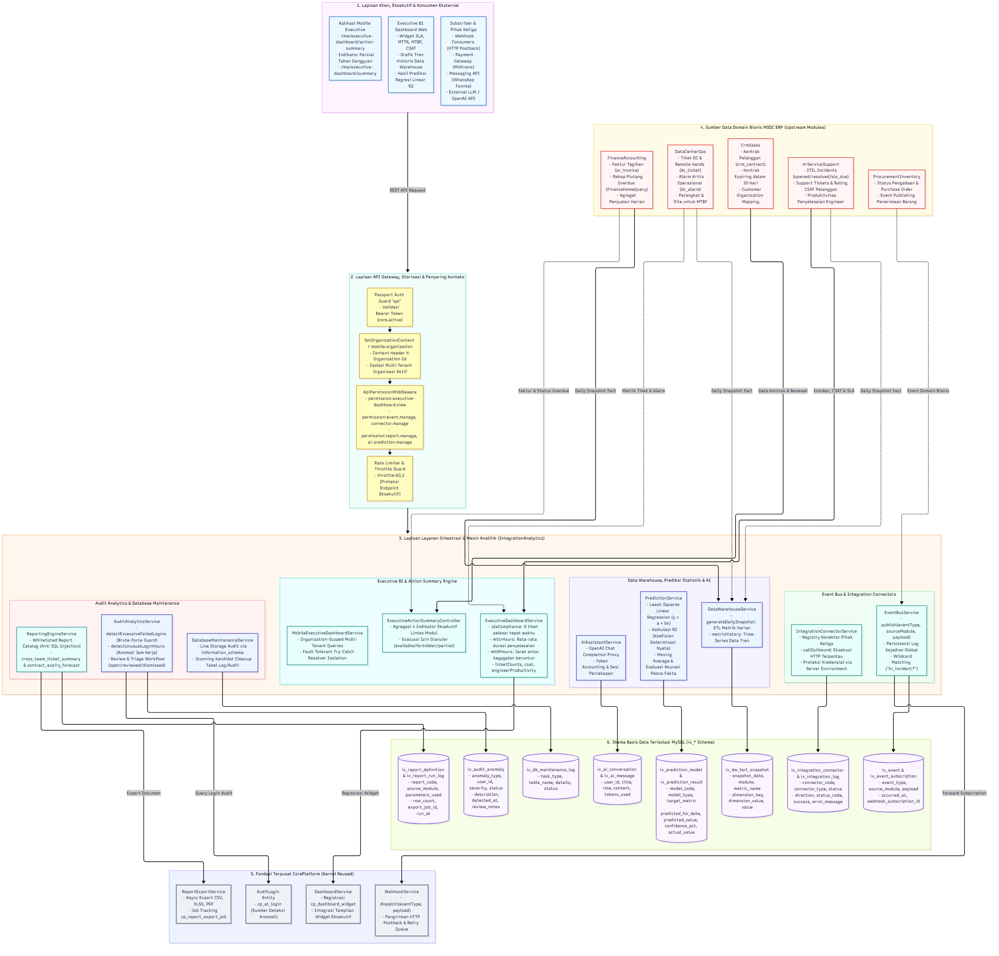

# BEDAH MODUL INTEGRATIONANALYTICS: LAPISAN AGREGASI BI, DASHBOARD EKSEKUTIF, & ORKESTRASI INTEGRASI MSDC ERP
## Modul: IntegrationAnalytics (`Team 7 — Cross-Domain Event Infrastructure, Third-Party Connectors, Reporting Engine, Database Maintenance, Executive Dashboard/BI, AI Assistant, AI Prediction, Data Warehouse, & Audit Analytics`)
**Target Cakupan**: Lapisan Agregasi Lintas Modul ERP (`DataCenterOps`, `CrmSales`, `FinanceAccounting`, `HrServiceSupport`, `ProcurementInventory`, `CorePlatform`)

---

## 1. PERAN STRATEGIS & FILOSOFI BISNIS INTEGRATIONANALYTICS DALAM EKOSISTEM MSDC ERP

Dalam ekosistem aplikasi *Enterprise Resource Planning* (ERP) berskala penyedia layanan *Data Center* dan *Managed Network Services*, setiap unit fungsional bisnis—seperti operasional lantai rak data center (*Data Center Operations*), manajemen hubungan pelanggan dan kontrak penjualan (*CRM & Sales*), pembukuan piutang dan jurnal keuangan (*Finance & Accounting*), pengelolaan tiket gangguan ITIL dan kepegawaian (*HR & Service Support*), serta pengadaan logistik perangkat (*Procurement & Inventory*)—beroperasi dengan domain model dan skema basis data transaksional yang terspesialisasi (*highly normalized Online Transaction Processing / OLTP*).

Akan tetapi, kelemahan mendasar dari model OLTP yang terisolasi (*siloed architecture*) adalah ketidakmampuan manajemen eksekutif (seperti Direktur Operasional, CTO, dan CFO) untuk memperoleh visibilitas performa korporat secara komprehensif, cepat, dan lintas fungsi (*cross-functional single pane of glass*). Jika setiap modul operasional dibebani kewajiban menyajikan laporan agregat makro, menghitung metrik korporat terpadu, atau membangun kanal integrasi pihak ketiga secara mandiri, maka akan terjadi pemborosan komputasi (*query contention* pada tabel transaksional), inkonsistensi formula indikator kinerja (*KPI divergence*), serta risiko kebocoran batasan domain (*domain boundary bleed*).

Modul **`IntegrationAnalytics`** hadir sebagai lapisan agregasi *Business Intelligence* (BI), dashboard eksekutif terpadu, dan orkestrator integrasi antar-sistem. Filosofi rekayasa utama yang mendasari modul ini adalah **"Aggregate, Orchestrate, and Forecast without Data Duplication"** (Mengagregasi, Mengorkestrasi, dan Memprediksi Tanpa Duplikasi Data Transaksional). Modul ini memegang beberapa peran strategis:

1. **Pusat Konsolidasi Metrik Eksekutif (*Executive BI Aggregation Layer*)**: Mengonsolidasikan indikator kinerja utama secara *real-time*—termasuk *Service Level Agreement* (SLA) *compliance*, *Mean Time To Resolve* (MTTR), *Mean Time Between Failures* (MTBF), volume tiket terbuka lintas tim, produktivitas teknisi, serta tingkat kepuasan pelanggan (*Customer Satisfaction / CSAT*)—tanpa mengubah skema modul transaksional sumber.
2. **Kompilasi Status Tindakan Cepat Eksekutif (*Fault-Tolerant Action Summary Engine*)**: Menyajikan ringkasan indikator operasional mendesak (tagihan piutang lewat jatuh tempo, kontrak mendekati masa kedaluwarsa 30 hari, alarm data center berstatus kritis, dan tiket operasional yang melewati tenggat resolusi) dengan proteksi kegagalan parsial (*graceful degradation*) sehingga kegagalan satu modul upstream tidak meruntuhkan seluruh tampilan antarmuka seluler eksekutif.
3. **Infrastruktur Kejadian Lintas Domain Persisten (*Cross-Domain Event Infrastructure*)**: Menyediakan bus kejadian (*event bus*) yang mencatat setiap peristiwa penting dalam ekosistem ERP secara historis permanen guna keperluan forensik, pemicu analitik, dan otomatisasi penerusan ke *webhook* eksternal.
4. **Katalog Konektor Pihak Ketiga Terstandarisasi (*Third-Party Connectors Registry*)**: Mengelola registri dan pencatatan riwayat pemanggilan (*outbound telemetry logs*) ke penyedia layanan eksternal (seperti *payment gateway*, gerbang pengiriman pesan WhatsApp/SMS, dan platform pemantauan eksternal) dengan pemisahan kredensial rahasia pada lingkungan server yang aman.
5. **Gudang Data Ringan Berbasis Deret Waktu (*Lightweight Time-Series Data Warehouse*)**: Melakukan proses *Extract, Transform, Load* (ETL) ringkas harian ke dalam skema snapshot terpadu untuk membentuk basis data deret waktu yang menjadi bahan visualisasi tren dan peramalan statistik.
6. **Mesin Prediksi Statistik Deterministik (*Deterministic Statistical Forecasting Engine*)**: Menyediakan peramalan tren beban operasional masa depan berbasis regresi linier metode kuadrat terkecil (*least-squares linear regression*) dengan pembuktian matematis koefisien determinasi nyata ($R^2$), serta perataan bergerak (*moving average*), yang dapat diukur akurasi pasca-faktanya.
7. **Deteksi Anomali Keamanan Jejak Audit (*Rule-Based Audit Analytics*)**: Memindai rekaman log akses dari kernel platform untuk mengidentifikasi indikasi serangan siber seperti *brute-force login*, percobaan kredensial curian (*credential stuffing*), serta akses di luar jam operasional wajar.
8. **Prinsip *Reusability* Fondasi CorePlatform**: Modul `IntegrationAnalytics` secara sadar tidak merancang ulang mekanisme autentikasi *OAuth2*, *Two-Factor Authentication* (2FA), manajemen sesi, *API Gateway*, mesin *scheduler/queue*, maupun mesin tata letak *widget* dashboard. Seluruh mekanisme fundamental tersebut didelegasikan dan memanfaatkan layanan bersama yang disediakan oleh kernel `CorePlatform` (sebagaimana telah dibahas pada [modul-core-platform.md](file:///D:/website/MSDC/laporan_akhir/00-bedah-klaster/core-platform/md/modul-core-platform.md)).

---

## 2. PETA FITUR & SUB-MODUL UTAMA

Berdasarkan hasil audit menyeluruh terhadap kode sumber backend pada `MSDC/Modules/IntegrationAnalytics/` dan struktur rute API pada `routes/api.php`, kapabilitas `IntegrationAnalytics` dikelompokkan ke dalam 8 sub-modul fungsional:

### 2.1. Executive Dashboard & Real-Time BI Aggregation
Sub-modul ini bertanggung jawab mengumpulkan data dari berbagai modul bisnis dan menghitung metrik matematis operasional secara riil:
* **SLA Compliance Calculator**: Menghitung persentase insiden ITIL (`Incident`) dan tiket layanan pelanggan (`SupportTicket`) yang berhasil diselesaikan (*resolved*) sebelum batas waktu *Service Level Agreement* (`sla_resolution_due_at`). Tiket tanpa target SLA dikecualikan secara objektif agar tidak dianggap sebagai pelanggaran (*breach*).
* **MTTR (Mean Time To Resolve) Engine**: Menghitung rata-rata durasi penyelesaian insiden dan tiket gangguan dalam satuan jam dari selisih waktu pembukaan (`opened_at`) hingga waktu penutupan (`resolved_at`).
* **MTBF (Mean Time Between Failures) Engine**: Menganalisis keandalan perangkat keras (*affected_device_id*) atau fasilitas gedung data center (*affected_site_id*) tertentu dengan menghitung rata-rata interval jeda waktu antar-kejadian insiden berurutan yang menimpa target yang sama.
* **Open Ticket Consolidated Counts**: Menyajikan agregasi tiket aktif secara serentak dari 3 sistem terpisah: tiket fasilitas data center (*Data Center Ops Ticket*), insiden operasional ITIL (*HR Incident*), dan tiket komplain pelanggan (*Support Ticket*).
* **Engineer Productivity Index**: Memetakan volume tiket yang berhasil diselesaikan oleh masing-masing personil teknisi (*assignee*) dalam kurun waktu tertentu.
* **CSAT (Customer Satisfaction) Tracker**: Mengagregasikan skor kepuasan pelanggan secara objektif dari rekaman `satisfaction_rating` pada tiket dukungan pelanggan.
* **Widget Engine Bridge**: Mendaftarkan seluruh metrik di atas ke dalam *Dashboard Widget Engine* milik `CorePlatform` (`cp_dashboard_widget`) melalui `DashboardService::registerWidget()`, sehingga dapat ditata secara dinamis pada dashboard utama ERP.

### 2.2. Executive Action Summary (Mobile & Fast-Response Indicators)
Dirancang khusus untuk mendukung kebutuhan pimpinan korporat melalui aplikasi seluler eksekutif (`/me/executive-dashboard/action-summary`):
* **Penyajian 4 Indikator Kritis**:
  1. `invoice_overdue`: Jumlah faktur penjualan yang telah melewati tenggat jatuh tempo dari modul `FinanceAccounting` via `FinanceHomeQuery`.
  2. `contract_expiring_30`: Jumlah kontrak pelanggan dari modul `CrmSales` yang akan habis masa berlakunya dalam kurun waktu 30 hari ke depan untuk mitigasi risiko hilangnya pendapatan (*revenue churn*).
  3. `alarm_critical_open`: Jumlah alarm sensor telemetri fasilitas data center berstatus kritis yang belum tertangani dari modul `DataCenterOps`.
  4. `resolution_overdue`: Jumlah tiket data center yang telah melampaui batas waktu penanganan target.
* **Fault-Tolerant Resolution Envelope**: Setiap indikator dibungkus dalam mekanisme penanganan kesalahan independen (*isolated try-catch*). Status indikator diklasifikasikan secara eksplisit: `available` (tersedia dan valid), `forbidden` (pengguna tidak memiliki hak akses RBAC terhadap domain terkait), `partial` (data hanya terverifikasi sebagian), atau `unavailable` (modul *upstream* mengalami kegagalan sementara tanpa menghentikan respon indikator lainnya).

### 2.3. Cross-Domain Event Infrastructure (Event Bus)
Menyediakan infrastruktur pencatatan kejadian terdistribusi yang persisten:
* **Penyimpanan Kejadian Atomik (`ix_event`)**: Merekam tipe kejadian (`event_type`), nama modul asal (`source_module`), muatan data transaksi (`payload` dalam format JSON), dan penanda waktu terjadinya (`occurred_at`).
* **Sistem Langganan Fleksibel (`ix_event_subscription`)**: Mendukung pendaftaran konsumen kejadian internal dengan pencocokan nama kejadian berbasis pola *wildcard* (contohnya `hr_incident.*` yang secara otomatis menangkap kejadian `hr_incident.created` maupun `hr_incident.resolved`).
* **Jembatan Webhook Eksternal**: Jika suatu langganan kejadian ditautkan dengan `webhook_subscription_id`, layanan `EventBusService` secara otomatis memicu `WebhookService::dispatch()` milik `CorePlatform` untuk mengirimkan notifikasi *HTTP POST callback* ke sistem eksternal dengan mekanisme antrean (*queue*) dan *retry policy*.

### 2.4. Third-Party Integration Connectors
Mengelola titik integrasi dengan platform pihak ketiga:
* **Katalog Konektor Terstruktur (`ix_integration_connector`)**: Mendaftarkan identitas konektor (`connector_code`, `connector_name`), klasifikasi tipe (`payment_gateway`, `messaging`, `monitoring`, `other`), dan konfigurasi non-sensitif (`base_url`, *timeout*, mode *sandbox/production*).
* **Pemisahan Kredensial Sensitif**: Menegakkan aturan arsitektur ketat bahwa kunci API rahasia (*API Secret Key / Private Tokens*) dilarang keras disimpan di dalam basis data, melainkan wajib dibaca dari variabel lingkungan server (*environment variables*) pada saat eksekusi panggilan.
* **Telemetri Panggilan Keluar (`ix_integration_log`)**: Mencatat secara transparan setiap transaksi *outbound HTTP* mencakup *payload* permintaan, kode status HTTP, waktu respon, status keberhasilan, dan pesan kesalahan.

### 2.5. Reporting Engine & Cross-Domain Report Catalog
Mesin pelaporan lintas divisi korporat yang aman dari eksploitasi:
* **Katalog Laporan Berbasis Whitelist (`REGISTERED_REPORTS`)**: Mengeliminasi risiko serangan injeksi SQL (*SQL injection*) dengan melarang penerimaan kueri SQL dinamis dari klien. Setiap jenis laporan wajib dipetakan ke metode generator kode yang telah didefinisikan secara resmi di sisi server:
  - `cross_team_ticket_summary`: Rekapitulasi perbandingan tiket terbuka lintas 3 sistem operasional terpisah.
  - `contract_expiry_forecast`: Prakiraan daftar kontrak penjualan yang akan kedaluwarsa dalam $N$ hari ke depan beserta nilai nominal bulanan (*monthly value*).
* **Integrasi Generator Berkas Lintas Format**: Terintegrasi langsung dengan `ReportExportService` milik `CorePlatform` untuk memproses konversi hasil laporan menjadi berkas unduhan CSV, Excel (*XLSX*), atau PDF melalui penugasan *background job* (`export_job_id`).

### 2.6. Data Warehouse & Lightweight Time-Series Fact Snapshot
Gudang data operasional mini untuk kebutuhan visualisasi tren historis:
* **Skema Snapshot Fleksibel (`ix_dw_fact_snapshot`)**: Menyimpan data agregat dengan granularitas harian (`snapshot_date`), asal modul (`module`), nama metrik (`metric_name`), serta pasangan dimensi opsional (`dimension_key` dan `dimension_value`) untuk segmentasi data tanpa memerlukan perubahan skema tabel (*schema-less dimensions*).
* **Proses ETL Terjadwal (`generateDailySnapshot`)**: Menarik rekaman angka agregat dari `DataCenterOps` (`ticket_count_open`), `HrServiceSupport` (`incident_count_open`, `support_ticket_count_open`), dan `FinanceAccounting` (`ar_invoice_count_today`).
* **Kueri Deret Waktu Historis (`metricHistory`)**: Menyediakan data deret waktu yang siap dikonsumsi oleh pustaka visualisasi grafik pada frontend (Recharts / Chart.js) atau sebagai data latih masukan bagi mesin prediksi.

### 2.7. AI Prediction & Statistical Forecasting Engine
Modul peramalan beban operasional berbasis metode matematika terverifikasi:
* **Regresi Linier Kuadrat Terkecil (*Least-Squares Linear Regression*)**: Menghitung garis tren matematis optimal $y = a + bx$ atas sekumpulan titik koordinat data historis gudang data.
* **Verifikasi Koefisien Determinasi Nyata ($R^2$)**: Menghitung nilai keyakinan prediksi (*confidence percentage*) secara ilmiah berdasarkan perbandingan jumlah kuadrat residu (*residual sum of squares / $SS_{\text{res}}$*) terhadap jumlah kuadrat total (*total sum of squares / $SS_{\text{tot}}$*):
  $$R^2 = 1 - \frac{\sum_{i=1}^{n} (y_i - \hat{y}_i)^2}{\sum_{i=1}^{n} (y_i - \bar{y})^2}$$
* **Model Perataan Bergerak (*Moving Average*)**: Alternatif peramalan jangka pendek berbasis rata-rata pergerakan $N$ titik data historis terakhir.
* **Audit Akurasi Pasca-Fakta (`recordActual`)**: Menyediakan fasilitas pencatatan nilai realisasi aktual setelah tanggal target terlampaui guna menghitung galat dan persentase akurasi model secara otomatis (`accuracy_pct = (1 - |prediksi - aktual| / aktual) * 100`).

### 2.8. AI Assistant & LLM Context Proxy
Layanan interaksi asisten cerdas berbasis pemrosesan bahasa alami:
* **Delegasi Layanan LLM Terstandarisasi**: Mengarahkan kueri ke API penyedia *Large Language Model* eksternal yang kompatibel dengan format OpenAI *Chat Completion* (misalnya OpenAI GPT-4o-mini).
* **Pengelolaan Konteks Percakapan Multi-Turn**: Menyimpan sesi percakapan (`ix_ai_conversation`) dan pesan berurutan (`ix_ai_message`), serta mengirimkan seluruh riwayat konteks sebelumnya ke LLM agar percakapan memiliki memori kontinuitas dialog yang alami.
* **Pencatatan Konsumsi Token (*Token Accounting*)**: Merekam metrik penggunaan token (`tokens_used`) pada setiap interaksi untuk analisis biaya operasional AI.
* **Pernyataan Penolakan Eksplisit (*Fail-Fast Configuration Guard*)**: Jika kunci konfigurasi `IX_AI_API_KEY` tidak terdefinisi pada berkas lingkungan server, sistem langsung menolak permintaan dengan pengecualian `RuntimeException` yang jelas daripada menyajikan jawaban simulasi palsu.

### 2.9. Audit Analytics & Deteksi Anomali Akses
Layanan analisis forensik keamanan berbasis aturan (*rule-based security anomaly detection*):
* **Pemeriksaan Jejak Audit Kernel**: Membaca langsung tabel `cp_at_login` dari `CorePlatform` tanpa menyalin atau menduplikasi basis data log.
* **Deteksi Percobaan Login Beruntun (*Excessive Failed Logins*)**: Mengidentifikasi potensi serangan *brute force* apabila ditemukan upaya login gagal dengan alamat email yang sama melebihi ambang batas (contoh: $\ge 5$ kali dalam jendela waktu 15 menit). Tingkat keparahan (*severity*) secara otomatis dinaikkan menjadi `critical` jika frekuensi mencapai dua kali lipat ambang batas.
* **Deteksi Jam Kerja Tidak Lazim (*Unusual Login Hours*)**: Menandai keberhasilan login staf yang terjadi pada rentang dini hari (00:00 - 05:00) yang berpotensi menjadi anomali akun yang disusupi.
* **Alur Peninjauan Insiden Keamanan (`ix_audit_anomaly`)**: Menyediakan status penanganan anomali (`open`, `reviewed`, `dismissed`) beserta catatan evaluasi dari tim administrator keamanan.

### 2.10. Database Maintenance & Live Storage Profiling
Sub-modul pemantauan kesehatan penyimpanan basis data secara langsung:
* **Audit Penyimpanan Nyata via `information_schema`**: Mengambil ukuran tabel aktual dalam satuan *Megabytes* (data dan indeks) beserta estimasi jumlah baris langsung dari metadata mesin MySQL secara *real-time*.
* **Pemindai Kandidat Pembersihan (*Cleanup Candidates Scanner*)**: Menghitung jumlah rekaman data usang pada tabel-tabel log yang telah melampaui batas retensi tertentu (contoh: log permintaan API atau log integrasi yang berusia lebih dari 90 hari) tanpa melakukan penghapusan otomatis (*read-only candidate discovery*).

---

## 3. ARSITEKTUR FULLSTACK & ALUR KODE END-TO-END

Struktur interaksi fullstack pada modul `IntegrationAnalytics` memisahkan secara tegas tanggung jawab antarmuka pengguna eksekutif, gerbang penyaring keamanan (*middleware*), lapisan orkestrasi analitik (*service layer*), keterikatan modul upstream, dan persistensi basis data:



### 3.1. Alur 1: Pipeline Agregasi Indikator Eksekutif Lintas Modul Tahan Gangguan (Fault-Tolerant Action Summary)

Ketika pimpinan eksekutif membuka modul analitik pada perangkat seluler atau web dashboard, sistem mengeksekusi pipeline konsolidasi 4 indikator kritis dengan mekanisme pertahanan berlapis:

1. **Pengiriman Permintaan**: Aplikasi klien mengirimkan permintaan `GET /api/v1/integration-analytics/me/executive-dashboard/action-summary`.
2. **Penyaringan Middleware Pipeline**:
   - `auth:api`: Memverifikasi keabsahan *OAuth2 Bearer Token* via Laravel Passport guard `api`.
   - `core.active`: Memastikan akun pengguna berada dalam status aktif (`is_active = true`).
   - `mobile.organization`: Mengidentifikasi konteks organisasi kerja aktif pengguna dan menginjeksinya ke atribut request (`mobile_actor_context`).
   - `permission:executive-dashboard.view`: Memvalidasi bahwa peran otorisasi pengguna memiliki hak akses melihat dashboard eksekutif.
   - `throttle:60,1`: Membatasi laju permintaan maksimal 60 panggilan per menit guna mencegah beban berlebih (*denial-of-service*) pada fungsi agregasi basis data.
3. **Eksekusi Lapisan Controller (`ExecutiveActionSummaryController::__invoke`)**:
   - Mengambil objek pengguna aktif dan ID organisasi (`$org`).
   - Mengevaluasi hak akses spesifik terhadap masing-masing indikator domain secara mandiri:

```php
$indicators = [
    'invoice_overdue' => $this->indicator($actor->can('ar.view'), fn () =>
        $finance->bucket($finance->open($org), 'overdue')->count()),

    'contract_expiring_30' => $this->indicator($sales->allowed($actor, 'contracts'), fn () =>
        $this->completeCount(
            $sales->bucket($sales->query('contracts', $org), 'contracts', 'expiring_30', $now)->count(),
            $sales->bucket(DB::table('crm_contract as item')->where('item.organization_id', $org),
                'contracts', 'expiring_30', $now)->count(),
        )),

    'alarm_critical_open' => $this->indicator($operations->canAlarms($actor), fn () =>
        $this->completeCount(
            $operations->alarmBucket($operations->alarms($org))->count(),
            $operations->alarmBucket(DB::table('dc_alarm as a')->where('a.organization_id', $org))->count(),
        )),

    'resolution_overdue' => $this->indicator($operations->canTickets($actor), fn () =>
        $this->completeCount(
            $operations->ticketBucket($operations->tickets($org), 'resolution_overdue', $now)->count(),
            $operations->ticketBucket(DB::table('dc_ticket as t')->where('t.organization_id', $org),
                'resolution_overdue', $now)->count(),
        )),
];
```

4. **Penegakan Fault-Tolerant Resolution Envelope**:
   - Setiap penghitungan dibungkus dalam pembantu `indicator(bool $allowed, callable $count)`.
   - Jika pengguna tidak memiliki wewenang pada modul tertentu (misalnya staf teknis yang tidak memiliki akses piutang `ar.view`), sistem tidak menghentikan respon melainkan menyematkan status `'status' => 'forbidden'`.
   - Jika terjadi *unhandled database exception* pada kueri modul *upstream*, sistem menangkap `Throwable`, melaporkan ke log pelacak kesalahan via `report($exception)`, dan menandai indikator tersebut sebagai `'status' => 'unavailable'`, sementara ketiga indikator lainnya tetap tersaji utuh:

```php
private function indicator(bool $allowed, callable $count): array
{
    if (! $allowed) {
        return ['status' => 'forbidden', 'count' => null];
    }

    try {
        $total = $count();
        return $total === null
            ? ['status' => 'partial', 'count' => null]
            : ['status' => 'available', 'count' => $total];
    } catch (Throwable $exception) {
        report($exception);
        return ['status' => 'unavailable', 'count' => null];
    }
}
```

5. **Pengiriman Respon HTTP**: Respon dikembalikan dalam bentuk JSON terstruktur dengan *header* `Cache-Control: private, no-store` demi menjamin data yang ditampilkan selalu mutakhir dan tidak tersimpan di proxy publik perantara.

---

### 3.2. Alur 2: Pipeline Bus Kejadian Lintas Domain & Penerusan Webhook Eksternal

Infrastruktur kejadian lintas domain menjamin rekam jejak operasi penting dapat dikonsumsi oleh subsistem lain maupun pihak ketiga tanpa menciptakan keterikatan kopling erat (*loose coupling*):

1. **Penerbitan Kejadian (*Event Publishing*)**:
   - Modul bisnis manapun dalam ekosistem MSDC ERP dapat memicu publikasi kejadian melalui injeksi container dependensi:
   ```php
   app(EventBusService::class)->publish(
       'hr_incident.resolved',
       'HrServiceSupport',
       ['incident_number' => $incident->incident_number, 'resolved_by' => $user->id]
   );
   ```
2. **Penyimpanan Permanen Kejadian (`EventBusService::publish`)**:
   - Kejadian disimpan secara atomik ke dalam tabel `ix_event` dengan status waktu kejadian saat itu (`occurred_at = now()`).
3. **Pencocokan Langganan Berbasis Wildcard (`matchesEventType`)**:
   - Sistem mengambil daftar langganan aktif dari `ix_event_subscription` yang memiliki konfigurasi `webhook_subscription_id`.
   - Sistem mencocokkan string kejadian terhadap pola langganan yang mendukung sufiks bintang (contohnya pola `hr_incident.*` cocok dengan kejadian `hr_incident.created`, `hr_incident.updated`, maupun `hr_incident.resolved`):

```php
private function matchesEventType(string $pattern, string $eventType): bool
{
    if ($pattern === $eventType) {
        return true;
    }
    if (str_ends_with($pattern, '.*')) {
        return str_starts_with($eventType, substr($pattern, 0, -1));
    }
    return false;
}
```

4. **Delegasi Pengiriman ke Kernel CorePlatform**:
   - `EventBusService` tidak membangun ulang pustaka HTTP *dispatcher* atau antrean pengiriman ulang (*retry backoff*).
   - Apabila ditemukan langganan yang cocok, sistem memanggil layanan kernel `WebhookService::dispatch($event->event_type, $event->payload)` yang mengeksekusi pengiriman *HTTP POST* secara *asynchronous* melalui antrean sistem (`cp_ntf_queue` / `cp_webhook_delivery_log`).

---

### 3.3. Alur 3: Pipeline ETL Data Warehouse & Prediksi Beban Operasional Berbasis Regresi Linier ($R^2$)

Peramalan operasional masa depan pada modul `IntegrationAnalytics` diimplementasikan secara murni matematis dan dapat diverifikasi:

1. **Siklus ETL Harian (`DataWarehouseService::generateDailySnapshot`)**:
   - Perintah terjadwal (*cron job*) mengeksekusi agregasi metrik harian.
   - Metrik diakumulasi dari `DataCenterOps` (`ticket_count_open`), `HrServiceSupport` (`incident_count_open`, `support_ticket_count_open`), dan `FinanceAccounting` (`ar_invoice_count_today`).
   - Setiap metrik disimpan atau diperbarui pada tabel `ix_dw_fact_snapshot` menggunakan klausa atomik `updateOrCreate` pada kombinasi kunci `(snapshot_date, module, metric_name)`.
2. **Permintaan Pembuatan Prediksi (`PredictionController::generate`)**:
   - Pengguna dengan izin `permission:ai-prediction.manage` memicu pembentukan prediksi untuk $N$ hari ke depan (misalnya 7 hari).
   - Sistem mengambil deret data historis dari `ix_dw_fact_snapshot` untuk metrik yang ditargetkan.
   - Sistem memvalidasi ketersediaan data minimum ($\ge 3$ titik data historis); jika tidak mencukupi, sistem menolak eksekusi dengan pesan panduan yang jelas.
3. **Kalkulasi Matematis Regresi Linier & Koefisien Determinasi ($R^2$)**:
   - Sistem mengonversi data historis menjadi pasangan koordinat $(x_i, y_i)$ di mana $x$ merepresentasikan indeks urutan hari dan $y$ merepresentasikan nilai metrik riil.
   - Menghitung kemiringan (*slope / $b$*) dan titik potong (*intercept / $a$*) menggunakan rumus kuadrat terkecil standar:
     $$b = \frac{\sum (x_i - \bar{x})(y_i - \bar{y})}{\sum (x_i - \bar{x})^2}, \quad a = \bar{y} - b\bar{x}$$
   - Menghitung nilai prediksi untuk setiap periode target masa depan: $\hat{y} = a + b \cdot x_{\text{target}}$.
   - Menghitung koefisien determinasi $R^2$ untuk mengukur seberapa presisi garis regresi memodelkan fluktuasi data historis riil:

```php
private function linearRegression(array $points, int $targetX): array
{
    $n = count($points);
    $meanX = array_sum(array_column($points, 'x')) / $n;
    $meanY = array_sum(array_column($points, 'y')) / $n;

    $numerator = 0.0;
    $denominator = 0.0;
    foreach ($points as $p) {
        $numerator += ($p['x'] - $meanX) * ($p['y'] - $meanY);
        $denominator += ($p['x'] - $meanX) ** 2;
    }

    $slope = $denominator != 0.0 ? $numerator / $denominator : 0.0;
    $intercept = $meanY - $slope * $meanX;
    $predicted = $intercept + $slope * $targetX;

    // R² = 1 - (SS_res / SS_tot)
    $ssRes = 0.0;
    $ssTot = 0.0;
    foreach ($points as $p) {
        $fitted = $intercept + $slope * $p['x'];
        $ssRes += ($p['y'] - $fitted) ** 2;
        $ssTot += ($p['y'] - $meanY) ** 2;
    }
    $rSquared = $ssTot != 0.0 ? max(0, 1 - ($ssRes / $ssTot)) : 0.0;

    return [$predicted, round($rSquared * 100, 2)];
}
```

4. **Persistensi Hasil Prediksi (`ix_prediction_result`)**:
   - Setiap titik tanggal target disimpan dengan nilai `predicted_value` dan `confidence_pct` (hasil persentase $R^2 \times 100$). Nilai `actual_value` sengaja dibiarkan `null`.
5. **Evaluasi Validasi Pasca-Fakta (`recordActual`)**:
   - Ketika tanggal target telah terlewati dan nilai aktual tercatat pada gudang data, administrator menginput nilai riil tersebut.
   - Model Eloquent secara otomatis mengkalkulasikan persentase akurasi model melalui fungsi *accessor* `getAccuracyPctAttribute()`:
   ```php
   public function getAccuracyPctAttribute(): ?float
   {
       if ($this->actual_value === null || (float) $this->actual_value == 0.0) {
           return null;
       }
       $error = abs((float) $this->predicted_value - (float) $this->actual_value) / abs((float) $this->actual_value);
       return round(max(0, 1 - $error) * 100, 2);
   }
   ```

---

## 4. TITIK INTEGRASI LINTAS MODUL (CROSS-MODULE CONTRACTS)

Modul `IntegrationAnalytics` bertindak sebagai simpul konvergensi (*hub*) yang berinteraksi dengan seluruh modul bisnis dalam arsitektur MSDC ERP melalui kontrak antarmuka berikut:

| Modul Mitra | Entitas / Layanan yang Dikonsumsi | Tipe Integrasi | Tujuan Bisnis & Alur Pertukaran Data |
| :--- | :--- | :--- | :--- |
| **`CorePlatform`** | `DashboardService::registerWidget()` | *Service Method* | Mendaftarkan 4 widget KPI utama (`exec-sla-compliance`, `exec-mttr`, `exec-ticket-counts`, `exec-csat`) ke repositori widget platform (`cp_dashboard_widget`). |
| **`CorePlatform`** | `WebhookService::dispatch()` | *Service Method* | Meneruskan rekaman kejadian bus internal (`ix_event`) yang memiliki langganan aktif ke klien eksternal secara asinkron. |
| **`CorePlatform`** | `ReportExportService::export()` | *Service Method* | Menyerahkan hasil kompilasi laporan lintas domain untuk digenerasi menjadi berkas fisik (CSV, XLSX, PDF) melalui sistem *job queue*. |
| **`CorePlatform`** | `AuditLogin` (`cp_at_login`) | *Eloquent Query* | Membaca rekaman riwayat autentikasi pengguna untuk mendeteksi serangan *brute force* login gagal dan anomali login di luar jam kerja normal. |
| **`CorePlatform`** | `ApiKeyMiddleware` & RBAC | *Security Layer* | Mengamankan seluruh rute API analitik menggunakan izin granuler (`permission:*`) dan autentikasi token Passport guard `api`. |
| **`DataCenterOps`** | `Ticket` (`dc_ticket`) | *Eloquent Query* | Menghitung volume tiket operasional fasilitas data center terbuka (`openTickets()`), tiket lewat batas resolusi (*resolution overdue*), dan snapshot harian DW. |
| **`DataCenterOps`** | `Alarm` (`dc_alarm`) | *Eloquent Query* | Memantau akumulasi alarm fasilitas kritis data center (`alarm_critical_open`) via `MobileOperationsRead`. |
| **`DataCenterOps`** | `Device` & `Site` | *Query & Relationship* | Menghitung metrik keandalan MTBF (*Mean Time Between Failures*) untuk perangkat server (`affected_device_id`) atau gedung fasilitas (`affected_site_id`). |
| **`CrmSales`** | `Contract` (`crm_contract`) | *Eloquent Query* | Mengidentifikasi kontrak pelanggan yang aktif dan akan berakhir dalam 30 hari ke depan guna menyusun perkiraan pendapatan dan retensi pelanggan. |
| **`CrmSales`** | `Customer` (`crm_customer`) | *Tenant Scope Mapping* | Memetakan kepemilikan insiden dan tiket layanan pelanggan ke unit cabang organisasi yang sah (`branch_organization_id`) pada mode multi-tenancy. |
| **`FinanceAccounting`** | `ArInvoice` (`fa_ar_invoice`) | *Eloquent Query* | Mengakumulasi volume faktur penjualan harian pada snapshot DW dan menghitung tagihan piutang yang telah lewat jatuh tempo via `FinanceHomeQuery`. |
| **`HrServiceSupport`** | `Incident` (`hr_incident`) | *Eloquent Query* | Menghitung kepatuhan target SLA insiden ITIL, kalkulasi durasi MTTR, dan pemetaan produktivitas penyelesaian insiden per teknisi (*assignee*). |
| **`HrServiceSupport`** | `SupportTicket` (`hr_support_ticket`) | *Eloquent Query* | Menghitung kepatuhan SLA tiket komplain pelanggan serta rata-rata skor kepuasan pelanggan (*CSAT Rating*). |
| **`ProcurementInventory`**| Kejadian Pengadaan & Logistik | *Event Publishing* | Menerima publikasi status *Purchase Order* (PO) dan penerimaan barang gudang untuk dicatat ke dalam log kejadian persisten `ix_event`. |

---

## 5. SPESIFIKASI ENDPOINT API & SKEMA TABEL INTI

### 5.1. Matriks Endpoint API Utama

Berikut adalah spesifikasi lengkap endpoint RESTful API yang diekspos oleh modul `IntegrationAnalytics` di bawah awalan rute `/api/v1/integration-analytics`:

| Metode | Endpoint URI | Middleware & Izin Otorisasi | Controller & Action | Deskripsi Fungsi Bisnis |
| :--- | :--- | :--- | :--- | :--- |
| `GET` | `/me/executive-dashboard/action-summary` | `auth:api`, `mobile.organization`, `permission:executive-dashboard.view`, `throttle:60,1` | `ExecutiveActionSummaryController` | Ringkasan 4 indikator operasional mendesak dengan proteksi kesalahan parsial (*fault-tolerant*). |
| `GET` | `/me/executive-dashboard/summary` | `auth:api`, `mobile.organization`, `permission:executive-dashboard.view`, `throttle:60,1` | `ExecutiveDashboardController@mobileSummary` | Ringkasan metrik eksekutif spesifik organisasi aktif untuk antarmuka seluler. |
| `GET` | `/executive-dashboard/summary` | `auth:api`, `permission:executive-dashboard.view` | `ExecutiveDashboardController@summary` | Rekapitulasi menyeluruh metrik SLA, MTTR, volume tiket, produktivitas engineer, dan CSAT. |
| `GET` | `/executive-dashboard/sla-compliance` | `auth:api`, `permission:executive-dashboard.view` | `ExecutiveDashboardController@slaCompliance` | Menghitung persentase kepatuhan resolusi insiden dan tiket terhadap target waktu SLA. |
| `GET` | `/executive-dashboard/mttr` | `auth:api`, `permission:executive-dashboard.view` | `ExecutiveDashboardController@mttr` | Mengambil rata-rata waktu penyelesaian gangguan (*Mean Time To Resolve*) dalam satuan jam. |
| `GET` | `/executive-dashboard/mtbf` | `auth:api`, `permission:executive-dashboard.view` | `ExecutiveDashboardController@mtbf` | Menghitung rata-rata jeda waktu antar-insiden (*Mean Time Between Failures*) untuk perangkat/site. |
| `GET` | `/executive-dashboard/ticket-counts` | `auth:api`, `permission:executive-dashboard.view` | `ExecutiveDashboardController@ticketCounts` | Rekapitulasi jumlah tiket terbuka dari 3 modul operasional (DC Ops, ITIL, dan Customer Support). |
| `GET` | `/executive-dashboard/engineer-productivity` | `auth:api`, `permission:executive-dashboard.view` | `ExecutiveDashboardController@engineerProductivity` | Peringkat produktivitas penyelesaian tiket insiden berdasarkan personil staf teknis. |
| `GET` | `/executive-dashboard/csat` | `auth:api`, `permission:executive-dashboard.view` | `ExecutiveDashboardController@csat` | Nilai rata-rata kepuasan pelanggan (*Customer Satisfaction Rating*). |
| `POST` | `/executive-dashboard/register-widgets` | `auth:api`, `permission:executive-dashboard.view` | `ExecutiveDashboardController@registerWidgets` | Mendaftarkan seluruh widget analitik ke Dashboard Widget Engine kernel CorePlatform. |
| `GET` | `/events` | `auth:api`, `permission:event.view` | `EventController@index` | Menampilkan log riwayat kejadian operasional lintas domain dengan paginasi dan filter tanggal. |
| `POST` | `/events` | `auth:api`, `permission:event.manage` | `EventController@store` | Mempublikasikan rekaman kejadian baru secara manual via protokol HTTP. |
| `POST` | `/event-subscriptions` | `auth:api`, `permission:event.manage` | `EventController@subscriptionStore` | Mendaftarkan langganan kejadian internal beserta relasi penerusan ke webhook eksternal. |
| `GET` | `/connectors` | `auth:api`, `permission:connector.view` | `IntegrationConnectorController@index` | Menampilkan katalog konektor integrasi pihak ketiga yang terdaftar di sistem. |
| `GET` | `/connectors/{id}` | `auth:api`, `permission:connector.view` | `IntegrationConnectorController@show` | Menampilkan detail konfigurasi non-sensitif konektor beserta riwayat log panggilannya. |
| `POST` | `/connectors` | `auth:api`, `permission:connector.manage` | `IntegrationConnectorController@store` | Mendaftarkan konektor integrasi eksternal baru ke dalam sistem. |
| `POST` | `/connectors/{id}/status` | `auth:api`, `permission:connector.manage` | `IntegrationConnectorController@setStatus` | Mengubah status operasional konektor (`active` atau `inactive`). |
| `POST` | `/connectors/{id}/call` | `auth:api`, `permission:connector.manage` | `IntegrationConnectorController@callOutbound` | Mengeksekusi panggilan HTTP keluar generik ke konektor eksternal dan mencatat lognya. |
| `GET` | `/report-definitions` | `auth:api`, `permission:report.view` | `ReportingEngineController@index` | Menampilkan daftar definisi laporan lintas domain yang terdaftar di sistem. |
| `POST` | `/report-definitions` | `auth:api`, `permission:report.manage` | `ReportingEngineController@store` | Mendaftarkan definisi laporan baru berbasis katalog laporan tervalidasi (*whitelist*). |
| `POST` | `/report-definitions/{id}/run` | `auth:api`, `permission:report.manage` | `ReportingEngineController@run` | Menjalankan kalkulasi laporan dan mendelegasikan ekspor berkas fisik (CSV/XLSX/PDF). |
| `GET` | `/data-warehouse/metrics` | `auth:api`, `permission:data-warehouse.view` | `DataWarehouseController@availableMetrics` | Menampilkan daftar metrik operasional unik yang tersimpan pada snapshot gudang data. |
| `GET` | `/data-warehouse/metric-history` | `auth:api`, `permission:data-warehouse.view` | `DataWarehouseController@metricHistory` | Mengambil data deret waktu historis untuk visualisasi grafik tren metrik tertentu. |
| `POST` | `/data-warehouse/generate-snapshot` | `auth:api`, `permission:data-warehouse.manage` | `DataWarehouseController@generateSnapshot` | Memicu eksekusi proses ETL snapshot harian atas seluruh metrik lintas modul. |
| `GET` | `/prediction-models` | `auth:api`, `permission:ai-prediction.view` | `PredictionController@modelIndex` | Mengambil daftar model prediksi statistik yang terkonfigurasi. |
| `POST` | `/prediction-models` | `auth:api`, `permission:ai-prediction.manage` | `PredictionController@modelStore` | Mendaftarkan model prediksi statistik baru (tipe `linear_trend` atau `moving_average`). |
| `POST` | `/prediction-models/{id}/generate` | `auth:api`, `permission:ai-prediction.manage` | `PredictionController@generate` | Menghasilkan titik prediksi masa depan beserta kalkulasi $R^2$ (*confidence percentage*). |
| `POST` | `/prediction-results/{id}/record-actual` | `auth:api`, `permission:ai-prediction.manage` | `PredictionController@recordActual` | Mencatat realisasi nilai aktual untuk mengevaluasi persentase akurasi model peramalan. |
| `GET` | `/audit-anomalies` | `auth:api`, `permission:audit-analytics.view` | `AuditAnalyticsController@index` | Menampilkan daftar temuan anomali keamanan log jejak audit sistem. |
| `POST` | `/audit-anomalies/detect-failed-logins`| `auth:api`, `permission:audit-analytics.view` | `AuditAnalyticsController@detectFailedLogins` | Memindai indikasi serangan *brute-force* login gagal beruntun dari data jejak audit. |
| `POST` | `/audit-anomalies/detect-unusual-hours`| `auth:api`, `permission:audit-analytics.view` | `AuditAnalyticsController@detectUnusualHours` | Memindai aktivitas login sukses staf yang terjadi di luar jam kerja normal (00:00-05:00). |
| `POST` | `/audit-anomalies/{id}/review` | `auth:api`, `permission:audit-analytics.view` | `AuditAnalyticsController@review` | Melakukan audit status temuan anomali menjadi `reviewed` atau `dismissed`. |
| `GET` | `/ai/status` | `auth:api`, `permission:ai-assistant.use` | `AiAssistantController@status` | Memeriksa ketersediaan konfigurasi kunci API asisten kecerdasan buatan. |
| `POST` | `/ai/conversations` | `auth:api`, `permission:ai-assistant.use` | `AiAssistantController@conversationStore` | Membuka sesi percakapan asisten kecerdasan buatan baru untuk pengguna aktif. |
| `POST` | `/ai/conversations/{id}/messages` | `auth:api`, `permission:ai-assistant.use` | `AiAssistantController@sendMessage` | Mengirimkan pesan pengguna dan meneruskan seluruh riwayat konteks ke penyedia LLM. |
| `GET` | `/db-maintenance/logs` | `auth:api`, `permission:db-maintenance.view` | `DatabaseMaintenanceController@index` | Menampilkan riwayat log tugas pemeliharaan basis data yang pernah dijalankan. |
| `POST` | `/db-maintenance/check-table-sizes` | `auth:api`, `permission:db-maintenance.manage` | `DatabaseMaintenanceController@checkTableSizes` | Mengaudit ukuran penyimpanan aktual 30 tabel terbesar langsung via `information_schema`. |
| `POST` | `/db-maintenance/find-cleanup-candidates`| `auth:api`, `permission:db-maintenance.manage` | `DatabaseMaintenanceController@findCleanupCandidates`| Memindai volume baris data log usang yang memenuhi kriteria retensi untuk pembersihan. |

---

### 5.2. Skema Entitas Basis Data Utama (`ix_*` Schema)

Seluruh tabel pada modul `IntegrationAnalytics` menggunakan prefiks standar `ix_` untuk menjamin kerapian struktur skema basis data bersama:

1. **Entitas Bus Kejadian (`ix_event` & `ix_event_subscription`)**:
   - `ix_event`: Menyimpan rekaman kejadian sistem (`id`, `event_type` VARCHAR(100), `source_module` VARCHAR(50), `payload` JSON, `occurred_at` TIMESTAMP). Diindeks pada `event_type`, `source_module`, dan `occurred_at`.
   - `ix_event_subscription`: Menyimpan aturan langganan internal (`id`, `event_type` VARCHAR(100) mendukung pola *wildcard*, `subscriber_name` VARCHAR(150), `webhook_subscription_id` BIGINT UNSIGNED berelasi lunak ke tabel `cp_webhook_subscription` milik `CorePlatform`, `is_active` BOOLEAN).
2. **Entitas Konektor Pihak Ketiga (`ix_integration_connector` & `ix_integration_log`)**:
   - `ix_integration_connector`: Registri konektor eksternal (`id`, `connector_code` VARCHAR(50) UNIQUE, `connector_name` VARCHAR(150), `connector_type` ENUM('payment_gateway', 'messaging', 'monitoring', 'other'), `provider_name` VARCHAR(100), `config` JSON untuk parameter non-sensitif, `status` ENUM('active', 'inactive'), `last_used_at` TIMESTAMP).
   - `ix_integration_log`: Catatan audit panggilan API keluar (`id`, `connector_id` FK ke `ix_integration_connector` dengan aturan *cascade on delete*, `direction` ENUM('outbound', 'inbound'), `request_payload` JSON, `response_payload` JSON, `status_code` SMALLINT UNSIGNED, `success` BOOLEAN, `error_message` TEXT, `occurred_at` TIMESTAMP). Diindeks komposit pada `['connector_id', 'occurred_at']`.
3. **Entitas Gudang Data Ringan (`ix_dw_fact_snapshot`)**:
   - Menyimpan fakta agregasi berkala (`id`, `snapshot_date` DATE, `module` VARCHAR(50), `metric_name` VARCHAR(100), `dimension_key` VARCHAR(50) NULL, `dimension_value` VARCHAR(100) NULL, `value` DECIMAL(18, 4)). Diindeks komposit pada `['snapshot_date', 'module', 'metric_name']` dan indeks tunggal pada `metric_name` guna mengoptimasi pembacaan deret waktu analitik.
4. **Entitas Peramalan Statistik (`ix_prediction_model` & `ix_prediction_result`)**:
   - `ix_prediction_model`: Definisi model peramalan (`id`, `model_code` VARCHAR(50) UNIQUE, `model_name` VARCHAR(150), `model_type` ENUM('linear_trend', 'moving_average'), `target_metric` VARCHAR(100), `source_module` VARCHAR(50)).
   - `ix_prediction_result`: Titik data prediksi per tanggal (`id`, `model_id` FK ke `ix_prediction_model`, `predicted_for_date` DATE, `predicted_value` DECIMAL(18, 4), `confidence_pct` DECIMAL(5, 2) yang menyimpan hasil kalkulasi koefisien determinasi $R^2$, `actual_value` DECIMAL(18, 4) NULL yang diisi setelah tanggal target terlampaui, `generated_at` TIMESTAMP). Diindeks komposit pada `['model_id', 'predicted_for_date']`.
5. **Entitas Pelaporan Lintas Domain (`ix_report_definition` & `ix_report_run_log`)**:
   - `ix_report_definition`: Katalog laporan tervalidasi (`id`, `report_code` VARCHAR(50) UNIQUE, `report_name` VARCHAR(200), `source_module` VARCHAR(50), `description` TEXT, `default_parameters` JSON, `created_by` FK ke `users`).
   - `ix_report_run_log`: Riwayat eksekusi laporan (`id`, `report_definition_id` FK ke `ix_report_definition`, `parameters_used` JSON, `row_count` INT UNSIGNED, `export_job_id` BIGINT UNSIGNED berelasi lunak ke `cp_report_export_job` milik `CorePlatform`, `run_by` FK ke `users`, `run_at` TIMESTAMP).
6. **Entitas Analisis Forensik Audit (`ix_audit_anomaly`)**:
   - Rekaman temuan anomali keamanan (`id`, `anomaly_type` VARCHAR(100), `user_id` FK ke `users` NULL, `description` TEXT, `severity` ENUM('info', 'warning', 'critical'), `status` ENUM('open', 'reviewed', 'dismissed'), `detected_at` TIMESTAMP, `review_notes` TEXT). Diindeks pada `status` dan `anomaly_type`.
7. **Entitas Asisten Kecerdasan Buatan (`ix_ai_conversation` & `ix_ai_message`)**:
   - `ix_ai_conversation`: Sesi dialog per pengguna (`id`, `user_id` FK ke `users`, `title` VARCHAR(255)).
   - `ix_ai_message`: Butir pesan percakapan (`id`, `conversation_id` FK ke `ix_ai_conversation` dengan aturan *cascade on delete*, `role` ENUM('user', 'assistant', 'system'), `content` LONGTEXT, `tokens_used` INT UNSIGNED NULL).
8. **Entitas Pemeliharaan Basis Data (`ix_db_maintenance_log`)**:
   - Riwayat eksekusi pemeliharaan (`id`, `task_type` ENUM('table_analyze', 'cleanup', 'size_check'), `table_name` VARCHAR(100) NULL, `details` JSON yang memuat statistik ukuran tabel atau jumlah baris kandidat pembersihan, `status` ENUM('success', 'failed'), `error_message` TEXT, `run_by` FK ke `users`, `run_at` TIMESTAMP).

---

## 6. BANK PERTANYAAN & JAWABAN PENGUJI (FOKUS ARSITEKTUR ERP & BI)

Berikut adalah rangkuman skenario pengujian kritis terkait rancang bangun dan arsitektur modul `IntegrationAnalytics` beserta formula jawaban ilmiah berbasis kode sumber:

### Pertanyaan 1: Mengapa sistem memilih arsitektur analitik berbasis kalkulasi langsung (live queries) dan snapshot agregat (lightweight fact tables) daripada menerapkan arsitektur replikasi basis data terpisah (Dedicated Data Warehouse / OLAP DB terpisah)?
> **Jawaban Akademis:**  
> Keputusan perancangan ini didasarkan pada prinsip efisiensi sumber daya infrastruktur dan latensi data bagi operasional korporat berskala *medium-to-large enterprise*. Mengimplementasikan klaster basis data OLAP terpisah (seperti ClickHouse atau Amazon Redshift) memerlukan infrastruktur tambahan, biaya pemeliharaan *pipeline Change Data Capture* (CDC via Debezium/Kafka), dan menimbulkan latensi replikasi data (*replication lag*) yang menghambat pengambilan keputusan operasional taktis.  
> Modul `IntegrationAnalytics` menerapkan strategi *hybrid pragmatic architecture*:  
> 1. Untuk metrik operasional mendesak (*tactical KPIs* seperti alarm kritis, tiket tertunda, dan kepatuhan SLA hari ini), sistem mengeksekusi kueri indeks teroptimasi secara langsung (*live indexed queries*) ke tabel sumber dengan batasan waktu singkat dan proteksi laju panggilan (*rate limiting*).  
> 2. Untuk tren jangka panjang dan analisis historis (*strategic trends*), sistem menjalankan proses ETL ringan harian ke dalam tabel fakta terpadu `ix_dw_fact_snapshot`.  
> Dengan pendekatan ini, modul memperoleh keuntungan performa dan tren historis yang memadai tanpa beban kompleksitas arsitektur terdistribusi yang berlebihan.

---

### Pertanyaan 2: Bagaimana pola ketahanan kegagalan (Fault-Tolerant Graceful Degradation) diimplementasikan pada endpoint mobile executive dashboard sehingga kegagalan satu modul upstream tidak meruntuhkan seluruh dashboard?
> **Jawaban Akademis:**  
> Pada sistem monolitik terdistribusi atau modular konvensional, agregasi data lintas modul sering kali dirancang menggunakan satu blok transaksi atau pemanggilan sekuensial tunggal. Jika salah satu modul mengalami kegagalan (misalnya modul `FinanceAccounting` mengalami *table lock* atau kehabisan memori), seluruh permintaan API dashboard akan terlempar sebagai kegagalan sistem (*HTTP 500 Internal Server Error*).  
> Untuk mencegah kegagalan berantai (*cascading failure*), controller `ExecutiveActionSummaryController` dan `ExecutiveDashboardController@mobileSummary` mengimplementasikan pola *Isolated Execution Envelopes*. Setiap resolver metrik dibungkus di dalam struktur *anonymous function* dan blok penanganan kesalahan (*try-catch*) mandiri. Apabila suatu resolver melempar pengecualian (*exception*), sistem menangkap `Throwable`, mencatat laporan kesalahan ke sistem telemetri (*error logging*), menetapkan nilai data modul tersebut sebagai `null` dengan status `'unavailable'`, serta menambahkan rincian kendala ke array `module_errors`.  
> Respon HTTP tetap dikembalikan dengan kode status `HTTP 200 OK` dengan metadata penanda `'partial' => true`. Dengan rancangan ini, pengguna eksekutif tetap dapat melihat metrik alarm data center dan kepatuhan SLA tiket yang berstatus sehat, meskipun metrik keuangan sedang mengalami kendala sementara.

---

### Pertanyaan 3: Mengapa ReportingEngineService membatasi eksekusi laporan hanya pada kode yang terdaftar dalam daftar putih (REGISTERED_REPORTS) dan melarang penerimaan kueri SQL dinamis dari antarmuka pengguna?
> **Jawaban Akademis:**  
> Memperbolehkan klien mengirimkan klausa kueri SQL atau definisi *reporting criteria* secara bebas dari antarmuka pengguna merupakan anti-pola (*anti-pattern*) arsitektur keamanan tingkat tinggi yang membuka celah kerentanan *SQL Injection* dan pembobolan isolasi penyewa (*tenant boundary bypass*). Klien yang dimanipulasi dapat menyuntikkan klausa *cross-join* untuk membaca data organisasi lain atau mengeksekusi kueri *table scan* berat yang dapat membekukan performa mesin basis data (*Denial of Service*).  
> Oleh sebab itu, `ReportingEngineService` menerapkan prinsip *Closed-Box Reporting Catalog*. Sistem membatasi kode laporan melalui konstanta `REGISTERED_REPORTS`:
> ```php
> private const REGISTERED_REPORTS = [
>     'cross_team_ticket_summary' => 'generateCrossTeamTicketSummary',
>     'contract_expiry_forecast'   => 'generateContractExpiryForecast',
> ];
> ```
> Sebelum laporan diproses, sistem memvalidasi eksistensi `report_code` menggunakan `array_key_exists`. Kueri data dienkapsulasi secara ketat di dalam metode internal PHP yang memanfaatkan *Eloquent ORM* dan *Query Builder*, di mana setiap parameter pengguna (seperti batas hari `days_ahead`) dikonversi tipe datanya (*type-casted*) dan diikat melalui mekanisme *parameter binding* yang aman. Hal ini menjamin bahwa seluruh data yang dihasilkan terisolasi dan bebas dari risiko eksekusi kueri sembarangan.

---

### Pertanyaan 4: Bagaimana mekanisme matematis kalkulasi confidence_pct pada PredictionService dan mengapa koefisien determinasi R² lebih dapat dipertanggungjawabkan secara akademik daripada sekadar angka acak atau klaim AI generik?
> **Jawaban Akademis:**  
> Banyak implementasi peramalan pada aplikasi perangkat lunak komersial mencantumkan angka persentase keyakinan palsu (*mock confidence score*) berbasis fungsi probabilistik statis atau bilangan acak. Dalam audit teknis dan tinjauan ilmiah, klaim tersebut tidak memiliki validitas empiris.  
> Modul `IntegrationAnalytics` menerapkan pendekatan statistika inferensial deterministik menggunakan regresi linier kuadrat terkecil (*Ordinary Least Squares / OLS*). Persentase keyakinan (`confidence_pct`) dihitung secara eksak dari Koefisien Determinasi ($R^2$):
> $$R^2 = 1 - \frac{SS_{\text{res}}}{SS_{\text{tot}}} = 1 - \frac{\sum_{i=1}^{n} (y_i - (a + bx_i))^2}{\sum_{i=1}^{n} (y_i - \bar{y})^2}$$
> Di mana $SS_{\text{res}}$ merepresentasikan variabilitas data yang gagal dijelaskan oleh model regresi linier (selisih kuadrat antara titik aktual dengan garis regresi), sedangkan $SS_{\text{tot}}$ merepresentasikan total variabilitas data di sekitar nilai rata-rata historis. Nilai $R^2$ berada pada rentang $0$ hingga $1$ (atau $0\%$ hingga $100\%$). Jika $R^2 = 0.85$, hal tersebut membuktikan secara matematis bahwa $85\%$ dari variasi perubahan volume tiket masa lalu berhasil dijelaskan oleh tren linier waktu, sehingga memberikan dasar keyakinan ilmiah yang kokoh bagi manajemen dalam merencanakan alokasi kapasitas teknisi data center.

---

### Pertanyaan 5: Bagaimana arsitektur EventBusService dan IntegrationConnectorService memisahkan persistensi log kejadian dari pengiriman webhook, serta bagaimana kredensial pihak ketiga diamankan?
> **Jawaban Akademis:**  
> Sistem memisahkan tanggung jawab antara pencatatan riwayat kejadian (*event persistence*) dan pengiriman pesan jaringan (*network dispatching*) untuk menjamin keandalan data (*durability*):  
> 1. Ketika suatu kejadian dipublikasikan via `EventBusService::publish()`, langkah pertama yang dieksekusi adalah menyimpan rekaman secara permanen ke dalam tabel `ix_event`. Hal ini menjamin bahwa meskipun jaringan eksternal atau server *subscriber* sedang *down*, bukti kejadian operasional tetap tersimpan secara *immutable* di dalam ERP untuk keperluan audit dan analitik.  
> 2. Untuk pengiriman ke sistem luar, `EventBusService` memeriksa langganan pada `ix_event_subscription`. Pengiriman tidak dilakukan secara sinkron di dalam *thread* pemanggil, melainkan didelegasikan ke `WebhookService::dispatch()` milik `CorePlatform`. Layanan ini memanfaatkan antrean asinkron (*queue worker*) dan mencatat riwayat upaya pengiriman beserta kode respon di tabel `cp_webhook_delivery_log`, dilengkapi kebijakan pengiriman ulang otomatis (*exponential backoff retry*).  
> 3. Dari aspek keamanan kredensial pihak ketiga, tabel `ix_integration_connector` hanya menyimpan konfigurasi non-sensitif (seperti `base_url` dan mode lingkungan). Kunci rahasia (*API Secret / Private Keys*) dilarang keras disimpan di dalam basis data untuk memitigasi risiko kebocoran data jika terjadi *dumping* basis data ilegal. Pengambilan kredensial diwajibkan melalui variabel lingkungan server (*environment variables* via `env()`) yang hanya dapat diakses oleh proses PHP internal server pada saat runtime.
