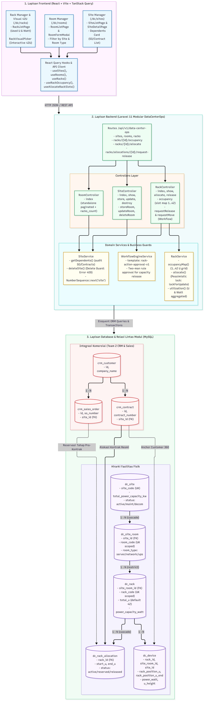

# BEDAH KLASTER 1: HIRARKI FASILITAS FISIK GEDUNG DATA CENTER

## Modul: Data Center Operations (DC Ops) — MSDC ERP

**Target Sub-Menu**:

1. **Site Manager** (`/dc/sites`)
2. **Room Manager** (`/dc/rooms`)
3. **Rack Manager & Visual 42U** (`/dc/racks`)

---

## 1. RINGKASAN EKSEKUTIF & FILOSOFI BISNIS

Dalam industri *Colocation Data Center* dan *Managed Services*, aset komersial yang dijual kepada pelanggan bukanlah sekadar "koneksi internet", melainkan **ruang fisik (*floor space & rack space*)**, **keandalan daya listrik (*power capacity*)**, dan **suhu terkontrol (*cooling SLA*)**.

Untuk mengelola ribuan server pelanggan secara akurat tanpa kekacauan penempatan, arsitektur sistem informasi Data Center Infrastructure Management (DCIM) wajib menerapkan **pemodelan spasial bertingkat (*hierarchical spatial containment*)**:

$$
\text{Site (Gedung/Kampus DC)} \longrightarrow \text{Room (Ruang/Zona/Lantai)} \longrightarrow \text{Rack (42U Chassis)} \longrightarrow \text{Slot U (Unit Fisik 1..42)}
$$

### 1.1. Filosofi Bisnis Per Sub-Menu

1. **Site Manager (`/dc/sites`) — Tingkat Makro Gedung**:
   - Merepresentasikan fasilitas fisik gedung data center (misal: *DC-Surabaya-01*, *DC-Jakarta-Gedung Cyber*).
   - Menyimpan parameter kapasitas makro: total kapasitas daya listrik fasilitas (`total_power_capacity_kw`), batas total agregat *bandwidth* (`total_bandwidth_mbps`), status operasional gedung (`active`, `maintenance`, `decommissioned`), serta penanda *Cost Center* akuntansi.
   - **Interkoneksi CRM**: Site bertindak sebagai jangkar (*anchor*) legal bagi Sales Order (`crm_sales_order`) dan Kontrak Pelanggan (`crm_contract`). Pelanggan menandatangani kontrak penempatan server di gedung tertentu.
2. **Room Manager (`/dc/rooms`) — Tingkat Zona & Ruangan**:
   - Membagi gedung ke dalam ruangan fungsional atau zona keamanan: *Server Room (Data Hall)*, *Network Room (Meet-Me Room / MMR)*, *UPS & Battery Room*, atau *Staging Area*.
   - Mencatat koordinat lantai (*floor*), zona keamanan (*zone*), tipe ruangan (*room_type*), dan luas ruangan (*area_sqm*).
   - Memisahkan ruangan berdaya tinggi (ruang server) dari ruangan penunjang (ruang baterai/UPS) untuk mempermudah audit ISO 27001 dan TIA-942.
3. **Rack Manager & Visual 42U (`/dc/racks`) — Tingkat Unit Rak Komersial**:
   - Merepresentasikan lemari rak server standar EIA-310 (umumnya berukuran 42U).
   - Mencatat alokasi daya maksimum per rak (`power_capacity_watt`, misal: 3.500 Watt atau 5.000 Watt per rak).
   - Menghitung utilisasi ruang (sisa U) dan utilisasi daya (sisa Watt) secara *real-time*.
   - **Visual 42U Elevation Grid**: Antarmuka visual interaktif vertikal dari U-42 (paling atas) hingga U-01 (paling bawah), memetakan slot mana yang masih kosong (*green*), telah direservasi oleh Sales Order (*amber/blue*), atau telah terisi server fisik pelanggan (*red*).

---

## 2. ARSITEKTUR END-TO-END (FULLSTACK CODE TRACE)

Alur pemrosesan data pada Klaster 1 mengalir secara modular dari komponen antarmuka pengguna hingga transaksi database dengan isolasi *multi-tenant*:

```
[React UI Component] 
       │ (User Interaction & Event)
       ▼
[TanStack Query Hook & Axios] (useSites / useRooms / useRacks / useRackOccupancy)
       │ (HTTP GET/POST/PUT/DELETE + Headers: Bearer Token, X-Organization-Id)
       ▼
[Laravel API Route] (Modules/DataCenterOps/routes/api.php)
       │ (Route Binding & Middleware Auth/Tenant)
       ▼
[Controller Layer] (SiteController / RoomController / RackController)
       │ (Input Validation & DTO Creation)
       ▼
[Service Layer] (SiteService / RackService / WorkflowEngineService)
       │ (Business Rules, Number Sequences, Pessimistic Locking, Delete Guards)
       ▼
[Eloquent ORM & MySQL] (dc_site, dc_site_room, dc_rack, dc_rack_allocation, dc_device)
```

### 2.1. Trace 1: Audit Dependensi Lintas Modul pada Detail Site

Saat pengguna membuka halaman **Detail Site** (`/dc/sites/:id`):

1. **Frontend**: Komponen `SiteDetailPage.tsx` memanggil *hook* `useSite(id)`.
2. **API Request**: Axios mengirimkan request `GET /api/v1/data-center-ops/sites/{id}`.
3. **Controller**: `SiteController::show(Site $site)` dieksekusi. Controller melakukan *eager-load* relasi `rooms` dan memanggil `SiteService::getDependents($site)`.
4. **Service Logic (`SiteService::getDependents`)**:
   - Menghitung jumlah rak dan perangkat:
     ```php
     $rackCount = Rack::whereHas('siteRoom', fn ($q) => $q->where('site_id', $site->id))->count();
     $deviceCount = Device::where('site_id', $site->id)->count();
     ```
   - Mengambil kontrak aktif pelanggan yang terikat ke site ini:
     ```php
     $contracts = Contract::where('site_id', $site->id)
         ->with('customer:id,company_name')
         ->get(['id', 'contract_number', 'status', 'customer_id']);
     ```
   - Mengambil Sales Order (tahap reservasi komersial sebelum kontrak aktif):
     ```php
     $salesOrders = SalesOrder::where('site_id', $site->id)
         ->with('customer:id,company_name')
         ->get(['id', 'so_number', 'status', 'customer_id']);
     ```
   - Memeriksa alokasi daya (`PowerAllocation`) dan alokasi *bandwidth* (`BandwidthAllocation`) yang berstatus `active` atau `reserved`.
   - Mengalkulasi bendera perlindungan:
     ```php
     'can_delete' => $contracts->isEmpty() && $salesOrders->isEmpty()
         && $powerAllocCount === 0 && $bandwidthAllocCount === 0
         && $devicesWithCustomer->isEmpty() && $racksWithActiveAlloc->isEmpty(),
     ```
5. **Respons & UI Guard**: Frontend menerima objek `dependents`. Jika `can_delete === false`, tombol hapus dinonaktifkan (*disabled*) dan kartu **Dependents Card** menampilkan daftar kontrak, nomor SO, dan nama perusahaan pelanggan yang wajib diselesaikan terlebih dahulu.

### 2.2. Trace 2: Standalone Room Index dengan Eager Loading

Untuk mencegah inefisiensi query $N+1$ pada daftar ruangan:

1. **Frontend**: `RoomListPage.tsx` memanggil `useRooms({ site_id, room_type, search, page, per_page })`.
2. **Endpoint**: `GET /api/v1/data-center-ops/rooms`.
3. **Controller (`RoomController::index`)**:
   ```php
   $rooms = SiteRoom::query()
       ->with('site:id,site_code,site_name')
       ->withCount('racks')
       ->when($request->filled('site_id'), fn ($q) => $q->where('site_id', $request->site_id))
       ->when($request->filled('room_type'), fn ($q) => $q->where('room_type', $request->room_type))
       ->when($request->filled('search'), function ($q) use ($request) {
           $search = $request->search;
           $q->where(fn ($sub) => $sub->where('room_code', 'like', "%{$search}%")->orWhere('room_name', 'like', "%{$search}%"));
       })
       ->orderBy('room_code')
       ->paginate($request->integer('per_page', 25));
   ```

   *Eager loading* `with('site')` dan `withCount('racks')` memastikan informasi site induk dan jumlah rak dalam ruangan diperoleh hanya dalam 2 query SQL terindeks, terlepas dari berapa pun jumlah baris yang ditampilkan.

### 2.3. Trace 3: Visual 42U Occupancy Map Grid

Peta visual rak pada `RackVisualPicker.tsx` bekerja melalui pemetaan unit slot:

1. **Frontend**: Memanggil `useRackOccupancy(rackId)` yang menembak `GET /api/v1/data-center-ops/racks/{id}/occupancy`.
2. **Controller & Service (`RackService::occupancyMap`)**:
   - Mengambil seluruh alokasi ruang pelanggan yang berstatus `active` atau `reserved`:
     ```php
     foreach ($rack->allocations()->whereIn('status', ['active', 'reserved'])->with('customer:id,company_name')->get() as $allocation) {
         for ($u = $allocation->start_u; $u <= $allocation->end_u; $u++) {
             $occupied[$u] = [
                 'allocation_id' => $allocation->id,
                 'customer_name' => $allocation->customer?->company_name,
                 'status'        => $allocation->status,
             ];
         }
     }
     ```
   - Mengambil perangkat fisik server (`dc_device`) yang terpasang pada rak dari `rack_position_u` hingga `rack_position_u_end`:
     ```php
     foreach (Device::where('rack_id', $rack->id)->whereNotNull('rack_position_u')->get() as $device) {
         $endU = $device->rack_position_u_end ?? $device->rack_position_u;
         for ($u = $device->rack_position_u; $u <= $endU; $u++) {
             $occupied[$u] = ($occupied[$u] ?? []) + [
                 'device_id'   => $device->id,
                 'device_code' => $device->device_code,
                 'device_name' => $device->device_name,
             ];
         }
     }
     ```
   - Mengompilasi array slot dari $u = 1$ hingga `total_u` (42):
     ```php
     for ($u = 1; $u <= $rack->total_u; $u++) {
         $slots[] = isset($occupied[$u])
             ? ['u' => $u, 'status' => 'booked'] + $occupied[$u]
             : ['u' => $u, 'status' => 'available'];
     }
     ```
3. **Render Vertikal di Frontend**:
   Komponen `RackVisualPicker.tsx` menggunakan CSS `flex flex-col-reverse` sehingga slot $U=42$ dirender paling atas dan $U=1$ paling bawah, identik dengan fisik lemari rak di lorong data center.

---

## 3. LOGIKA PROTEKSI & INTEGRITAS DATA (BUSINESS GUARDS)

### 3.1. Keunikan Bertingkat (*Scoped Uniqueness*)

Sistem menerapkan aturan *database constraint* yang unik untuk mencerminkan realitas operasional data center:

1. **`site_code`**: Unik per organisasi (*scoped to organization*), otomatis digenerasi oleh sistem nomor urut terpusat `NumberSequence::next('site')` (misal: `SITE-2026-0001`).
2. **`room_code`**: Unik **per Site** (`UNIQUE KEY ('site_id', 'room_code')`). Hal ini memungkinkan dua site berbeda sama-sama memiliki ruangan bernama `R-SERVER-01` tanpa memicu *integrity constraint violation*.
3. **`rack_code`**: Unik **per Room** (`UNIQUE KEY ('site_room_id', 'rack_code')`). Kode rak seperti `R01`, `R02`, `R03` adalah konvensi penomoran baris rak lokal di setiap ruangan. Dengan skema ini, teknisi di Ruang A dan Ruang B dapat sama-sama memiliki rak `R01`.

### 3.2. Pencegahan Tumpang Tindih Slot (*Overlap Prevention & Pessimistic Lock*)

Saat staf melakukan reservasi ruang rak melalui `RackService::allocate()`, sistem wajib menjamin tidak ada dua transaksi yang memesan rentang U yang saling bersinggungan.

Sistem menerapkan penguncian pesimis (*pessimistic locking*) di dalam transaksi database:

```php
return DB::transaction(function () use ($rack, $data, $startU, $endU) {
    $overlap = $rack->allocations()
        ->whereIn('status', ['active', 'reserved'])
        ->where('start_u', '<=', $endU)
        ->where('end_u', '>=', $startU)
        ->lockForUpdate()
        ->exists();

    if ($overlap) {
        throw new \RuntimeException("Rentang U {$startU}-{$endU} tumpang tindih dengan alokasi active/reserved lain di rack '{$rack->rack_code}'.");
    }

    return RackAllocation::create([...]);
});
```

> [!IMPORTANT]
> Klausul `where('start_u', '<=', $endU)->where('end_u', '>=', $startU)` adalah formula matematis standar deteksi irisan dua interval tertutup $[A_1, A_2] \cap [B_1, B_2] \neq \emptyset$. Ditambah dengan `lockForUpdate()`, sistem kebal terhadap *race conditions* saat dua Sales Order diajukan pada detik yang sama.

### 3.3. Mekanisme Persetujuan Bertingkat (*Two-Man Rule Workflow Engine*)

Pelepasan kapasitas rak (*release*) atau pemindahan alokasi rak (*move*) tidak boleh dilakukan secara sepihak oleh teknisi lapangan karena menyangkut hak komersial dan penagihan pelanggan (*billing*).

Modul mengintegrasikan `WorkflowEngineService`:

1. Teknisi mengajukan pelepasan via `RackController::requestRelease()`.
2. Controller tidak langsung mengubah status, melainkan mendaftarkan tiket persetujuan:
   ```php
   $this->workflowEngine->submit(
       moduleCode: 'data-center-ops',
       documentType: 'rack_release',
       documentId: $allocation->id,
       payload: [...],
       templateCode: 'rack-action-approval-v1',
   );
   ```
3. Status alokasi berubah menjadi `pending_release`.
4. Kapasitas baru resmi dilepas dan device ditandai lepas hanya setelah Manager Data Center menyetujui (*approved*) melalui event listener `SyncRackActionApprovalResult`.

---

## 4. DIAGRAM ARSITEKTUR KLASTER 1

Diagram berikut memetakan relasi hierarki fisik, integrasi modul CRM/Sales, dan alur fullstack data center ops:



*Sumber diagram mentah*: `diagrams/source/arsitektur-klaster-1-fasilitas-fisik.mmd`

---

## 5. BANK PERTANYAAN & JAWABAN SIDANG PENGUJI

Berikut adalah 5 pertanyaan kritis yang sering diajukan oleh dosen penguji atau pembimbing lapangan saat sidang tugas akhir / magang beserta formula jawaban ilmiahnya:

### Q1: Mengapa penomoran kode rak (`rack_code`) tidak dibuat unik secara global di seluruh sistem, melainkan hanya unik per ruangan (`site_room_id`)?

**Jawaban Mahasiswa**:

> "Dalam standar industri data center fisik (seperti TIA-942 dan BICSI-002), penamaan lemari rak dirancang berdasarkan tata letak baris (*aisle grid*) di dalam ruangan tertentu, misalnya baris `A01-A10` di Server Room 1. Apabila data center memiliki 5 gedung atau 10 ruangan berbeda, sangat lumrah setiap ruangan memiliki lemari rak bernama `R01` atau `Rack-A01`. Jika kami memaksakan *unique constraint* secara global pada kolom `rack_code`, maka di ruangan kedua staf terpaksa menamai rak dengan nama aneh yang tidak sesuai dengan label fisik di lapangan. Oleh karena itu, integritas database dirancang menggunakan *composite unique key* pada level `['site_room_id', 'rack_code']`. Untuk membedakannya di antarmuka sistem, kami menggunakan *eager loading* yang selalu merender hierarki lengkap: `Site Code -> Room Name -> Rack Code`."

### Q2: Bagaimana sistem Anda menangani *concurrency* saat ada dua staf sales atau staf DC yang mencoba mengalokasikan slot U yang sama pada detik yang bersamaan?

**Jawaban Mahasiswa**:

> "Kami menerapkan mekanisme *Pessimistic Locking* menggunakan klausa `lockForUpdate()` di dalam blok `DB::transaction()` pada `RackService::allocate()`. Sebelum sebuah *record* alokasi baru disimpan, sistem mengeksekusi query pengecekan irisan interval matematis `start_u <= end_u_input AND end_u >= start_u_input` dengan mengunci baris-baris data terkait di tabel `dc_rack_allocation`. Transaksi kedua yang mencoba membaca atau menulis pada rentang rak yang sama akan dipaksa menunggu (*wait lock*) hingga transaksi pertama selesai (*commit* atau *rollback*). Jika alokasi pertama berhasil, transaksi kedua langsung memicu `RuntimeException` yang dikembalikan sebagai HTTP 409 Conflict ke antarmuka pengguna dengan pesan bahwa slot tersebut sudah terisi."

### Q3: Mengapa penghapusan Site dan Room tidak menggunakan `cascadeOnDelete` biasa, melainkan menerapkan audit dependensi yang ketat (*Delete Guards*)?

**Jawaban Mahasiswa**:

> "Karena data center melibatkan kontrak hukum komersial dan perangkat berharga tinggi milik pelanggan pihak ketiga (*tenant assets*). Jika kami mengizinkan penghapusan berantai (*cascade delete*) tanpa penjagaan, seorang operator yang tidak sengaja menghapus satu Site akan memusnahkan seluruh riwayat penempatan perangkat pelanggan, alokasi daya, dan memutus keterkaitan data pada modul CRM (Sales Order dan Kontrak Pelanggan). Oleh sebab itu, fungsi `SiteService::deleteSite()` bertindak sebagai *gatekeeper*: sistem memeriksa apakah masih ada kontrak aktif, sales order, alokasi daya/bandwidth aktif, atau perangkat berpemilik. Jika ditemukan satu saja keterkaitan komersial, penghapusan ditolak secara mutlak dengan status HTTP 409. Operasi *cascade delete* hanya diizinkan untuk entitas murni infrastruktur internal yang sudah benar-benar kosong dari keterikatan pelanggan."

### Q4: Mengapa status alokasi rak memiliki nilai `reserved` selain `active`? Apa bedanya secara teknis dan bisnis?

**Jawaban Mahasiswa**:

> "Secara bisnis, terdapat jeda waktu antara penandatanganan penawaran harga (*Sales Order*) oleh calon pelanggan dengan tanggal aktifnya kontrak operasional (*Contract Active*). Pada tahap Sales Order, calon pelanggan telah memesan 10U ruang rak. Jika sistem baru mengunci rak saat kontrak aktif, maka selama masa tunggu tersebut slot rak tersebut rawan dijual kembali oleh sales lain (*over-selling* / *double booking*). Oleh karena itu, kami memperkenalkan status `reserved` yang dikaitkan ke `sales_order_id`. Secara teknis pada fungsi `occupancyMap()` dan `allocate()`, slot `reserved` diperlakukan sama persis dengan `active` yaitu berstatus *occupied/booked*, sehingga tidak bisa dialokasikan ke pihak lain. Perbedaannya, status `reserved` belum memicu proses *billing* penagihan bulanan sebelum statusnya berubah menjadi `active`."

### Q5: Mengapa pelepasan alokasi rak (*rack release*) memerlukan alur kerja persetujuan (*Workflow Engine*) dan tidak langsung dihapus oleh staf teknisi lapangan?

**Jawaban Mahasiswa**:

> "Pelepasan slot rak (*de-allocation*) memiliki dampak finansial langsung terhadap penghentian pendapatan berulang (*Monthly Recurring Revenue / MRR*) dari pelanggan. Untuk mencegah kecurangan (*fraud*) atau kesalahan operasional di mana teknisi lapangan melepas kapasitas pelanggan tanpa konfirmasi dari divisi komersial, kami menerapkan prinsip tata kelola *Four-Eyes Principle (Two-Man Rule)*. Tombol pelepasan di UI mengeksekusi `RackController::requestRelease()` yang mengirimkan proposal pelepasan ke `WorkflowEngineService` dengan template `rack-action-approval-v1`. Status slot menjadi `pending_release`. Alokasi baru benar-benar dilepas dari rak setelah disetujui secara resmi oleh Manager Operasional melalui modul persetujuan terpusat."
