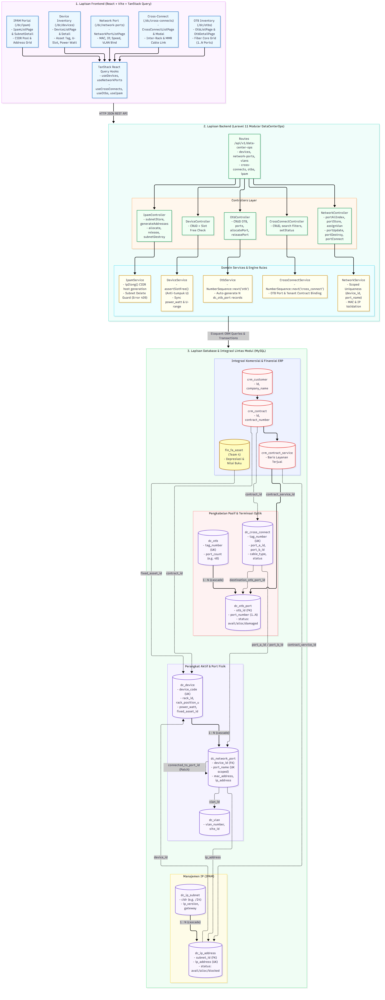

# BEDAH KLASTER 2: JARINGAN, PORT & PENGKABELAN (CONNECTIVITY LAYER)
## Modul: Data Center Operations (DC Ops) — MSDC ERP
**Target Sub-Menu**:
1. **Device Inventory** (`/dc/devices`)
2. **Network Port Management** (`/dc/network-ports`)
3. **Cross-Connect** (`/dc/cross-connects`)
4. **OTB Inventory (Optical Termination Box)** (`/dc/otbs`)
5. **IPAM (IP Address Management - Subnet & IP Pool)** (`/dc/ipam`)

---

## 1. RINGKASAN EKSEKUTIF & FILOSOFI BISNIS

Apabila Klaster 1 memodelkan "wadah fisik gedung" (*spatial containment*), maka **Klaster 2 memodelkan "jantung operasional dan konektivitas" (*active hardware, passive cabling, & logical addressing*)**.

Di dalam data center komersial, konektivitas tidak dapat dicatat hanya sebagai "kabel colok". Terdapat pemisahan tegas antara:
1. **Perangkat Keras Aktif (*Active Compute & Switching Devices*)**: Server, Core Switch, Edge Router, Firewall, PDU, dan Storage.
2. **Antarmuka Jaringan Fisik (*NIC / Physical Ports*)**: Port bawaan pada perangkat fisik (`eth0`, `sfp-sfpplus1`, `GigabitEthernet0/1`).
3. **Pengkabelan Pasif Antar-Rak & Meet-Me Room (*Passive Cross-Connect*)**: Kabel fisik (fiber optic / twisted pair UTP) yang melintasi lorong rak (*cable tray*) atau menghubungkan rak pelanggan ke rak ISP/Carrier di *Meet-Me Room (MMR)*.
4. **Terminasi Pasif Densitas Tinggi (*Optical Termination Box / OTB*)**: Kotak terminasi patch panel optik fisik yang menampung puluhan hingga ratusan *core* kabel serat optik.
5. **Alamat Logika (*Logical IP Addressing & VLAN*)**: Alokasi blok subnet IPv4/IPv6 publik dan privat beserta penetapan segmen broadcast VLAN.

```
+---------------------------------------------------------------------------------------------------+
| KLASTER 2: CONNECTIVITY & ACTIVE/PASSIVE INFRASTRUCTURE                                           |
|                                                                                                   |
|  [IPAM: dc_ip_subnet / dc_ip_address] ──(Bind IP)──┐                                              |
|                                                     ▼                                             |
|  [ACTIVE DEVICE: dc_device] ──(1:N)──> [PHYSICAL PORT: dc_network_port] (MAC, Speed, VLAN)      |
|         │                                          │                                              |
|         │ (Mounted at U-Position)                  ▼ (Connected via Cross-Connect)                |
|         ▼                                          │                                              |
|  [PHYSICAL RACK: dc_rack]                [CABLE: dc_cross_connect]                                |
|                                                    │                                              |
|                                                    ▼ (Terminated to Optical Core)                 |
|                                          [OPTICAL BOX: dc_otb_port / dc_otb]                      |
|                                                                                                   |
|  Integrasi Komersial: crm_customer, crm_contract, crm_contract_service                            |
|  Integrasi Finansial: fin_fa_asset (Penyusutan Nilai Buku & Biaya Perolehan)                      |
+---------------------------------------------------------------------------------------------------+
```

---

## 2. ARSITEKTUR END-TO-END (FULLSTACK CODE TRACE)

### 2.1. Trace 1: Pendaftaran Device & Guard Anti-Tumpuk Slot U
Saat staf mendaftarkan server baru ke dalam lemari rak:
1. **Frontend**: `DeviceDetailPage.tsx` atau modal registrasi memanggil hook `useCreateDevice()`.
2. **API Endpoint**: `POST /api/v1/data-center-ops/devices`.
3. **Controller**: `DeviceController::store(Request $request)` memvalidasi atribut perangkat (`device_code`, `site_id`, `site_room_id`, `rack_id`, `rack_position_u`, `u_height`, `power_watt`, `customer_id`, `contract_id`, `fixed_asset_id`).
4. **Service Guard (`DeviceService::assertSlotFree`)**:
   - Sistem menghitung rentang U yang akan ditempati: `start_u = rack_position_u` dan `end_u = start_u + u_height - 1`.
   - Jika device ditautkan ke kontrak pelanggan, sistem memastikan slot tersebut berada di dalam rentang alokasi kontrak (`RackAllocation` aktif):
     ```php
     $hasValidAlloc = RackAllocation::where('contract_id', $contractId)
         ->where('rack_id', $rackId)
         ->where('start_u', '<=', $startU)
         ->where('end_u', '>=', $endU)
         ->whereIn('status', ['active', 'reserved'])
         ->exists();
     ```
   - Sistem memeriksa bahwa tidak ada perangkat fisik lain yang sedang menduduki slot tersebut:
     ```php
     $conflict = Device::where('rack_id', $rackId)
         ->where('id', '!=', $deviceId)
         ->whereNotNull('rack_position_u')
         ->where(function ($q) use ($startU, $endU) {
             $q->where('rack_position_u', '<=', $endU)
               ->where(DB::raw('COALESCE(rack_position_u_end, rack_position_u)'), '>=', $startU);
         })
         ->exists();
     if ($conflict) {
         throw new \RuntimeException("Slot U{$startU}-U{$endU} di rak ini sudah ditempati oleh perangkat lain.");
     }
     ```
5. **Database Transaction**: Device tersimpan di `dc_device`. Nilai daya listrik (`power_watt`) otomatis diakumulasikan ke agregat utilisasi rak di `RackController::index`.

### 2.2. Trace 2: Master Network Port Management & Scoped Uniqueness
Pada rilis terbaru sistem (setelah revitalisasi *Full-Stack CRUD*):
1. **Frontend**: Pengguna dapat mengelola port fisik baik secara terpusat di `/dc/network-ports` (`NetworkPortListPage.tsx`) maupun per perangkat di `/dc/devices/:id` (`DeviceDetailPage.tsx`).
2. **API Endpoints**:
   - `GET /api/v1/data-center-ops/network-ports` (Katalog master seluruh port terpaginasi dengan pencarian nama port, MAC address, IP address, nama device, dan VLAN).
   - `POST /api/v1/data-center-ops/devices/{device}/ports` (Pendaftaran port fisik baru).
   - `PUT /api/v1/data-center-ops/network-ports/{port}` (Pembaruan konfigurasi kecepatan link, tipe port, MAC, dan IP).
   - `DELETE /api/v1/data-center-ops/network-ports/{port}` (Pelepasan port jaringan secara aman).
3. **Database Constraint (`dc_network_port`)**:
   `UNIQUE KEY ('device_id', 'port_name')`  
   *Penjelasan*: Port bernama `eth0` atau `mgmt` diperbolehkan ada di ribuan server berbeda, namun wajib unik mutlak di dalam unit fisik server yang sama.
4. **Validasi Tambahan**: Controller memvalidasi format `mac_address` (standar IEEE 802) dan format `ip_address` sebelum disimpan.

### 2.3. Trace 3: Cross-Connect Antar-Rak & Meet-Me Room
Kabel *Cross-Connect* merepresentasikan produk jaringan yang **dijual secara komersial kepada tenant**:
1. **Karakteristik Fisik**: Kabel UTP (Cat5e, Cat6, Cat6a) atau Fiber Optic (Single-mode 9/125, Multi-mode OM3/OM4) yang ditarik dari Rak Tenant ke Rak Tenant lain, atau dari Rak Tenant ke Meet-Me Room (MMR) milik Carrier/Telco eksternal.
2. **Pola Desain Fleksibel (*Hybrid Endpoints*)**:
   - Sisi Sumber (*Side A*): Dapat ditautkan ke entitas formal `port_a_id` (`dc_network_port`) ATAU lokasi bebas `source_location` + `source_port`.
   - Sisi Tujuan (*Side B*): Dapat ditautkan ke `port_b_id` (`dc_network_port`), terminasi optik internal `destination_otb_port_id` (`dc_otb_port`), ATAU lokasi bebas luar sistem `destination_location` + `destination_port` (misal: *MMR Rack 05 - Patch Panel Telkom Port 12*).
3. **Auto-Numbering**: Nomor tag fisik pada kabel (`tag_number`) otomatis digenerasi oleh `NumberSequence::next('cross_connect')` (misal: `XC-2026-0042`).
4. **Tautan Komersial**: Terikat langsung ke `customer_id`, `contract_id`, dan `contract_service_id` untuk perhitungan penagihan bulanan (*recurring fee*).

### 2.4. Trace 4: Otomasi Port OTB (Optical Termination Box)
Optical Termination Box (OTB) adalah panel pasif kabel serat optik densitas tinggi:
1. **Pembuatan Kotak OTB**: Staf mendaftarkan OTB baru dengan kapasitas port fisik (misal: `port_count = 48` atau `256`).
2. **Otomasi Generate Baris Port (`OtbService::create`)**:
   Sistem tidak hanya menyimpan angka `48` sebagai teks, melainkan mengeksekusi *bulk creation* di dalam database transaction:
   ```php
   for ($i = 1; $i <= $portCount; $i++) {
       OtbPort::create([
           'organization_id' => $otb->organization_id,
           'otb_id'          => $otb->id,
           'port_number'     => $i,
           'status'          => 'available',
       ]);
   }
   ```
3. **Alokasi Core Optik**: Setiap core optik (`dc_otb_port`) memiliki siklus hidup mandiri: `available` (kosong), `allocated` (terpakai oleh kontrak pelanggan tertentu), atau `damaged` (redaman optik tinggi/putus).
4. **Siklus Hidup Reusable**: Saat kontrak pelanggan berakhir, fungsi `OtbService::releasePort()` mengembalikan status port menjadi `available` tanpa menghapus baris data historisnya.

### 2.5. Trace 5: Kalkulasi Biner Subnet IPAM (`ip2long` & `long2ip`)
Modul IPAM mengelola alokasi alamat IP publik dan privat:
1. **Pendaftaran Subnet**: Staf mendaftarkan blok CIDR (misal: `103.10.20.0/24` atau `10.50.0.0/22`).
2. **Algoritma Konversi Host Matematis (`IpamService::generateAddressesForSubnet`)**:
   Untuk subnet IPv4 (maksimal prefix `/22` atau 1.024 host per blok):
   ```php
   [$network, $prefixStr] = explode('/', $subnet->cidr);
   $prefix = (int) $prefixStr;
   $networkLong = ip2long($network);
   $hostCount = 2 ** (32 - $prefix); // misal: 2^(32-24) = 256 alamat

   for ($i = 0; $i < $hostCount; $i++) {
       $ip = long2ip($networkLong + $i);
       IpAddress::create([
           'subnet_id'  => $subnet->id,
           'ip_address' => $ip,
           'status'     => 'available',
       ]);
   }
   ```
3. **Alokasi IP**: Alamat IP individual dapat dialokasikan ke pelanggan (`customer_id`), perangkat jaringan (`device_id`), atau baris kontrak layanan (`contract_service_id`).

---

## 3. LOGIKA PROTEKSI & INTEGRITAS DATA (BUSINESS GUARDS)

### 3.1. Integritas Perangkat ke Modul Finansial Fixed Assets (`fin_fa_asset`)
Di sistem MSDC ERP, perangkat data center memiliki dua dimensi pencatatan:
- **Dimensi Fisik (DataCenterOps - Team 3)**: Di rak mana server dipasang, slot U berapa, daya listrik yang diserap, dan port jaringan yang aktif.
- **Dimensi Akuntansi & Finansial (Fixed Asset Management - Team 4)**: Tanggal perolehan, harga beli (*purchase cost*), metode penyusutan (*depreciation method*), masa manfaat, dan akumulasi nilai buku (*book value*).

Kolom `dc_device.fixed_asset_id` adalah foreign key resmi ke tabel `fin_fa_asset`. Dengan relasi ini, auditor keuangan dapat melakukan *stock opname* fisik secara presisi (mengecek letak server di lorong rak tertentu berdasarkan tag aset finansial).

### 3.2. Subnet Delete Guard (HTTP 409 Conflict)
Menghapus blok subnet yang masih memiliki alamat IP terpakai akan merusak alur routing dan kontrak penagihan IP publik pelanggan.

Pada `IpamService::deleteSubnet()`:
```php
$activeAllocations = $subnet->addresses()
    ->whereIn('status', ['allocated', 'reserved'])
    ->count();

if ($activeAllocations > 0) {
    throw new \RuntimeException(
        "Subnet '{$subnet->cidr}' masih memiliki {$activeAllocations} alamat IP yang sedang digunakan atau dicadangkan. Lepas alokasi alamat terlebih dahulu sebelum menghapus subnet."
    );
}
```
Jika tidak ada alokasi aktif, sistem mengeksekusi penghapusan di dalam database transaction: menghapus seluruh anak IP yang berstatus `available`, lalu menghapus record subnet induknya.

### 3.3. Siklus Hidup Aset Pengkabelan Reusable (*Not Disposable*)
Berbeda dengan barang habis pakai (*consumable*), kabel Cross-Connect dan Port OTB di data center adalah **aset fisik berulang (*reusable infrastructure assets*)**:
- Saat kontrak pelanggan terminasi (*terminated*), kabel fisik di *cable ladder* tidak dibuang. Kabel dilepas dari port server pelanggan, diuji kelayakannya (*testing & OTDR measurement*), lalu statusnya diubah menjadi `available`.
- Jika terdapat serat optik yang putus (*broken fiber core*) atau redaman sinyal optik terlalu tinggi (di atas ambang batas dBm), teknisi menandai port sebagai `damaged`. Sistem melarang port berstatus `damaged` untuk dialokasikan ke kontrak manapun hingga diperbaiki.

---

## 4. DIAGRAM ARSITEKTUR KLASTER 2

Diagram berikut memperlihatkan relasi menyeluruh antara perangkat aktif, antarmuka port, pengkabelan pasif OTB & Cross-Connect, pool alamat IPAM, serta interkoneksi ke modul CRM dan Fixed Assets:



*Sumber diagram mentah*: `diagrams/source/arsitektur-klaster-2-jaringan-pengkabelan.mmd`

---

## 5. BANK PERTANYAAN & JAWABAN SIDANG PENGUJI

### Q1: Apa perbedaan mendasar antara Port Jaringan Fisik (`dc_network_port`) dan Kabel Cross-Connect (`dc_cross_connect`) dalam arsitektur sistem ini?
**Jawaban Mahasiswa**:
> "Keduanya merepresentasikan dua lapisan infrastruktur yang berbeda. `dc_network_port` merepresentasikan antarmuka fisik (*Network Interface Card / SFP port*) yang melekat pada unit perangkat tertentu (misal port `eth0` pada Server A). Port ini mencatat atribut internal seperti MAC address, kecepatan link, dan penugasan VLAN. Sedangkan `dc_cross_connect` merepresentasikan kabel pasif antar-rak atau kabel dari rak tenant menuju *Meet-Me Room (MMR)* milik operator telekomunikasi pihak ketiga. Secara bisnis, Cross-Connect adalah produk komersial yang dijual dan ditagih bulanan ke pelanggan (*billable recurring service*), sedangkan Network Port adalah komponen pembentuk topologi lokal perangkat."

### Q2: Bagaimana sistem mencegah terjadinya tumpang tindih (*overlap*) saat dua server fisik dipasang pada lemari rak yang sama?
**Jawaban Mahasiswa**:
> "Kami menerapkan validasi komputasi interval matematis pada fungsi `DeviceService::assertSlotFree()`. Server di data center sering kali berukuran lebih dari 1U (misalnya server storage 2U atau 4U). Sistem menghitung rentang slot yang dibutuhkan: dari `start_u = rack_position_u` hingga `end_u = start_u + u_height - 1`. Sebelum menyimpan, sistem mengeksekusi query database untuk memastikan tidak ada perangkat lain di rak tersebut yang memiliki irisan interval $[A_1, A_2] \cap [B_1, B_2] \neq \emptyset$. Jika ditemukan irisan slot dengan perangkat lain yang sudah terpasang, sistem langsung menolak transaksi dengan memicu `RuntimeException` sehingga integritas tata letak rak fisik tetap terjaga."

### Q3: Mengapa entitas `dc_device` memiliki relasi foreign key ke tabel `fin_fa_asset` milik modul Fixed Assets (Keuangan)?
**Jawaban Mahasiswa**:
> "Dalam tata kelola IT Enterprise dan standar ITIL, manajemen aset fisik harus selaras dengan akuntansi keuangan perusahaan (*Financial Asset Management*). Server atau Core Switch bernilai puluhan hingga ratusan juta rupiah tercatat sebagai aset tetap perusahaan yang mengalami depresiasi nilai buku setiap bulan. Dengan menghubungkan `dc_device.fixed_asset_id` ke tabel `fin_fa_asset` (Team 4), sistem MSDC ERP menyatukan data operasional fisik (di rak mana server berada dan status operasinya) dengan data akuntansi (nilai perolehan, masa manfaat, dan metode penyusutan), sehingga mempermudah audit kepatuhan aset dan audit pajak perusahaan."

### Q4: Bagaimana cara kerja algoritma auto-generate alamat IP pada modul IPAM dan pembuatan port pada OTB?
**Jawaban Mahasiswa**:
> "Untuk modul OTB, saat operator mendaftarkan kotak OTB baru dengan parameter kapasitas `port_count = 48`, fungsi `OtbService::create()` secara otomatis mengeksekusi perulangan database transaction untuk membuat 48 baris data anak di tabel `dc_otb_port` dengan nomor urut 1 sampai 48 berstatus `available`. Untuk modul IPAM, sistem menggunakan algoritma translasi biner alamat IP: fungsi `IpamService::generateAddressesForSubnet()` memecah CIDR (misalnya `103.10.20.0/24`), mengubah IP jaringan awal menjadi integer 32-bit menggunakan fungsi bawaan PHP `ip2long()`, menghitung total host $2^{(32 - \text{prefix})}$, lalu melakukan perulangan untuk men-generate seluruh alamat IP individual menggunakan `long2ip()`. Alamat IP yang telah ter-generate siap dialokasikan secara granular ke pelanggan atau antarmuka server."

### Q5: Mengapa penghapusan Subnet pada IPAM tidak langsung di-cascade, melainkan dijaga oleh Delete Guard yang mengembalikan error HTTP 409?
**Jawaban Mahasiswa**:
> "Karena alamat IP publik di data center merupakan sumber daya krusial yang terikat langsung ke kontrak aktif pelanggan dan konfigurasi DNS/routing live. Jika sebuah subnet diizinkan dihapus sembarangan (*cascade delete*), maka seluruh riwayat alokasi IP pelanggan akan musnah seketika dan dapat menyebabkan kekacauan operasional jaringan. Oleh sebab itu, fungsi `IpamService::deleteSubnet()` melakukan audit dependensi: jika masih ada alamat IP di dalam subnet tersebut yang berstatus `allocated` atau `reserved`, transaksi dibatalkan seketika dengan status HTTP 409 Conflict. Penghapusan subnet hanya diizinkan apabila seluruh alamat IP di dalamnya sudah berstatus `available` (bersih dari alokasi pelanggan)."
