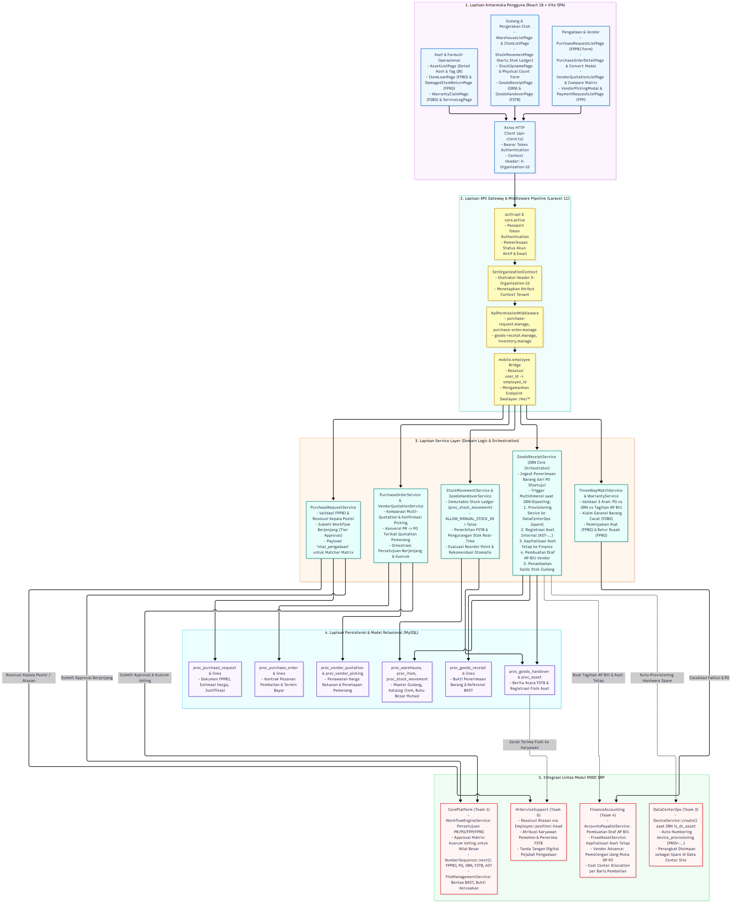

# BEDAH MODUL PROCUREMENTINVENTORY: ORKESTRASI PENGADAAN BARANG/JASA, KONTROL STOK GUDANG, & SIKLUS HIDUP ASET DATA CENTER MSDC ERP
## Modul: ProcurementInventory (`Team 5 — Sourcing, Vendor Quotation & RFQ, Purchase Request, Multi-Tier Purchase Order Approval, Goods Receipt, Handover, Stock Movement Ledger, & Data Center Device Provisioning`)
**Target Cakupan**: Tata Kelola Pengadaan Terintegrasi, Mitigasi Risiko Concurrency Stok Gudang, Validasi Tiga Arah (Three-Way Matching), serta Provisioning Otomatis Perangkat Keras Data Center

---

## 1. PERAN STRATEGIS & FILOSOFI BISNIS PROCUREMENTINVENTORY DALAM EKOSISTEM MSDC ERP

Industri penyedia infrastruktur *Data Center* dan *Managed Network Services* tergolong sebagai sektor usaha berintensitas modal sangat tinggi (*capital-intensive industry*). Komponen operasional seperti *server blade, core switch 100GbE, Optical Distribution Frame (ODF), Precision Air Conditioning (PAC)*, baterai *Uninterruptible Power Supply* (UPS), hingga generator diesel memerlukan investasi belanja modal (*Capital Expenditure / CAPEX*) dan belanja operasional (*Operational Expenditure / OPEX*) bernilai puluhan miliar rupiah. Pengadaan perangkat keras tanpa tata kelola yang terotomasi dan transparan berisiko menimbulkan pembelian redundan, pembengkakan biaya (*budget overruns*), kecurangan pengadaan (*procurement fraud*), hingga ketidaksinkronan spesifikasi perangkat keras dengan standar sertifikasi fasilitas (*Tier III/IV facility compliance*).

Lebih jauh lagi, ketiadaan integrasi antara logistik pengadaan dan inventaris operasional pusat data kerap memicu anomali "perangkat siluman" (*phantom inventory* atau *shadow hardware*), yaitu perangkat keras jaringan yang dibeli namun tidak tercatat di ruang rak (*rack layout*), atau sebaliknya teknisi memasang *switch* yang belum diverifikasi garansi dan asal-usul perolehannya.

Modul **`ProcurementInventory`** dirancang untuk menegakkan prinsip tata kelola korporat yang kokoh (*corporate governance & internal control*) melalui filosofi rekayasa: **"All Data Center Hardware Must Originate from Procurement"** (Semua Perangkat Data Center Wajib Berasal dari Jalur Pengadaan Resmi). Modul ini mengorkestrasi rantai pasok (*supply chain*) end-to-end:

1. **Pemisahan Tugas & Persetujuan Bertingkat (*Segregation of Duties & Multi-Tier Approvals*)**: Mencegah pemohon (*requester*) menyetujui anggarannya sendiri. Pembelian barang/jasa bernilai besar diatur melalui ambang batas bertingkat (*threshold tiers*) yang mewajibkan persetujuan kuorum jamak (*quorum voting*) dari pimpinan divisi hingga Direksi via mesin alur kerja *CorePlatform*.
2. **Penetapan Rekanan Transparan (*Competitive Bidding & RFQ*)**: Memfasilitasi komparasi penawaran harga (*Request for Quotation / RFQ*) dari sedikitnya 3 rekanan rekanan bisnis secara objektif sebelum pesanan pembelian (*Purchase Order*) diterbitkan.
3. **Penyelarasan Multidimensi Otomatis pada Penerimaan Barang (*Multidimensional Goods Receipt Automation*)**: Saat pesanan tiba di gudang dan Berita Acara Serah Terima (BAST) ditandatangani, satu aksi pencatatan *Goods Receipt Note* (GRN) secara atomik memicu:
   - *Auto-provisioning* perangkat keras ke katalog inventaris `DataCenterOps` dengan status awal *spare*.
   - Pembuatan kartu aset fisik (*Asset Tagging*) dengan kode QR.
   - Pendaftaran kapitalisasi aset tetap (*Fixed Asset*) ke modul `FinanceAccounting`.
   - Pembuatan draf tagihan hutang usaha (*Accounts Payable Bill*) ke rekanan.
   - Penambahan saldo fisik pada buku besar stok gudang (*Stock Movement Ledger*).
4. **Buku Besar Stok Kekal (*Immutable Stock Movement Ledger*)**: Saldo persediaan barang gudang tidak disimpan sebagai angka statis yang dapat dimanipulasi manual, melainkan dihitung secara deterministik dari riwayat transaksi mutasi masuk dan keluar (*event-sourced stock balance*), dilengkapi larangan penambahan saldo manual (*Manual Stock-In Guard*).
5. **Mitigasi Kerugian Finansial (*Three-Way Matching*)**: Menyediakan mekanisme audit otomatis yang memverifikasi kesesuaian kuantitas dan harga antara pesanan pembelian (*PO*), penerimaan fisik gudang (*GRN*), dan faktur tagihan rekanan (*AP Bill*) sebelum pembayaran kas dicairkan.

---

## 2. PETA FITUR & SUB-MODUL UTAMA

Berdasarkan audit teknis terhadap direktori backend `MSDC/Modules/ProcurementInventory/` dan antarmuka web pada `MSDCFrontend/src/modules/procurement-inventory/`, kapabilitas sistem dikelompokkan ke dalam 6 pilar utama:

```
┌─────────────────────────────────────────────────────────────────────────────┐
│                       MODUL PROCUREMENTINVENTORY                            │
├──────────────────────┬──────────────────────┬───────────────────────────────┤
│ 1. PENGADAAN & PR    │ 2. SELEKSI REKANAN   │ 3. PESANAN PEMBELIAN (PO)     │
│    (PURCHASING)      │    (RFQ & VENDOR)    │    & PEMBAYARAN MUKA (FPP)    │
│  - Form FPPBJ Resmi  │  - Direktori Vendor  │  - Konversi PR/RFQ ke PO      │
│  - Resolusi Atasan   │  - Evaluasi Kinerja  │  - Approval Matrix & Kuorum   │
│  - Justifikasi Biaya │  - RFQ Multi-Vendor  │  - Form Permintaan Pembayaran │
│  - Approval Tiers    │  - Matriks Komparasi │  - Uang Muka DP Vendor        │
│  - Draf Lampiran     │  - Penetapan Pemenang│  - Pelacakan Status Kirim     │
├──────────────────────┼──────────────────────┼───────────────────────────────┤
│ 4. PENERIMAAN BARANG │ 5. GUDANG & PERSEDIAAN│ 6. ASET & FORMULIR LAPANGAN  │
│    (GOODS RECEIPT)   │    (STOCK MOVEMENTS) │    (LIFECYCLE MANAGEMENT)     │
│  - Dokumen GRN Resmi │  - Master Gudang/Item│  - Form Serah Terima (FSTB)   │
│  - Provisioning DC   │  - Saldo Ledger Stok │  - Peminjaman Alat (FPBG)     │
│  - Registrasi AP Bill│  - Reorder Point Auto│  - Retur Barang Rusak (FPRG)  │
│  - Kapitalisasi FA   │  - Stock Opname Fisik│  - Klaim Garansi Rekanan (FGBG│
│  - Validasi 3 Arah   │  - Stock Transfer    │  - Buku Servis Jasa (Log)     │
└──────────────────────┴──────────────────────┴───────────────────────────────┘
```

### 2.1. Manajemen Vendor & Rekanan Bisnis (*Vendor Management & Scorecards*)
Pengelolaan direktori pemasok perangkat dan penyedia jasa teknis:
* **Registrasi & Verifikasi Rekanan (`/procurement/vendors`)**: Menyimpan profil legalitas rekanan (nomor TDP/NIB, NPWP perusahaan, bank koresponden, dan kontak narahubung), serta dokumen perjanjian kerahasiaan (*Non-Disclosure Agreement / NDA*).
* **Kartu Penilaian Kinerja (*Vendor Scorecard* - `/procurement/vendors/scorecards`)**: Evaluasi kuantitatif berkala terhadap ketepatan waktu pengiriman (*on-time delivery*), kualitas fisik barang (rasio barang cacat/rusak), serta fleksibilitas pembayaran (*payment term compliance*).

### 2.2. Permintaan Pengadaan Barang/Jasa (*Purchase Request / FPPBJ*)
Titik awal inisiasi pengadaan kebutuhan operasional internal:
* **Formulir Permintaan Pengadaan Barang/Jasa (FPPBJ - `/procurement/purchase-requests`)**: Pengajuan pengadaan barang inventaris, perangkat keras data center (*is_dc_asset*), maupun perbaikan jasa teknis (*service line*).
* **Pemberian Kode Dokumen Terstandarisasi**: Penomoran resmi dokumen mengikuti format standar korporat MSDC Surabaya (misal `FPPBJ/MSDC-SBY-26.004-041`) melalui mesin penomoran terpusat.
* **Resolusi Atasan Otomatis (*Position Head Resolution*)**: Mengidentifikasi atasan langsung pemohon dari struktur jabatan `HrServiceSupport` (`Employee::with('position.head')`) untuk ditugaskan sebagai peninjau tahap pertama.

### 2.3. Penawaran Harga & Seleksi Rekanan (*RFQ & Vendor Picking*)
Mekanisme pengadaan kompetitif untuk menjamin efisiensi belanja:
* **Pengajuan Penawaran Harga (*Request for Quotation / RFQ* - `/procurement/quotations`)**: Perekaman lembar penawaran resmi dari rekanan kandidat mencakup harga satuan, diskon volume, termin pembayaran, serta masa berlaku harga penawaran.
* **Matriks Perbandingan Penawaran (*Comparison Matrix*)**: Visualisasi komparasi multi-vendor yang menyandingkan harga terendah, estimasi waktu tunggu barang (*lead time*), dan garansi purnajual.
* **Penetapan Pemenang (*Vendor Picking*)**: Formalisasi penetapan vendor terpilih yang mengunci harga satuan ke dalam kontrak pengadaan.

### 2.4. Pesanan Pembelian & Alur Persetujuan Kuorum (*Purchase Order & Payment Request*)
Penerbitan kontrak komitmen pengadaan barang/jasa resmi:
* **Penerbitan Pesanan Pembelian (PO - `/procurement/purchase-orders`)**: Konversi otomatis dari FPPBJ yang disetujui. Apabila proses pengadaan melalui jalur RFQ, spesifikasi dan harga baris PO secara mutlak dikunci mengikuti dokumen penawaran pemenang (*Vendor Picking*), meniadakan manipulasi harga sepihak.
* **Orkestrasi Persetujuan Kuorum (*Workflow Quorum Approval*)**: Evaluasi nilai total pesanan (`nilai_pengadaan`) terhadap matriks persetujuan berjenjang (*Tier Approval Matrix*). Pengadaan bernilai di atas ambang tertentu mewajibkan persetujuan jamak (*two-man rule / quorum*) dari para direktur.
* **Formulir Permintaan Pembayaran (FPP - `/procurement/payment-requests`)**: Pengajuan pencairan uang muka rekanan (*down payment*) yang langsung terintegrasi dengan pemotongan uang muka otomatis (*advance netting*) pada modul keuangan.

### 2.5. Penerimaan Barang Multi-Dimensi (*Goods Receipt / GRN*)
Jantung integrasi lintas batas yang menghubungkan rantai pasok ke ruang data center dan buku besar akuntansi:
* **Penerimaan Fisik & Verifikasi Kondisi (`/procurement/goods-receipts`)**: Pemeriksaan kuantitas fisik dan kesesuaian barang terhadap pesanan pembelian, pencatatan nomor Berita Acara Serah Terima (BAST), serta pengunggahan bukti foto/dokumen biner.
* **Provisioning Otomatis Perangkat Data Center**: Bila baris barang ditandai sebagai aset data center (`is_dc_asset = true`), eksekusi *post GRN* secara otomatis memanggil `DeviceService::create()` pada modul `DataCenterOps`, mendaftarkan perangkat berstatus *spare* dengan nomor seri provisioning global (`PROV-...`).
* **Integrasi Akuntansi Hutang Usaha (*AP Bill Generation*)**: Membentuk draf tagihan vendor pada modul `FinanceAccounting` yang siap direkonsiliasi oleh staf akuntansi, mencegah pencatatan ganda (*double accounting entry*).

### 2.6. Manajemen Pergudangan & Saldo Persediaan (*Warehouse & Stock Movement*)
Pengendalian logistik fisik suku cadang dan material habis pakai:
* **Buku Besar Pergerakan Stok (*Stock Movement Ledger* - `/procurement/stock-movements`)**: Pencatatan mutasi masuk (*receipt*), mutasi keluar (*issue*), transfer antar-gudang (*transfer*), serta penyesuaian opname (*adjustment*).
* **Proteksi Mutasi Manual (*Manual Stock-In Guard*)**: Menolak manipulasi penambahan saldo barang secara manual (`ALLOW_MANUAL_STOCK_IN = false`). Penambahan stok hanya diizinkan melalui jalur resmi penerimaan GRN atau transfer gudang.
* **Titik Pesan Ulang & Otomasi Pemesanan (*Reorder Point & Auto-Reorder*)**: Sistem memantau batas aman persediaan (*reorder point*) terhadap saldo riil dan secara proaktif merekomendasikan penerbitan FPPBJ baru, mempertimbangkan kuantitas pesanan yang sedang berjalan (*open PR quantity*).
* **Sensus Persediaan Berkala (*Stock Opname* - `/procurement/stock-opnames`)**: Fasilitas audit fisik berkala dengan pembekuan perhitungan (*stock counting lock*) dan pelaporan selisih barang.

### 2.7. Formulir Serah Terima & Siklus Hidup Aset Operasional
Tata kelola fisik barang pasca-penerimaan gudang:
* **Formulir Serah Terima Barang (FSTB / Goods Handover - `/procurement/goods-handovers`)**: Dokumentasi penyerahan barang dari pengelola gudang ke karyawan pengguna akhir, yang secara seketika memicu pemotongan saldo persediaan gudang.
* **Peminjaman Alat & Peralatan Gudang (FPBG / Item Loan - `/procurement/item-loans`)**: Tata tertib peminjaman perangkat uji (*tester tools, fiber cleaver, OTDR*) dengan pemantauan batas pengembalian.
* **Formulir Pengembalian Rusak Gudang (FPRG / Damaged Item Return - `/procurement/damaged-returns`)**: Alur penyerahan aset rusak dengan bukti visual dan persetujuan ganda (*Head of Department* dan *Finance*).
* **Formulir Garansi Barang Gudang (FGBG / Warranty Claim - `/procurement/warranty-claims`)**: Pengajuan klaim garansi ke pihak rekanan untuk barang cacat produksi.

---

## 3. ARSITEKTUR FULLSTACK & ALUR KODE END-TO-END

Struktur interaksi fullstack pada modul `ProcurementInventory` memadukan antarmuka pengguna, pipa penyaring otentikasi/multi-tenancy, orkestrasi transaksi rantai pasok, dan integrasi lintas departemen:



### 3.1. Alur 1: Siklus Pengadaan Berjenjang (PR $\rightarrow$ RFQ $\rightarrow$ PO Kuorum)

Proses pengadaan dirancang mengikuti jalur audit ketat (*auditable procurement pipeline*):

1. **Pembuatan Permintaan Pembelian (FPPBJ) di Frontend**:
   Pemohon mengisi kebutuhan material/jasa pada `PurchaseRequestListPage.tsx`. Frontend mengirimkan payload ke `POST /api/v1/procurement-inventory/purchase-requests`.
2. **Validasi & Resolusi Kepala Posisi (`PurchaseRequestService::create`)**:
   Sistem mewajibkan pemohon terikat pada profil karyawan sah di `HrServiceSupport`. Hal ini krusial agar sistem dapat mengekstrak atasan langsung (*Head of Position*) sebagai penilai tahap pertama:
   ```php
   $employeeId = $data['employee_id'] ?? Employee::where('user_id', $data['requested_by'])->value('id');
   if (! $employeeId) {
       throw new \InvalidArgumentException('Akun Anda belum ditautkan ke profil Employee manapun.');
   }

   $pr = PurchaseRequest::create([
       'organization_id' => $orgId,
       'pr_number'       => $this->generateDocumentNumber('FPPBJ', 'purchase_request_yearly', $orgId),
       'requested_by'    => $data['requested_by'],
       'employee_id'     => $employeeId,
       'purpose'         => $data['purpose'],
       'status'          => 'draft',
   ]);
   ```
3. **Pengajuan Approval ke Mesin Workflow (`PurchaseRequestService::submitForApproval`)**:
   Sistem menghitung total estimasi pengadaan dan menyuntikkan payload `nilai_pengadaan` ke `WorkflowEngineService`. Nama variabel ini dicocokkan terhadap tabel matriks batas nominal persetujuan (*Approval Matrix*):
   ```php
   $instance = $this->workflowService->submit(
       moduleCode: 'procurement-inventory',
       documentType: 'purchase_request',
       documentId: $pr->id,
       payload: [
           'pr_number'        => $pr->pr_number,
           'approver_user_id' => $headUserId,
           'nilai_pengadaan'  => round($totalEstimated, 2),
           'total_amount'     => round($totalEstimated, 2),
           'purpose'          => $pr->purpose,
       ],
       initiatedBy: $userId,
       referenceNumber: $pr->pr_number,
   );

   $pr->update(['status' => 'submitted', 'workflow_instance_id' => $instance->id]);
   ```
4. **Komparasi Penawaran & Penetapan Pemenang (*Vendor Picking*)**:
   Setelah FPPBJ disetujui, staf pengadaan mendaftarkan beberapa surat penawaran harga rekanan (`VendorQuotationService::createQuotation`). Manajer memilih satu penawaran terbaik dan mengonfirmasinya (`VendorPicking::status = 'confirmed'`).
5. **Konversi FPPBJ Menjadi Purchase Order Terikat Rekanan (`PurchaseOrderService::createFromPurchaseRequest`)**:
   Saat pesanan pembelian dibentuk, sistem mendeteksi keberadaan *picking* yang telah dikonfirmasi. Spesifikasi baris pesanan, diskon, dan harga satuan secara deterministik disalin langsung dari penawaran rekanan pemenang tersebut:
   ```php
   $picking = VendorPicking::with('quotation.lines')
       ->where('purchase_request_id', $pr->id)
       ->where('status', 'confirmed')
       ->latest('id')
       ->first();

   if ($picking) {
       // Bangun baris PO langsung dari baris quotation pemenang RFQ
       foreach ($picking->quotation->lines as $qtLine) {
           $lines[] = [
               'item_id'      => $prLine->line_type === 'service' ? null : ($prLine->item_id ?? null),
               'description'  => $qtLine->description,
               'quantity'     => (float) $qtLine->quantity,
               'unit_price'   => (float) $qtLine->unit_price,
               'discount_pct' => (float) $qtLine->discount_pct,
               'amount'       => round($qtLine->quantity * $qtLine->unit_price * (1 - $qtLine->discount_pct / 100), 2),
               'is_dc_asset'  => $data['is_dc_asset'] ?? false,
           ];
       }
   }
   ```
6. **Eksekusi Alur Persetujuan Kuorum PO**:
   PO diajukan ke `WorkflowEngineService`. Untuk pesanan di atas batas plafon tertentu (misal di atas Rp 100.000.000), mesin alur kerja menerapkan aturan kuorum jamak (*two-man rule* atau multi-direktur) yang mengharuskan $N$ suara persetujuan sebelum PO dapat dicetak dan dikirimkan ke pihak rekanan.

---

### 3.2. Alur 2: Posting Goods Receipt (GRN) & Auto-Provisioning Perangkat Data Center

Penerimaan barang fisik merupakan simpul transaksi paling krusial di mana satu tindakan eksekusi memicu 5 dampak otomatis lintas modul secara atomik di dalam `DB::transaction`:

1. **Penguncian Transaksi & Evaluasi Status (`GoodsReceiptService::postGrn`)**:
   Hanya GRN berstatus `draft` yang dapat diposting. Seluruh baris diperiksa terhadap kelengkapan data lokasi gedung (`site_id`) dan kategori akun perolehan.
2. **Auto-Provisioning Hardware ke DataCenterOps (`provisionDcAsset`)**:
   Untuk setiap baris yang memiliki penanda `is_dc_asset = true`, sistem mengeksekusi layanan `DeviceService::create()` milik modul `DataCenterOps`:
   ```php
   $device = $this->deviceService->create([
       'device_name' => $poLine->description,
       'device_type' => $line->device_type,
       'site_id'     => $line->site_id,
       'status'      => 'spare', // Disimpan sebagai unit cadangan sebelum dipasang di rak
       'notes'       => "Diterima dari GRN {$grn->grn_number} (PO {$po->po_number}, vendor {$vendor->vendor_name}).",
   ]);
   ```
   *Device code* digenerasi secara atomik melalui nomor urut global `device_provisioning` (`PROV-...`).
3. **Pencatatan Kartu Registrasi Aset Internal**:
   Sistem menerbitkan entri `Asset` pada tabel `proc_asset` (`AST-...`) yang menautkan `device_id` perangkat DC Ops ke kode fisik aset dan fasilitas lokasi gedung data center (`site_id`).
4. **Kapitalisasi Aset Tetap ke Modul Finance (`FixedAssetService::registerAsset`)**:
   Bila baris pesanan ditandai `capitalize_as_fixed_asset = true`, sistem memanggil `FixedAssetService` untuk mendaftarkan aset pada daftar depresiasi korporat (metode garis lurus / *straight line*). Pendaftaran dilakukan tanpa memicu entri jurnal perolehan (*without post acquisition*) guna menghindari pencatatan jurnal ganda.
5. **Pembuatan Draf Tagihan Hutang Usaha (*AP Bill Generation*)**:
   Sistem mengeksekusi `AccountsPayableService::createBill()` untuk menerbitkan draf tagihan vendor di `FinanceAccounting`. Apabila PO terkait memiliki pembayaran uang muka (DP via FPP), sistem secara otomatis menerapkan penyesuaian pemotongan saldo muka (*automatic advance netting*).
6. **Pemutakhiran Saldo Stok Gudang (*Stock Movement Creation*)**:
   Untuk material habis pakai non-aset, sistem mencatat mutasi masuk (`direction = 'in'`, `movement_type = 'receipt'`) pada tabel `proc_stock_movement`.

---

### 3.3. Alur 3: Integritas Stok Gudang & Penarikan Barang (FSTB)

Pengelolaan persediaan fisik menerapkan standar buku besar kekal:

1. **Perhitungan Saldo Berbasis Buku Besar Mutasi (`StockMovementService::balance`)**:
   Sistem tidak menyimpan kolom `total_stock` pada tabel `proc_item` untuk menghindari degradasi data saat transaksi konkuren. Saldo fisik selalu dihitung dari agregasi matematis mutasi masuk dikurangi mutasi keluar:
   ```php
   public function balance(Item $item, Warehouse $warehouse): float
   {
       $in = StockMovement::where('item_id', $item->id)
           ->where('warehouse_id', $warehouse->id)
           ->where('direction', 'in')
           ->sum('quantity');

       $out = StockMovement::where('item_id', $item->id)
           ->where('warehouse_id', $warehouse->id)
           ->where('direction', 'out')
           ->sum('quantity');

       return round((float) $in - (float) $out, 2);
   }
   ```
2. **Larangan Penambahan Saldo Manual (*Manual Stock-In Guard*)**:
   Konstanta `ALLOW_MANUAL_STOCK_IN = false` diberlakukan secara tegas. Pengguna dilarang memasukkan angka penambahan stok secara sepihak. Setiap penambahan kuantitas wajib diverifikasi melalui nomor dokumen resmi GRN penerimaan pesanan.
3. **Penyerahan Fisik Barang ke Karyawan via FSTB (`GoodsHandoverService::create`)**:
   Ketika staf mengambil material (misal *patch cord fiber* atau *transceiver SFP+*), staf gudang menerbitkan Berita Acara FSTB (`FSTB/MSDC-SBY-...`).  
   Sistem memverifikasi sisa kuantitas GRN yang belum diserahkan (`quantityAvailableForHandover()`), lalu secara instan mengeksekusi mutasi keluar:
   ```php
   $this->stockMovementService->issue([
       'item_id'          => $itemId,
       'warehouse_id'     => $handover->warehouse_id,
       'quantity'         => $quantity,
       'reference_type'   => 'goods_handover',
       'reference_number' => $handover->handover_number,
       'employee_id'      => $data['received_by_employee_id'],
   ]);
   ```
   Saldo persediaan gudang langsung berkurang secara *real-time*.

---

### 3.4. Alur 4: Validasi Integritas Tiga Arah (Three-Way Matching)

Guna memitigasi risiko pembayaran tagihan fiktif atau kelebihan bayar (*overbilling*), sistem menyediakan laporan pengawasan `ThreeWayMatchService`:

1. **Kompilasi Data Tiga Sisi**:
   Layanan memindai seluruh pesanan pembelian yang telah memiliki penerimaan gudang berstatus *posted*, lalu mengagregasi data dari tiga pilar transaksi:
   - **Pilar 1 (Komitmen Biaya)**: Kuantitas dan harga satuan pada baris *Purchase Order*.
   - **Pilar 2 (Realisasi Fisik)**: Kuantitas aktual yang diterima gudang pada *Goods Receipt Note*.
   - **Pilar 3 (Klaim Finansial)**: Nilai nominal yang ditagihkan rekanan pada dokumen *AP Bill* di modul keuangan.
2. **Evaluasi Selisih Berdasarkan Batas Toleransi (*Tolerance Evaluation*)**:
   Sistem mengevaluasi selisih dengan ambang toleransi matematis:
   - Toleransi Harga (*Price Tolerance*): Rp 0,01.
   - Toleransi Kuantitas (*Quantity Tolerance*): 0,0001 unit.
   - Toleransi Nominal Total (*Amount Tolerance*): Rp 1,00.
3. **Klasifikasi Status Hasil Rekonsiliasi**:
   - `matched`: Kuantitas dan harga barang yang dipesan, diterima fisik, dan ditagihkan bernilai identik.
   - `variance`: Ditemukan ketidakcocokan (misal harga tagihan lebih mahal dari kontrak PO atau barang diterima kurang dari jumlah faktur).
   - `unbilled`: Barang fisik telah diterima gudang namun rekanan belum menerbitkan faktur tagihan.
4. Laporan ini menjadi rujukan wajib bagi manajer akuntansi sebelum menyetujui transaksi pengeluaran kas (*Cash Disbursement*).

---

## 4. TITIK INTEGRASI LINTAS MODUL (CROSS-MODULE CONTRACTS)

Modul `ProcurementInventory` beroperasi sebagai poros operasional dan finansial dengan kontrak antarmuka yang sangat spesifik:

| Modul Mitra | Jenis Kontrak | Arah Aliran Data | Mekanisme Teknis & Realisasi Kode |
| :--- | :--- | :--- | :--- |
| **`DataCenterOps`** | *Domain Service Call* | `ProcurementInventory` $\rightarrow$ `DataCenterOps` | `GoodsReceiptService::provisionDcAsset()` memanggil `DeviceService::create()` untuk mendaftarkan perangkat jaringan berstatus `spare` dengan penomoran urut `device_provisioning` (`PROV-...`). |
| **`DataCenterOps`** | *Master Data Entity* | `DataCenterOps` $\rightarrow$ `ProcurementInventory` | Model `Warehouse`, `Asset`, dan `GoodsReceiptLine` mereferensikan entitas lokasi gedung fisik `\Modules\DataCenterOps\Entities\Site::class` (`site_id`). |
| **`CorePlatform`** | *Universal Workflow Engine* | `ProcurementInventory` $\leftrightarrow$ `CorePlatform` | Pengajuan persetujuan berjenjang dokumen FPPBJ (`purchase_request`), Pesanan Pembelian (`purchase_order`), Permintaan Pembayaran DP (`payment_request`), dan Retur Rusak (`damaged_item_return`) via `WorkflowEngineService::submit()`. |
| **`CorePlatform`** | *Central Number Sequence* | `ProcurementInventory` $\leftarrow$ `CorePlatform` | Menghasilkan kode dokumen atomik: `FPPBJ` (PR Tahunan), `PO` (Purchase Order), `GRN` (Goods Receipt), `FSTB` (Handover), `AST` (Asset), `QT` (Quotation), dan `WH` (Warehouse). |
| **`CorePlatform`** | *File Management Service* | `ProcurementInventory` $\rightarrow$ `CorePlatform` | Berkas biner Berita Acara Serah Terima (BAST), berkas penawaran rekanan, dan foto bukti kerusakan disimpan pada entitas `cp_fm_file` dan diakses secara aman melalui representasi *preview blob*. |
| **`FinanceAccounting`**| *Domain Service Call* | `ProcurementInventory` $\rightarrow$ `FinanceAccounting` | `GoodsReceiptService::postGrn()` memanggil `AccountsPayableService::createBill()` untuk menerbitkan draf tagihan vendor dan `FixedAssetService::registerAsset()` untuk kapitalisasi aset tetap. |
| **`FinanceAccounting`**| *Accounts Payable Netting*| `ProcurementInventory` $\rightarrow$ `FinanceAccounting` | `PaymentRequestController::postAdvance()` mengeksekusi `AccountsPayableService::postVendorAdvance()` untuk membukukan pembayaran uang muka (DP) rekanan. |
| **`FinanceAccounting`**| *Master Data Entity* | `FinanceAccounting` $\rightarrow$ `ProcurementInventory` | Baris pembelian mereferensikan kode pusat biaya `fa_cost_center` (`cost_center_id`) dan bagan akun standar (*Chart of Accounts*). |
| **`HrServiceSupport`** | *Organizational Structure*| `HrServiceSupport` $\rightarrow$ `ProcurementInventory` | `PurchaseRequestService` dan `PurchaseOrderService` mengidentifikasi atasan langsung penilai persetujuan dokumen melalui relasi jabatan `Employee::with('position.head')`. |
| **`HrServiceSupport`** | *Personnel Assignment* | `HrServiceSupport` $\rightarrow$ `ProcurementInventory` | Dokumen FSTB mereferensikan `received_by_employee_id` dan `handed_over_by_employee_id` ke entitas `hr_employee`. |

---

## 5. SPESIFIKASI ENDPOINT API & SKEMA TABEL INTI

### 5.1. Matriks Endpoint API Utama

Berikut adalah daftar endpoint RESTful representatif yang diekspos oleh `ProcurementInventory` pada berkas `routes/api.php`:

| Metode | Alamat Endpoint URI | Controller Penanggung Jawab | Hak Akses (RBAC) & Deskripsi |
| :--- | :--- | :--- | :--- |
| `GET` | `/api/v1/procurement-inventory/purchase-requests` | `PurchaseRequestController@index` | `permission:purchase-request.view` — Menampilkan daftar dokumen FPPBJ dengan sinkronisasi status alur kerja massal (*bulk sync*). |
| `POST` | `/api/v1/procurement-inventory/purchase-requests` | `PurchaseRequestController@store` | `permission:purchase-request.manage` — Registrasi draf FPPBJ baru beserta rincian barang/jasa dan estimasi biaya. |
| `POST` | `/api/v1/procurement-inventory/purchase-requests/{id}/submit` | `PurchaseRequestController@submitForApproval` | `permission:purchase-request.manage` — Mengajukan FPPBJ ke alur persetujuan berjenjang Workflow Engine. |
| `POST` | `/api/v1/procurement-inventory/purchase-requests/{id}/quotations/pick` | `VendorQuotationController@pickVendor` | `permission:purchase-request.manage` — Mengonfirmasi rekanan pemenang seleksi harga (*Vendor Picking*). |
| `POST` | `/api/v1/procurement-inventory/purchase-requests/{id}/convert-to-po` | `PurchaseOrderController@storeFromPurchaseRequest` | `permission:purchase-order.manage` — Mengonversi FPPBJ menjadi Pesanan Pembelian resmi terikat rekanan pemenang. |
| `POST` | `/api/v1/procurement-inventory/purchase-orders/{id}/submit` | `PurchaseOrderController@submitForApproval` | `permission:purchase-order.manage` — Mengajukan PO ke alur persetujuan kuorum direksi. |
| `POST` | `/api/v1/procurement-inventory/purchase-orders/{id}/goods-receipts` | `GoodsReceiptController@storeDraft` | `permission:goods-receipt.manage` — Menerbitkan draf tanda penerimaan fisik barang dari pesanan pembelian. |
| `POST` | `/api/v1/procurement-inventory/goods-receipts/{id}/post` | `GoodsReceiptController@post` | `permission:goods-receipt.manage` — Posting GRN: memicu *auto-provisioning* perangkat DC Ops, tagihan AP Bill, dan mutasi stok. |
| `POST` | `/api/v1/procurement-inventory/goods-handovers` | `GoodsHandoverController@store` | `permission:goods-handover.manage` — Penerbitan dokumen FSTB dan pengurangan saldo fisik persediaan gudang. |
| `GET` | `/api/v1/procurement-inventory/stock-movements/balances` | `StockMovementController@allBalances` | `permission:inventory.view` — Mengambil ringkasan saldo terkini seluruh item dari buku besar mutasi. |
| `GET` | `/api/v1/procurement-inventory/stock-movements/reorder-suggestions` | `StockMovementController@reorderSuggestions` | `permission:inventory.view` — Rekomendasi otomatis pengadaan ulang bagi item yang menyentuh batas *reorder point*. |
| `GET` | `/api/v1/procurement-inventory/reports/three-way-match` | `ProcurementReportController@threeWayMatch` | `permission:purchase-order.view` — Laporan audit rekonsiliasi tiga arah (PO vs GRN vs Faktur Tagihan AP Bill). |
| `POST` | `/api/v1/procurement-inventory/payment-requests/{id}/post-advance` | `PaymentRequestController@postAdvance` | `permission:payment-request.manage` — Membukukan pencairan uang muka (DP) pesanan ke modul keuangan. |

---

### 5.2. Skema Entitas Basis Data Utama

Basis data dirancang dengan keterikatan integritas referensial dan konvensi prefiks `proc_`:

```
┌─────────────────────────────────┐           ┌─────────────────────────────────┐
│       proc_purchase_request     │           │       proc_purchase_order       │
├─────────────────────────────────┤           ├─────────────────────────────────┤
│ id (PK)                         │1         *│ id (PK)                         │
│ pr_number (VARCHAR, UNIQ)       │───────────│ po_number (VARCHAR, UNIQ)       │
│ requested_by (FK -> users)      │           │ purchase_request_id (FK, NULL)  │
│ employee_id (FK -> hr_employee) │           │ vendor_id (FK -> proc_vendor)   │
│ department_id (FK -> cp_dept)   │           │ total_amount (DECIMAL 14,2)     │
│ purpose (TEXT)                  │           │ status (draft/submitted/appr)   │
│ status (draft/submitted/appr)   │           │ workflow_instance_id (BIGINT)   │
│ workflow_instance_id (BIGINT)   │           └────────────────┬────────────────┘
└────────────────┬────────────────┘                            │ 1
                 │ 1                                           │
                 │                                             │
                 │ *                                           │ *
                 ▼                                             ▼
┌─────────────────────────────────┐           ┌─────────────────────────────────┐
│     proc_purchase_request_line  │           │        proc_goods_receipt       │
├─────────────────────────────────┤           ├─────────────────────────────────┤
│ id (PK)                         │           │ id (PK)                         │
│ purchase_request_id (FK)        │           │ grn_number (VARCHAR, UNIQ)      │
│ item_id (FK -> proc_item, NULL) │           │ purchase_order_id (FK)          │
│ description (TEXT)              │           │ warehouse_id (FK)               │
│ quantity (DECIMAL 10,2)         │           │ receipt_date (DATE)             │
│ line_type (goods/service)       │           │ status (draft/posted)           │
│ is_dc_asset (BOOLEAN)           │           │ ap_bill_id (FK -> fa_ap_bill)   │
└─────────────────────────────────┘           └────────────────┬────────────────┘
                                                               │ 1
                                                               │
                                                               │ *
                                                               ▼
┌─────────────────────────────────┐           ┌─────────────────────────────────┐
│       proc_stock_movement       │           │        proc_goods_handover      │
├─────────────────────────────────┤           ├─────────────────────────────────┤
│ id (PK)                         │           │ id (PK)                         │
│ organization_id (BIGINT)        │           │ handover_number (VARCHAR, UNIQ) │
│ item_id (FK -> proc_item)       │<──────────│ goods_receipt_id (FK)           │
│ warehouse_id (FK)               │           │ handed_over_by_employee_id (FK) │
│ direction (ENUM: in/out)        │           │ received_by_employee_id (FK)    │
│ movement_type (receipt/issue)   │           │ handover_date (DATE)            │
│ quantity (DECIMAL 10,2)         │           └─────────────────────────────────┘
│ reference_number (VARCHAR)      │
└─────────────────────────────────┘
```

1. **Entitas Sourcing & Pesanan (`proc_vendor`, `proc_purchase_request`, `proc_purchase_order`, `proc_vendor_quotation`, `proc_vendor_picking`)**:
   - `proc_vendor`: Profil pemasok (`vendor_code`, `vendor_name`, `tax_id`, `payment_term_days`, `status`).
   - `proc_purchase_request` & `lines`: Dokumen kebutuhan internal (`pr_number`, `employee_id`, `department_id`, `cost_center_id`, `purpose`, `status`, `workflow_instance_id`). Baris rincian memuat atribut `line_type` (*goods* atau *service*) serta *flag* `is_dc_asset`.
   - `proc_purchase_order` & `lines`: Perjanjian pengadaan resmi (`po_number`, `vendor_id`, `order_date`, `total_amount`, `status`, `workflow_instance_id`).
   - `proc_vendor_quotation` & `proc_vendor_picking`: Rekam jejak penawaran rekanan dan penetapan pemenang lelang tertutup.
2. **Entitas Penerimaan & Logistik (`proc_goods_receipt`, `proc_goods_receipt_line`, `proc_warehouse`, `proc_item`)**:
   - `proc_goods_receipt`: Rekaman fisik penerimaan barang (`grn_number`, `purchase_order_id`, `warehouse_id`, `receipt_date`, `status`, `ap_bill_id`).
   - `proc_goods_receipt_line`: Rincian fisik barang yang diterima, memuat `quantity_received`, `unit_cost`, `site_id`, `device_type`, dan `warranty_expiry`.
   - `proc_warehouse` & `proc_item`: Data induk fasilitas penyimpanan dan katalog spesifikasi material.
3. **Entitas Mutasi Stok & Serah Terima (`proc_stock_movement`, `proc_goods_handover`, `proc_asset`)**:
   - `proc_stock_movement`: Buku besar mutasi inventaris (`item_id`, `warehouse_id`, `direction`, `movement_type`, `quantity`, `unit_cost`, `reference_type`, `reference_number`, `performed_by`, `employee_id`).
   - `proc_goods_handover`: Bukti serah terima FSTB (`handover_number`, `goods_receipt_id`, `handed_over_by_employee_id`, `received_by_employee_id`, `handover_date`).
   - `proc_asset`: Registrasi identitas fisik aset (`asset_number`, `asset_name`, `device_id`, `site_id`, `fixed_asset_id`, `status`).

---

## 6. BANK PERTANYAAN & JAWABAN PENGUJI (FOKUS ARSITEKTUR ERP & DC OPS)

Berikut adalah ringkasan skenario pengujian kritis terkait arsitektur `ProcurementInventory` beserta formula jawaban ilmiah berbasis kode:

### Pertanyaan 1: Mengapa sistem memberlakukan aturan bahwa seluruh perangkat keras di DataCenterOps harus berasal dari proses Goods Receipt (GRN) pada modul ProcurementInventory?
> **Jawaban Akademis:**  
> Dalam tata kelola fasilitas data center kelas *enterprise*, keterlacakan asal-usul aset (*hardware lineage & audit trail*) merupakan syarat mutlak pemenuhan sertifikasi kepatuhan (seperti ISO/IEC 27001 dan SOC 2). Membiarkan operator teknis mendaftarkan perangkat secara langsung di dasbor operasional tanpa melalui jalur pengadaan berisiko menimbulkan fenomena *shadow IT* dan *phantom inventory*, di mana perangkat yang terpasang di rak tidak memiliki dokumen perolehan legal, kejelasan masa garansi rekanan, kepastian anggaran biaya, maupun pencatatan akuntansi nilai aset.  
> Dengan memusatkan *provisioning* melalui metode `GoodsReceiptService::provisionDcAsset()`, sistem menjamin integritas rantai pasok: (1) Perangkat dipastikan telah disetujui anggarannya melalui alur FPPBJ dan PO, (2) Spesifikasi perangkat terverifikasi melalui Berita Acara Penerimaan (BAST), (3) Masa garansi rekanan tercatat di sistem, dan (4) Perangkat secara deterministik teregistrasi ke modul `DataCenterOps` dengan status awal `spare` sebelum ditugaskan ke unit rak server komersial.

---

### Pertanyaan 2: Mengapa saldo persediaan barang pada StockMovementService tidak disimpan sebagai atribut statis (misal kolom 'current_stock' di tabel item), dan mengapa mutasi masuk secara manual dilarang keras?
> **Jawaban Akademis:**  
> Dalam arsitektur sistem informasi pergudangan modern, menyimpan saldo persediaan sebagai kolom statis pada tabel barang sangat rentan terhadap insiden inkonsistensi konkurensi (*concurrency race conditions*), di mana pembaruan saldo secara simultan dapat menimpa kalkulasi transaksi lain (*lost updates*). Selain itu, nilai statis meniadakan kemampuan audit forensik karena tidak menyediakan jejak historis bagaimana suatu angka saldo terbentuk.  
> Modul `ProcurementInventory` mengadopsi pola *Event-Sourced Ledger*, di mana tabel `proc_stock_movement` menjadi satu-satunya sumber kebenaran (*single source of truth*). Saldo fisik pada suatu gudang selalu dihitung secara deterministik melalui fungsi agregasi `SUM(in) - SUM(out)`.  
> Selanjutnya, konstanta `ALLOW_MANUAL_STOCK_IN = false` ditegakkan untuk memitigasi risiko manipulasi fisik barang (*shrinkage / fraud*). Penambahan barang ke dalam sistem hanya diizinkan melalui pintu resmi dokumen penerimaan *Goods Receipt* (GRN) yang memiliki bukti transaksi PO yang sah, atau melalui transfer resmi antar-gudang.

---

### Pertanyaan 3: Bagaimana mekanisme konversi Purchase Request (FPPBJ) menjadi Purchase Order menjamin bahwa harga satuan dan rekanan yang dipilih tidak dimanipulasi oleh staf pengadaan?
> **Jawaban Akademis:**  
> Manipulasi rekanan atau penggelembungan harga (*price markup*) dicegah melalui penguncian integritas transaksi pada metode `PurchaseOrderService::createFromPurchaseRequest()`.  
> Apabila proses pengadaan melalui tahapan perbandingan penawaran (*Request for Quotation / RFQ*), sistem memeriksa rekaman pada entitas `VendorPicking` yang berstatus `confirmed`. Ketika rekaman tersebut ditemukan, sistem mengabaikan parameter vendor masukan manual dan secara mutlak mengunci pesanan pembelian kepada rekanan pemenang tersebut. Selain itu, baris rincian PO (`lines`) tidak disalin dari estimasi awal FPPBJ, melainkan dibangun langsung dari baris penawaran resmi rekanan pemenang (`$picking->quotation->lines`), mencakup harga satuan persis dan persentase diskon yang disepakati. Setelah PO berhasil diterbitkan, status rekaman *picking* diperbarui menjadi `converted_to_po` untuk mencegah penggunaan ulang penawaran yang sama.

---

### Pertanyaan 4: Mengapa saat GoodsReceiptService mengeksekusi kapitalisasi aset tetap ke FixedAssetService, metode tersebut sengaja TIDAK mengeksekusi pembuatan jurnal perolehan (post acquisition)?
> **Jawaban Akademis:**  
> Keputusan rekayasa ini diambil untuk mencegah anomali pencatatan akuntansi ganda (*double booking / duplicate journal entries*) pada buku besar korporat.  
> Pada saat transaksi GRN diposting (`postGrn()`), sistem secara bersamaan memicu dua hal: (1) Mendaftarkan profil fisik aset ke modul aset tetap via `FixedAssetService::registerAsset()`, dan (2) Menerbitkan draf faktur tagihan vendor via `AccountsPayableService::createBill()`. Dalam standar akuntansi komersial, perolehan aset dari pihak ketiga diakui saat timbulnya kewajiban hutang kepada pemasok melalui ayat jurnal:  
> $$\text{Debit: Aset Tetap Perangkat Jaringan} \quad / \quad \text{Kredit: Hutang Usaha Vendor (AP)}$$  
> Ayat jurnal ini telah diakomodasi sepenuhnya oleh dokumen *AP Bill*. Jika `registerAsset()` juga mengeksekusi jurnal perolehan mandiri (*post acquisition*), sistem akan mencatat penambahan nilai aset dua kali di neraca keuangan korporat. Oleh karena itu, pendaftaran aset pada tahap GRN dilakukan secara "polos" (*metadata registration only*), menyerahkan seluruh posting jurnal perolehan kepada siklus integrasi hutang usaha.

---

### Pertanyaan 5: Bagaimana ThreeWayMatchService mendeteksi potensi kecurangan atau kesalahan pembayaran sebelum kas perusahaan dicairkan ke vendor?
> **Jawaban Akademis:**  
> `ThreeWayMatchService` mengimplementasikan kontrol preventif (*preventive financial guard*) dengan membandingkan tiga artefak transaksi secara terpisah: (1) Kuantitas dan harga satuan komitmen pada baris *Purchase Order*, (2) Kuantitas fisik riil yang diterima dan diverifikasi gudang pada Berita Acara *Goods Receipt Note*, dan (3) Kuantitas serta nilai nominal yang ditagihkan oleh vendor pada faktur *AP Bill*.  
> Sistem melakukan pencocokan silang menggunakan ambang toleransi matematis presisi (toleransi harga Rp 0,01 dan nominal Rp 1,00). Apabila rekanan menagihkan harga yang melebihi kesepakatan PO (*price discrepancy*), atau menagihkan kuantitas barang yang belum pernah diterima secara fisik oleh staf gudang (*quantity overbilling*), sistem menandai transaksi tersebut berstatus `variance` dan mengisolasi tagihan tersebut. Laporan ini memberikan transparansi penuh kepada manajer keuangan untuk menangguhkan pencairan pembayaran kas hingga dilakukan rekonsiliasi atau penerbitan nota kredit (*credit note*) oleh rekanan.
