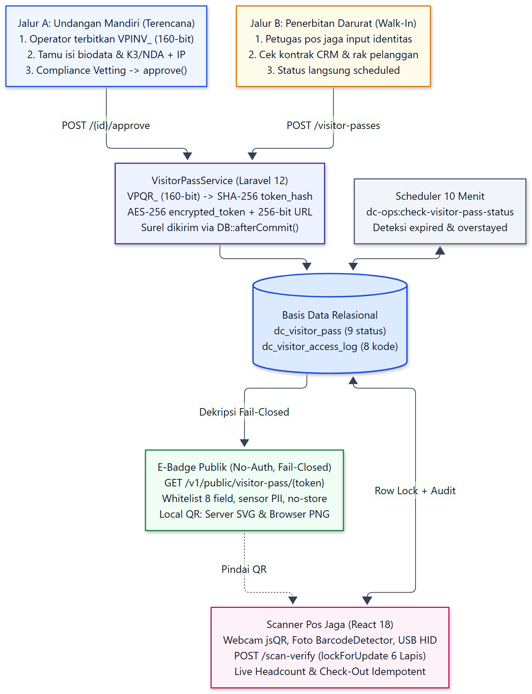
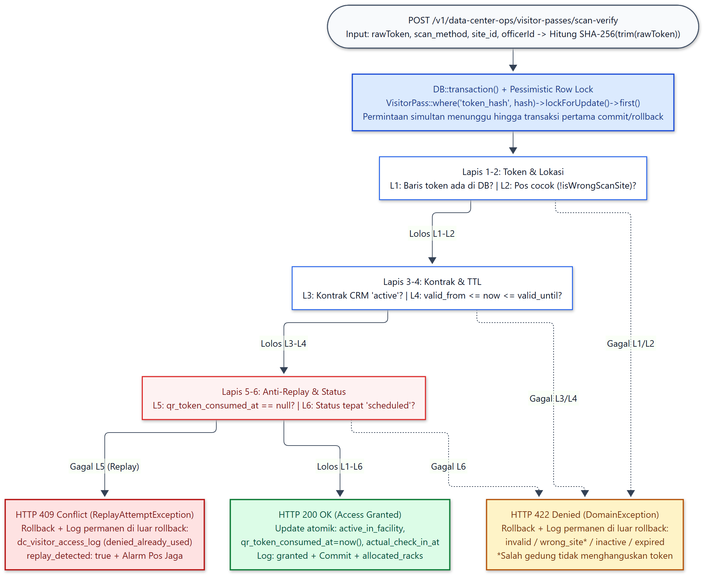
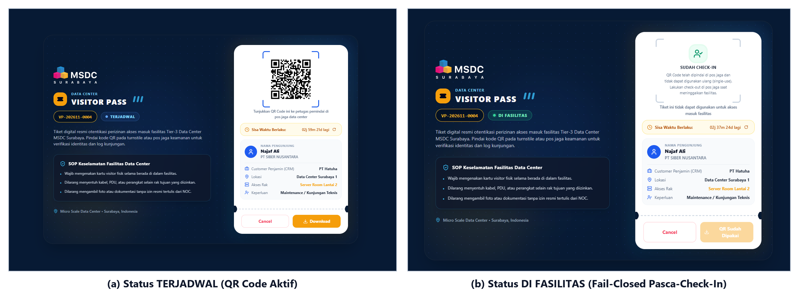
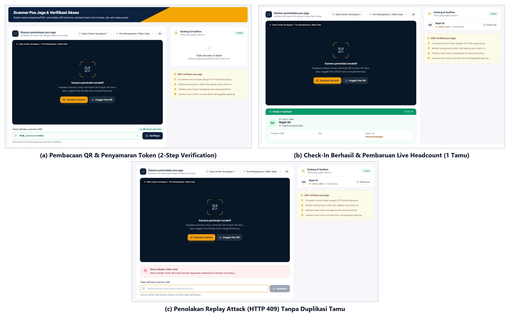

# RANCANG BANGUN SISTEM MANAJEMEN IZIN AKSES FISIK PUSAT DATA BERBASIS *DYNAMIC ONE-TIME QR CODE* DENGAN PROTEKSI *ANTI-REPLAY* MENGACU ISO/IEC 27001

*¹Muhammad Akmal Firmansyah, ²Ardhon Rakhmadi, ³M. Triman Prasodjo*

¹Program Studi Informatika, Fakultas Ilmu Komputer, Universitas Pembangunan Nasional “Veteran” Jawa Timur, Indonesia.  
²Program Studi Informatika, Fakultas Ilmu Komputer, Universitas Pembangunan Nasional “Veteran” Jawa Timur, Indonesia.  
³Unit Teknologi Informasi, PT Jawa Pos Media Televisi (JTV), Surabaya, Indonesia.

DOI: (diisi oleh editor)  
*Corresponding Author: [email.korespondensi@student.upnjatim.ac.id]*  
Submit: [Bulan Tahun] | Accepted: [Bulan Tahun] | Published: [Bulan Tahun]

---

## ABSTRAK

Pencatatan izin masuk pengunjung pusat data (*data center*) secara manual maupun berbasis *Quick Response* (QR) *code* statis menyisakan celah keamanan serius. Tangkapan layar tiket dapat digandakan (*replay attack*), pemindaian serentak memicu kondisi balapan (*race condition*), dan jejak auditnya belum memenuhi standar ISO/IEC 27001:2022. Penelitian ini merancang dan membangun sistem manajemen izin akses fisik pusat data berbasis *dynamic one-time QR code*. Sistem dikembangkan dengan arsitektur terpisah (*decoupled*) menggunakan Laravel 12 dan React 18. Keamanan token dibangun melalui pembangkit acak kriptografis 160-bit (`VPINV_` dan `VPQR_`) yang disimpan sebagai *hash* SHA-256. Alur penerbitan memisahkan jalur undangan pendaftaran mandiri tanpa akun dari jalur darurat (*walk-in*). *Endpoint* publik dilindungi melalui penyaringan respons (*response whitelisting*) dan perenderan *QR code* lokal secara *fail-closed*. Pada pos jaga, enam lapis validasi *anti-replay* dieksekusi di dalam transaksi penguncian baris pesimis (`lockForUpdate()`). Setiap pemindaian ulang ditolak dengan status HTTP 409 *Conflict* dan dicatat permanen di luar *rollback* pada log audit. Perintah terjadwal setiap 10 menit memantau kedaluwarsa izin dan status *overstay* tanpa *check-out* otomatis. Evaluasi memadukan pengujian fitur otomatis PHPUnit dan uji penerimaan pengguna (*User Acceptance Testing*, UAT) di lingkungan *staging*. Seluruh 39 skenario uji unik dengan 205 *assertions* lulus 100% dalam 4,10 detik, serta UAT di lingkungan *staging* mengonfirmasi kesiapan operasional tanpa galat kritis.

Kata Kunci: izin akses fisik, pusat data, *dynamic one-time QR code*, proteksi *anti-replay*, ISO/IEC 27001

---

## *DESIGN AND IMPLEMENTATION OF A PHYSICAL ACCESS PERMIT MANAGEMENT SYSTEM FOR DATA CENTERS BASED ON DYNAMIC ONE-TIME QR CODE WITH ANTI-REPLAY PROTECTION COMPLIANT WITH ISO/IEC 27001*

## *ABSTRACT*

*Manual visitor logging and static Quick Response (QR) code guestbooks leave critical physical security gaps in data centers. Attackers can duplicate ticket screenshots (replay attacks), concurrent scans can trigger race conditions, and audit trails often fail to satisfy ISO/IEC 27001:2022 controls. This study designs and implements a physical access permit management system for data centers based on dynamic one-time QR codes. The system adopts a decoupled architecture built on Laravel 12 and React 18. Token security relies on 160-bit cryptographically secure random strings (`VPINV_` and `VPQR_`) stored as SHA-256 hashes. Issuance separates unauthenticated self-registration invitations from emergency walk-in entry. Public endpoints enforce strict response whitelisting and fail-closed local QR code rendering. At the security desk, a six-layer anti-replay pipeline executes inside a pessimistic row-locking database transaction (`lockForUpdate()`). Repeated scans trigger HTTP 409 Conflict responses and persist permanent audit logs outside transaction rollbacks. A 10-minute scheduled task detects expired permits and overstay anomalies without automated check-out. Evaluation combines automated feature testing with PHPUnit and staging User Acceptance Testing (UAT). All 39 unique test scenarios covering 205 assertions passed (100%) in 4.10 seconds, and staging UAT confirmed operational readiness without critical defects.*

*Keywords: physical access permit, data center, dynamic one-time QR code, anti-replay protection, ISO/IEC 27001*

---

## PENDAHULUAN

Pusat data (*data center*) kolokasi menampung perangkat komputasi, jaringan inti, dan informasi bisnis milik berbagai pelanggan korporat. Keamanan aset di dalamnya tidak cukup dijaga lewat pertahanan jaringan semata. Fasilitas tersebut menuntut kendali akses fisik yang ketat terhadap setiap teknisi, vendor, dan tamu eksternal. Standar internasional ISO/IEC 27001:2022 melalui domain kendali fisik mewajibkan identifikasi pengunjung, pembatasan area otorisasi, pencatatan waktu masuk-keluar, dan jejak audit (*audit trail*) yang dapat diverifikasi [1]. Evaluasi audit surveilans *Statement of Applicability* ISO/IEC 27001:2022 pada pusat data internal oleh Widharto dan Kartawidjaja [2] menegaskan pentingnya keselarasan antara kontrol terdokumentasi dan praktik harian. Di sektor teregulasi, Pratiwi dkk. [3] menemukan bahwa tata kelola akses pihak ketiga dan perlindungan data pribadi masih menyisakan celah ketika standar dijalankan secara prosedural tanpa dukungan kontrol teknis otomatis.

Berbagai organisasi mulai mengganti buku tamu kertas dengan sistem akses berbasis *Quick Response* (QR) *code*. Tinjauan sistematis Alsawi dan Ibrahim [4] atas beragam *QR Code-Based Access Control Systems* (QR-ACS) mencatat keunggulan *QR code* sebagai autentikasi nirsentuh berbiaya rendah. Namun, tingkat keamanannya sangat bergantung pada cara pembangkitan, penyajian, dan validasi token [4]. Buku tamu berbasis web di PT Petrokimia Gresik karya Mubarok dan Chotijah [5] serta kontrol pintu pintar karya Jain dkk. [6] masih memakai *QR code* statis atau pencocokan pengenal tunggal di basis data (*database*). Pendekatan tersebut rentan terhadap *replay attack* karena tangkapan layar tiket dapat dibagikan lalu dipindai ulang oleh pihak lain. Sistem *check-in* tamu perkantoran oleh Saputra dkk. [7] memang sudah menyediakan persetujuan tuan rumah, *Role-Based Access Control* (RBAC), deteksi *overstay*, dan daftar kehadiran darurat. Arsitektur manajemen pengunjung *enterprise* berbasis Laravel karya Jasri dkk. [8] juga telah memadukan autentikasi *QR code* dengan *Representational State Transfer Application Programming Interface* (REST API). Meskipun demikian, kedua rancangan tersebut belum menerapkan penguncian konkurensi pemindaian serentak, validasi silang kontrak penyewaan rak, maupun pembatasan pos gedung pada fasilitas *multi-site*.

Celah keamanan sistem akses *QR code* tidak hanya muncul di lapisan kriptografi, tetapi juga pada konkurensi transaksi dan paparan API publik. Evaluasi multi-skenario sistem *QR code* *anti-replay* oleh Slameto dkk. [9] menelaah 26 studi *QR code* di Indonesia. Kajian itu mengungkap bahwa pengujian *anti-replay* menyeluruh masih jarang ditemukan dan umumnya menyasar identitas digital umum, bukan izin akses fisik gedung [9]. Di sisi transaksi basis data, studi empiris Wang dkk. [10] pada delapan aplikasi web sumber terbuka menemukan cacat kebenaran pada 53 dari 91 transaksi tingkat aplikasi (*ad hoc transactions*). Temuan ini sejalan dengan penyelidikan Miyachi dkk. [11] mengenai kerentanan *Time-of-Check to Time-of-Use* (TOCTOU) *race condition* pada aplikasi web PHP. Dua permintaan yang tiba bersamaan dapat meloloskan aksi yang seharusnya hanya boleh berjalan sekali [11]. Pada antarmuka eksternal, OWASP API Security Top 10:2023 menyoroti risiko *Broken Object Property Level Authorization* yang memicu paparan data berlebih (*excessive data exposure*) saat *endpoint* mengembalikan objek internal secara utuh [12]. Idris dkk. [13] juga menempatkan celah paparan data ini sebagai ancaman khas layanan web berbasis API.

Berangkat dari celah riset tersebut, penelitian ini merancang, membangun, dan menguji sistem manajemen izin akses fisik pusat data berbasis *dynamic one-time QR code* yang mengacu pada ISO/IEC 27001:2022. Kontribusi utama penelitian ini terbagi atas empat pilar teknis. Pertama, sistem memisahkan jalur undangan pendaftaran mandiri tanpa akun dan jalur darurat (*walk-in*) dengan token acak kriptografis 160-bit (`VPINV_` dan `VPQR_`) tersimpan dalam *hash* SHA-256 serta persetujuan operator berbasis daftar periksa kepatuhan. Kedua, sistem menerapkan enam lapis validasi *anti-replay* di dalam transaksi penguncian baris pesimis (`lockForUpdate()`) yang mengembalikan HTTP 409 *Conflict* serta mencatat log permanen di luar *rollback*. Ketiga, *endpoint* publik diamankan lewat *response whitelisting*, penyensoran *Personally Identifiable Information* (PII), *header* `Cache-Control: private, no-store`, dan perenderan *QR code* lokal secara *fail-closed*. Keempat, keandalan fungsional dan keamanan diverifikasi lewat pengujian fitur otomatis (*automated feature testing*) dan uji penerimaan pengguna (*User Acceptance Testing*, UAT) pada lingkungan *staging* pusat data kolokasi.

---

## METODOLOGI

### 1. Tahapan Pengembangan dan Lingkup Sistem

Sistem dikembangkan melalui pendekatan iteratif berbasis *Agile* agar aturan keamanan, validasi kontrak, dan alur petugas pos jaga dapat diuji secara bertahap bersama tim operasional [14]. Siklus kerja mencakup empat fase utama: analisis persyaratan ISO/IEC 27001:2022, perancangan arsitektur terpisah dan skema basis data, implementasi *backend* beserta *frontend*, serta verifikasi melalui pengujian otomatis dan UAT *staging*.

Implementasi dirancang sebagai subsistem keamanan akses fisik pada platform operasional pusat data kolokasi PT Jawa Pos Media Televisi (JTV) Surabaya. Subsistem ini terintegrasi dengan modul *Customer Relationship Management* (CRM). Setiap izin masuk dikunci pada kontrak komersial aktif, lokasi gedung (*site*), ruang server, dan daftar rak spesifik (`target_rack_ids`) milik pelanggan penjamin. Keselarasan mekanisme teknis yang dibangun terhadap klausul kontrol relevan pada Annex A ISO/IEC 27001:2022 [1] dirangkum pada Tabel 1.

**Tabel 1. Pemetaan klausul kontrol Annex A ISO/IEC 27001:2022 terhadap mekanisme teknis sistem**

| Klausul Annex A ISO/IEC 27001:2022 | Tujuan Kontrol Keamanan | Mekanisme Teknis yang Diimplementasikan |
| :--- | :--- | :--- |
| A.7.2 (*Physical Entry Controls*) | Membatasi akses area aman hanya bagi tamu terotorisasi pada jadwal berlaku | Jalur undangan (`VPINV_`) terpisah dari *walk-in*, daftar periksa kepatuhan, token `VPQR_` ber-TTL, *2-step verification*, serta enam lapis validasi (`lockForUpdate()`, HTTP 409) |
| A.7.3 (*Securing Offices, Rooms, and Facilities*) | Mengunci otorisasi fisik hingga tingkat gedung, ruang server, dan rak pelanggan | Verifikasi silang kontrak aktif CRM, penguncian gedung, ruang, dan rak (`target_rack_ids`), validasi pos (`isWrongScanSite()`), *Live Headcount*, serta deteksi *overstay* 10 menit |
| A.8.15 (*Logging*) | Merekam peristiwa akses, penolakan, dan anomali keamanan secara permanen | Tabel *append-only* `dc_visitor_access_log` dengan delapan kode keputusan, penulisan log penolakan di luar *rollback*, rekaman waktu dan IP K3/NDA, serta identitas petugas pos |

### 2. Arsitektur Terpisah dan Pemodelan Basis Data

Arsitektur web memisahkan *backend* Laravel 12 (PHP 8.4) dari *frontend* *Single Page Application* (SPA) React 18 dan TypeScript 5.6 untuk menjaga modularitas batas akses [15]. Sepuluh *endpoint* internal di bawah `/v1/data-center-ops/visitor-passes` dilindungi autentikasi OAuth2 (*Laravel Passport*) dan RBAC granular berbasis *Spatie Laravel Permission*. Hak akses dibagi tegas antara hak baca (`visitor-pass.view`) dan hak kelola atau pemindaian (`visitor-pass.manage`). Di sisi lain, tiga *endpoint* eksternal di bawah `/v1/public/` bekerja tanpa sesi masuk untuk formulir registrasi tamu dan tampilan *E-Badge* berbasis token acak. Alur menyeluruh antarkomponen diperlihatkan pada Gambar 1.

**Gambar 1. Arsitektur *decoupled* sistem manajemen izin akses fisik pusat data (jalur undangan mandiri, jalur darurat *walk-in*, *E-Badge* publik, dan stasiun pemindai pos jaga)**

Penyimpanan data dipisahkan ke dalam dua tabel inti agar siklus hidup tiket terpisah dari rekaman peristiwa pemindaian:

1. Tabel `dc_visitor_pass` menyimpan nomor seri tiket bulanan (`VP-YYYYMM-XXXX`), relasi pelanggan dan kontrak (`organization_id`, `customer_id`, `contract_id`, `site_id`, `site_room_id`, serta `target_rack_ids` berformat JSON), dan atribut undangan (`invite_token_hash`, `invite_token_expires_at`, `allowed_start_date`, `allowed_end_date`). Tabel ini juga memuat biodata tamu, bukti persetujuan keselamatan dan kesehatan kerja (K3) serta *Non-Disclosure Agreement* (NDA) (`safety_nda_agreed_at`, `safety_nda_ip`), jadwal kunjungan beserta jendela *Time-to-Live* (TTL) (`valid_from`, `valid_until`), dan kolom kriptografi (`token_hash`, `encrypted_token`, `public_url_token`, `qr_token_consumed_at`). Siklus hidup tiket dikendalikan melalui sembilan status (`pending_registration`, `registered`, `scheduled`, `active_in_facility`, `overstayed`, `completed`, `cancelled`, `expired`, `denied`) bersama identitas petugas persetujuan, *check-in*, dan *check-out*.
2. Tabel `dc_visitor_access_log` berfungsi sebagai catatan audit permanen (*append-only*) untuk setiap pemindaian. Atribut yang direkam meliputi `scan_timestamp`, `attempted_token_hash`, `scan_method` (`webcam_guard`, `usb_scanner`, `manual_override`, `turnstile_gate`, atau `checkout_scan`), `officer_id`, `ip_address`, `user_agent`, kode keputusan (`granted`, `checkout_granted`, `denied_invalid_token`, `denied_expired`, `denied_already_used`, `denied_contract_inactive`, `denied_overstayed`, `denied_wrong_site`), serta keterangan alasan.

Seluruh kolom waktu disimpan dalam *Coordinated Universal Time* (UTC) berformat ISO-8601 (`Z`). Sebaliknya, batas tanggal bisnis seperti `allowed_start_date`, `allowed_end_date`, tanggal kontrak, dan *scope* harian `validToday` dievaluasi pada zona Waktu Indonesia Barat (WIB, `Asia/Jakarta`). Strategi ini mencegah pergeseran tanggal selama tujuh jam saat pemrosesan izin terjadi pada dini hari WIB.

### 3. Mekanisme Kriptografi Token, Penyaringan Respons, dan Jadwal

Sistem membangkitkan tiga kredensial acak melalui *Cryptographically Secure Pseudorandom Number Generator* (CSPRNG) PHP `random_bytes()`. Rincian panjang, entropi, dan penyimpanan setiap token dirangkum pada Tabel 2.

**Tabel 2. Spesifikasi token kriptografi dan mekanisme penyimpanan**

| Jenis Token | Format & Panjang | Entropi (bit) | Penyimpanan Basis Data | Kebijakan Keamanan |
| :--- | :--- | :---: | :--- | :--- |
| Token Undangan | `VPINV_` + 40 heksadesimal (46 karakter) | 160 | *Hash* SHA-256 (`invite_token_hash`, unik) | Hangus setelah status menjadi `registered` atau lewat batas hari WIB |
| Token *QR Code* Akses | `VPQR_` + 40 heksadesimal (45 karakter) | 160 | *Hash* SHA-256 (`token_hash`, unik) + AES-256 (`encrypted_token`) | Sekali pakai (*single-use*); hanya terbit pasca-persetujuan atau *walk-in* |
| Token URL *E-Badge* | 64 karakter heksadesimal | 256 | Teks unik (`public_url_token`) | Akses baca-saja (*read-only*); tanpa rotasi token saat dekripsi gagal |

Pada jalur kunjungan terencana (Jalur A), operator menerbitkan undangan `pending_registration` setelah sistem memastikan kontrak CRM aktif dan rak teralokasi bagi pelanggan terkait. Tamu membuka tautan publik untuk mengisi biodata, daftar peralatan, teknisi pendamping, jadwal kunjungan, serta deklarasi K3 dan NDA yang merekam stempel waktu dan alamat IP. Metode `assertVisitScheduleWithinPermit()` menolak jadwal yang selesai sebelum waktu datang, melebihi batas durasi `MAX_VISIT_HOURS = 14` jam (satu *shift*), atau keluar dari rentang izin dan kontrak.

Untuk mencegah paparan data berlebih sesuai panduan OWASP API Security [12], [13], *endpoint* `POST /v1/public/visitor-invitation/{token}/register` menerapkan *response whitelisting* melalui `toRegistrationSummary()`. Metode ini membatasi keluaran hanya pada delapan atribut aman (`pass_number`, `status`, `visitor_name`, `visitor_company`, `site_name`, `room_name`, `planned_check_in_at`, `planned_check_out_at`). Atribut sensitif seperti nomor kartu tanda penduduk (KTP), IP NDA, catatan operator, detail kontrak, dan ID petugas tidak pernah dikirim ke klien publik. Properti `$hidden` pada model `VisitorPass` turut menyembunyikan seluruh kolom *hash* dan *ciphertext* dari serialisasi bawaan.

Penerbitan *QR code* pada jalur terencana mensyaratkan persetujuan operator melalui `approveVisitorPass()` di dalam `DB::transaction()` dengan `lockForUpdate()`. Metode ini memvalidasi ulang status kontrak serta memastikan jadwal kunjungan belum terlewati. Selanjutnya, sistem menghitung jendela TTL mulai dua jam sebelum `planned_check_in_at` hingga dua jam setelah `planned_check_out_at`, lalu membangkitkan token `VPQR_`. Pengiriman surel *E-Badge* dibungkus dalam `DB::afterCommit()` agar latensi *Simple Mail Transfer Protocol* (SMTP) tidak menahan kunci baris dan surel batal dikirim jika transaksi mengalami *rollback*.

Pada *endpoint* `GET /v1/public/visitor-pass/{publicUrlToken}`, pengendali publik menjaga sifat *read-only* dan *idempotent* serta mengirim *header* `Cache-Control: private, no-store` [16]. Nomor identitas tamu disensor pada atribut `visitor_identity_masked` hingga hanya empat digit awal dan akhir yang terlihat. Dekripsi `encrypted_token` bekerja secara *fail-closed*: apabila tiket kedaluwarsa, sudah terpakai, dibatalkan, atau gagal didekripsi, server mengembalikan `qr_payload = null` tanpa menulis mutasi ke basis data. Perenderan *QR code* berjalan lokal di server melalui pustaka `endroid/qr-code` dalam format *Scalable Vector Graphics* (SVG) *data Uniform Resource Identifier* (URI). Pada peramban, perender kanvas lokal juga membentuk matriks ISO/IEC 18004 secara mandiri sehingga token akses fisik tidak pernah dikirim ke layanan eksternal.

### 4. Desain Verifikasi Enam Lapis *Anti-Replay* dan Pemantauan *Overstay*

Verifikasi pemindaian pos jaga pada `VisitorPassService::scanAndVerify()` dirancang untuk memblokir duplikasi tangkapan layar sekaligus *TOCTOU race condition*. Alur transaksi terkunci dan pencabangan responsnya disajikan pada Gambar 2.

**Gambar 2. Diagram alur transaksi penguncian baris pesimis (`lockForUpdate()`) dan enam lapis validasi *anti-replay* pada `scanAndVerify()`**

Saat `POST /v1/data-center-ops/visitor-passes/scan-verify` menerima token mentah, layanan menghitung `SHA-256(trim(rawToken))` lalu membuka transaksi dengan `VisitorPass::where('token_hash', $attemptedHash)->lockForUpdate()->first()`. Klausa `lockForUpdate()` memasang kunci eksklusif tingkat baris. Permintaan kedua yang datang pada milidetik bersamaan dipaksa menunggu sampai transaksi pertama selesai melakukan *commit*. Di dalam transaksi terkunci itu, enam lapis validasi dievaluasi berurutan:

1. **Lapis 1 (Keberadaan Token):** Token yang *hash*-nya tidak ditemukan ditolak dengan `DomainException` (HTTP 422, log `denied_invalid_token`).
2. **Lapis 2 (Kesesuaian Gedung / *Site Guard*):** Fungsi `isWrongScanSite()` mencocokkan `site_id` pos jaga dengan `site_id` tiket. Ketidakcocokan ditolak (HTTP 422, log `denied_wrong_site`) tanpa menghanguskan token agar tamu masih dapat melapor di gedung tujuan yang benar.
3. **Lapis 3 (Keaktifan Kontrak CRM):** Relasi kontrak pelanggan wajib berstatus `active`; kontrak nonaktif ditolak dengan log `denied_contract_inactive`.
4. **Lapis 4 (Jendela Validitas TTL):** Waktu pemindaian wajib berada pada rentang `valid_from` hingga `valid_until`; pelanggaran batas waktu dicatat sebagai `denied_expired`.
5. **Lapis 5 (Proteksi *Anti-Replay* Sekali Pakai):** Jika `qr_token_consumed_at !== null` atau status sudah `active_in_facility`/`overstayed`, sistem melempar `ReplayAttemptException`. Pengecualian ini dipetakan ke **HTTP 409 *Conflict*** sesuai *Request for Comments* (RFC) 9110 [16] dengan penanda `replay_detected: true`.
6. **Lapis 6 (*Whitelist* Status):** Sistem hanya meloloskan tiket berstatus tepat `scheduled`. Status lain seperti `registered` atau `cancelled` ditolak secara *fail-closed*.

Apabila keenam lapis terpenuhi, sistem memperbarui `status = 'active_in_facility'`, `qr_token_consumed_at = now()`, dan `actual_check_in_at = now()` secara atomik. Rekaman `granted` dicatat di `dc_visitor_access_log`, lalu daftar rak teralokasi (`allocated_racks`) dikembalikan bersama status HTTP 200. Sebaliknya, jika `ReplayAttemptException` atau `DomainException` terpicu, transaksi di-*rollback* untuk melepas kunci baris. Blok `catch` di luar transaksi kemudian menulis rekaman `denied_already_used` atau kode penolakan lain ke `dc_visitor_access_log` agar bukti percobaan serangan tetap permanen. Status terminal (`cancelled`, `completed`, `denied`) juga diproteksi agar tidak tertimpa oleh percobaan pemindaian lanjutan.

Proses *check-out* (`checkOut()`) dan pembatalan (`cancelVisitorPass()`) turut memakai `DB::transaction()` dan `lockForUpdate()` untuk menjamin sifat *idempotent* terhadap klik ganda. Untuk pemantauan batas waktu, perintah `dc-ops:check-visitor-pass-status` dijadwalkan setiap 10 menit dengan proteksi `withoutOverlapping()`. Perintah tersebut mengalihkan tiket `scheduled` dan undangan yang lewat waktu menjadi `expired`. Pengunjung `active_in_facility` yang melampaui `valid_until` diubah statusnya menjadi `overstayed` disertai peringatan *in-app* bagi operator tanpa *check-out* otomatis, karena tamu tersebut secara fisik masih berada di dalam gedung.

### 5. Rancangan Pengujian

Verifikasi sistem ditempuh melalui dua metode pengujian saling melengkapi. Lapisan pertama berupa pengujian fitur otomatis dengan PHPUnit 11.5.56 pada PHP 8.4.0 menggunakan basis data SQLite *in-memory* dan pembekuan waktu deterministik (`$this->travelTo()`). Pengujian ini mencakup 36 skenario inti pada rangkaian uji registrasi mandiri. Rangkaian uji terpadu *E-Badge* publik mewarisi 36 skenario tersebut sekaligus menambahkan 3 skenario keamanan *E-Badge* lokal sehingga total terdapat 39 skenario uji unik. Lapisan kedua berupa UAT *end-to-end* pada lingkungan *staging* pusat data bersama perwakilan operasional guna menguji alur pemindai pos jaga, *compliance vetting*, dan penghitung okupansi (*live headcount*).

Untuk memverifikasi proteksi sekali pakai secara langsung pada antarmuka pengguna, pengujian *staging* menjalankan protokol **Skenario Uji A** (*end-to-end* siklus token dan simulasi *replay attack*) dalam lima tahap berurutan. Pertama, operator menerbitkan *E-Badge* aktif berstatus terjadwal dengan citra *QR code* lokal serta hitung mundur masa berlaku. Kedua, petugas membaca *QR code* tersebut pada stasiun pemindai pos jaga guna memastikan token tersamar saat menunggu konfirmasi (*2-step verification*). Ketiga, petugas mengonfirmasi *check-in* untuk memvalidasi status keberhasilan sekaligus pertambahan otomatis jumlah tamu pada panel *Live Headcount*. Keempat, citra *QR code* yang sama dipindai ulang guna menyimulasikan *replay attack* dan memverifikasi pemblokiran HTTP 409 *Conflict* tanpa menggandakan jumlah tamu. Kelima, halaman *E-Badge* publik diperiksa kembali untuk memastikan perubahan status pasca-konsumsi serta penghilangan citra *QR code* secara *fail-closed*.

---

## HASIL DAN PEMBAHASAN

### 1. Implementasi Alur Registrasi, *Compliance Vetting*, dan *E-Badge* Lokal

Halaman registrasi mandiri tanpa akun menyajikan rincian penjamin, lokasi gedung, ruang server, rak tujuan, dan instruksi keselamatan. Usai tamu menyetujui deklarasi K3 serta NDA lalu mengirim formulir, antarmuka menjalankan *backoff polling* bertahap (jeda 5, 15, hingga 30 detik) dan mengalihkan tamu secara otomatis ke *E-Badge* dalam lima detik begitu operator menyetujui izin. Operator meninjau pendaftaran pada halaman detail tiket dan mengeksekusi persetujuan lewat modal verifikasi kepatuhan. Tombol persetujuan terkunci hingga operator mencentang dua verifikasi wajib: kesesuaian identitas beserta NDA serta kesesuaian barang bawaan beserta jadwal kunjungan. Untuk gangguan mendadak di luar jam kerja, petugas menggunakan halaman penerbitan izin darurat (Jalur B) agar izin *walk-in* langsung berstatus `scheduled` selama kontrak pelanggan aktif.

Setelah izin disetujui, halaman publik menyajikan kartu *E-Badge* digital dengan logika validasi klien berprinsip *fail-closed*. Citra *QR code* hanya dirender secara lokal apabila tiket berstatus `scheduled`, belum terkonsumsi, belum melewati `valid_until`, dan *payload* sesuai pola `^VPQR_[A-Za-z0-9]+$`. Siklus perubahan tampilan *E-Badge* terverifikasi langsung pada tiket uji *staging* **`VP-202611-0004`** (Gambar 3). Tiket tersebut diterbitkan bagi tamu *PT Siber Nusantara* dengan penjamin *PT Hatuha* menuju *Data Center Surabaya 1 - Server Room Lantai 2*. Pada kondisi awal, kartu berstatus `TERJADWAL` menampilkan *QR code* lokal beserta hitung mundur masa berlaku `02j 59m 21d` dan tombol unduh aktif (Gambar 3a). Usai tiket dipindai di pos jaga, status *E-Badge* publik otomatis berganti menjadi `DI FASILITAS` dengan penanda `SUDAH CHECK-IN` serta tombol nonaktif `QR Sudah Dipakai`. Pada kondisi tersebut, citra *QR code* ditiadakan sepenuhnya secara *fail-closed* meskipun sisa jendela berlaku masih `02j 37m 24d` (Gambar 3b).

**Gambar 3. Siklus tampilan kartu tiket digital *E-Badge* pada tiket `VP-202611-0004`: (a) status `TERJADWAL` dengan *QR code* lokal aktif dan hitung mundur berlaku; (b) status `DI FASILITAS` / `SUDAH CHECK-IN` secara *fail-closed* pasca-konsumsi**

### 2. Implementasi Stasiun Pemindai Pos Jaga (*Scanner Guard*) dan *Live Headcount*

Antarmuka stasiun pemindai pos jaga berjalan langsung di komputer resepsionis maupun tablet satpam tanpa perangkat pembaca khusus. Pemindaian mendukung tiga moda input: kamera langsung peramban dengan `jsQR` tiap 250 ms, unggah foto *QR code*, dan pemindai *barcode* USB berbasis *Human Interface Device* (HID). Khusus moda unggah foto, pemindaian memadukan `BarcodeDetector` terakselerasi perangkat keras dengan pemindaian multi-skala `jsQR` agar citra beresolusi beragam tetap terbaca akurat.

Stasiun pemindai memberlakukan konfirmasi dua langkah (*2-step verification*) untuk menekan kesalahan operasi petugas. Token hasil pembacaan disamarkan dengan 10 karakter penutup tetap agar nilai aslinya tidak terpapar pada *Document Object Model* (DOM). Token tersebut kedaluwarsa otomatis dalam 60 detik apabila tidak segera diverifikasi. Pilihan gedung pos jaga (`site_id`) tersimpan pada `localStorage` perangkat gerbang agar setiap panggilan `scan-verify` menyertakan identitas lokasi fisik. Di sisi kanan layar, panel *Live Headcount* memanggil *endpoint* daftar tamu aktif untuk menampilkan seluruh pengunjung berstatus `active_in_facility` dan `overstayed` secara waktu nyata sebagai acuan evakuasi darurat. Umpan balik *Web Audio API* turut membedakan nada konfirmasi masuk, *check-out*, dan peringatan penolakan bagi petugas.

**Gambar 4. Pengujian pemindai pos jaga pada tiket `VP-202611-0004`: (a) penyamaran token (*2-step verification*); (b) *check-in* dan *Live Headcount*; (c) penolakan *replay* (HTTP 409)**

Rangkaian pengujian Skenario Uji A pada tiket `VP-202611-0004` di pos *Data Center Surabaya 1* memperlihatkan alur verifikasi secara kronologis (Gambar 4). Saat citra *QR code* dibaca pada stasiun pemindai, antarmuka menyamarkan token menjadi `VPQR_1••••••••••8b6c` sambil menunggu konfirmasi petugas, sementara panel *Live Headcount* masih mencatat `0 tamu` (Gambar 4a). Begitu petugas menekan verifikasi pada pukul `16.02.40 WIB`, sistem menampilkan spanduk hijau `Check-in berhasil`. Panel *Live Headcount* pun langsung bertambah dari `0 tamu` menjadi `1 tamu` beserta tombol *check-out* (Gambar 4b). Ketika citra *QR code* yang sama dipindai ulang untuk menyimulasikan *replay attack*, sistem segera memblokir akses melalui peringatan merah *"Akses ditolak: Kode QR sudah pernah digunakan sebelumnya (Single-use policy)."* (HTTP 409 *Conflict*). Pada saat yang sama, panel *Live Headcount* tetap bertahan pada `1 tamu` tanpa menggandakan entri kehadiran (Gambar 4c).

### 3. Hasil Pengujian Otomatis Fungsional, Keamanan, dan UAT

Eksekusi rangkaian pengujian fitur otomatis pada PHP 8.4.0 dan PHPUnit 11.5.56 menyelesaikan seluruh **39 skenario uji unik** dengan **205 *assertions***. Tingkat kelulusan mencapai **100% (39 lulus, 0 gagal, 0 dilewati)** dalam waktu **4,10 detik**. Rangkuman seluruh kategori skenario uji dan hasil verifikasinya tercantum pada Tabel 3.

**Tabel 3. Hasil pengujian otomatis fungsional dan keamanan Klaster 5 (39 skenario uji unik, 205 *assertions*)**

| Kategori Uji | Cakupan Skenario Uji Aktual | Jumlah Skenario | Hasil |
| :--- | :--- | :---: | :---: |
| Siklus Hidup Undangan & Registrasi Mandiri | Penerbitan undangan `VPINV_`, detail publik (`pending_registration`/`registered`/`scheduled`), kompatibilitas *payload* frontend, auto-sinkronisasi nomor seri `VP-YYYYMM-XXXX`, dan penolakan *approve* status tak sah | 7 | 7/7 Lulus |
| Validasi Jadwal, Durasi, & Kontrak CRM | Penolakan *check-out* ≤ *check-in*, durasi > 14 jam (tepat 14 jam lulus), keluar rentang tanggal izin, melewati kontrak, validasi ulang jadwal/kontrak saat *approve*, dan toleransi 15 menit *endpoint* publik | 8 | 8/8 Lulus |
| Konsistensi Zona Waktu WIB & UTC | Konversi *fallback* 09:00–18:00 WIB ke 02:00–11:00 UTC (ISO-8601 `Z`), batas kedaluwarsa akhir hari 23:59:59 WIB, penafsiran waktu operator tanpa *offset*, kelayakan kontrak WIB, notifikasi *overstay* WIB, dan *scope* harian | 7 | 7/7 Lulus |
| Keamanan API Publik & *Fail-Closed* E-Badge | *Response whitelisting* (13 atribut sensitif tidak bocor), *GET read-only* tanpa mutasi DB, pengiriman SVG lokal tanpa izin staf, penolakan render *QR code* untuk 5 kondisi tak sah, dan *fail-closed* saat *renderer* gagal | 6 | 6/6 Lulus |
| Proteksi *Anti-Replay*, Lokasi Gedung, & Integritas Transaksi | *Check-in* sukses + penolakan *replay* dengan `ReplayAttemptException` (HTTP 409), *whitelist* status `scheduled`, penolakan salah gedung (`denied_wrong_site`), proteksi status final, *double check-out* *idempotent*, pembatalan terkunci, dan `DB::afterCommit()` email | 9 | 9/9 Lulus |
| Pemantauan *Overstay* & *Scheduler* | Transisi `scheduled` ke `expired`, penandaan `active_in_facility` ke `overstayed` tanpa *auto check-out* (tetap dapat di-*check-out* petugas), dan eksekusi perintah penjadwalan berstatus keluar 0 | 2 | 2/2 Lulus |
| **Total Keseluruhan** | **Seluruh rangkaian uji terpadu *E-Badge* dan izin kunjungan (36 skenario inti + 3 skenario *E-Badge* lokal)** | **39** | **39/39 Lulus (100%)** |

Tiga hasil verifikasi penting menonjol dari rangkaian uji otomatis tersebut. Pertama, skenario uji registrasi mandiri dan proteksi *anti-replay* memastikan pemindaian pertama menandai `qr_token_consumed_at` secara atomik, sedangkan pemindaian ulang token yang sama melempar `ReplayAttemptException` (HTTP 409) sambil menyimpan log `denied_already_used` di luar *rollback*. Kedua, skenario uji verifikasi lintas gedung memvalidasi penolakan saat gedung pos tidak cocok (`denied_wrong_site`) tanpa menghanguskan token sehingga tiket tetap berlaku di gedung tujuan. Ketiga, skenario uji penyaringan respons publik memastikan tidak satu pun dari 13 atribut internal maupun empat nilai sensitif (nomor KTP, IP NDA, catatan operator, dan nomor kontrak) bocor ke respons JSON publik. Pengujian `DB::afterCommit()` juga memastikan notifikasi surel hanya terkirim pada tingkat transaksi nol (`DB::transactionLevel() === 0`) dan batal terkirim apabila transaksi luar mengalami *rollback*.

Selain pengujian otomatis, validasi *end-to-end* di lingkungan *staging* dilaksanakan melalui UAT pada 19 November 2026 di PT Jawa Pos Media Televisi (JTV) Surabaya bersama perwakilan teknis pengelola pusat data. Pengujian lapangan mencakup penerbitan undangan, pengisian formulir mandiri beserta K3/NDA, persetujuan operator lewat modal kepatuhan, eksekusi Skenario Uji A pada tiket `VP-202611-0004` (Gambar 3 dan Gambar 4), pemantauan *Live Headcount*, dan proses *check-out*. Seluruh alur fungsional dan kendali keamanan dinyatakan sesuai spesifikasi tanpa galat kritis.

### 4. Perbandingan dengan Penelitian Terdahulu dan Keterbatasan

Untuk menempatkan kontribusi sistem terhadap literatur mutakhir, Tabel 4 membandingkan rancangan yang dibangun dengan empat penelitian akses pengunjung berbasis *QR code* periode 2021–2026.

**Tabel 4. Perbandingan kapabilitas keamanan dengan penelitian terdahulu**

| Aspek Perbandingan | Mubarok & Chotijah (2021) [5] | Jain dkk. (2023) [6] | Saputra dkk. (2026) [7] | Jasri dkk. (2026) [8] | Sistem yang Diusulkan (2026) |
| :--- | :--- | :--- | :--- | :--- | :--- |
| Domain Penerapan | Buku tamu industri manufaktur | Pintu pintar berbasis Arduino | Pencatatan tamu kantor pemerintahan | Manajemen pengunjung *enterprise* | Pusat data kolokasi (*multi-site*) |
| Token *QR Code* Dinamis Sekali Pakai | Tidak (statis) | Tidak (UID statis) | Tidak | Parsial (autentikasi QR) | Ya (`VPQR_` 160-bit CSPRNG + SHA-256 + TTL) |
| *Pessimistic Locking* Anti-*Replay* (HTTP 409) | Tidak | Tidak | Tidak | Tidak | Ya (`DB::transaction` + `lockForUpdate()`) |
| *Response Whitelisting* & *Local QR* Publik | Tidak | Tidak | Tidak | Tidak dibahas | Ya (8 *field* aman, sensor PII, `no-store`, lokal) |
| Verifikasi Silang Kontrak Aktif & Pos Gedung | Tidak | Tidak | Tidak | Tidak (berbasis karyawan) | Ya (kontrak CRM, rak target, `isWrongScanSite()`) |
| Jejak Audit & Kontrol Fisik ISO/IEC 27001 | Tidak | Parsial (log UID) | Parsial (*audit log*, *overstay*, darurat) | Parsial (uji OWASP ZAP) | Ya (K3/NDA IP, *vetting*, 8 kode log permanen, *overstay* 10 mnt) |

Dibandingkan dengan rancangan buku tamu *QR code* statis [5], [6], konsumsi token sekali pakai di dalam transaksi terkunci menutup celah pembagian tangkapan layar serta *TOCTOU race condition* [10], [11]. Dibandingkan dengan platform tamu web modern [7], [8], sistem ini mengaitkan otorisasi fisik langsung pada kontrak kolokasi dan rak teralokasi pelanggan. Pemisahan respons publik yang ketat turut mencegah *excessive data exposure* [12], [13], sementara perenderan *QR code* lokal melindungi kredensial dari paparan layanan eksternal. Berbeda dengan pendekatan tanda tangan asimetris *Rivest-Shamir-Adleman* (RSA) dengan *Probabilistic Signature Scheme* (PSS) oleh Slameto dkk. [9] untuk dokumen digital umum, penggunaan *hash* SHA-256 terpusat bersama *pessimistic row locking* menyediakan pencabutan status seketika (*instant revocation*) lintas pos gedung sekaligus tetap ringan dijalankan pada operasional pusat data.

Penelitian ini masih menyisakan dua keterbatasan yang perlu diperhatikan. Pertama, pemindaian pos jaga baru diuji pada kamera peramban, unggah foto, dan masukan *USB scanner*. Integrasi aktuator perangkat keras *turnstile gate* baru tersedia pada kontrak parameter `turnstile_gate` dan belum dihubungkan ke pengontrol pintu fisik. Kedua, pengujian otomatis pada studi ini memvalidasi kebenaran logika konkurensi dan integritas transaksi di SQLite *in-memory*. Pengukuran latensi antrean kunci baris (*lock wait latency*) di bawah ratusan permintaan simultan pada klaster MySQL/InnoDB produksi belum termasuk dalam cakupan eksperimen ini.

---

## KESIMPULAN DAN SARAN

Penelitian ini menghasilkan sistem manajemen izin akses fisik pusat data berbasis *dynamic one-time QR code* dengan proteksi *anti-replay* yang selaras dengan kendali fisik ISO/IEC 27001:2022. Pemisahan jalur undangan mandiri tanpa akun dan jalur darurat *walk-in* dipadukan dengan token acak kriptografis 160-bit (`VPINV_` dan `VPQR_`) tersimpan dalam *hash* SHA-256. Pengamanan *endpoint* publik diterapkan lewat *response whitelisting* delapan atribut dan perenderan *QR code* lokal secara *fail-closed*. Di pos jaga, enam lapis validasi *anti-replay* di dalam transaksi `lockForUpdate()` memblokir duplikasi tangkapan layar (HTTP 409 *Conflict*), pelanggaran lintas gedung, dan *check-out* ganda sambil menjaga catatan permanen di `dc_visitor_access_log`. Hasil pengujian fitur otomatis pada PHP 8.4.0 dan PHPUnit 11.5.56 menunjukkan seluruh 39 skenario uji unik (205 *assertions*) lulus 100% dalam 4,10 detik, serta validasi UAT *staging* tanggal 19 November 2026 mengonfirmasi kesiapan operasional tanpa galat kritis.

Untuk penelitian lanjutan, dua pengembangan terarah disarankan. Pertama, *endpoint* `scan-verify` perlu diintegrasikan dengan perangkat keras *turnstile gate* dan kartu *Radio Frequency Identification* (RFID) agar gerbang fisik terbuka otomatis setelah respons HTTP 200. Kedua, pengembang perlu menguji beban konkuren (*concurrency load testing*) pada klaster MySQL/InnoDB produksi guna mengukur *throughput* pemindaian simultan dan latensi antrean kunci baris saat puncak aktivitas pemeliharaan pusat data.

---

## DAFTAR RUJUKAN

[1] International Organization for Standardization, *ISO/IEC 27001:2022 Information Security, Cybersecurity and Privacy Protection — Information Security Management Systems — Requirements*. Geneva: ISO/IEC, 2022. [Online]. Available: https://www.iso.org/standard/27001

[2] C. Widharto and M. A. Kartawidjaja, “Evaluasi Statement of Applicability ISO 27001:2022 melalui audit surveilans pada pusat data internal,” *Jurnal Praktik Keinsinyuran*, vol. 3, no. 2, pp. 135–146, 2026, doi: https://doi.org/10.25170/jpk.v3i02.7631.

[3] S. A. Pratiwi, R. Mayanti, S. A. N. Arifin, N. D. Rahmawati, and R. B. Wicaksono, “Hasil evaluasi implementasi ISO/IEC 27001:2022 dan ISO/IEC 27701:2019 dalam penguatan Sistem Manajemen Keamanan Informasi dan Privasi di PT Bank XYZ,” *Jurnal Nasional Komputasi dan Teknologi Informasi (JNKTI)*, vol. 8, no. 5, pp. 2550–2555, 2025, doi: https://doi.org/10.32672/jnkti.v8i5.9811.

[4] W. Alsawi and D. M. Ibrahim, “QR code-based access control systems: Architectural taxonomy, security landscape, and future research directions,” *International Journal of Advanced Computer Science and Applications (IJACSA)*, vol. 17, no. 4, 2026, doi: https://doi.org/10.14569/ijacsa.2026.0170458.

[5] A. Y. Mubarok and U. Chotijah, “Sistem informasi buku tamu menggunakan QR code berbasis web pada PT Petrokimia Gresik,” *Jurnal Ilmiah ILKOMINFO - Ilmu Komputer & Informatika*, vol. 4, no. 1, 2021, doi: https://doi.org/10.47324/ilkominfo.v4i1.112.

[6] A. Jain, A. Panwar, M. Azam, and R. Khanam, “Smart door access control system based on QR code,” *International Journal of Informatics and Communication Technology (IJ-ICT)*, vol. 12, no. 2, p. 171, 2023, doi: https://doi.org/10.11591/ijict.v12i2.pp171-179.

[7] R. M. Saputra, S. Wiyono, A. A. Murtopo, and S. Syefudin, “Pengembangan sistem check-in tamu digital berbasis web untuk monitoring kunjungan pada Dinas Kominfo Kabupaten Tegal,” *Jurnal Penelitian Sistem Informasi (JPSI)*, vol. 4, no. 3, pp. 149–166, 2026, doi: https://doi.org/10.54066/jpsi.v4i3.4493.

[8] J. M. Jasri, W. G. Priambodo, B. Bambang, A. Hudawi, A. Tholib, M. F. Rahman, and A. Ambari, “Design and evaluation of an enterprise-oriented visitor management architecture with QR code authentication and RESTful integration,” *MATRIK: Jurnal Manajemen, Teknik Informatika dan Rekayasa Komputer*, vol. 25, no. 3, pp. 585–600, 2026, doi: https://doi.org/10.30812/matrik.v25i3.6486.

[9] A. A. Slameto, Y. Sutanto, and H. Kurniawan, “Multi-scenario security evaluation of an RSA-PSS anti-replay QR code system with a PRISMA 2020 review of Indonesian prior work,” *Journal of Applied Informatics and Computing (JAIC)*, vol. 10, no. 5, pp. 4510–4522, 2026, doi: https://doi.org/10.30871/jaic.v10i5.14095.

[10] Z. Wang, C. Tang, X. Zhang, Q. Yu, B. Zang, H. Guan, and H. Chen, “Ad hoc transactions through the looking glass: An empirical study of application-level transactions in web applications,” *ACM Transactions on Database Systems*, vol. 49, no. 1, pp. 1–43, 2024, doi: https://doi.org/10.1145/3638553.

[11] R. Miyachi, K. Nagashima, and T. Saito, “Investigation and countermeasures for TOCTOU race condition vulnerabilities in WordPress plugins with execution limits,” *Journal of Information Processing*, vol. 33, pp. 1181–1190, 2025, doi: https://doi.org/10.2197/ipsjjip.33.1181.

[12] OWASP Foundation, *OWASP API Security Top 10:2023*. OWASP Foundation, 2023. [Online]. Available: https://owasp.org/API-Security/editions/2023/en/0x11-t10/

[13] M. Idris, I. Syarif, and I. Winarno, “Web application security education platform based on OWASP API Security Project,” *EMITTER International Journal of Engineering Technology*, vol. 10, no. 2, pp. 246–261, 2022, doi: https://doi.org/10.24003/emitter.v10i2.705.

[14] N. A. Hidayah and N. M. Asnadi, “Penerapan metode Agile dalam manajemen proyek: Systematic literature review,” *Jurnal Perangkat Lunak*, vol. 6, no. 1, pp. 43–53, 2024, doi: https://doi.org/10.32520/jupel.v6i1.2858.

[15] F. P. E. Putra, R. W. Efendi, A. B. Tamam, and W. A. Pramadi, “Tren dan praktik terbaik dalam pengembangan web berbasis API: Kajian literatur terhadap framework Laravel dan React,” *Infomatek*, vol. 27, no. 1, pp. 165–178, 2025, doi: https://doi.org/10.23969/infomatek.v27i1.25122.

[16] R. T. Fielding, M. Nottingham, and J. Reschke, “HTTP Semantics,” Internet Engineering Task Force (IETF), RFC 9110, Jun. 2022, doi: https://doi.org/10.17487/RFC9110.
